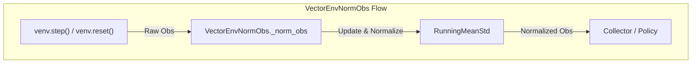
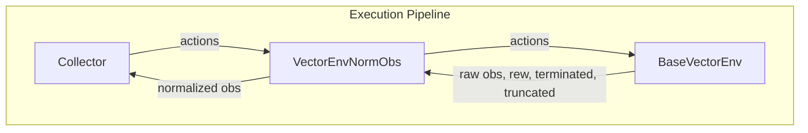

<!-- source: DeepWiki mcp.deepwiki.com · repo thu-ml/tianshou · page 4.2 Environment Wrappers · fetched 2026-10-30 -->

# Environment Wrappers

<details>
<summary>Relevant source files</summary>

The following files were used as context for generating this wiki page:

- [docs/02_deep_dives/L2_Buffer.ipynb](docs/02_deep_dives/L2_Buffer.ipynb)
- [docs/02_deep_dives/L3_Environments.ipynb](docs/02_deep_dives/L3_Environments.ipynb)
- [docs/02_deep_dives/L4_GAE.ipynb](docs/02_deep_dives/L4_GAE.ipynb)
- [test/base/test_env.py](test/base/test_env.py)
- [tianshou/__init__.py](tianshou/__init__.py)
- [tianshou/data/__init__.py](tianshou/data/__init__.py)
- [tianshou/env/__init__.py](tianshou/env/__init__.py)
- [tianshou/env/gym_wrappers.py](tianshou/env/gym_wrappers.py)
- [tianshou/env/venv_wrappers.py](tianshou/env/venv_wrappers.py)
- [tianshou/env/venvs.py](tianshou/env/venvs.py)
- [tianshou/env/worker/dummy.py](tianshou/env/worker/dummy.py)
- [tianshou/env/worker/ray.py](tianshou/env/worker/ray.py)
- [tianshou/env/worker/subproc.py](tianshou/env/worker/subproc.py)

</details>


Environment wrappers in Tianshou provide a modular way to modify the behavior of environments without changing their underlying implementation. These wrappers enable functionality such as observation normalization, action space conversions, and truncation handling.

For details on parallel execution engines, see [Vectorized Environments and Workers](#4.1).

## Overview of Environment Wrappers

Environment wrappers extend the decorator and composition patterns to dynamically alter environment inputs, outputs, or termination semantics. In Tianshou, wrappers are divided into two main categories:
1. **Vector Environment Wrappers**: Operate on `BaseVectorEnv` instances (`[tianshou/env/venvs.py:25-68]()`), performing operations like running observation normalization across parallel instances.
2. **Gymnasium Wrappers**: Modify standard single-environment behaviors (`[tianshou/env/gym_wrappers.py:8-80]()`), such as mapping continuous action spaces to discrete bins or converting truncation flags.

```mermaid
classDiagram
    class "BaseVectorEnv" {
        +workers: List[EnvWorker]
        +reset()
        +step(action)
    }
    
    class "VectorEnvWrapper" {
        +venv: BaseVectorEnv
        +reset()
        +step(action)
    }
    
    class "VectorEnvNormObs" {
        +obs_rms: RunningMeanStd
        +update_obs_rms: bool
        +_norm_obs(obs)
    }
    
    class "ContinuousToDiscrete" {
        +action_space: gym.spaces.MultiDiscrete
        +mesh: np.ndarray
        +action(act)
    }
    
    class "MultiDiscreteToDiscrete" {
        +action_space: gym.spaces.Discrete
        +bases: np.ndarray
        +action(act)
    }
    
    class "TruncatedAsTerminated" {
        +step(act)
    }
    
    BaseVectorEnv <|-- VectorEnvWrapper
    VectorEnvWrapper <|-- VectorEnvNormObs
    
    note for VectorEnvWrapper "Composes BaseVectorEnv"
    note for VectorEnvNormObs "Normalizes observations via RunningMeanStd"
    note for ContinuousToDiscrete "Converts gym.spaces.Box to MultiDiscrete"
    note for MultiDiscreteToDiscrete "Converts MultiDiscrete to Discrete"
    note for TruncatedAsTerminated "Sets terminated = terminated or truncated"
```

Sources:
- [tianshou/env/venv_wrappers.py:11-70]()
- [tianshou/env/venvs.py:25-68]()
- [tianshou/env/gym_wrappers.py:8-80]()

---

## Vector Environment Wrappers

Tianshou provides vectorized wrappers that inherit from or wrap `BaseVectorEnv` to apply batch-level transformations.

### Base Vector Environment Wrapper

The `VectorEnvWrapper` class serves as the abstract base for all vector environment wrappers (`[tianshou/env/venv_wrappers.py:11-67]`). It holds a reference to an underlying `BaseVectorEnv` (`self.venv`) and delegates method calls, forwarding reserved Gymnasium attributes directly (`[tianshou/env/venvs.py:127-129]()`).

### Observation Normalization (`VectorEnvNormObs`)

`VectorEnvNormObs` normalizes vectorized observations using running statistics maintained by `RunningMeanStd` (`[tianshou/env/venv_wrappers.py:69-120]()`).



During training, observation statistics update dynamically. During evaluation, `update_obs_rms` can be disabled, and statistics can be synchronized using `set_obs_rms()` and `get_obs_rms()`.

Sources:
- [tianshou/env/venv_wrappers.py:11-120]()
- [test/base/test_env.py:245-343]()

---

## Gymnasium Action Space & Episode Wrappers

For single environments (or wrapped before vectorization), Tianshou implements three key gymnasium-compatible wrappers (`[tianshou/env/gym_wrappers.py:8-80]()`).

### Continuous to Discrete Conversion (`ContinuousToDiscrete`)

`ContinuousToDiscrete` inherits from `gym.ActionWrapper` (`[tianshou/env/gym_wrappers.py:8-35]()`). It takes an environment with a continuous `gym.spaces.Box` action space and discretizes each dimension into `action_per_dim` bins, replacing `env.action_space` with a `gym.spaces.MultiDiscrete` space and constructing a linear mapping `mesh`.

### Multi-Discrete to Discrete Conversion (`MultiDiscreteToDiscrete`)

`MultiDiscreteToDiscrete` takes a `gym.spaces.MultiDiscrete` action space and flattens it into a single `gym.spaces.Discrete` space (`[tianshou/env/gym_wrappers.py:37-59]()`). It calculates stride bases to map scalar discrete indices back into multi-dimensional discrete arrays during `action()`.

### Truncated Episodes Handling (`TruncatedAsTerminated`)

`TruncatedAsTerminated` overrides `step()` to set `terminated = terminated or truncated` (`[tianshou/env/gym_wrappers.py:61-80]()`). This is required for algorithms that do not natively handle time-limit truncations separately from terminal states.

Sources:
- [tianshou/env/gym_wrappers.py:8-80]()
- [test/base/test_env.py:345-391]()

---

## Usage Patterns and Integration

Environment wrappers integrate directly into the data collection loop between the `Collector` and the underlying `BaseVectorEnv` workers.



### Combining Wrappers

```python
# Example pattern for setting up train and test environments with normalization
train_env = VectorEnvNormObs(DummyVectorEnv(env_fns))
test_env = VectorEnvNormObs(DummyVectorEnv(env_fns), update_obs_rms=False)
test_env.set_obs_rms(train_env.get_obs_rms())
```

Sources:
- [tianshou/env/venv_wrappers.py:11-120]()
- [tianshou/env/gym_wrappers.py:8-80]()
- [test/base/test_env.py:331-391]()

---

## Summary of Wrapper Classes

| Class Name | Module Path | Base Class | Primary Purpose |
|------------|-------------|------------|-----------------|
| `VectorEnvWrapper` | `tianshou.env.venv_wrappers` | `BaseVectorEnv` | Base proxy class for vector env wrappers |
| `VectorEnvNormObs` | `tianshou.env.venv_wrappers` | `VectorEnvWrapper` | Running observation mean/variance normalization |
| `ContinuousToDiscrete` | `tianshou.env.gym_wrappers` | `gym.ActionWrapper` | Converts `Box` action space to `MultiDiscrete` |
| `MultiDiscreteToDiscrete` | `tianshou.env.gym_wrappers` | `gym.ActionWrapper` | Converts `MultiDiscrete` action space to `Discrete` |
| `TruncatedAsTerminated` | `tianshou.env.gym_wrappers` | `gym.Wrapper` | Treats time-limit truncations as terminations |

Sources:
- [tianshou/env/__init__.py:3-10]()
- [tianshou/env/venv_wrappers.py:11-120]()
- [tianshou/env/gym_wrappers.py:8-80]()

---

