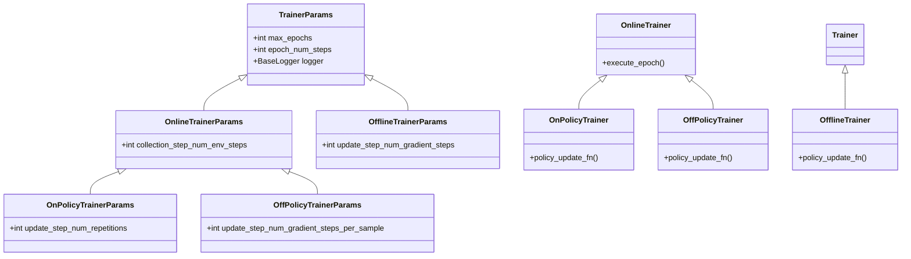

<!-- source: DeepWiki mcp.deepwiki.com · repo thu-ml/tianshou · page 5 Trainer System · fetched 2026-10-30 -->

# Trainer System

Relevant source files

The following files were used as context for generating this wiki page:

- [CHANGELOG.md](CHANGELOG.md)
- [docs/02_deep_dives/L5_Collector.ipynb](docs/02_deep_dives/L5_Collector.ipynb)
- [docs/02_deep_dives/L6_MARL.ipynb](docs/02_deep_dives/L6_MARL.ipynb)
- [tianshou/highlevel/algorithm.py](tianshou/highlevel/algorithm.py)
- [tianshou/trainer.py](tianshou/trainer.py)

The Trainer System is the central orchestration component in Tianshou v2 (`[tianshou/trainer.py:1-32]()`) that manages the reinforcement learning training process. It coordinates environment data collection, policy updates, and evaluation while tracking training progress, callbacks, and stopping criteria. This document provides a high-level overview of the trainer architecture. For specialized configuration and implementation details, see [OnPolicyTrainer](#5.1) and [OffPolicyTrainer and OfflineTrainer](#5.2).

## Overview and Architecture

In Tianshou v2, the monolithic "God class" trainer (`BaseTrainer`) has been refactored into a clean hierarchy [CHANGELOG.md:38-44] rooted in `OnlineTrainer` and `OfflineTrainer`, with concrete implementations for `OnPolicyTrainer`, `OffPolicyTrainer`, and `OfflineTrainer` [tianshou/trainer.py:40-65]. Configuration options are encapsulated in dedicated parameter dataclasses (`TrainerParams` and its subclasses) [CHANGELOG.md:45-47]. Iterator semantics have been replaced by explicit epoch execution methods such as `execute_epoch` [CHANGELOG.md:52-53].

Sources: [CHANGELOG.md:38-47](), [tianshou/trainer.py:80-160]()

## Core Training Concepts

Training is structured hierarchically around epochs, training steps, and test steps [tianshou/trainer.py:5-32]:

- **Epoch**: The outermost iteration level of the training loop, consisting of a series of training steps followed by a single test/evaluation step [tianshou/trainer.py:7-9].
- **Training Step**: Performs the operations required to update the neural network components via the RL algorithm (`Algorithm`), involving collection steps (for online learning) and update steps [tianshou/trainer.py:10-27].
- **Test Step**: Collects test episodes from dedicated evaluation environments to assess policy performance and check early stopping criteria (`stop_fn`) [tianshou/trainer.py:29-31].

Sources: [tianshou/trainer.py:5-32]()

## Callbacks and Stopping Criteria

All trainers accept configuration dataclasses derived from `TrainerParams` [tianshou/trainer.py:80-160], which expose hooks and callbacks for customization:
- `training_fn`: Executed at the beginning of each training step [tianshou/trainer.py:125-130].
- `test_fn`: Executed at the beginning of each test step [tianshou/trainer.py:132-137].
- `stop_fn`: Determines whether training should terminate early based on evaluation scores [tianshou/trainer.py:139-150].
- `save_best_fn`: Called when a new optimal evaluation score is achieved [tianshou/trainer.py:158-161].

Sources: [tianshou/trainer.py:80-160]()

---

## 5.1 OnPolicyTrainer

For PPO, A2C, TRPO, and other on-policy reinforcement learning algorithms, the `OnPolicyTrainer` processes entire batches of freshly collected trajectories per update iteration. 

For detailed configuration parameters (`OnPolicyTrainerParams`) and usage, see [OnPolicyTrainer](#5.1).

Sources: [CHANGELOG.md:38-44](), [tianshou/trainer.py:40-65]()

---

## 5.2 OffPolicyTrainer and OfflineTrainer

For off-policy algorithms (e.g., DQN, SAC, TD3) and offline datasets (e.g., BCQ, CQL), `OffPolicyTrainer` and `OfflineTrainer` manage replay buffers, mini-batch sampling, and multiple gradient updates per environment collection step.

For detailed configuration parameters (`OffPolicyTrainerParams`, `OfflineTrainerParams`) and usage, see [OffPolicyTrainer and OfflineTrainer](#5.2).

Sources: [CHANGELOG.md:38-44](), [tianshou/trainer.py:40-65]()

---

