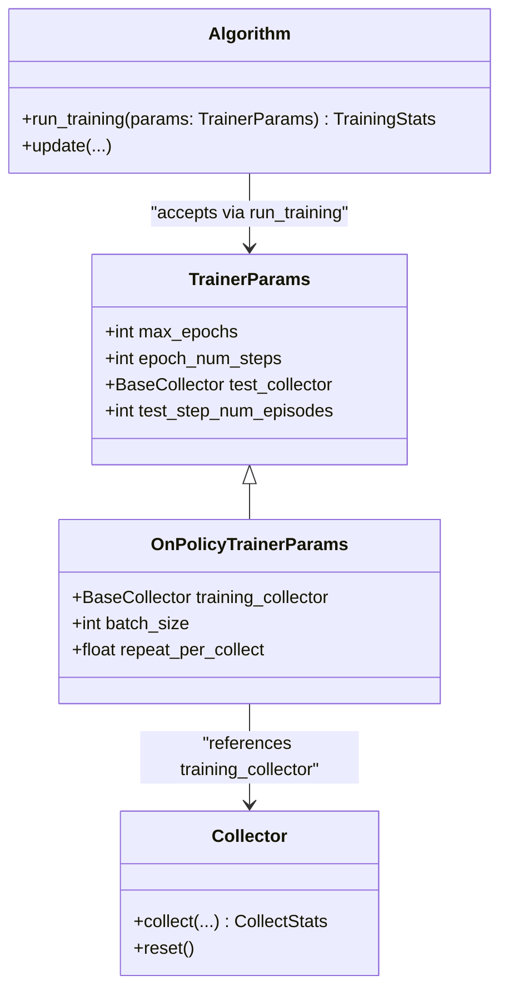
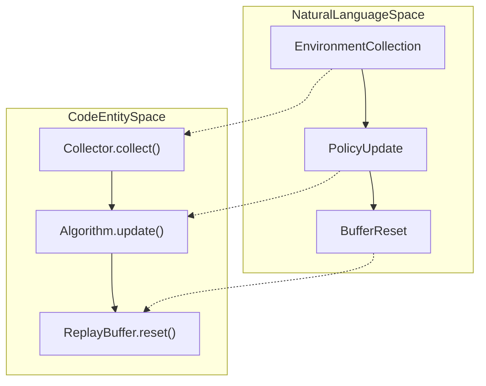

<!-- source: DeepWiki mcp.deepwiki.com · repo thu-ml/tianshou · page 5.1 OnPolicyTrainer · fetched 2026-10-30 -->

# OnPolicyTrainer

<details>
<summary>Relevant source files</summary>

The following files were used as context for generating this wiki page:

- [docs/02_deep_dives/L5_Collector.ipynb](docs/02_deep_dives/L5_Collector.ipynb)
- [docs/02_deep_dives/L6_MARL.ipynb](docs/02_deep_dives/L6_MARL.ipynb)
- [test/continuous/test_ddpg.py](test/continuous/test_ddpg.py)
- [test/continuous/test_ppo.py](test/continuous/test_ppo.py)
- [test/continuous/test_td3.py](test/continuous/test_td3.py)
- [test/discrete/test_dqn.py](test/discrete/test_dqn.py)
- [test/discrete/test_drqn.py](test/discrete/test_drqn.py)
- [tianshou/trainer.py](tianshou/trainer.py)

</details>


## Purpose and Scope

The `OnPolicyTrainer` and its configuration dataclass `OnPolicyTrainerParams` manage the execution loop for on-policy reinforcement learning algorithms (such as PPO, A2C, and TRPO). In on-policy training, experiences collected via environment interactions are used immediately to update the policy and are subsequently discarded, enforcing the strict on-policy data distribution requirement.

Sources: [`tianshou/trainer.py:1-160`](), [`test/continuous/test_ppo.py:17-18`](), [`test/continuous/test_ppo.py:115-130`]()

## Architecture Overview and Code Entity Mapping

The training architecture relies on configuration dataclasses (`TrainerParams`, `OnPolicyTrainerParams`) that govern data collection through `Collector` instances and gradient updates via `Algorithm` instances.

### Diagram: Trainer Architecture and Code Entity Mapping

Sources: [`tianshou/trainer.py:80-160`](), [`tianshou/algorithm/algorithm_base.py:50-56`]()

## On-Policy Training Workflow and Data Flow

During each epoch, the training loop alternates between collecting trajectories from vectorized environments and executing optimization passes over the collected buffer data.

### Diagram: Natural Language Space to Code Entity Space Flow

Sources: [`tianshou/trainer.py:1-160`](), [`test/continuous/test_ppo.py:115-136`]()

## Configuration Parameters (`OnPolicyTrainerParams`)

`OnPolicyTrainerParams` extends base trainer parameters with settings tailored to on-policy algorithms:
- `training_collector`: The `Collector` instance used to gather training rollouts.
- `batch_size`: Mini-batch size utilized during policy optimization.
- `repeat_per_collect`: Number of times to iterate over the collected dataset per collection step.

Sources: [`tianshou/trainer.py:80-160`](), [`test/continuous/test_ppo.py:17-18`]()

## Usage Example

```python
result = algorithm.run_training(
    OnPolicyTrainerParams(
        training_collector=training_collector,
        test_collector=test_collector,
        max_epochs=args.epoch,
        epoch_num_steps=args.epoch_num_steps,
        batch_size=args.batch_size,
        repeat_per_collect=args.update_step_num_repetitions,
        stop_fn=stop_fn,
        save_best_fn=save_best_fn,
        logger=logger,
    )
)
```
Sources: [`test/continuous/test_ppo.py:115-160`]()

---

