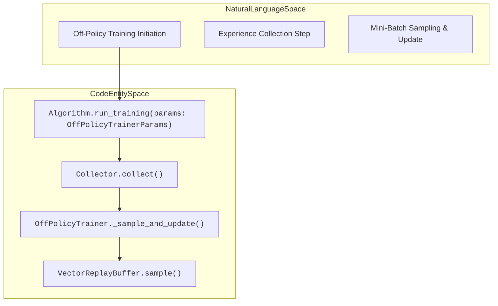
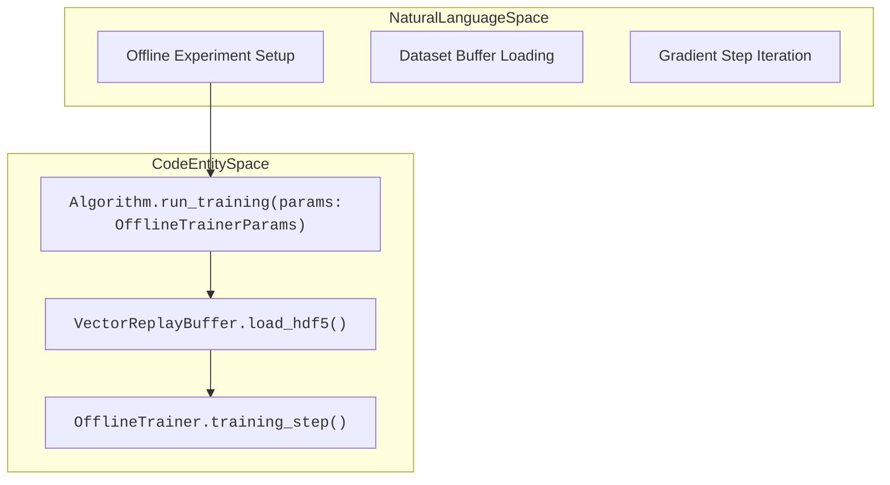
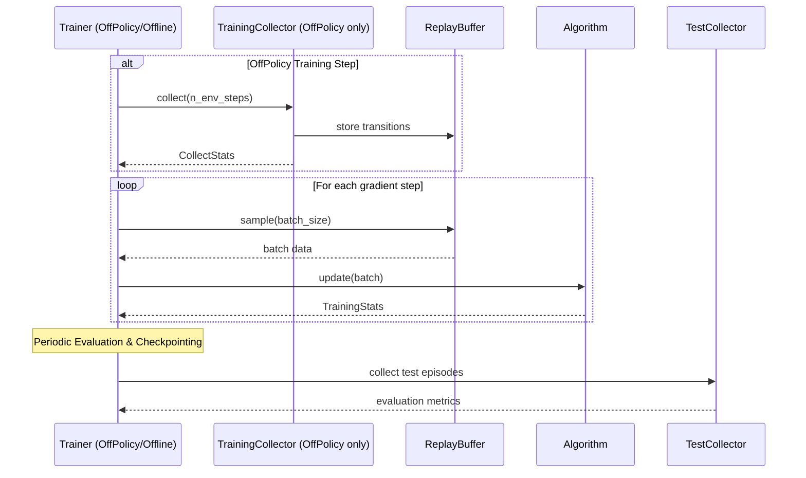

<!-- source: DeepWiki mcp.deepwiki.com · repo thu-ml/tianshou · page 5.2 OffPolicyTrainer and OfflineTrainer · fetched 2026-10-30 -->

# OffPolicyTrainer and OfflineTrainer

Relevant source files

The following files were used as context for generating this wiki page:

- [docs/02_deep_dives/L5_Collector.ipynb](docs/02_deep_dives/L5_Collector.ipynb)
- [docs/02_deep_dives/L6_MARL.ipynb](docs/02_deep_dives/L6_MARL.ipynb)
- [test/continuous/test_redq.py](test/continuous/test_redq.py)
- [test/offline/gather_pendulum_data.py](test/offline/gather_pendulum_data.py)
- [test/offline/test_bcq.py](test/offline/test_bcq.py)
- [test/offline/test_cql.py](test/offline/test_cql.py)
- [test/offline/test_discrete_bcq.py](test/offline/test_discrete_bcq.py)
- [test/offline/test_discrete_cql.py](test/offline/test_discrete_cql.py)
- [test/offline/test_discrete_crr.py](test/offline/test_discrete_crr.py)
- [tianshou/trainer.py](tianshou/trainer.py)

This page documents Tianshou's `OffPolicyTrainer` and `OfflineTrainer` systems, along with their respective configuration parameter dataclasses (`OffPolicyTrainerParams` and `OfflineTrainerParams`) and how they orchestrate model updates using replay buffers and collectors.

Sources: [`tianshou/trainer.py:1-40`]()

## Overview

Off-policy and offline reinforcement learning trainers manage gradient updates where data samples do not need to be generated exclusively by the policy currently being optimized. 

- **`OffPolicyTrainer`**: Orchestrates online off-policy learning (e.g., DQN, SAC, TD3, REDQ), where a collector continuously interacts with the environment, populates a replay buffer (`VectorReplayBuffer`), and the trainer performs multiple mini-batch gradient updates per collection step.
- **`OfflineTrainer`**: Orchestrates offline/imitation learning (e.g., BCQ, CQL, CRR, DiscreteBCQ), where no environment interaction occurs during training; instead, updates are performed entirely on a static, pre-collected replay buffer dataset.

Sources: [`tianshou/trainer.py:1-32`]()

## OffPolicyTrainer and OffPolicyTrainerParams

The `OffPolicyTrainer` manages the iterative loop for algorithms where exploration and exploitation occur simultaneously via a training collector and a replay buffer. 

### Parameter Dataclass: `OffPolicyTrainerParams`

Configuration parameters for off-policy training are encapsulated in `OffPolicyTrainerParams`. Key attributes include:

| Parameter | Type | Description |
|-----------|------|-------------|
| `training_collector` | `BaseCollector` | Collector responsible for gathering training experiences from training environments [test/continuous/test_redq.py:136](). |
| `test_collector` | `BaseCollector \| None` | Collector used for periodic policy evaluation [tianshou/trainer.py:116](). |
| `max_epochs` | `int` | Maximum number of training epochs [tianshou/trainer.py:82](). |
| `epoch_num_steps` | `int` | Total number of environment steps collected per epoch [tianshou/trainer.py:109](). |
| `collection_step_num_env_steps` | `int` | Number of environment steps to collect per training step before updating [test/continuous/test_redq.py:163](). |
| `update_step_num_gradient_steps_per_sample` | `float` | Number of gradient updates performed per collected environment step (`update_per_step`) [test/continuous/test_redq.py:166](). |
| `batch_size` | `int` | Mini-batch size sampled from the replay buffer for each gradient step [test/continuous/test_redq.py:165](). |
| `stop_fn` | `Callable[[float], bool] \| None` | Callback function to determine early stopping based on evaluation score [tianshou/trainer.py:139](). |
| `save_best_fn` | `Callable[[Algorithm], None] \| None` | Callback invoked when a new best evaluation score is achieved [tianshou/trainer.py:158](). |

Sources: [`tianshou/trainer.py:80-160`](), [`test/continuous/test_redq.py:158-166`]()

### Code-to-System Mapping: Off-Policy Training Loop

Sources: [`test/continuous/test_redq.py:157-166`](), [`tianshou/trainer.py:1-40`]()

## OfflineTrainer and OfflineTrainerParams

The `OfflineTrainer` handles training algorithms that learn entirely from fixed datasets without environment interaction during training.

### Parameter Dataclass: `OfflineTrainerParams`

Configuration parameters for offline training are encapsulated in `OfflineTrainerParams`. Key attributes include:

| Parameter | Type | Description |
|-----------|------|-------------|
| `buffer` | `ReplayBuffer` | Pre-collected replay buffer containing expert or exploratory transition datasets [test/offline/test_cql.py:161](). |
| `test_collector` | `BaseCollector \| None` | Collector used to evaluate the learned policy on test environments [test/offline/test_cql.py:169](). |
| `max_epochs` | `int` | Maximum number of training epochs [tianshou/trainer.py:82](). |
| `epoch_num_steps` | `int` | Number of gradient update steps executed per epoch [test/offline/test_cql.py:164](). |
| `batch_size` | `int` | Mini-batch size sampled from the static dataset buffer [test/offline/test_cql.py:166](). |
| `stop_fn` | `Callable[[float], bool] \| None` | Early stopping predicate based on test evaluation scores [test/offline/test_cql.py:167](). |
| `save_best_fn` | `Callable[[Algorithm], None] \| None` | Callback function to persist the best-performing policy checkpoint [test/offline/test_cql.py:168](). |

Sources: [`tianshou/trainer.py:80-160`](), [`test/offline/test_cql.py:160-172`]()

### Code-to-System Mapping: Offline Training Execution

Sources: [`test/offline/test_cql.py:73-160`]()

## Execution Flow and Data Flow

The following sequence diagram illustrates how `OffPolicyTrainer` and `OfflineTrainer` interact with collectors, buffers, and algorithms during a training step.

Sources: [`tianshou/trainer.py:1-40`](), [`test/continuous/test_redq.py:136-166`]()

## Comparison of Trainer Types

| Aspect | `OffPolicyTrainer` | `OfflineTrainer` |
|--------|---------------------|------------------|
| **Environment Interaction** | Active collection during training (`training_collector`) | None (`buffer` is static) |
| **Data Source** | Dynamically expanding `ReplayBuffer` | Fixed, pre-loaded `ReplayBuffer` |
| **Primary Use Cases** | DQN, SAC, TD3, REDQ [test/continuous/test_redq.py:121]() | BCQ, CQL, CRR, DiscreteBCQ [test/offline/test_cql.py:144](), [test/offline/test_discrete_bcq.py:102]() |
| **Primary Parameter Class** | `OffPolicyTrainerParams` [test/continuous/test_redq.py:158]() | `OfflineTrainerParams` [test/offline/test_cql.py:160]() |

Sources: [`tianshou/trainer.py:1-40`](), [`test/continuous/test_redq.py:121-166`](), [`test/offline/test_cql.py:144-172`]()

---

