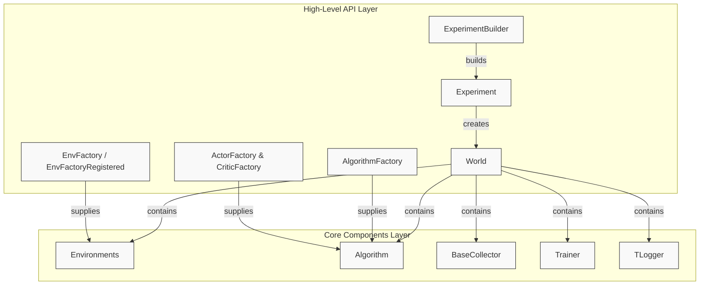

<!-- source: DeepWiki mcp.deepwiki.com · repo thu-ml/tianshou · page 6 High-Level API · fetched 2026-10-30 -->

# High-Level API

Relevant source files

The following files were used as context for generating this wiki page:

- [examples/mujoco/mujoco_env.py](examples/mujoco/mujoco_env.py)
- [tianshou/highlevel/__init__.py](tianshou/highlevel/__init__.py)
- [tianshou/highlevel/env.py](tianshou/highlevel/env.py)
- [tianshou/highlevel/experiment.py](tianshou/highlevel/experiment.py)
- [tianshou/highlevel/persistence.py](tianshou/highlevel/persistence.py)
- [tianshou/highlevel/trainer.py](tianshou/highlevel/trainer.py)
- [tianshou/highlevel/world.py](tianshou/highlevel/world.py)

The High-Level API in Tianshou provides a declarative, configuration-driven approach for setting up and running reinforcement learning experiments. It abstracts away the boilerplate code typically required to manually instantiate environments, neural network modules, optimizers, collectors, and trainers, allowing users to focus on experiment design and hyperparameter tuning.

For a comprehensive overview of Tianshou's core architecture, see [Overview](#1). Below is an architectural overview of how the high-level API components interact with core system entities.

Sources: [tianshou/highlevel/experiment.py:1-176](), [tianshou/highlevel/env.py:107-160]()

---

## 6.1. Experiment Framework

The experiment framework centers around configuration dataclasses, experiment container objects, and execution contexts. `ExperimentConfig` [tianshou/highlevel/experiment.py:125-154]() handles non-RL execution settings such as random seeds, execution devices (`cuda`/`cpu`), persistence directories, and evaluation rendering. An `Experiment` instance bundles these configurations with factory definitions, enabling lightweight serialization and pickling for reproducible runs.

Execution resolves into a `World` instance [tianshou/highlevel/world.py:13-25](), which houses active environment wrappers, algorithm policies, data collectors, loggers, and trainers. The framework also supports experiment persistence (saving policies and environment normalization states) as well as multi-seed execution via `ExperimentCollection` for rigorous benchmarking.

For details, see [Experiment Framework](#6.1).

Sources: [tianshou/highlevel/experiment.py:1-176](), [tianshou/highlevel/world.py:1-34](), [tianshou/highlevel/persistence.py:60-154]()

---

## 6.2. Experiment Builders

To simplify constructing complex experiment objects, Tianshou implements the builder pattern via `ExperimentBuilder`. Builders provide a fluent interface for chaining configuration methods (such as specifying logging, optimization, and sampling parameters) before compiling a fully configured `Experiment`.

In addition to generic builders, algorithm-specific subclasses such as `PPOExperimentBuilder`, `DQNExperimentBuilder`, `SACExperimentBuilder`, and others encapsulate algorithm-tailored defaults, network topologies, and hyperparameter structures. These builders streamline the transition between different RL paradigms while maintaining strict type safety and modular extensibility.

For details, see [Experiment Builders](#6.2).

Sources: [tianshou/highlevel/experiment.py:1-18]()

---

## 6.3. Algorithm and Environment Factories

Decoupling instantiation logic from experiment execution is handled through dedicated factory hierarchies. The `AlgorithmFactory` base class and its concrete implementations manage the creation of specific algorithms, handling policy initialization, target networks, and update rules.

Concurrently, environment creation is managed through `EnvFactory` and `EnvFactoryRegistered` [examples/mujoco/mujoco_env.py:73-84](), which abstract away vectorization strategies (`VectorEnvType`) and mode-specific environment generation (`EnvMode.TRAINING`, `EnvMode.TEST`, `EnvMode.WATCH`) [tianshou/highlevel/env.py:59-106](). This ensures consistent observation normalization, wrapper application, and parallel execution contexts across training and evaluation phases.

For details, see [Algorithm and Environment Factories](#6.3).

Sources: [tianshou/highlevel/env.py:29-160](), [examples/mujoco/mujoco_env.py:27-109]()

---

## 6.4. Module Factories and Parameter Objects

Neural network architectures and algorithm hyperparameters are constructed using modular factory classes and parameter dataclasses. Actor and critic factories (e.g., `ActorFactoryDefault`, `CriticFactoryDefault`) assemble backbone networks like MLPs or recurrent structures with customizable activation functions and output distributions.

Parameter objects encapsulate tuning parameters such as learning rate schedulers, entropy coefficients (`alpha`), distribution functions (`dist_fn`), exploration noise processes, optimizer factories (`OptimizerFactoryAdam`), and collector settings. These objects integrate cleanly into experiment builders to provide fine-grained control over training dynamics.

For details, see [Module Factories and Parameter Objects](#6.4).

Sources: [tianshou/highlevel/experiment.py:41-118]()

---

