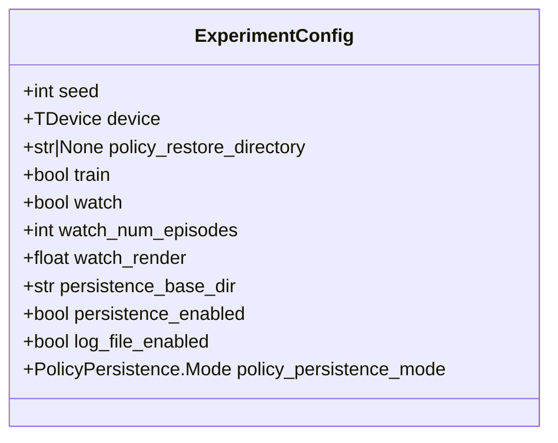
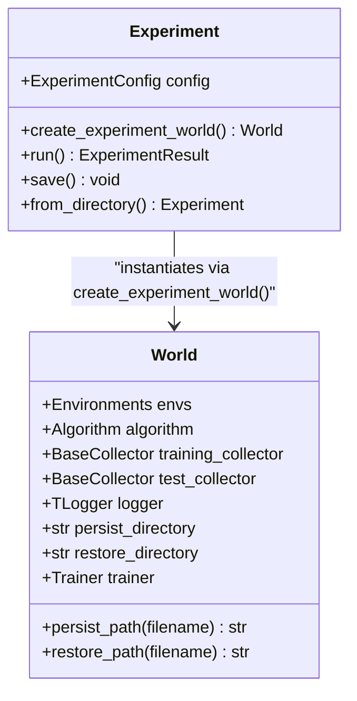
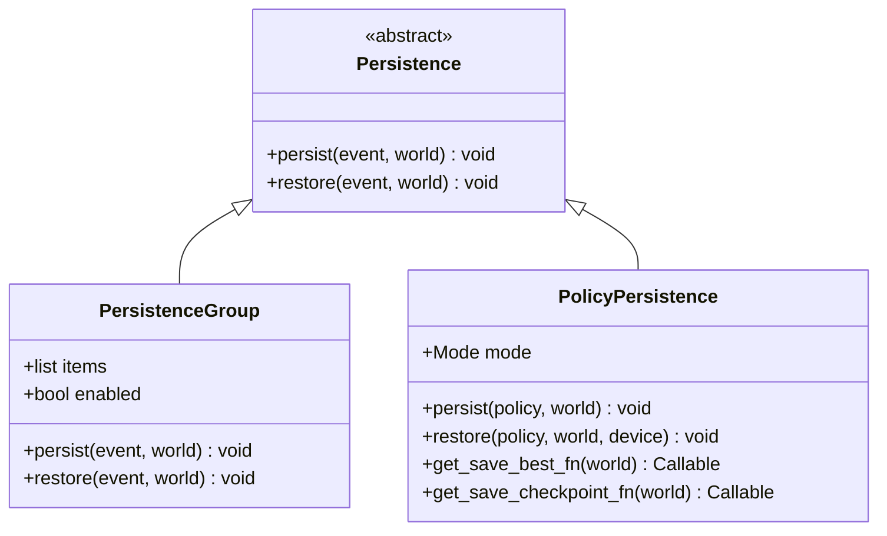

<!-- source: DeepWiki mcp.deepwiki.com · repo thu-ml/tianshou · page 6.1 Experiment Framework · fetched 2026-10-30 -->

# Experiment Framework

<details>
<summary>Relevant source files</summary>

The following files were used as context for generating this wiki page:

- [examples/mujoco/mujoco_env.py](examples/mujoco/mujoco_env.py)
- [tianshou/highlevel/config.py](tianshou/highlevel/config.py)
- [tianshou/highlevel/env.py](tianshou/highlevel/env.py)
- [tianshou/highlevel/experiment.py](tianshou/highlevel/experiment.py)
- [tianshou/highlevel/persistence.py](tianshou/highlevel/persistence.py)
- [tianshou/highlevel/trainer.py](tianshou/highlevel/trainer.py)
- [tianshou/highlevel/world.py](tianshou/highlevel/world.py)

</details>


This page documents the Experiment Framework, which forms part of Tianshou's high-level API (`tianshou/highlevel/experiment.py:1-18`()). The framework provides a structured approach to configuring, building, executing, and persisting reinforcement learning experiments with minimal boilerplate code while supporting extensive customizability.

## Overview

The Experiment Framework serves as a high-level abstraction layer bridging user-defined configurations and Tianshou's underlying reinforcement learning components (`tianshou/highlevel/experiment.py:1-18`()). It encapsulates experiments into lightweight, serializable objects containing configurations and factory references (`tianshou/highlevel/experiment.py:165-176`()).

Title: "Experiment Framework Component Architecture"
```mermaid
flowchart TD
    subgraph "tianshou/highlevel/experiment.py"
        EC["ExperimentConfig"]
        E["Experiment"]
        EB["ExperimentBuilder"]
        ECL["ExperimentCollection"]
    end

    EB -->|builds| E
    EC -->|configures| E
    E --> ECL
    ECL -->|runs multiple| E

    subgraph "tianshou/highlevel/world.py & Core"
        W["World"]
        P["Algorithm"]
        ENV["Environments"]
        TR["Trainer"]
        COL["BaseCollector"]
    end

    E -->|create_experiment_world()| W
    W -->|contains| P
    W -->|contains| ENV
    W -->|contains| TR
    W -->|contains| COL
```

Sources: [tianshou/highlevel/experiment.py:1-18](), [tianshou/highlevel/experiment.py:125-176](), [tianshou/highlevel/world.py:13-34]()

## Key Components

### ExperimentConfig

The `ExperimentConfig` dataclass (`tianshou/highlevel/experiment.py:125-154`()) manages global experiment settings that are independent of specific reinforcement learning algorithms or training hyper-parameters.

Title: "ExperimentConfig Class Structure"


Key configuration properties include:
- Random number generator seed initialization (`tianshou/highlevel/experiment.py:129-130`())
- Target Torch device (`tianshou/highlevel/experiment.py:131-132`())
- Policy restoration directories (`tianshou/highlevel/experiment.py:133-134`())
- Training and evaluation flags (`tianshou/highlevel/experiment.py:135-142`())
- Persistence and logging directories (`tianshou/highlevel/experiment.py:143-153`())

Sources: [tianshou/highlevel/experiment.py:125-154]()

### Experiment and World

The `Experiment` class (`tianshou/highlevel/experiment.py:170-176`()) represents a complete, picklable reinforcement learning experiment. When executed, it instantiates a `World` object (`tianshou/highlevel/world.py:13-35`()), which holds the runtime instances.

Title: "Experiment and World Code Entities"


Sources: [tianshou/highlevel/experiment.py:125-176](), [tianshou/highlevel/world.py:13-34]()

### Persistence and PolicyPersistence

Tianshou's persistence infrastructure is built around the abstract `Persistence` interface, `PersistenceGroup`, and `PolicyPersistence` (`tianshou/highlevel/persistence.py:32-154`()). These components manage saving and restoring neural network weights (`torch.nn.Module`), state dictionaries, and environment-specific statistics such as observation normalization running means (`examples/mujoco/mujoco_env.py:48-71`()).

Title: "Persistence Architecture and Event Handling"


Sources: [tianshou/highlevel/persistence.py:32-154](), [examples/mujoco/mujoco_env.py:48-71]()

### ExperimentCollection and Multi-Seed Runs

`ExperimentCollection` wraps a list of `Experiment` instances to facilitate parallel or sequential batch execution across multiple random seeds via experiment launchers (`tianshou/highlevel/experiment.py:13-15`()).

Title: "Multi-Seed Experiment Collection Code Flow"
```mermaid
flowchart TD
    subgraph "tianshou/highlevel/experiment.py"
        EB["ExperimentBuilder"] -->|build_seeded_collection()| EC["ExperimentCollection"]
        EC -->|contains list| E1["Experiment(seed=42)"]
        EC -->|contains list| E2["Experiment(seed=43)"]
        EC -->|contains list| E3["Experiment(seed=44)"]
    end
    subgraph "tianshou/evaluation/launcher.py"
        EC -->|run(launcher)| L["ExpLauncher / RegisteredExpLauncher"]
        L -->|executes| R["ExperimentResult List"]
    end
```

Sources: [tianshou/highlevel/experiment.py:13-15]()

## Training Configuration and Callbacks

Training parameters are governed by `TrainingConfig` (`tianshou/highlevel/config.py:11-149`()), defining epoch boundaries, collection transition limits, buffer allocation sizes, and parallel environment counts. Furthermore, training callbacks (`EpochTrainCallback`, `EpochTestCallback`, `EpochStopCallback`) enable fine-grained phase-specific behaviors such as epsilon decay schedules for discrete Q-learning algorithms (`tianshou/highlevel/trainer.py:25-157`()).

Sources: [tianshou/highlevel/config.py:11-149](), [tianshou/highlevel/trainer.py:25-157]()

---

