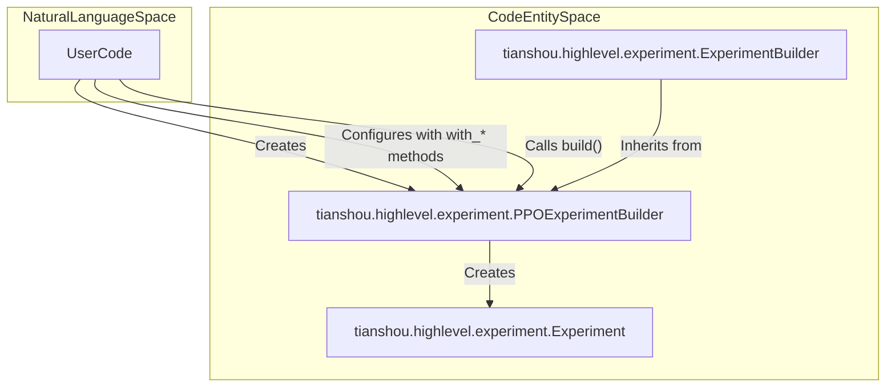
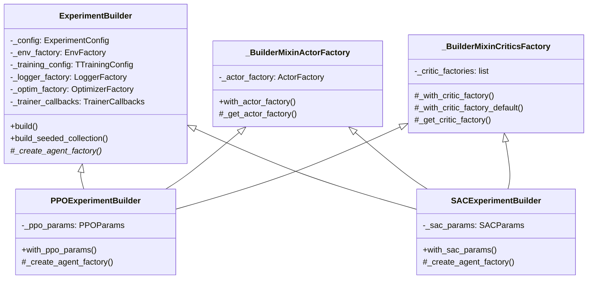
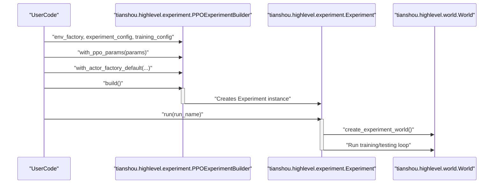

<!-- source: DeepWiki mcp.deepwiki.com · repo thu-ml/tianshou · page 6.2 Experiment Builders · fetched 2026-10-30 -->

# Experiment Builders

<details>
<summary>Relevant source files</summary>

The following files were used as context for generating this wiki page:

- [examples/discrete/discrete_dqn_hl.py](examples/discrete/discrete_dqn_hl.py)
- [examples/mujoco/mujoco_env.py](examples/mujoco/mujoco_env.py)
- [test/highlevel/test_experiment_builder.py](test/highlevel/test_experiment_builder.py)
- [tianshou/highlevel/env.py](tianshou/highlevel/env.py)
- [tianshou/highlevel/experiment.py](tianshou/highlevel/experiment.py)
- [tianshou/highlevel/persistence.py](tianshou/highlevel/persistence.py)
- [tianshou/highlevel/trainer.py](tianshou/highlevel/trainer.py)
- [tianshou/highlevel/world.py](tianshou/highlevel/world.py)

</details>


## Purpose and Scope

This document explains the Builder Pattern implementation in Tianshou's high-level API (`tianshou/highlevel/experiment.py`). The Builder Pattern is used to simplify the creation of complex reinforcement learning experiments by providing a fluent, readable interface for configuring numerous components. This page covers the architecture of experiment builders, how they're used to construct experiments, and how to customize various aspects of the experimental setup.

For information about the overall High-Level API, see [High-Level API](#6). For Agent and Environment Factories, see [Algorithm and Environment Factories](#6.3).

Sources:
- [tianshou/highlevel/experiment.py:1-18](tianshou/highlevel/experiment.py:1-18)

## Overview of the Builder Pattern in Tianshou

The Builder Pattern in Tianshou allows users to create complex reinforcement learning experiments with chainable method calls that make the code more readable and maintainable. It separates the construction logic (how components are created and connected) from the representation (the actual `Experiment` objects), enabling algorithm-specific configuration through specialized builders.



Sources:
- [tianshou/highlevel/experiment.py:170-176](tianshou/highlevel/experiment.py:170-176)
- [examples/mujoco/mujoco_env.py:40-45](examples/mujoco/mujoco_env.py:40-45)

## Architecture

The Builder Pattern in Tianshou is implemented through a hierarchy of builder classes, with mixins providing specific functionality:



Sources:
- [tianshou/highlevel/experiment.py:1-60](tianshou/highlevel/experiment.py:1-60)
- [test/highlevel/test_experiment_builder.py:27-50](test/highlevel/test_experiment_builder.py:27-50)

### Core Components

1. **`ExperimentBuilder` (Abstract Base Class)**
   - Provides the foundation for all builders.
   - Manages common configuration parameters (`ExperimentConfig`, `EnvFactory`, training configuration).
   - Defines the interface for customization through `with_*` methods.

2. **Builder Mixins**
   - Mixins like actor and critic factories add modular capabilities for composing neural network components.

3. **Algorithm-Specific Builders**
   - Inherit from `ExperimentBuilder` and appropriate mixins (e.g., `PPOExperimentBuilder`, `DQNExperimentBuilder`, `SACExperimentBuilder`).
   - Implement algorithm-specific configuration methods (`with_ppo_params`, `with_dqn_params`, etc.).
   - Override `_create_agent_factory()` to create the appropriate agent factory.

Sources:
- [tianshou/highlevel/experiment.py:41-61](tianshou/highlevel/experiment.py:41-61)

## Building Process

The experiment building process follows a specific flow across user calls, factory construction, and world initialization:



Sources:
- [tianshou/highlevel/experiment.py:170-176](tianshou/highlevel/experiment.py:170-176)
- [tianshou/highlevel/world.py:13-25](tianshou/highlevel/world.py:13-25)

## Key Customization Points

The Builder Pattern provides numerous customization points through its fluent interface:

### 1. Algorithm Parameters
Each algorithm-specific builder provides a method to set algorithm-specific parameters (e.g., `with_ppo_params`, `with_sac_params`, `with_dqn_params`) using dedicated parameter dataclasses [test/highlevel/test_experiment_builder.py:27-65]().

### 2. Network Architecture
Customize neural network architectures via default factories or custom actor/critic factories [examples/discrete/discrete_dqn_hl.py:54-67]().

### 3. Optimizer Configuration
Configure optimizers using optimizer factory methods [tianshou/highlevel/experiment.py:101-104]().

### 4. Training Callbacks
Add custom callbacks for training events, such as `EpochTrainCallback`, `EpochTestCallback`, or `EpochStopCallback` [tianshou/highlevel/trainer.py:25-83]().

Sources:
- [tianshou/highlevel/experiment.py:101-114](tianshou/highlevel/experiment.py:101-114)
- [tianshou/highlevel/trainer.py:25-83](tianshou/highlevel/trainer.py:25-83)

## Example Usage

Here is an example of creating a DQN experiment using `DQNExperimentBuilder` [examples/discrete/discrete_dqn_hl.py:55-68]():

```python
experiment_builder = (
    DQNExperimentBuilder(env_factory, experiment_config, training_config)
    .with_dqn_params(
        DQNParams(
            lr=1e-3,
            gamma=0.9,
            n_step_return_horizon=3,
            target_update_freq=320,
            eps_training=0.3,
            eps_inference=0.0,
        ),
    )
    .with_model_factory_default(hidden_sizes=(64, 64))
)
experiment_builder.build_and_run(num_experiments=num_experiments, launcher=experiment_launcher)
```

Sources:
- [examples/discrete/discrete_dqn_hl.py:55-70](examples/discrete/discrete_dqn_hl.py:55-70)

## Advanced Usage

### Running Multiple Experiments with Different Seeds
The builder can produce a seeded collection of experiments via `build_seeded_collection(num_experiments)` to evaluate statistical significance across runs [examples/discrete/discrete_dqn_hl.py:24-33]().

Sources:
- [examples/discrete/discrete_dqn_hl.py:24-33](examples/discrete/discrete_dqn_hl.py:24-33)

## Conclusion
The Builder Pattern in Tianshou provides a clean, declarative way to configure and run complex reinforcement learning experiments while minimizing boilerplate and maintaining readability across algorithms.

Sources:
- [tianshou/highlevel/experiment.py:1-18](tianshou/highlevel/experiment.py:1-18)

---

