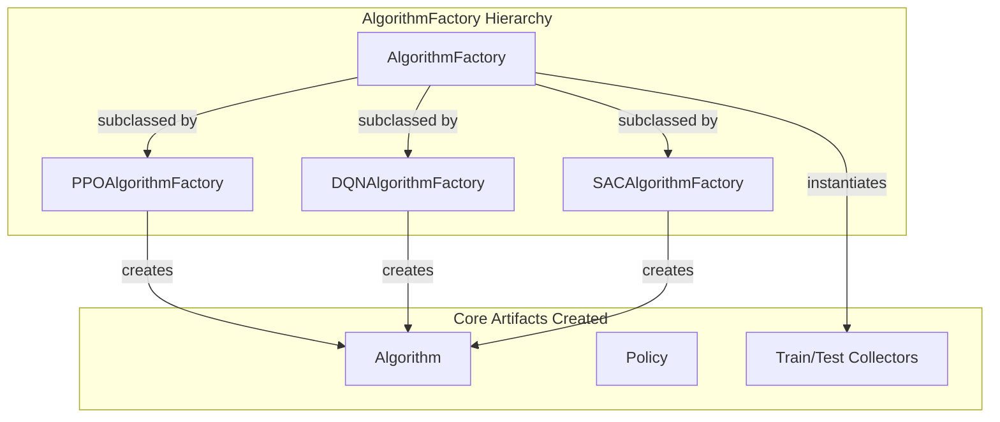
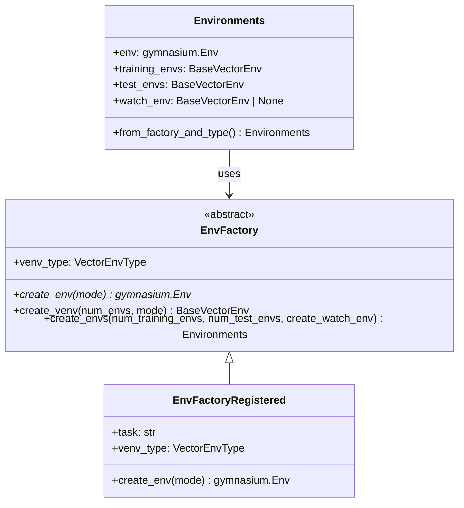
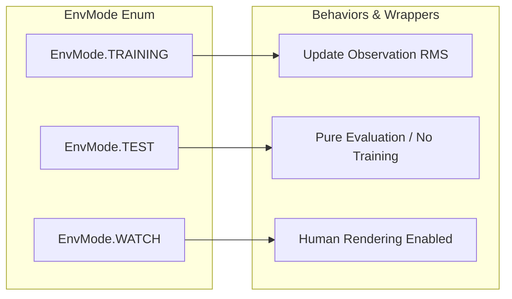
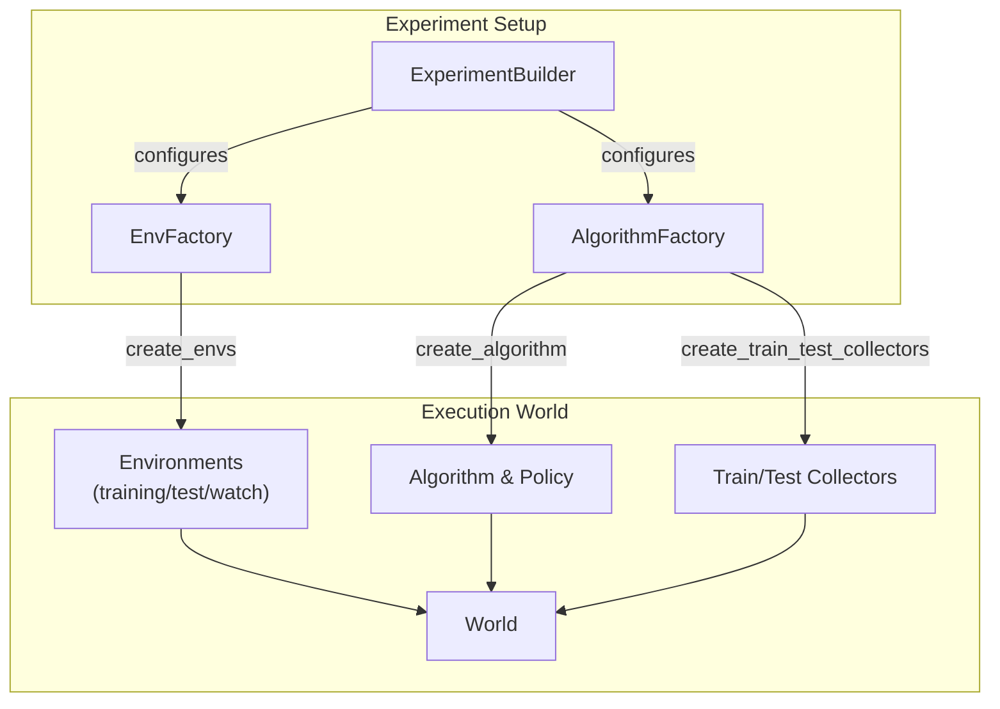

<!-- source: DeepWiki mcp.deepwiki.com · repo thu-ml/tianshou · page 6.3 Algorithm and Environment Factories · fetched 2026-10-30 -->

# Algorithm and Environment Factories

Relevant source files

The following files were used as context for generating this wiki page:

- [CHANGELOG.md](CHANGELOG.md)
- [examples/mujoco/mujoco_env.py](examples/mujoco/mujoco_env.py)
- [test/highlevel/env_factory.py](test/highlevel/env_factory.py)
- [tianshou/highlevel/algorithm.py](tianshou/highlevel/algorithm.py)
- [tianshou/highlevel/env.py](tianshou/highlevel/env.py)
- [tianshou/highlevel/experiment.py](tianshou/highlevel/experiment.py)
- [tianshou/highlevel/persistence.py](tianshou/highlevel/persistence.py)
- [tianshou/highlevel/trainer.py](tianshou/highlevel/trainer.py)
- [tianshou/highlevel/world.py](tianshou/highlevel/world.py)

## Purpose and Scope

This document describes the `AlgorithmFactory` hierarchy and the environment factory abstractions (`EnvFactory`, `EnvFactoryRegistered`) in Tianshou's high-level API. These factories encapsulate the instantiation and configuration of learning algorithms, policies, collectors, and vectorized environments across different execution modes (`EnvMode`). They serve as foundational building blocks for the high-level `Experiment` framework.

For details on how experiments are structured, see [Experiment Framework](#6.1), and for algorithm-specific builders, see [Experiment Builders](#6.2).

---

## AlgorithmFactory Hierarchy

The `AlgorithmFactory` is an abstract base class responsible for instantiating an `Algorithm`, its underlying policy, optimizers, trainers, and data collectors [tianshou/highlevel/algorithm.py:110-119]().

Sources:
- [tianshou/highlevel/algorithm.py:110-193]()
- [tianshou/highlevel/experiment.py:41-54]()

### Core Responsibilities of `AlgorithmFactory`

1. **Collector Construction**: The method `create_train_test_collectors` configures `ReplayBuffer` or `VectorReplayBuffer` depending on environment parallelism and builds training and testing collectors [tianshou/highlevel/algorithm.py:123-166]().
2. **Algorithm & Policy Instantiation**: Subclasses implement `_create_algorithm` to construct specific RL algorithms (e.g., PPO, DQN, SAC) [tianshou/highlevel/algorithm.py:187-193]().
3. **Wrapper and Callback Management**: Manages policy wrapper factories and trainer callbacks [tianshou/highlevel/algorithm.py:116-118, 168-176]().

Sources:
- [tianshou/highlevel/algorithm.py:110-193]()

---

## Environment Factories (`EnvFactory` and `EnvFactoryRegistered`)

Tianshou provides an environment factory abstraction to handle single environments, vectorized execution, and mode-specific configuration.

Sources:
- [tianshou/highlevel/env.py:107-160]()
- [examples/mujoco/mujoco_env.py:73-92]()

### `EnvFactoryRegistered`

`EnvFactoryRegistered` inherits from `EnvFactory` and standardizes the creation of Gym/Gymnasium environments using registered task strings (e.g., `"CartPole-v1"`, `"Pendulum-v1"`) [test/highlevel/env_factory.py:7-20](). It also optionally integrates with `EnvPool` for high-throughput vectorized execution [examples/mujoco/mujoco_env.py:73-84]().

Sources:
- [examples/mujoco/mujoco_env.py:73-84]()
- [test/highlevel/env_factory.py:7-20]()

---

## Creating Environments per Mode (`EnvMode`)

Environments behave differently depending on their intended usage phase. Tianshou defines an `EnvMode` enumeration to differentiate these phases:

Sources:
- [tianshou/highlevel/env.py:59-65]()
- [examples/mujoco/mujoco_env.py:87-92]()

### Mode-Specific Instantiation

When `Environments.from_factory_and_type` is invoked, it passes the appropriate `EnvMode` to the factory method [tianshou/highlevel/env.py:124-152]():
- `EnvMode.TRAINING`: Used for gathering experience samples; observation RMS normalization wrappers update statistics (`update_obs_rms=True`) [examples/mujoco/mujoco_env.py:91]().
- `EnvMode.TEST`: Used for periodic evaluation without updating normalization stats (`update_obs_rms=False`).
- `EnvMode.WATCH`: Used for visual inspection and rendering post-training.

Sources:
- [tianshou/highlevel/env.py:59-65, 124-152]()
- [examples/mujoco/mujoco_env.py:87-92]()

---

## Integration within the Experiment Framework

Factories are assembled inside `Experiment` and `World` instances to orchestrate setup [tianshou/highlevel/experiment.py:155-168, tianshou/highlevel/world.py:13-25]().

Sources:
- [tianshou/highlevel/experiment.py:155-168]()
- [tianshou/highlevel/algorithm.py:110-166]()
- [tianshou/highlevel/env.py:107-160]()
- [tianshou/highlevel/world.py:13-25]()

Sources:
- [tianshou/highlevel/experiment.py:155-168]()
- [tianshou/highlevel/algorithm.py:110-166]()
- [tianshou/highlevel/env.py:107-160]()
- [tianshou/highlevel/world.py:13-25]()

---

