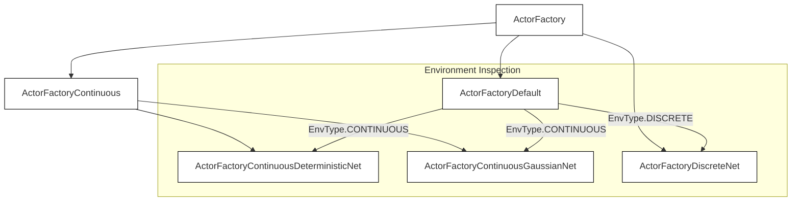
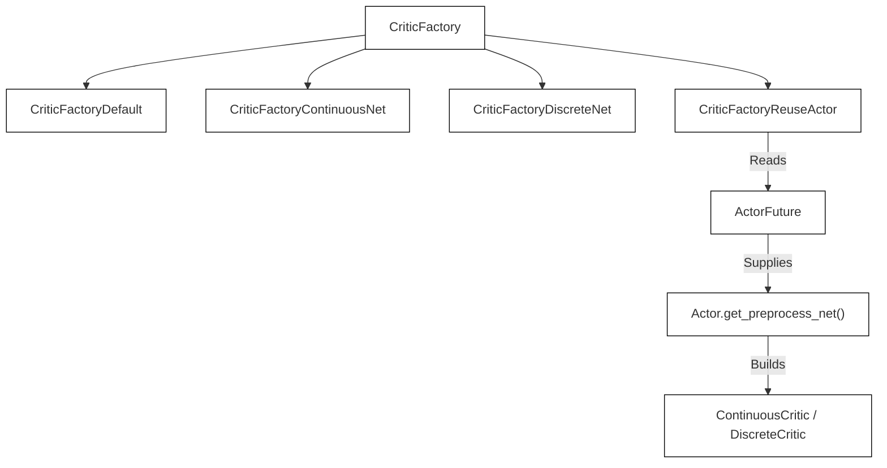

<!-- source: DeepWiki mcp.deepwiki.com · repo thu-ml/tianshou · page 6.4 Module Factories and Parameter Objects · fetched 2026-10-30 -->

# Module Factories and Parameter Objects

Relevant source files

The following files were used as context for generating this wiki page:

- [tianshou/highlevel/module/actor.py](tianshou/highlevel/module/actor.py)
- [tianshou/highlevel/module/core.py](tianshou/highlevel/module/core.py)
- [tianshou/highlevel/module/critic.py](tianshou/highlevel/module/critic.py)
- [tianshou/highlevel/module/intermediate.py](tianshou/highlevel/module/intermediate.py)
- [tianshou/highlevel/module/special.py](tianshou/highlevel/module/special.py)
- [tianshou/highlevel/params/algorithm_params.py](tianshou/highlevel/params/algorithm_params.py)
- [tianshou/highlevel/params/algorithm_wrapper.py](tianshou/highlevel/params/algorithm_wrapper.py)
- [tianshou/highlevel/params/alpha.py](tianshou/highlevel/params/alpha.py)
- [tianshou/highlevel/params/collector.py](tianshou/highlevel/params/collector.py)
- [tianshou/highlevel/params/dist_fn.py](tianshou/highlevel/params/dist_fn.py)
- [tianshou/highlevel/params/env_param.py](tianshou/highlevel/params/env_param.py)
- [tianshou/highlevel/params/lr_scheduler.py](tianshou/highlevel/params/lr_scheduler.py)
- [tianshou/highlevel/params/noise.py](tianshou/highlevel/params/noise.py)
- [tianshou/highlevel/params/optim.py](tianshou/highlevel/params/optim.py)

## Purpose and Scope
This section documents Tianshou v2's declarative high-level API components for constructing neural network modules (actors and critics) and configuring hyperparameters (such as entropy coefficients, learning rate schedulers, exploration noise, distribution functions, optimizers, and collectors). These factories and parameter dataclasses bridge high-level user specifications with low-level algorithm implementations.

---

## 1. Actor Module Factories
Actor factories encapsulate the creation of policy action-selection networks and their corresponding action distribution functions based on environment metadata.

The abstract base class `ActorFactory` defines methods for module creation and distribution function mapping [tianshou/highlevel/module/actor.py:53-65](). Concrete implementations handle discrete, continuous Gaussian, or continuous deterministic action spaces.

*Figure 1: Actor factory architecture mapping environment types to concrete network factories.*

Sources: `[tianshou/highlevel/module/actor.py:53-184]()`

---

## 2. Critic Module Factories
Critic factories instantiate value networks used in actor-critic and value-based algorithms. The `CriticFactory` interface requires a `create_module` method that accepts environment properties, device configuration, action usage flags, and discrete output dimension parameters [tianshou/highlevel/module/critic.py:17-36]().

To share feature extraction layers between the actor and critic networks, Tianshou implements `CriticFactoryReuseActor`, which leverages an `ActorFuture` container to defer critic creation until the actor module is instantiated [tianshou/highlevel/module/critic.py:134-144]().

*Figure 2: Critic creation and actor feature reuse data flow.*

Sources: `[tianshou/highlevel/module/critic.py:17-181]()`, `[tianshou/highlevel/module/actor.py:41-46]()`

---

## 3. Specialized Module Factories
For distributional reinforcement learning algorithms requiring specialized architectures, Tianshou provides factories like `ImplicitQuantileNetworkFactory`. This factory constructs an `ImplicitQuantileNetwork` using an intermediate representation factory for its backbone preprocessing network [tianshou/highlevel/module/special.py:11-29]().

Sources: `[tianshou/highlevel/module/special.py:11-29]()`

---

## 4. Parameter Objects and Transformation System
The high-level API uses parameter dataclasses inheriting from `Params` to collect training and algorithm hyperparameters [tianshou/highlevel/module/algorithm_params.py:169-176](). 

Because low-level policy classes expect instantiated objects (e.g., actual noise instances, distribution functions, or optimizers) rather than high-level configuration factories, Tianshou utilizes `ParamTransformer` classes to convert dictionaries during initialization [tianshou/highlevel/module/algorithm_params.py:31-43]().

- `ParamTransformerOptimFactory`: Replaces optimizer factory parameters and learning rate schedulers with configured `OptimizerFactory` instances [tianshou/highlevel/module/algorithm_params.py:94-130]().
- `ParamTransformerAutoAlpha`: Instantiates `AutoAlpha` objects from `AutoAlphaFactory` specifications [tianshou/highlevel/module/algorithm_params.py:132-141]().
- `ParamTransformerNoiseFactory`: Converts noise factory objects into operational `BaseNoise` instances using environment bounds [tianshou/highlevel/module/algorithm_params.py:142-146]().

Sources: `[tianshou/highlevel/module/algorithm_params.py:18-184]()`

---

## 5. Specific Parameter Factories

### Entropy Alpha (`alpha.py`)
For maximum entropy algorithms like SAC, `AutoAlphaFactoryDefault` manages entropy regularization coefficients, learning rates, and target entropy calculations based on action space dimensions [tianshou/highlevel/params/alpha.py:22-57]().

Sources: `[tianshou/highlevel/params/alpha.py:1-57]()`

### Learning Rate Scheduler (`lr_scheduler.py`)
`LRSchedulerFactoryFactoryLinear` creates linear learning rate schedulers tied to training epoch specifications and environment step counts [tianshou/highlevel/params/lr_scheduler.py:17-34]().

Sources: `[tianshou/highlevel/params/lr_scheduler.py:1-34]()`

### Distribution Functions (`dist_fn.py`)
`DistributionFunctionFactoryCategorical` and `DistributionFunctionFactoryIndependentGaussians` supply activation-to-distribution mapping functions for discrete (Categorical) and continuous (Independent Normal) action spaces [tianshou/highlevel/params/dist_fn.py:12-59]().

Sources: `[tianshou/highlevel/params/dist_fn.py:1-59]()`

### Exploration Noise (`noise.py`)
`NoiseFactoryMaxActionScaledGaussian` (aliased as `MaxActionScaled`) generates Gaussian noise whose standard deviation is proportional to the environment's maximum action values [tianshou/highlevel/params/noise.py:15-33]().

Sources: `[tianshou/highlevel/params/noise.py:1-33]()`

### Collectors (`collector.py`)
`CollectorFactoryDefault` instantiates standard experience collection loops (`Collector`) connecting policies, vector environments, and replay buffers [tianshou/highlevel/params/collector.py:29-39]().

Sources: `[tianshou/highlevel/params/collector.py:1-39]()`

---

