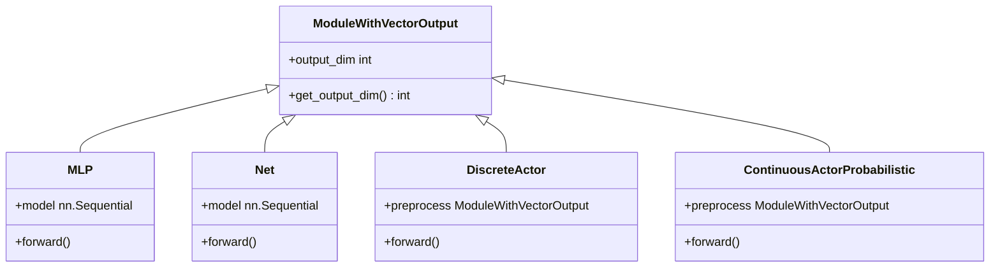
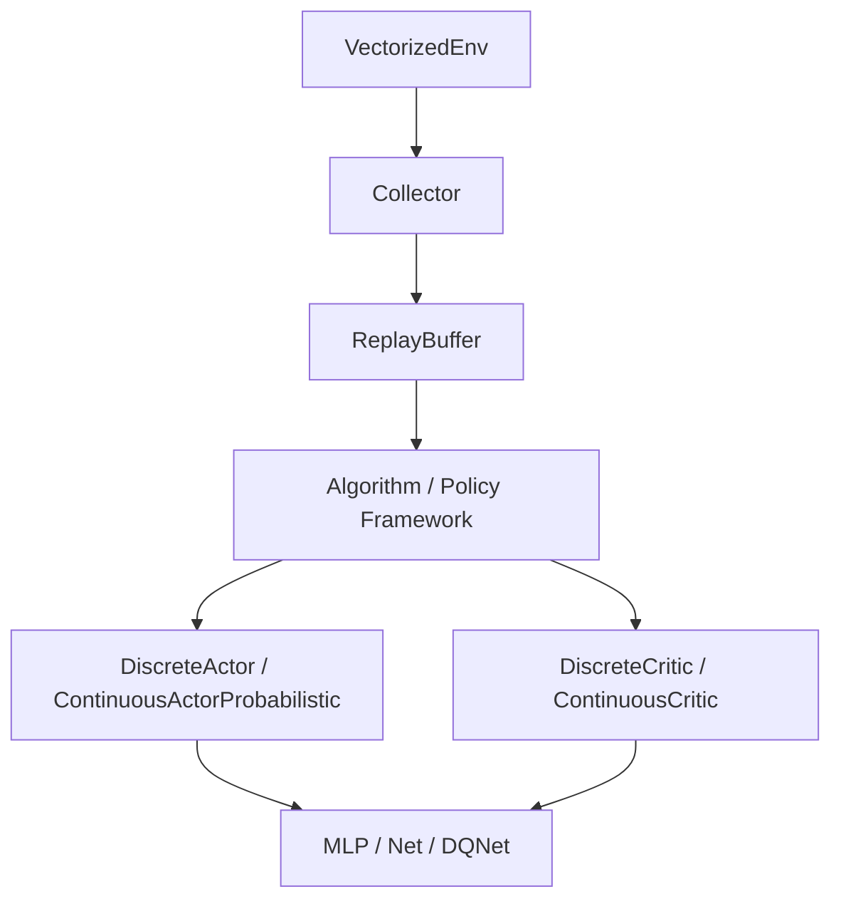

<!-- source: DeepWiki mcp.deepwiki.com · repo thu-ml/tianshou · page 7 Neural Network Components · fetched 2026-10-30 -->

# Neural Network Components

Relevant source files

The following files were used as context for generating this wiki page:

- [tianshou/env/atari/atari_network.py](tianshou/env/atari/atari_network.py)
- [tianshou/utils/net/common.py](tianshou/utils/net/common.py)
- [tianshou/utils/net/continuous.py](tianshou/utils/net/continuous.py)
- [tianshou/utils/net/discrete.py](tianshou/utils/net/discrete.py)

This page provides a high-level overview of the neural network components available in Tianshou [tianshou/utils/net/common.py:1-15](). These building blocks bridge raw environment observations and reinforcement learning algorithms, handling feature extraction, value estimation, and action distribution generation. 

As a parent page, this section summarizes the main network families. For detailed documentation and implementation specifics, refer to the child pages:
- [Common Networks](#7.1)
- [Actor-Critic Networks](#7.2)
- [Distributional RL Networks](#7.3)

Sources: [tianshou/utils/net/common.py:50-105](), [tianshou/utils/net/continuous.py:172-190](), [tianshou/utils/net/discrete.py:29-58]()

## Common Networks and Backbones

The foundation of Tianshou's architecture rests on general-purpose network abstractions defined in `tianshou/utils/net/common.py` [tianshou/utils/net/common.py:1-15](). The core base class `ModuleWithVectorOutput` ensures that all preprocessing modules expose a consistent output dimension interface [tianshou/utils/net/common.py:50-73]().

The `MLP` class implements standard multi-layer perceptrons with configurable activation functions, normalization layers (`nn.LayerNorm`, `nn.BatchNorm1d`), and input flattening [tianshou/utils/net/common.py:90-123](). Wrapping these are `Net` for flexible state representation (including dueling architecture support) and `Recurrent` for handling partially observable MDPs with RNN/LSTM memory [tianshou/utils/net/common.py:161-374]().

For detailed documentation, see [Common Networks](#7.1).

Sources: [tianshou/utils/net/common.py:50-374]()

## Actor and Critic Architectures

Tianshou provides specialized network architectures for actor-critic and value-based algorithms across both discrete and continuous action domains.

- **Discrete Networks**: `DiscreteActor` maps observations to action probabilities or values via a preprocessing backbone and linear layers [tianshou/utils/net/discrete.py:29-92](). `DiscreteCritic` estimates state values $V(s)$ [tianshou/utils/net/discrete.py:94-123]().
- **Continuous Networks**: `ContinuousActorDeterministic` directly outputs bounded actions for algorithms like DDPG [tianshou/utils/net/continuous.py:32-86](). `ContinuousActorProbabilistic` outputs distribution parameters ($\mu$ and $\sigma$) for stochastic policies such as PPO and SAC [tianshou/utils/net/continuous.py:172-261](). `ContinuousCritic` evaluates state-action pairs $Q(s, a)$ [tianshou/utils/net/continuous.py:99-170]().

For detailed documentation, see [Actor-Critic Networks](#7.2).

Sources: [tianshou/utils/net/discrete.py:29-123](), [tianshou/utils/net/continuous.py:32-261]()

## Distributional RL and Advanced Networks

To capture complex return distributions and enhance exploration, Tianshou implements advanced distributional and exploratory layers:

- **Distributional Networks**: `ImplicitQuantileNetwork` (IQN), `CosineEmbeddingNetwork`, and Atari-specific backbones like `C51Net` and `RainbowNet` model value distributions rather than expected values [tianshou/utils/net/discrete.py:126-186](), [tianshou/env/atari/atari_network.py:125-202]().
- **Exploration & Offline RL**: `NoisyLinear` layers provide parametric noise for exploration, while VAE and `Perturbation` networks model action distributions for offline RL algorithms like BCQ [tianshou/utils/net/discrete.py:321-360](), [tianshou/utils/net/continuous.py:410-490]().

For detailed documentation, see [Distributional RL Networks](#7.3).

Sources: [tianshou/utils/net/discrete.py:126-360](), [tianshou/env/atari/atari_network.py:125-202](), [tianshou/utils/net/continuous.py:410-490]()

## Integration Architecture

Neural network components integrate directly with policy classes and environment steps during training execution.

Sources: [tianshou/utils/net/common.py:90-105](), [tianshou/utils/net/discrete.py:29-123](), [tianshou/utils/net/continuous.py:32-170]()

## Network Feature Support Summary

| Component | Discrete Actions | Continuous Actions | Recurrent Support | Distributional RL | Dueling Architecture |
|-----------|:----------------:|:------------------:|:-----------------:|:-----------------:|:--------------------:|
| `Net` | ✓ | ✓ | | ✓ | ✓ |
| `Recurrent` | ✓ | ✓ | ✓ | | |
| `DiscreteActor` | ✓ | | | | |
| `DiscreteCritic` | ✓ | | | | |
| `ContinuousActorDeterministic` | | ✓ | | | |
| `ContinuousActorProbabilistic` | | ✓ | | | |
| `ContinuousCritic` | | ✓ | | | |
| `ImplicitQuantileNetwork` | ✓ | | | ✓ | |
| `RainbowNet` | ✓ | | | ✓ | ✓ |

Sources: [tianshou/utils/net/common.py:90-374](), [tianshou/utils/net/discrete.py:29-186](), [tianshou/utils/net/continuous.py:32-170](), [tianshou/env/atari/atari_network.py:154-202]()

---

