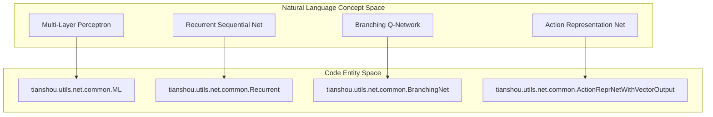

<!-- source: DeepWiki mcp.deepwiki.com · repo thu-ml/tianshou · page 7.1 Common Networks · fetched 2026-10-30 -->

# Common Networks

<details>
<summary>Relevant source files</summary>

The following files were used as context for generating this wiki page:

- [tianshou/env/atari/atari_network.py](tianshou/env/atari/atari_network.py)
- [tianshou/utils/net/common.py](tianshou/utils/net/common.py)
- [tianshou/utils/net/continuous.py](tianshou/utils/net/continuous.py)
- [tianshou/utils/net/discrete.py](tianshou/utils/net/discrete.py)

</details>


## Purpose and Scope

This document details the common neural network components provided by Tianshou as building blocks for reinforcement learning algorithms. These components serve as the foundation for creating policy and value networks used in various RL algorithms. This page focuses on base network architectures such as `MLP`, `Net`, `Recurrent`, `BranchingNet`, and `ActionReprNet`, while specialized actor-critic architectures are covered in [Actor-Critic Networks](#7.2).

Sources: [tianshou/utils/net/common.py:1-801]()

## Network Architecture Overview

The network components in Tianshou are designed to be modular and flexible, allowing users to construct networks for discrete and continuous action spaces. The following diagram illustrates the relationship between the base network abstractions and their corresponding code entities in `tianshou.utils.net.common`.

```mermaid
classDiagram
    direction TD
    
    class "nn.Module" as nnModule {
        <<PyTorch>>
    }
    
    class "ModuleWithVectorOutput" as ModuleWithVectorOutput {
        +int output_dim
        +get_output_dim()
        +from_module()
    }
    
    class "MLP" as MLP {
        +int input_dim
        +int output_dim
        +Sequence hidden_sizes
        +forward(obs)
    }
    
    class "Net" as Net {
        +MLP model
        +bool dueling
        +forward(obs, state, info)
    }
    
    class "Recurrent" as Recurrent {
        +nn.LSTM nn
        +forward(obs, state, info)
    }
    
    class "BranchingNet" as BranchingNet {
        +MLP common
        +nn.ModuleList branches
        +forward(obs, state, info)
    }
    
    class "ActionReprNetWithVectorOutput" as ActionReprNet {
        +int output_dim
        +forward(obs, state, info)
    }

    nnModule <|-- ModuleWithVectorOutput
    ModuleWithVectorOutput <|-- MLP
    ModuleWithVectorOutput <|-- Net
    ModuleWithVectorOutput <|-- Recurrent
    ModuleWithVectorOutput <|-- BranchingNet
    ModuleWithVectorOutput <|-- ActionReprNet
```

Sources: [tianshou/utils/net/common.py:50-166]()

## Core Network Components

### MLP (Multi-Layer Perceptron)

The `MLP` class (`[tianshou/utils/net/common.py:90-166]()`) implements a configurable multi-layer perceptron utilizing `miniblock` (`[tianshou/utils/net/common.py:22-47]()`) for constructing linear layers with optional normalization (`norm_layer`) and activation functions.

```mermaid
flowchart TD
    subgraph "MLP Data Flow"
        direction LR
        Input[""Input Vector""] --> Miniblock1[""miniblock(in_dim, out_dim)""]
        Miniblock1 --> Norm[""norm_layer (optional)""]
        Norm --> Act[""activation (e.g. ReLU)""]
        Act --> Hidden[""Hidden Features""]
        Hidden --> Output[""Output Layer""]
    end
```

Key features of `MLP`:
- Configurable `input_dim`, `output_dim`, and `hidden_sizes`.
- Optional per-layer or global `norm_layer` (e.g., `nn.LayerNorm`, `nn.BatchNorm1d`).
- Customizable activation functions.
- Flattening options via `flatten_input`.

Sources: [tianshou/utils/net/common.py:22-166]()

### Net

The `Net` class extends feature extraction capabilities, integrating state/action processing, dueling structures, and support for multi-dimensional observations.

Sources: [tianshou/utils/net/common.py:161-289]()

### Recurrent Networks

The `Recurrent` class implements sequential processing modules using recurrent neural networks (such as `nn.LSTM`) combined with linear projection layers for partially observable environments or sequence modeling.

Sources: [tianshou/utils/net/common.py:292-373]()

### BranchingNet

The `BranchingNet` class (`[tianshou/utils/net/common.py:454-566]`) implements a branching dual Q-network architecture for `BranchingDQNPolicy`, separating a common representation stream into individual action dimension branches.

```mermaid
flowchart TD
    subgraph "BranchingNet Architecture"
        Input[""Input State (obs)""] --> Common[""Common MLP Backbone""]
        Common --> Value[""Value Stream (V)""]
        Common --> Branch1[""Action Branch 1""]
        Common --> Branch2[""Action Branch 2""]
        Common --> BranchN[""Action Branch N""]
        
        Value --> Combine[""Combine Q = V + (A - mean)""]
        Branch1 --> Combine
        Branch2 --> Combine
        BranchN --> Combine
        
        Combine --> Output[""Branching Action Values""]
    end
```

Sources: [tianshou/utils/net/common.py:454-566]()

### ActionReprNet

The `ActionReprNet` and `ActionReprNetWithVectorOutput` abstractions provide standard interfaces for action representation networks, mapping observations to vector representations utilized across policy estimators and environment wrappers (e.g., `ScaledObsInputActionReprNet` in `[tianshou/env/atari/atari_network.py:38-58]()`).

Sources: [tianshou/utils/net/common.py:1-801](), [tianshou/env/atari/atari_network.py:38-58]()

## Utility Network Components

### ActorCritic

The `ActorCritic` class combines separate actor and critic modules into a unified `nn.Module` container for parameter management.

Sources: [tianshou/utils/net/common.py:377-390]()

### DataParallelNet

The `DataParallelNet` wrapper distributes network execution across multiple GPUs using PyTorch's `nn.DataParallel`.

Sources: [tianshou/utils/net/common.py:393-415]()

### EnsembleLinear

The `EnsembleLinear` class implements ensemble linear layers maintaining multiple weight tensors in parallel.

Sources: [tianshou/utils/net/common.py:418-450]()

## Utility Functions

### miniblock

The `miniblock` function constructs a sequence of PyTorch modules comprising a linear layer, an optional normalization layer, and an optional activation function.

Sources: [tianshou/utils/net/common.py:22-47]()

### get_dict_state_decorator

The `get_dict_state_decorator` helper function adapts networks to handle dictionary-structured observation spaces by flattening and concatenating specified keys.

Sources: [tianshou/utils/net/common.py:569-613]()

## Code Entity Mapping Diagram

The following diagram bridges system-level network concepts to concrete Python classes implemented in Tianshou source files.



Sources: [tianshou/utils/net/common.py:90-566]()

---

