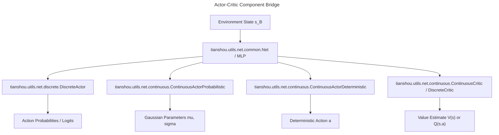
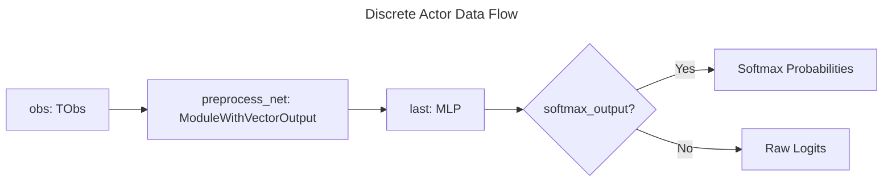
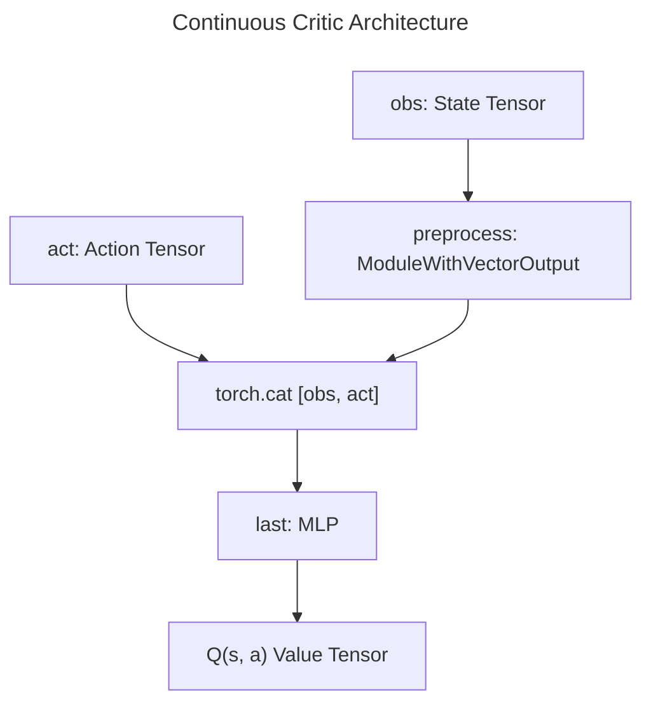
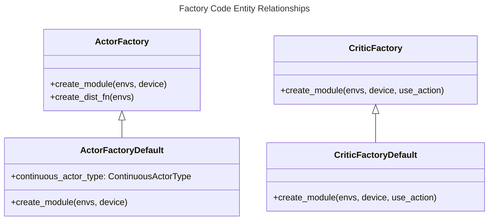

<!-- source: DeepWiki mcp.deepwiki.com · repo thu-ml/tianshou · page 7.2 Actor-Critic Networks · fetched 2026-10-30 -->

# Actor-Critic Networks

Relevant source files

The following files were used as context for generating this wiki page:

- [tianshou/env/atari/atari_network.py](tianshou/env/atari/atari_network.py)
- [tianshou/highlevel/module/actor.py](tianshou/highlevel/module/actor.py)
- [tianshou/highlevel/module/critic.py](tianshou/highlevel/module/critic.py)
- [tianshou/utils/net/common.py](tianshou/utils/net/common.py)
- [tianshou/utils/net/continuous.py](tianshou/utils/net/continuous.py)
- [tianshou/utils/net/discrete.py](tianshou/utils/net/discrete.py)

This page details the actor-critic network architectures implemented in Tianshou. Actor-critic methods maintain separate neural network representations for the policy (the actor, which selects actions) and the value function (the critic, which evaluates states or state-action pairs). This document covers discrete and continuous actor and critic modules, probabilistic extensions, high-level factories, and specialized backbone networks.

---

## 1. Overview and Core Architecture

In Tianshou, actor and critic models are structured around modular preprocessing backbones (`Net`, `MLP`, or custom visual encoders) combined with action-space-specific output layers.

Sources: [tianshou/utils/net/common.py:90-105](), [tianshou/utils/net/discrete.py:29-124](), [tianshou/utils/net/continuous.py:32-170]()

---

## 2. Actor Architectures

Tianshou provides distinct actor classes depending on whether the action space is discrete or continuous, and whether the policy is deterministic or stochastic.

### 2.1 Discrete Actors

`DiscreteActor` maps an observation tensor through a preprocessing backbone followed by an MLP layer to produce discrete action logits or softmax probabilities [tianshou/utils/net/discrete.py:29-91]().

Sources: [tianshou/utils/net/discrete.py:29-91]()

### 2.2 Continuous Actors: Deterministic vs. Probabilistic

For continuous action spaces, Tianshou distinguishes between deterministic policies (such as DDPG and TD3) and probabilistic policies (such as SAC and PPO).

- **`ContinuousActorDeterministic`**: Directly outputs continuous actions scaled by `max_action` and bounded via `torch.tanh` [tianshou/utils/net/continuous.py:32-86]().
- **`ContinuousActorProbabilistic`**: Outputs distribution parameters ($\mu$ and $\sigma$) used to construct continuous action distributions [tianshou/utils/net/continuous.py:172-261]().

Sources: [tianshou/utils/net/continuous.py:32-261]()

---

## 3. Critic Architectures

Critics evaluate states or state-action pairs to guide the actor's updates.

### 3.1 Discrete and Continuous Critics

- **`DiscreteCritic`**: Computes state value estimates $V(s)$ for discrete domains [tianshou/utils/net/discrete.py:94-124]().
- **`ContinuousCritic`**: Computes state-action value estimates $Q(s, a)$. It supports concatenation of state and action tensors, as well as reusing preprocessing networks via `apply_preprocess_net_to_obs_only` [tianshou/utils/net/continuous.py:99-170]().

Sources: [tianshou/utils/net/discrete.py:94-124](), [tianshou/utils/net/continuous.py:99-170]()

---

## 4. High-Level Factories for Actors and Critics

The high-level experiment framework uses factory patterns (`ActorFactory` and `CriticFactory`) to instantiate network modules dynamically based on environment specifications [tianshou/highlevel/module/actor.py:53-146](), [tianshou/highlevel/module/critic.py:17-36]().

- **`ActorFactoryDefault`**: Inspects environment type (`EnvType.DISCRETE` or `EnvType.CONTINUOUS`) and instantiates either discrete action models or Gaussian/deterministic continuous actors [tianshou/highlevel/module/actor.py:83-146]().
- **`CriticFactoryDefault`**: Constructs `ContinuousCritic` or `DiscreteCritic` instances with configurable hidden dimensions and activation functions [tianshou/highlevel/module/critic.py:38-78]().
- **`CriticFactoryReuseActor`**: Reuses the actor's preprocessing backbone for the critic to save memory and parameter count [tianshou/highlevel/module/critic.py:134-181]().

Sources: [tianshou/highlevel/module/actor.py:53-146](), [tianshou/highlevel/module/critic.py:17-181]()

---

## 5. Specialized Backbones and Distributional Networks

For complex observation spaces (such as Atari frames) or distributional reinforcement learning, Tianshou provides specialized network extensions.

- **`DQNet`, `C51Net`, `RainbowNet`**: Convolutional neural network backbones specialized for visual grid inputs, supporting dueling architectures and noisy linear layers [tianshou/env/atari/atari_network.py:60-202]().
- **`ImplicitQuantileNetwork` (IQN)**: Computes quantile value distributions by embedding quantile fractions $\tau$ via `CosineEmbeddingNetwork` [tianshou/utils/net/discrete.py:126-186]().

Sources: [tianshou/env/atari/atari_network.py:60-202](), [tianshou/utils/net/discrete.py:126-186]()

---

