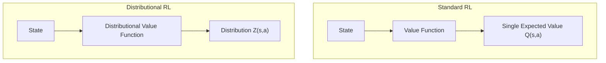
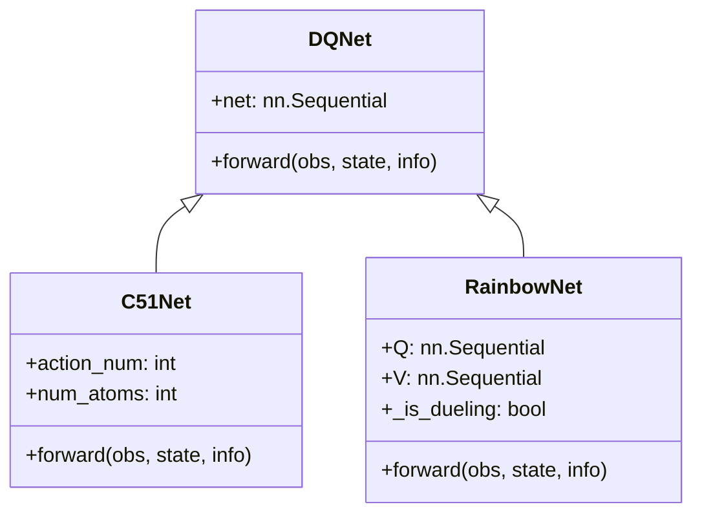
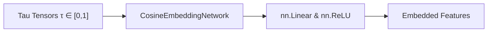
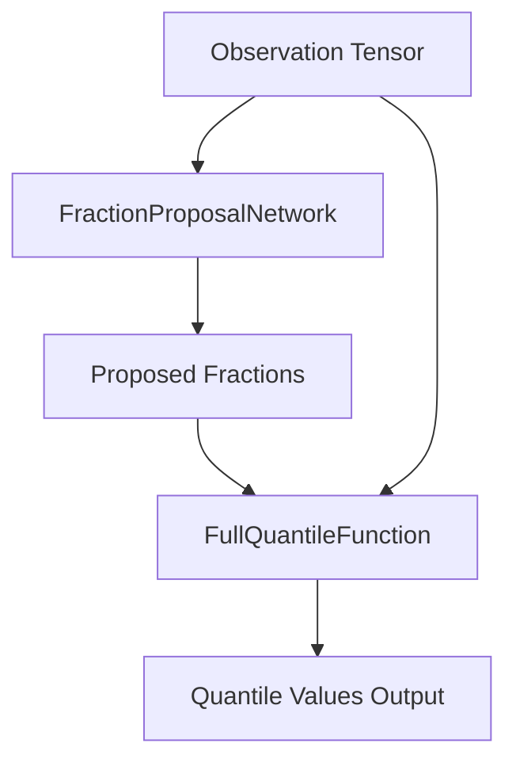
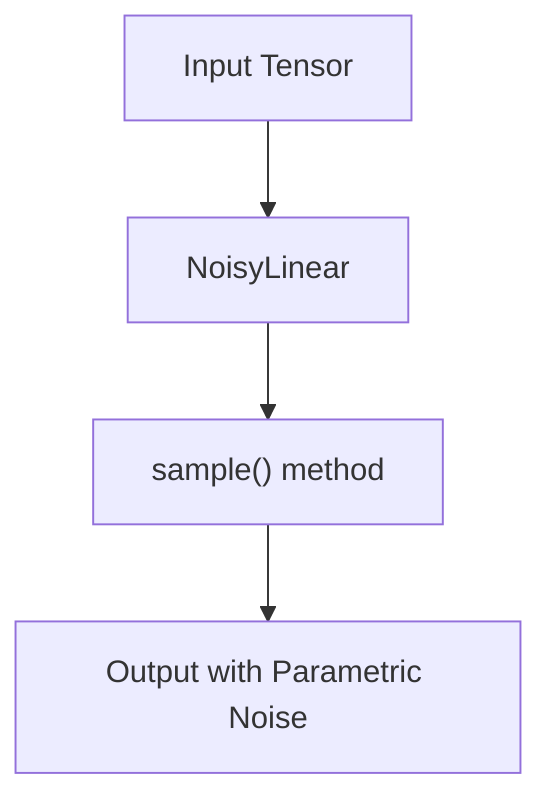

<!-- source: DeepWiki mcp.deepwiki.com · repo thu-ml/tianshou · page 7.3 Distributional RL Networks · fetched 2026-10-30 -->

# Distributional RL Networks

Relevant source files

The following files were used as context for generating this wiki page:

- [tianshou/algorithm/modelfree/rainbow.py](tianshou/algorithm/modelfree/rainbow.py)
- [tianshou/env/atari/atari_network.py](tianshou/env/atari/atari_network.py)
- [tianshou/utils/net/common.py](tianshou/utils/net/common.py)
- [tianshou/utils/net/continuous.py](tianshou/utils/net/continuous.py)
- [tianshou/utils/net/discrete.py](tianshou/utils/net/discrete.py)

## Purpose and Scope

This document details the neural network architectures specifically designed for distributional reinforcement learning algorithms in Tianshou. Distributional RL extends traditional value-based methods by modeling the entire distribution of returns rather than just the expected value. This page covers the network implementations that support algorithms like C51, QR-DQN, IQN, and FQF, as well as specialized components such as `CosineEmbeddingNetwork` [tianshou/utils/net/discrete.py:126-161](), `NoisyLinear` [tianshou/utils/net/discrete.py:321-378] (referenced in [tianshou/algorithm/modelfree/rainbow.py:10-11]()), and Atari backbones like `DQNet`, `C51Net`, and `RainbowNet` [tianshou/env/atari/atari_network.py:60-202]().

Sources: [tianshou/utils/net/discrete.py:126-378](), [tianshou/env/atari/atari_network.py:60-202]()

## Overview of Distributional RL

Distributional reinforcement learning represents the value function as a distribution over possible returns rather than a single expected value. This provides several advantages, including better uncertainty estimation, improved exploration, more stable learning dynamics, and enhanced performance in environments with multimodal reward distributions.

*Figure 1: Mapping Natural Language Space to Code Entity Space for Distributional vs Standard RL [tianshou/utils/net/common.py:1-166]()*

Sources: [tianshou/utils/net/common.py:1-166]()

## Supported Distributional Algorithms and Architectures

Tianshou implements network structures for several distributional RL algorithms across general utilities and Atari-specific modules:

| Algorithm / Class | Description | Main Network Component / File |
|-------------------|-------------|------------------------------|
| C51 | Categorical distribution with 51 fixed atoms | `C51Net` [tianshou/env/atari/atari_network.py:125-152]() |
| QR-DQN | Quantile Regression DQN with fixed quantiles | `DiscreteCritic` / `MLP` [tianshou/utils/net/discrete.py:94-124]() |
| IQN | Implicit Quantile Networks with sampled quantiles | `ImplicitQuantileNetwork`, `CosineEmbeddingNetwork` [tianshou/utils/net/discrete.py:126-215]() |
| FQF | Fully parameterized Quantile Function with learned fractions | `FullQuantileFunction`, `FractionProposalNetwork` [tianshou/utils/net/discrete.py:218-318]() |
| Rainbow | Combination of C51, NoisyNets, Dueling, etc. | `RainbowNet` [tianshou/env/atari/atari_network.py:154-202](), `RainbowDQN` [tianshou/algorithm/modelfree/rainbow.py:18-101]() |

Sources: [tianshou/env/atari/atari_network.py:60-202](), [tianshou/utils/net/discrete.py:94-318](), [tianshou/algorithm/modelfree/rainbow.py:18-101]()

## Categorical Distribution (C51) and Atari Backbones

For image-based and discrete control tasks, Tianshou provides specialized Atari network classes (`DQNet`, `C51Net`, `RainbowNet`) inside `tianshou/env/atari/atari_network.py`.

*Figure 2: Atari Network Hierarchy [tianshou/env/atari/atari_network.py:60-202]()*

`C51Net` inherits from `DQNet` and reshapes the network outputs via softmax to produce categorical distributions over support atoms [tianshou/env/atari/atari_network.py:125-152]().

Sources: [tianshou/env/atari/atari_network.py:60-152]()

## Cosine Embedding Network and Implicit Quantile Networks (IQN)

The `CosineEmbeddingNetwork` maps a scalar quantile $\tau \in [0, 1]$ to an embedding space using cosine functions [tianshou/utils/net/discrete.py:126-161]():

*Figure 3: Data flow in `CosineEmbeddingNetwork` [tianshou/utils/net/discrete.py:126-161]()*

`ImplicitQuantileNetwork` combines observation features with these cosine embeddings through element-wise multiplication to predict quantile values [tianshou/utils/net/discrete.py:163-215]().

Sources: [tianshou/utils/net/discrete.py:126-215]()

## Fully Parameterized Quantile Function (FQF)

FQF extends IQN by dynamically learning quantile fractions rather than sampling them uniformly. It uses a `FractionProposalNetwork` to output fractions and a `FullQuantileFunction` to compute the corresponding quantile values [tianshou/utils/net/discrete.py:218-318]().

*Figure 4: FQF Architecture and Data Flow [tianshou/utils/net/discrete.py:218-318]()*

Sources: [tianshou/utils/net/discrete.py:218-318]()

## Noisy Linear Layers for Rainbow

To support parameter-space noise exploration in algorithms like Rainbow DQN, Tianshou implements `NoisyLinear` [tianshou/utils/net/discrete.py:321-378](), which is sampled during training updates via helper methods in `RainbowDQN` [tianshou/algorithm/modelfree/rainbow.py:76-91]().

*Figure 5: NoisyLinear Execution Flow [tianshou/utils/net/discrete.py:321-378], [tianshou/algorithm/modelfree/rainbow.py:76-91]()*

Sources: [tianshou/utils/net/discrete.py:321-378](), [tianshou/algorithm/modelfree/rainbow.py:76-91]()

## Summary

Distributional RL networks in Tianshou provide robust support for modeling return distributions. Through `C51Net`, `RainbowNet`, `ImplicitQuantileNetwork`, `FullQuantileFunction`, and auxiliary modules like `CosineEmbeddingNetwork` and `NoisyLinear`, agents can capture complex multimodal return distributions and uncertainty effectively.

Sources: [tianshou/env/atari/atari_network.py:60-202](), [tianshou/utils/net/discrete.py:126-378](), [tianshou/algorithm/modelfree/rainbow.py:18-101]()

---

