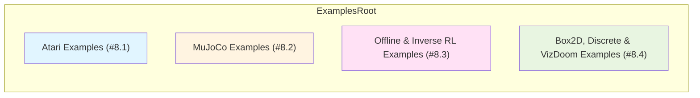

<!-- source: DeepWiki mcp.deepwiki.com · repo thu-ml/tianshou · page 8 Examples and Tutorials · fetched 2026-10-30 -->

# Examples and Tutorials

Relevant source files

The following files were used as context for generating this wiki page:

- [docs/01_user_guide/00_training_process.md](docs/01_user_guide/00_training_process.md)
- [docs/01_user_guide/01_apis.md](docs/01_user_guide/01_apis.md)
- [docs/01_user_guide/02_core_abstractions.md](docs/01_user_guide/02_core_abstractions.md)
- [docs/01_user_guide/index.rst](docs/01_user_guide/index.rst)
- [docs/02_deep_dives/0_intro.md](docs/02_deep_dives/0_intro.md)
- [docs/02_deep_dives/L1_Batch.ipynb](docs/02_deep_dives/L1_Batch.ipynb)
- [examples/discrete/discrete_dqn.py](examples/discrete/discrete_dqn.py)

This page provides a high-level overview of the `examples/` directory and documentation notebooks available in the Tianshou reinforcement learning framework. Tianshou includes a comprehensive collection of sample training scripts covering both the procedural and high-level APIs across diverse domains like Atari arcade games, MuJoCo continuous control, classic control/Box2D tasks, VizDoom FPS environments, and offline/inverse reinforcement learning.

For deep-dive walkthroughs and detailed code breakdowns, see the respective child pages:
- [Atari Examples](#8.1)
- [MuJoCo Examples](#8.2)
- [Offline and Inverse RL Examples](#8.3)
- [Box2D, Discrete and VizDoom Examples](#8.4)

Sources: [examples/discrete/discrete_dqn.py:1-99]()

---

## 8.1 Atari Examples

The Atari domain examples demonstrate how to train agents on classic arcade games using both procedural scripts and high-level experiment builders. These scripts cover value-based algorithms (such as DQN, C51, Rainbow, QRDQN, IQN, and FQF) as well as policy-gradient and actor-critic methods (like PPO and discrete SAC). They make use of dedicated Atari preprocessing wrappers to handle frame stacking, resizing, and grayscale conversions.

For complete details on Atari script walkthroughs, architecture setups, and hyperparameters, see [Atari Examples](#8.1).

Sources: [examples/atari/atari_dqn.py:1-50]()

---

## 8.2 MuJoCo Examples

MuJoCo examples focus on continuous-control physics simulation tasks (such as Hopper, HalfCheetah, and Ant). Tianshou provides both procedural implementations and declarative high-level API builder scripts (`mujoco_ppo_hl.py`, `mujoco_sac_hl.py`, etc.) for algorithms including PPO, SAC, A2C, TRPO, NPG, DDPG, TD3, REINFORCE, and REDQ. These scripts also integrate performance plotting and analysis tools.

For details on MuJoCo experiment configurations, builder workflows, and performance analysis, see [MuJoCo Examples](#8.2).

Sources: [docs/01_user_guide/01_apis.md:64-122]()

---

## 8.3 Offline and Inverse RL Examples

Offline RL and imitation learning examples leverage pre-collected datasets (such as D4RL benchmarks and Atari offline datasets) to train agents without online environment interaction. Supported algorithms include Behavior Cloning (BC), BCQ, CQL, CRR, TD3+BC, and Generative Adversarial Imitation Learning (GAIL).

For detailed documentation on offline buffer setups, constraint coefficients, and inverse RL pipelines, see [Offline and Inverse RL Examples](#8.3).

Sources: [docs/01_user_guide/00_training_process.md:95-101]()

---

## 8.4 Box2D, Discrete and VizDoom Examples

For simpler discrete and classic-control environments (such as `CartPole-v1` from Gymnasium and Box2D tasks), Tianshou provides lightweight scripts like `discrete_dqn.py`. Additionally, VizDoom integration examples demonstrate how to train agents in first-person shooter environments using CNN-based feature extractors with PPO or C51.

For comprehensive walkthroughs of classic control, Box2D, and VizDoom integrations, see [Box2D, Discrete and VizDoom Examples](#8.4).

Sources: [examples/discrete/discrete_dqn.py:13-31]()

---

