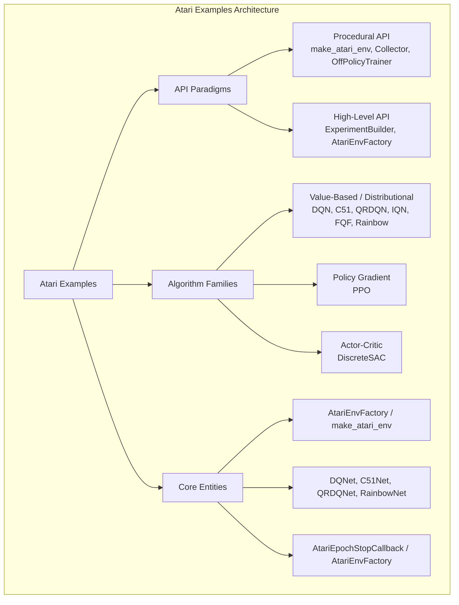
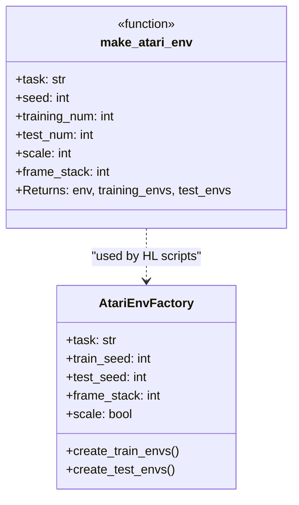
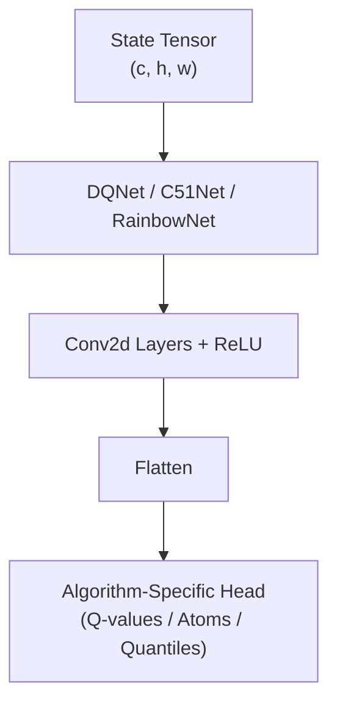
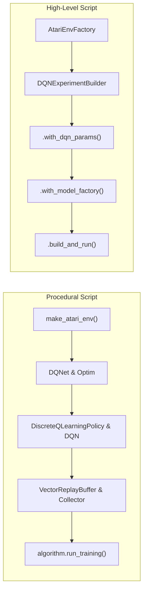

<!-- source: DeepWiki mcp.deepwiki.com · repo thu-ml/tianshou · page 8.1 Atari Examples · fetched 2026-10-30 -->

# Atari Examples

<details>
<summary>Relevant source files</summary>

The following files were used as context for generating this wiki page:

- [examples/atari/README.md](examples/atari/README.md)
- [examples/atari/atari_c51.py](examples/atari/atari_c51.py)
- [examples/atari/atari_dqn.py](examples/atari/atari_dqn.py)
- [examples/atari/atari_dqn_hl.py](examples/atari/atari_dqn_hl.py)
- [examples/atari/atari_fqf.py](examples/atari/atari_fqf.py)
- [examples/atari/atari_iqn.py](examples/atari/atari_iqn.py)
- [examples/atari/atari_iqn_hl.py](examples/atari/atari_iqn_hl.py)
- [examples/atari/atari_ppo.py](examples/atari/atari_ppo.py)
- [examples/atari/atari_ppo_hl.py](examples/atari/atari_ppo_hl.py)
- [examples/atari/atari_qrdqn.py](examples/atari/atari_qrdqn.py)
- [examples/atari/atari_rainbow.py](examples/atari/atari_rainbow.py)
- [examples/atari/atari_sac.py](examples/atari/atari_sac.py)
- [examples/atari/atari_sac_hl.py](examples/atari/atari_sac_hl.py)

</details>


This page documents the Atari environment examples provided in the Tianshou reinforcement learning framework. These examples demonstrate how to implement and train various reinforcement learning algorithms on classic Atari 2600 games using both the procedural API (`examples/atari/atari_dqn.py` [examples/atari/atari_dqn.py:1-257](), etc.) and the declarative high-level API (`examples/atari/atari_dqn_hl.py` [examples/atari/atari_dqn_hl.py:1-86](), etc.).

## Overview and Script Structure

The Atari examples showcase implementations of value-based, policy gradient, and actor-critic algorithms using pixel observations from Atari environments.



Sources: [examples/atari/atari_dqn.py:27-150](), [examples/atari/atari_dqn_hl.py:24-82](), [examples/atari/atari_ppo.py:37-151](), [examples/atari/atari_ppo_hl.py:21-83]()

## Environment Setup and Wrappers

Atari environments are configured using factory functions or environment factories that wrap raw ALE environments with standard preprocessing wrappers (such as frame skipping, grayscale conversion, resizing, and frame stacking).



Sources: [examples/atari/atari_dqn.py:71-78](), [examples/atari/atari_dqn_hl.py:62-62]()

Key wrapper steps include:
- `NoopResetEnv`: Executes random no-op actions at episode start.
- `MaxAndSkipEnv`: Skips frames and returns max pixel values.
- `EpisodicLifeEnv`: Treats life loss as terminal during training.
- `FireResetEnv`: Automatically executes FIRE action on reset.
- `WarpFrame`: Resizes observations to $84 \times 84$ grayscale.
- `ClipRewardEnv`: Clips rewards to $[-1, 1]$.
- `FrameStack`: Stacks consecutive frames (typically `frames_stack=4`).

Sources: [examples/atari/atari_wrapper.py]()

## Neural Network Components

Different algorithms leverage specialized backbone networks defined in the codebase:
- `DQNet`: Standard convolutional backbone for DQN, PPO, SAC, IQN, FQF [examples/atari/atari_dqn.py:91](), [examples/atari/atari_ppo.py:107](), [examples/atari/atari_sac.py:95](), [examples/atari/atari_iqn.py:90](), [examples/atari/atari_fqf.py:92]()
- `C51Net`: Distributional network for C51 [examples/atari/atari_c51.py:85]()
- `QRDQNet`: Quantile regression network for QR-DQN [examples/atari/atari_qrdqn.py:85]()
- `RainbowNet`: Network supporting noisy linear layers and dueling architectures for Rainbow [examples/atari/atari_rainbow.py:100]()
- `ImplicitQuantileNetwork` / `FullQuantileFunction`: Specialized quantile networks for IQN and FQF [examples/atari/atari_iqn.py:92](), [examples/atari/atari_fqf.py:93]()



Sources: [examples/atari/atari_dqn.py:90-91](), [examples/atari/atari_c51.py:84-85](), [examples/atari/atari_rainbow.py:99-109]()

## Procedural vs High-Level API Scripts

Tianshou provides both procedural training scripts (e.g., `atari_dqn.py` [examples/atari/atari_dqn.py]()) and high-level builder scripts (e.g., `atari_dqn_hl.py` [examples/atari/atari_dqn_hl.py]()).



Sources: [examples/atari/atari_dqn.py:71-201](), [examples/atari/atari_dqn_hl.py:62-85]()

## Supported Algorithm Scripts

The repository includes scripts covering the complete range of supported Atari algorithms:

| Algorithm | Procedural Script | High-Level Script | Key Policy / Algorithm Class |
|-----------|------------------|-------------------|------------------------------|
| DQN | `atari_dqn.py` [examples/atari/atari_dqn.py]() | `atari_dqn_hl.py` [examples/atari/atari_dqn_hl.py]() | `DiscreteQLearningPolicy`, `DQN` [examples/atari/atari_dqn.py:95-102]() |
| C51 | `atari_c51.py` [examples/atari/atari_c51.py]() | — | `C51Policy`, `C51` [examples/atari/atari_c51.py:89-98]() |
| Rainbow | `atari_rainbow.py` [examples/atari/atari_rainbow.py]() | — | `C51Policy`, `RainbowDQN` [examples/atari/atari_rainbow.py:112-122]() |
| QR-DQN | `atari_qrdqn.py` [examples/atari/atari_qrdqn.py]() | — | `QRDQNPolicy`, `QRDQN` [examples/atari/atari_qrdqn.py:95-101]() |
| IQN | `atari_iqn.py` [examples/atari/atari_iqn.py]() | `atari_iqn_hl.py` [examples/atari/atari_iqn_hl.py]() | `IQNPolicy`, `IQN` [examples/atari/atari_iqn.py:101-110]() |
| FQF | `atari_fqf.py` [examples/atari/atari_fqf.py]() | — | `FQFPolicy`, `FQF` [examples/atari/atari_fqf.py:104-109]() |
| PPO | `atari_ppo.py` [examples/atari/atari_ppo.py]() | `atari_ppo_hl.py` [examples/atari/atari_ppo_hl.py]() | `DiscreteActorPolicy`, `PPO` [examples/atari/atari_ppo.py:132-136]() |
| SAC (Discrete) | `atari_sac.py` [examples/atari/atari_sac.py]() | `atari_sac_hl.py` [examples/atari/atari_sac_hl.py]() | `DiscreteSACPolicy`, `DiscreteSAC` [examples/atari/atari_sac.py:118-122]() |

Sources: [examples/atari/atari_dqn.py](), [examples/atari/atari_c51.py](), [examples/atari/atari_rainbow.py](), [examples/atari/atari_qrdqn.py](), [examples/atari/atari_iqn.py](), [examples/atari/atari_fqf.py](), [examples/atari/atari_ppo.py](), [examples/atari/atari_sac.py]()

## Intrinsic Curiosity Module (ICM) Wrappers

Several procedural scripts (`atari_dqn.py`, `atari_ppo.py`, `atari_sac.py`) support intrinsic curiosity exploration via `ICMOffPolicyWrapper` and `ICMOnPolicyWrapper`:

```mermaid
flowchart TB
    Algorithm["Base Algorithm\n(DQN / PPO / SAC)"] --> ICMWrapper["ICMOffPolicyWrapper / ICMOnPolicyWrapper"]
    ICMModule["IntrinsicCuriosityModule\n(feature_net, forward/inverse models)"] --> ICMWrapper
    ICM Wrapper --> CombinedLoss["Combined Extrinsic + Intrinsic Reward"]
```

Sources: [examples/atari/atari_dqn.py:121-128](), [examples/atari/atari_ppo.py:164-171](), [examples/atari/atari_sac.py:145-152]()

---

