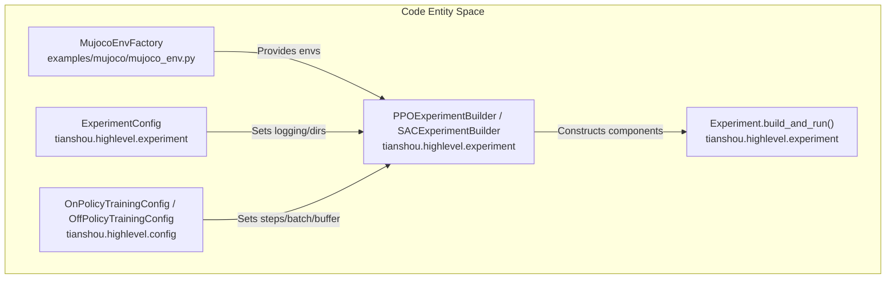
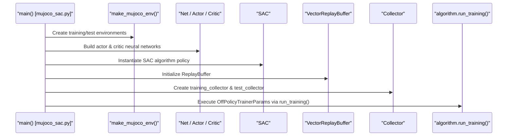

<!-- source: DeepWiki mcp.deepwiki.com · repo thu-ml/tianshou · page 8.2 MuJoCo Examples · fetched 2026-10-30 -->

# MuJoCo Examples

<details>
<summary>Relevant source files</summary>

The following files were used as context for generating this wiki page:

- [examples/mujoco/README.md](examples/mujoco/README.md)
- [examples/mujoco/analysis.py](examples/mujoco/analysis.py)
- [examples/mujoco/fetch_her_ddpg.py](examples/mujoco/fetch_her_ddpg.py)
- [examples/mujoco/mujoco_a2c.py](examples/mujoco/mujoco_a2c.py)
- [examples/mujoco/mujoco_a2c_hl.py](examples/mujoco/mujoco_a2c_hl.py)
- [examples/mujoco/mujoco_ddpg.py](examples/mujoco/mujoco_ddpg.py)
- [examples/mujoco/mujoco_ddpg_hl.py](examples/mujoco/mujoco_ddpg_hl.py)
- [examples/mujoco/mujoco_npg.py](examples/mujoco/mujoco_npg.py)
- [examples/mujoco/mujoco_npg_hl.py](examples/mujoco/mujoco_npg_hl.py)
- [examples/mujoco/mujoco_ppo.py](examples/mujoco/mujoco_ppo.py)
- [examples/mujoco/mujoco_ppo_hl.py](examples/mujoco/mujoco_ppo_hl.py)
- [examples/mujoco/mujoco_redq.py](examples/mujoco/mujoco_redq.py)
- [examples/mujoco/mujoco_redq_hl.py](examples/mujoco/mujoco_redq_hl.py)
- [examples/mujoco/mujoco_reinforce.py](examples/mujoco/mujoco_reinforce.py)
- [examples/mujoco/mujoco_reinforce_hl.py](examples/mujoco/mujoco_reinforce_hl.py)
- [examples/mujoco/mujoco_sac.py](examples/mujoco/mujoco_sac.py)
- [examples/mujoco/mujoco_sac_hl.py](examples/mujoco/mujoco_sac_hl.py)
- [examples/mujoco/mujoco_td3.py](examples/mujoco/mujoco_td3.py)
- [examples/mujoco/mujoco_td3_hl.py](examples/mujoco/mujoco_td3_hl.py)
- [examples/mujoco/mujoco_trpo.py](examples/mujoco/mujoco_trpo.py)
- [examples/mujoco/mujoco_trpo_hl.py](examples/mujoco/mujoco_trpo_hl.py)
- [examples/mujoco/plotter.py](examples/mujoco/plotter.py)
- [examples/mujoco/tools.py](examples/mujoco/tools.py)

</details>


## Purpose and Scope

This document details the MuJoCo continuous-control examples provided in the Tianshou reinforcement learning library (`examples/mujoco/`). It covers both the high-level declarative experiment API (`*_hl.py`) and procedural script implementations (`*.py`), alongside configuration patterns, environment factories, and algorithm setups for continuous control benchmarks like Ant, HalfCheetah, and Walker2d.

Sources: [examples/mujoco/mujoco_ppo_hl.py:1-85](), [examples/mujoco/mujoco_sac_hl.py:1-82]()

## Overview of MuJoCo Examples

Tianshou provides both declarative high-level experiment builders and procedural scripts for a wide variety of on-policy and off-policy algorithms on MuJoCo environments.

Title: MuJoCo High-Level Architecture Data Flow


Sources: [examples/mujoco/mujoco_ppo_hl.py:40-81](), [examples/mujoco/mujoco_sac_hl.py:38-78]()

## Supported Algorithms and Code Entities

The MuJoCo examples cover both on-policy gradient methods and off-policy actor-critic architectures.

Title: MuJoCo Algorithm Code Entity Mapping

```mermaid
graph TD
    subgraph "Natural Language Space: On-Policy"
        PPO["Proximal Policy Optimization"]
        A2C["Advantage Actor-Critic"]
        TRPO["Trust Region Policy Optimization"]
        NPG["Natural Policy Gradient"]
        REINFORCE["REINFORCE"]
    end

    subgraph "Code Entity Space: On-Policy Builders"
        PPOBuilder["PPOExperimentBuilder<br>examples/mujoco/mujoco_ppo_hl.py"]
        A2CBuilder["A2CExperimentBuilder<br>examples/mujoco/mujoco_a2c_hl.py"]
        TRPOBuilder["TRPOExperimentBuilder<br>examples/mujoco/mujoco_trpo_hl.py"]
        NPGBuilder["NPGExperimentBuilder<br>examples/mujoco/mujoco_npg_hl.py"]
        REINFORCEBuilder["ReinforceExperimentBuilder<br>examples/mujoco/mujoco_reinforce_hl.py"]
    end

    subgraph "Natural Language Space: Off-Policy"
        SAC["Soft Actor-Critic"]
        TD3["Twin Delayed DDPG"]
        DDPG["Deep Deterministic Policy Gradient"]
        REDQ["Randomized Ensembled Double Q-Learning"]
    end

    subgraph "Code Entity Space: Off-Policy Builders"
        SACBuilder["SACExperimentBuilder<br>examples/mujoco/mujoco_sac_hl.py"]
        TD3Builder["TD3ExperimentBuilder<br>examples/mujoco/mujoco_td3_hl.py"]
        DDPGBuilder["DDPGExperimentBuilder<br>examples/mujoco/mujoco_ddpg_hl.py"]
        REDQBuilder["REDQExperimentBuilder<br>examples/mujoco/mujoco_redq_hl.py"]
    end

    PPO --> PPOBuilder
    A2C --> A2CBuilder
    TRPO --> TRPOBuilder
    NPG --> NPGBuilder
    REINFORCE --> REINFORCEBuilder

    SAC --> SACBuilder
    TD3 --> TD3Builder
    DDPG --> DDPGBuilder
    REDQ --> REDQBuilder
```


Sources: [examples/mujoco/mujoco_ppo_hl.py:13](), [examples/mujoco/mujoco_sac_hl.py:12](), [examples/mujoco/mujoco_ddpg_hl.py:11](), [examples/mujoco/mujoco_td3_hl.py:13](), [examples/mujoco/mujoco_a2c_hl.py:12](), [examples/mujoco/mujoco_reinforce_hl.py:13](), [examples/mujoco/mujoco_trpo_hl.py:13](), [examples/mujoco/mujoco_redq_hl.py:12](), [examples/mujoco/mujoco_npg_hl.py:13]()

## Procedural vs High-Level Implementation

Tianshou provides two styles of execution for MuJoCo benchmarks:
1. **Procedural scripts** (`mujoco_sac.py`, `mujoco_td3.py`, `mujoco_ddpg.py`): Explicitly instantiate `Collector`, `ReplayBuffer`, `VectorReplayBuffer`, `Net`, and `OffPolicyTrainerParams`.
2. **High-level declarative scripts** (`mujoco_ppo_hl.py`, `mujoco_sac_hl.py`, etc.): Use specialized experiment builders that encapsulate boilerplate setup.

Title: Procedural Script Execution Sequence


Sources: [examples/mujoco/mujoco_sac.py:65-188](), [examples/mujoco/mujoco_td3.py:66-184](), [examples/mujoco/mujoco_ddpg.py:64-168]()

## Example Implementations and Parameterizations

### On-Policy High-Level Examples

On-policy high-level scripts such as `mujoco_ppo_hl.py` configure `OnPolicyTrainingConfig` and build parameter objects like `PPOParams`.

```python
training_config = OnPolicyTrainingConfig(
    max_epochs=max_epochs,
    epoch_num_steps=epoch_num_steps,
    batch_size=64,
    num_training_envs=64,
    num_test_envs=10,
    buffer_size=4096,
    collection_step_num_env_steps=2048,
    update_step_num_repetitions=1,
)
```

Sources: [examples/mujoco/mujoco_ppo_hl.py:43-52](), [examples/mujoco/mujoco_a2c_hl.py:44-53](), [examples/mujoco/mujoco_trpo_hl.py:43-52]()

### Off-Policy High-Level Examples

Off-policy high-level scripts utilize `OffPolicyTrainingConfig` with sample steps, start timesteps, and gradient step repetitions.

```python
training_config = OffPolicyTrainingConfig(
    max_epochs=max_epochs,
    epoch_num_steps=epoch_num_steps,
    num_training_envs=1,
    num_test_envs=10,
    buffer_size=1000000,
    batch_size=256,
    collection_step_num_env_steps=1,
    update_step_num_gradient_steps_per_sample=1,
    start_timesteps=10000,
    start_timesteps_random=True,
)
```

Sources: [examples/mujoco/mujoco_sac_hl.py:41-52](), [examples/mujoco/mujoco_td3_hl.py:46-57](), [examples/mujoco/mujoco_ddpg_hl.py:42-53]()

## Algorithm Parameter Summary

| Algorithm | Parameter Class | Key Hyperparameters | Source File |
|-----------|-----------------|---------------------|-------------|
| PPO | `PPOParams` | `gamma`, `gae_lambda`, `eps_clip`, `vf_coef`, `ent_coef` | `examples/mujoco/mujoco_ppo_hl.py` |
| SAC | `SACParams` | `tau`, `gamma`, `alpha`, `actor_lr`, `critic1_lr` | `examples/mujoco/mujoco_sac_hl.py` |
| TD3 | `TD3Params` | `tau`, `gamma`, `update_actor_freq`, `policy_noise`, `noise_clip` | `examples/mujoco/mujoco_td3_hl.py` |
| DDPG | `DDPGParams` | `actor_lr`, `critic_lr`, `gamma`, `tau`, `exploration_noise` | `examples/mujoco/mujoco_ddpg_hl.py` |
| A2C | `A2CParams` | `gamma`, `gae_lambda`, `ent_coef`, `vf_coef`, `optim` | `examples/mujoco/mujoco_a2c_hl.py` |
| TRPO | `TRPOParams` | `gamma`, `gae_lambda`, `max_kl`, `backtrack_coeff` | `examples/mujoco/mujoco_trpo_hl.py` |
| NPG | `NPGParams` | `gamma`, `gae_lambda`, `trust_region_size`, `optim_critic_iters` | `examples/mujoco/mujoco_npg_hl.py` |
| REDQ | `REDQParams` | `ensemble_size`, `subset_size`, `target_mode`, `alpha` | `examples/mujoco/mujoco_redq_hl.py` |
| REINFORCE | `ReinforceParams` | `gamma`, `action_bound_method`, `return_standardization` | `examples/mujoco/mujoco_reinforce_hl.py` |

Sources: [examples/mujoco/mujoco_ppo_hl.py:60-75](), [examples/mujoco/mujoco_sac_hl.py:59-68](), [examples/mujoco/mujoco_td3_hl.py:64-76](), [examples/mujoco/mujoco_ddpg_hl.py:60-68](), [examples/mujoco/mujoco_a2c_hl.py:60-72](), [examples/mujoco/mujoco_trpo_hl.py:59-72](), [examples/mujoco/mujoco_npg_hl.py:59-70](), [examples/mujoco/mujoco_redq_hl.py:59-70](), [examples/mujoco/mujoco_reinforce_hl.py:59-66]()

## Running and CLI Execution

All MuJoCo example scripts can be executed directly from the command line using the `logging.run_cli` utility, supporting parameters like `--task`, `--seed`, and joblib/sequential experiment launchers.

```bash
python examples/mujoco/mujoco_ppo_hl.py --task Ant-v4 --num_experiments 3
```

Sources: [examples/mujoco/mujoco_ppo_hl.py:84-85](), [examples/mujoco/mujoco_sac_hl.py:81-82]()

---

