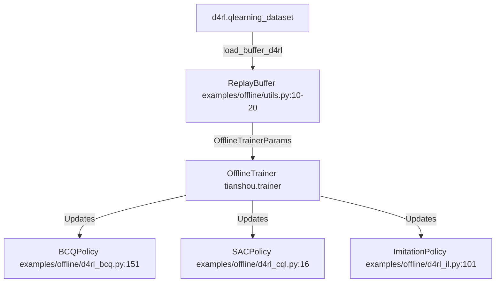
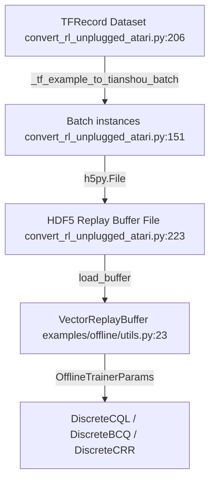
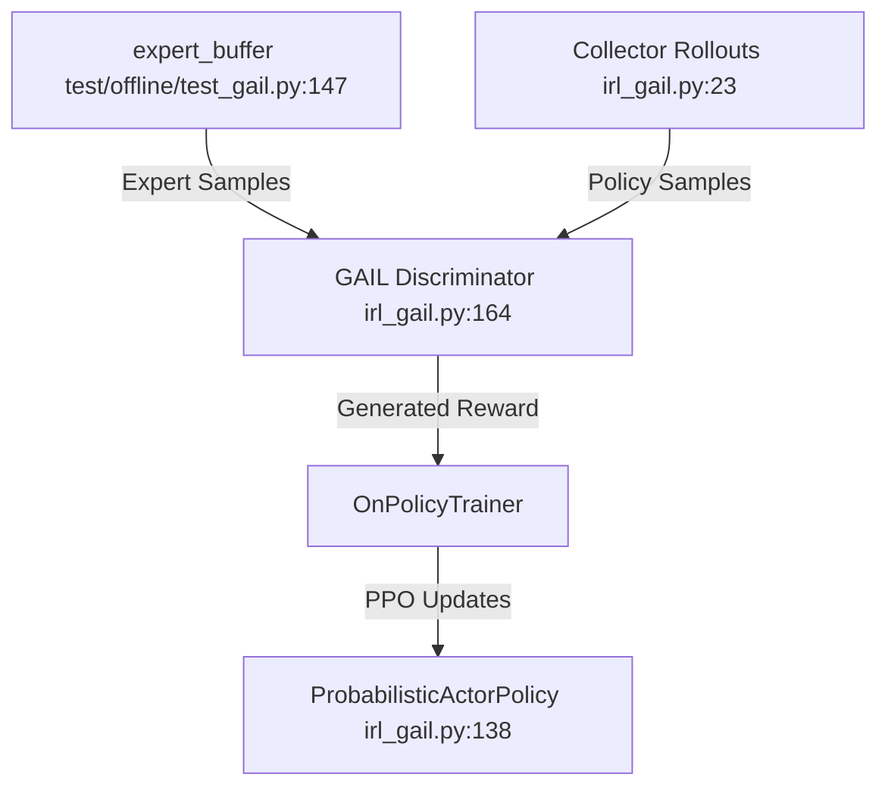

<!-- source: DeepWiki mcp.deepwiki.com · repo thu-ml/tianshou · page 8.3 Offline and Inverse RL Examples · fetched 2026-10-30 -->

# Offline and Inverse RL Examples

Relevant source files

The following files were used as context for generating this wiki page:

- [examples/inverse/irl_gail.py](examples/inverse/irl_gail.py)
- [examples/offline/README.md](examples/offline/README.md)
- [examples/offline/atari_bcq.py](examples/offline/atari_bcq.py)
- [examples/offline/atari_cql.py](examples/offline/atari_cql.py)
- [examples/offline/atari_crr.py](examples/offline/atari_crr.py)
- [examples/offline/atari_il.py](examples/offline/atari_il.py)
- [examples/offline/convert_rl_unplugged_atari.py](examples/offline/convert_rl_unplugged_atari.py)
- [examples/offline/d4rl_bcq.py](examples/offline/d4rl_bcq.py)
- [examples/offline/d4rl_cql.py](examples/offline/d4rl_cql.py)
- [examples/offline/d4rl_il.py](examples/offline/d4rl_il.py)
- [examples/offline/utils.py](examples/offline/utils.py)
- [test/offline/test_gail.py](test/offline/test_gail.py)

This page documents the offline reinforcement learning, imitation learning, and inverse reinforcement learning examples provided in Tianshou v2. It covers continuous control workflows using D4RL datasets (`examples/offline/`), discrete control Atari offline datasets (`examples/offline/`), data conversion utilities (`examples/offline/convert_rl_unplugged_atari.py`), and Generative Adversarial Imitation Learning (GAIL) (`examples/inverse/irl_gail.py`).

---

## 1. Continuous Control Offline RL (D4RL)

Tianshou provides continuous-control offline algorithms (`BCQ`, `CQL`, and Imitation Learning) that train entirely from static datasets without environment interaction during the training loop. These scripts use `d4rl` environments and datasets loaded via helper utilities.

### Data Loading and Utilities
Datasets are loaded from D4RL using `load_buffer_d4rl()` in `examples/offline/utils.py`, which extracts observations, actions, rewards, terminals, and next observations into a Tianshou `ReplayBuffer`. Observation normalization can be optionally applied via `normalize_all_obs_in_replay_buffer()`.

- **BCQ (`d4rl_bcq.py`)**: Utilizes a Variational Autoencoder (`VAE`) to model the behavior distribution, a perturbation network (`Perturbation`) to modify actions within bounds $\phi$, and Clipped Double Q-learning (`ContinuousCritic`) [examples/offline/d4rl_bcq.py:102-167]().
- **CQL (`d4rl_cql.py`)**: Implements Conservative Q-Learning over SAC (`SACPolicy`), adding a conservative penalty to push down out-of-distribution action values while supporting automatic alpha tuning (`AutoAlpha`) [examples/offline/d4rl_cql.py:14-24]().
- **IL (`d4rl_il.py`)**: Performs standard Behavior Cloning via `ImitationPolicy` and `OfflineImitationLearning` using deterministic continuous actors (`ContinuousActorDeterministic`) [examples/offline/d4rl_il.py:15-108]().

*Diagram 1: Continuous Offline RL Data Flow*

Sources: `examples/offline/utils.py:10-48]`, `examples/offline/d4rl_bcq.py:100-167]`, `examples/offline/d4rl_cql.py:14-24]`, `examples/offline/d4rl_il.py:15-110]()`.

---

## 2. Discrete Control Offline RL (Atari)

For discrete control domains, Tianshou provides offline implementations tested on Atari 2600 games using pre-generated or converted replay buffers.

### Atari Offline Scripts
- **BCQ (`atari_bcq.py`)**: Uses `DiscreteBCQ` and `DiscreteBCQPolicy` with a policy network and an imitator network to restrict action selection to likely actions [examples/offline/atari_bcq.py:15-127]().
- **CQL (`atari_cql.py`)**: Uses `DiscreteCQL` wrapping `QRDQNPolicy` with quantile regression networks (`QRDQNet`) [examples/offline/atari_cql.py:16-122]().
- **CRR (`atari_crr.py`)**: Implements Critic-Weighted Regression via `DiscreteCRR` [examples/offline/atari_crr.py:15-136]().
- **IL (`atari_il.py`)**: Standard imitation learning on Atari via `OfflineImitationLearning` and `ImitationPolicy` [examples/offline/atari_il.py:15-101]().

### RL Unplugged Conversion
The script `examples/offline/convert_rl_unplugged_atari.py` converts Google's RL Unplugged TFRecord Atari datasets into HDF5 format compatible with Tianshou's `ReplayBuffer.load_hdf5()` loader [examples/offline/convert_rl_unplugged_atari.py:6-223]().

*Diagram 2: Atari Offline Data Ingestion Pipeline*

Sources: `examples/offline/atari_bcq.py:15-135]`, `examples/offline/atari_cql.py:16-122]`, `examples/offline/atari_crr.py:15-136]`, `examples/offline/atari_il.py:15-101]`, `examples/offline/convert_rl_unplugged_atari.py:6-223]()`.

---

## 3. Inverse Reinforcement Learning (GAIL)

Generative Adversarial Imitation Learning is implemented in `examples/inverse/irl_gail.py` and tested in `test/offline/test_gail.py`. GAIL interleaves policy optimization via PPO with discriminator updates to distinguish expert transitions from agent rollouts.

### Key Components
- **`NoRewardEnv`**: A custom `gym.RewardWrapper` that overrides environment rewards with zeros, forcing the agent to rely entirely on the GAIL discriminator reward [examples/inverse/irl_gail.py:37-49]().
- **`GAIL` Algorithm**: Manages the policy, critic, and discriminator networks (`disc_net`), updating the discriminator using expert buffers (`expert_buffer`) and policy rollouts [examples/inverse/irl_gail.py:17]().
- **`ProbabilisticActorPolicy`**: Wraps the continuous probabilistic actor for rollout collection [examples/inverse/irl_gail.py:19]().

*Diagram 3: GAIL Training Architecture*

Sources: `examples/inverse/irl_gail.py:17-49]`, `test/offline/test_gail.py:11-159]()`.

---

