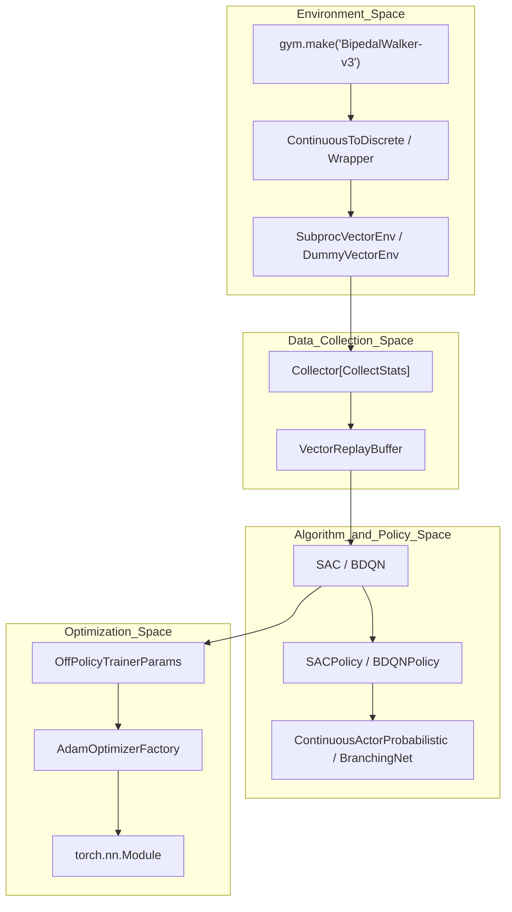
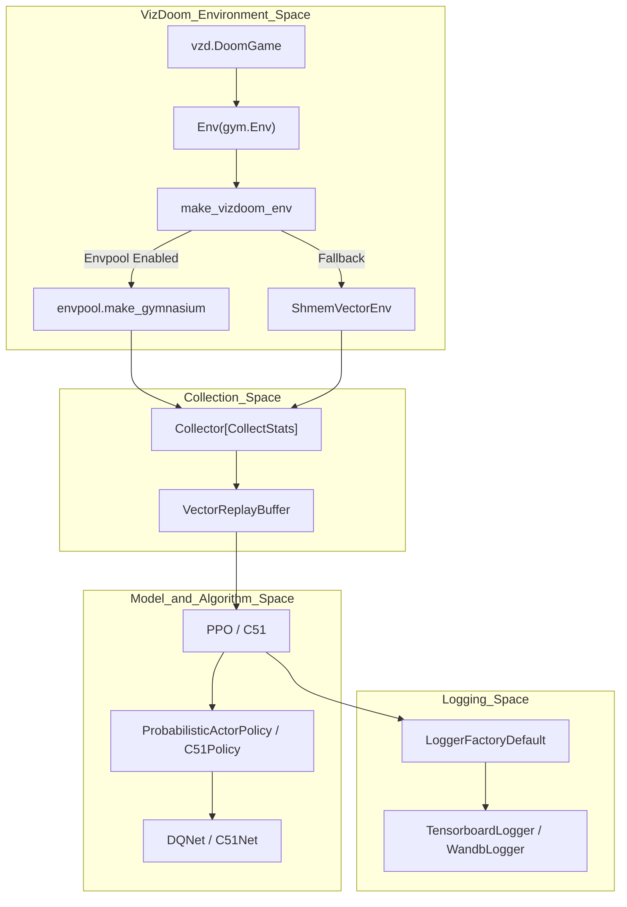

<!-- source: DeepWiki mcp.deepwiki.com · repo thu-ml/tianshou · page 8.4 Box2D, Discrete and VizDoom Examples · fetched 2026-10-30 -->

# Box2D, Discrete and VizDoom Examples

Relevant source files

The following files were used as context for generating this wiki page:

- [examples/box2d/README.md](examples/box2d/README.md)
- [examples/box2d/acrobot_dualdqn.py](examples/box2d/acrobot_dualdqn.py)
- [examples/box2d/bipedal_bdq.py](examples/box2d/bipedal_bdq.py)
- [examples/box2d/bipedal_hardcore_sac.py](examples/box2d/bipedal_hardcore_sac.py)
- [examples/box2d/lunarlander_dqn.py](examples/box2d/lunarlander_dqn.py)
- [examples/box2d/mcc_sac.py](examples/box2d/mcc_sac.py)
- [examples/discrete/discrete_dqn.py](examples/discrete/discrete_dqn.py)
- [examples/vizdoom/env.py](examples/vizdoom/env.py)
- [examples/vizdoom/vizdoom_c51.py](examples/vizdoom/vizdoom_c51.py)
- [examples/vizdoom/vizdoom_ppo.py](examples/vizdoom/vizdoom_ppo.py)
- [test/discrete/test_bdqn.py](test/discrete/test_bdqn.py)

This page documents the classic control, Box2D, and VizDoom environment integrations and examples provided in the Tianshou codebase. It covers concrete scripts for discrete action spaces (CartPole, LunarLander, Acrobot), continuous and high-dimensional discrete Box2D tasks (MountainCarContinuous, BipedalWalker, BipedalWalkerHardcore), and 3D first-person shooter integration using VizDoom.

---

## 1. Classic Control and Box2D Examples

Tianshou provides numerous reference implementations for classic control and Box2D environments under `examples/discrete/` and `examples/box2d/`. These examples demonstrate how to wire up vector environments, neural network backbones, policies, algorithms, and trainers.

### 1.1 Discrete Control: DQN on CartPole, LunarLander, and Acrobot
Discrete control scripts like `examples/discrete/discrete_dqn.py`, `examples/box2d/lunarlander_dqn.py`, and `examples/box2d/acrobot_dualdqn.py` showcase standard Q-learning workflows using `DiscreteQLearningPolicy` combined with the `DQN` algorithm class.

- **Environment Setup**: Environments are instantiated using `gym.make()` and wrapped into vectorized containers such as `DummyVectorEnv` or `SubprocVectorEnv` [examples/discrete/discrete_dqn.py:27-30](), [examples/box2d/lunarlander_dqn.py:63-67](), [examples/box2d/acrobot_dualdqn.py:61-65]().
- **Network Architecture**: The scripts use `Net` with optional dueling architectures (`dueling_param=(Q_param, V_param)`) to separate state-value and advantage estimation [examples/box2d/lunarlander_dqn.py:76-80](), [examples/box2d/acrobot_dualdqn.py:74-79]().
- **Optimization & Training**: Optimization uses `AdamOptimizerFactory` [examples/discrete/discrete_dqn.py:41](), [examples/box2d/lunarlander_dqn.py:82](), and training is driven by `OffPolicyTrainerParams` passed to `algorithm.run_training()` [examples/discrete/discrete_dqn.py:76-90](), [examples/box2d/lunarlander_dqn.py:127-143]().

Sources:
- `examples/discrete/discrete_dqn.py`
- `examples/box2d/lunarlander_dqn.py`
- `examples/box2d/acrobot_dualdqn.py`

### 1.2 High-Dimensional Discrete Actions: Branching DQN (BDQ)
To scale up to environments with large or continuous action spaces discretized per dimension, Tianshou provides `examples/box2d/bipedal_bdq.py` and its test suite `test/discrete/test_bdqn.py`.

- **Action Discretization**: The continuous action space of `BipedalWalker-v3` is transformed into a `MultiDiscrete` space using `ContinuousToDiscrete` [examples/box2d/bipedal_bdq.py:59-62](). For $N$ branches with $K$ actions per branch, standard DQN requires $K^N$ output neurons, whereas Branching DQN scales linearly ($K \times N$) [examples/box2d/README.md:10-17]().
- **Network**: Uses `BranchingNet` to split the shared representation into action-value branches [examples/box2d/bipedal_bdq.py:96-103]().
- **Policy & Algorithm**: Uses `BDQNPolicy` and `BDQN` [examples/box2d/bipedal_bdq.py:105-117]().

Sources:
- `examples/box2d/bipedal_bdq.py`
- `examples/box2d/README.md`
- `test/discrete/test_bdqn.py`

### 1.3 Continuous Control: Soft Actor-Critic (SAC)
Continuous Box2D tasks such as `MountainCarContinuous-v0` and `BipedalWalkerHardcore-v3` are solved using SAC (`examples/box2d/mcc_sac.py` and `examples/box2d/bipedal_hardcore_sac.py`).

- **Custom Environment Wrappers**: `BipedalHardcore` utilizes a custom `Wrapper` inheriting from `gym.Wrapper` to handle action repetition, reward scaling, and termination penalty removal (`rm_done`), which significantly accelerates convergence [examples/box2d/bipedal_hardcore_sac.py:57-87](), [examples/box2d/README.md:1-8]().
- **Actor and Critics**: Uses `ContinuousActorProbabilistic` and twin `ContinuousCritic` networks backed by `Net` [examples/box2d/bipedal_hardcore_sac.py:113-137]().
- **Entropy Tuning**: Automatic entropy adjustment is configured via `AutoAlpha` with a target entropy linked to action dimensions [examples/box2d/bipedal_hardcore_sac.py:140-144]().

Sources:
- `examples/box2d/mcc_sac.py`
- `examples/box2d/bipedal_hardcore_sac.py`
- `examples/box2d/README.md`

---

## 2. VizDoom Environment Integration

VizDoom provides 3D navigation and combat environments for reinforcement learning. Tianshou integrates VizDoom through custom environment wrappers and high-performance vectorization.

### 2.1 VizDoom Environment Definition (`examples/vizdoom/env.py`)
The `examples/vizdoom/env.py` module defines the custom `Env` class and environment construction helper `make_vizdoom_env()`.

- **Action Combinations**: Discrete action mappings are generated via `normal_button_comb()` or `battle_button_comb()` depending on whether the map involves combat or navigation [examples/vizdoom/env.py:19-43]().
- **Custom `gym.Env` Subclass**: The `Env` class loads ViZDoom configuration files (`cfg_path`), configures observation shapes (resizing screen buffers via OpenCV), extracts game variables (`HEALTH`, `KILLCOUNT`, `AMMO2`), and computes shaped rewards [examples/vizdoom/env.py:46-127]().
- **Vectorization Factory**: `make_vizdoom_env()` checks if `envpool` is installed. If available, it uses `envpool.make_gymnasium()`; otherwise, it falls back to `ShmemVectorEnv` with custom `Env` instances [examples/vizdoom/env.py:136-192]().

Sources:
- `examples/vizdoom/env.py`

### 2.2 VizDoom Algorithms: PPO and C51
VizDoom tasks like `D1_basic` are trained using algorithms adapted for image-based inputs, such as PPO (`examples/vizdoom/vizdoom_ppo.py`) and C51 (`examples/vizdoom/vizdoom_c51.py`).

- **Backbone Networks**: Both scripts use Atari/image-oriented network trunks (`DQNet` and `C51Net`) to process stacked frame observations (`C x H x W`) [examples/vizdoom/vizdoom_ppo.py:126-134](), [examples/vizdoom/vizdoom_c51.py:97-98]().
- **Optional Intrinsic Curiosity**: `vizdoom_ppo.py` supports the Intrinsic Curiosity Module (`ICMOnPolicyWrapper`) for sparse reward exploration [examples/vizdoom/vizdoom_ppo.py:86-102]().
- **Logging**: Integrates `LoggerFactoryDefault` supporting both TensorBoard and Weights & Biases (`wandb`) loggers [examples/vizdoom/vizdoom_c51.py:143-155]().

Sources:
- `examples/vizdoom/vizdoom_ppo.py`
- `examples/vizdoom/vizdoom_c51.py`

---

## 3. Architectural Data Flow & Component Mapping

The following diagrams bridge the natural language domain concepts to the exact code entities, classes, and modules used across Box2D and VizDoom examples.

### 3.1 Box2D SAC / BDQN Training Pipeline

Sources:
- `examples/box2d/bipedal_hardcore_sac.py`
- `examples/box2d/bipedal_bdq.py`
- `examples/box2d/lunarlander_dqn.py`

### 3.2 VizDoom Environment & Algorithm Pipeline

Sources:
- `examples/vizdoom/env.py`
- `examples/vizdoom/vizdoom_ppo.py`
- `examples/vizdoom/vizdoom_c51.py`

---

