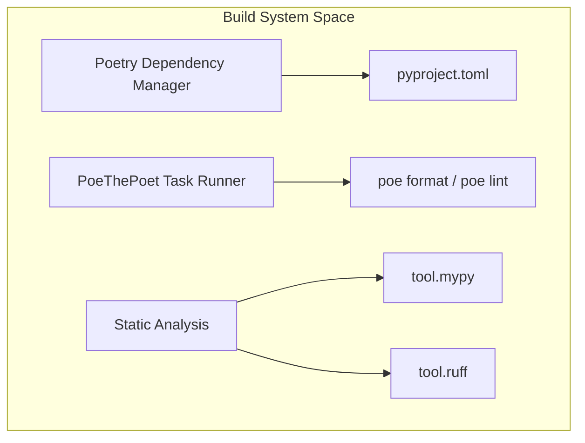
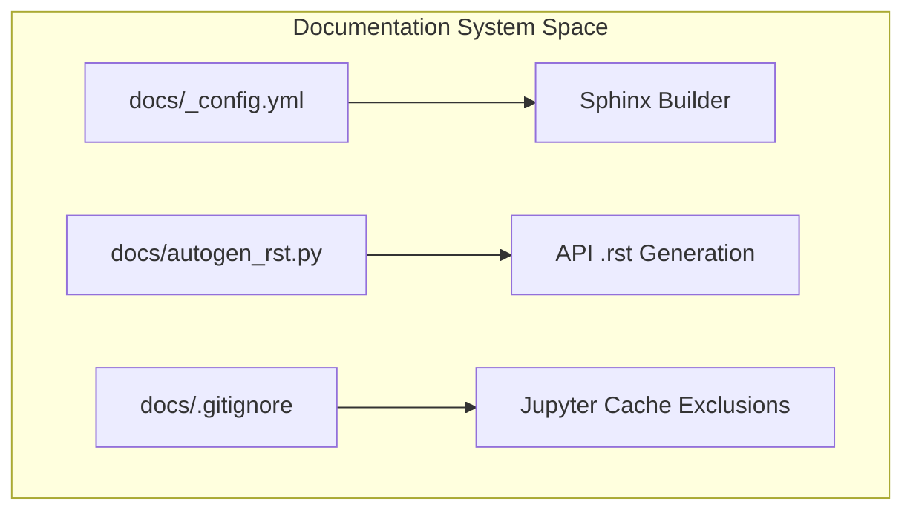
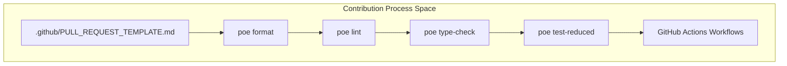

<!-- source: DeepWiki mcp.deepwiki.com · repo thu-ml/tianshou · page 9 Development and Contribution · fetched 2026-10-30 -->

# Development and Contribution

Relevant source files

The following files were used as context for generating this wiki page:

- [.github/ISSUE_TEMPLATE.md](.github/ISSUE_TEMPLATE.md)
- [.github/PULL_REQUEST_TEMPLATE.md](.github/PULL_REQUEST_TEMPLATE.md)
- [CONTRIBUTING.md](CONTRIBUTING.md)
- [docs/.gitignore](docs/.gitignore)
- [docs/_config.yml](docs/_config.yml)
- [docs/autogen_rst.py](docs/autogen_rst.py)
- [poetry.lock](poetry.lock)
- [pyproject.toml](pyproject.toml)

This page serves as the parent guide for contributing to the Tianshou reinforcement learning library (`tianshou`). It outlines the high-level workflow, dependency management, testing infrastructure, CI/CD pipelines, and documentation standards. For granular technical details, refer to the child pages linked throughout.

Sources: [pyproject.toml:1-10]()

## 1. Build System and Tooling

Tianshou manages dependencies using Poetry and automates development tasks via `poethepoet` [pyproject.toml:2-5, 104](). The project defines core requirements, optional extras (such as `atari`, `mujoco`, `envpool`), and a dedicated `dev` dependency group containing linters, type checkers, and documentation tools [pyproject.toml:26-90, 94-130](). Code formatting and linting are strictly enforced using Ruff and MyPy [pyproject.toml:113-149, 159-185]().

For details on Poetry configuration, task definitions, Ruff/MyPy settings, and devcontainer support, see [Build System and Tooling](#9.1).

Diagram: Build and Tooling Architecture

Sources: [pyproject.toml:2-185]()

## 2. Testing Framework

The test suite is structured to cover base utilities, continuous control algorithms, and discrete control algorithms. Determinism utilities and regression tests ensure that algorithm updates and refactorings do not inadvertently alter training trajectories or introduce non-determinism.

For details on test layout, regression tests, and determinism suites, see [Testing Framework](#9.2).

Sources: [.github/PULL_REQUEST_TEMPLATE.md:4-5]()

## 3. CI/CD Pipeline

Tianshou relies on GitHub Actions to execute automated checks across multiple operating systems and hardware configurations. Workflows handle standard pytest execution (`pytest.yml`), cross-platform compatibility (`extra_sys.yml`), GPU-accelerated tests (`gputest.yml`), and static analysis/documentation builds (`lint_and_docs.yml`). Standardized pull request and issue templates guide contributors through required validation steps [.github/PULL_REQUEST_TEMPLATE.md:1-10](), [.github/ISSUE_TEMPLATE.md:1-13]().

For details on workflow definitions, triggers, and runner setups, see [CI/CD Pipeline](#9.3).

Sources: [.github/PULL_REQUEST_TEMPLATE.md:1-10](), [.github/ISSUE_TEMPLATE.md:1-13]()

## 4. Documentation System

Documentation is built using Jupyter Book and Sphinx [docs/_config.yml:1-11, 95-102](). API references are automatically generated from source code docstrings via `docs/autogen_rst.py`, and interactive notebooks are processed while stripping output caches to maintain repository cleanliness [docs/_config.yml:16, 23](), [docs/autogen_rst.py:1-153]().

For details on Sphinx configuration, RST generation scripts, notebook stripping, and ReadTheDocs integration, see [Documentation System](#9.4).

Diagram: Documentation Generation Entity Map

Sources: [docs/_config.yml:1-129](), [docs/autogen_rst.py:1-153](), [docs/.gitignore:1-4]()

## 5. Contribution Workflow and Guidelines

Contributors are expected to follow a rigorous pull request checklist, verifying code formatting (`poe format`), linting (`poe lint`), type checking (`poe type-check`), and testing (`poe test-reduced`) before submitting changes [.github/PULL_REQUEST_TEMPLATE.md:1-10]().

Diagram: Contribution Flow Mapping

Sources: [.github/PULL_REQUEST_TEMPLATE.md:1-10]()

---

