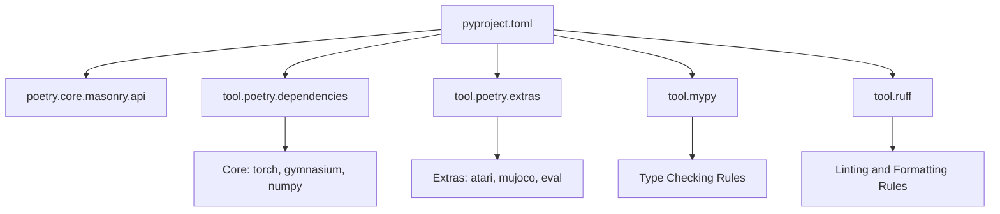
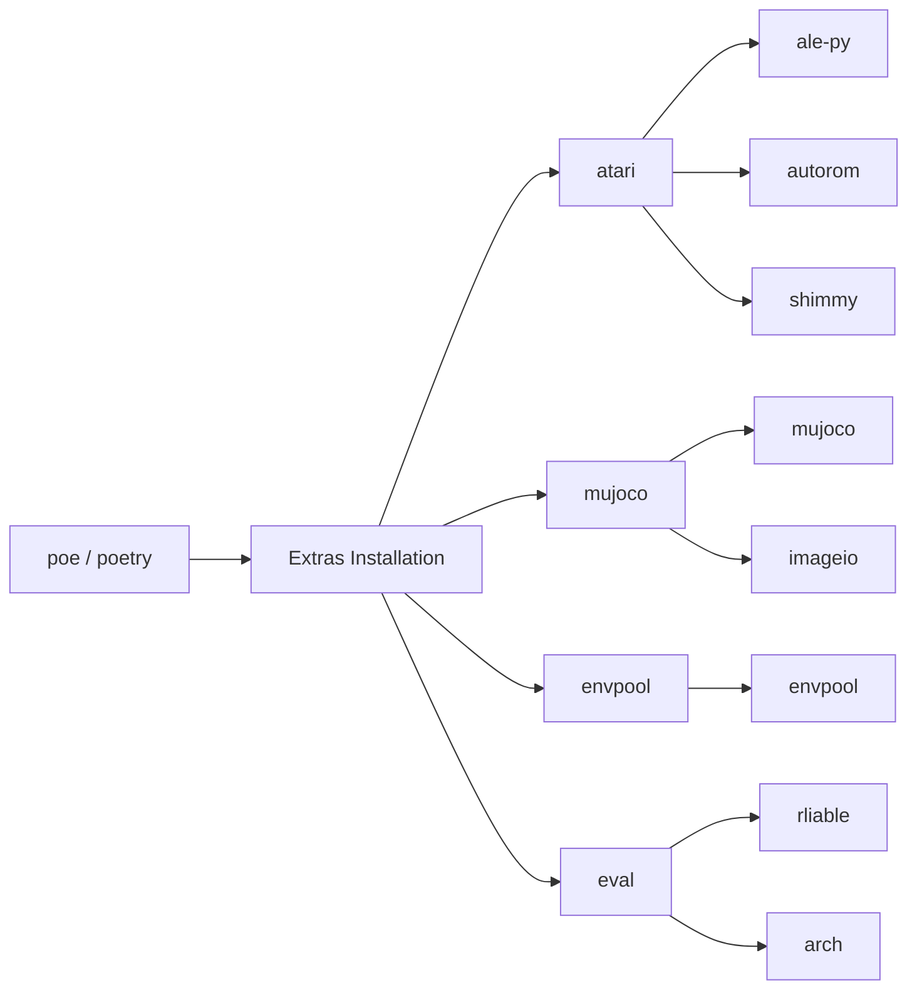
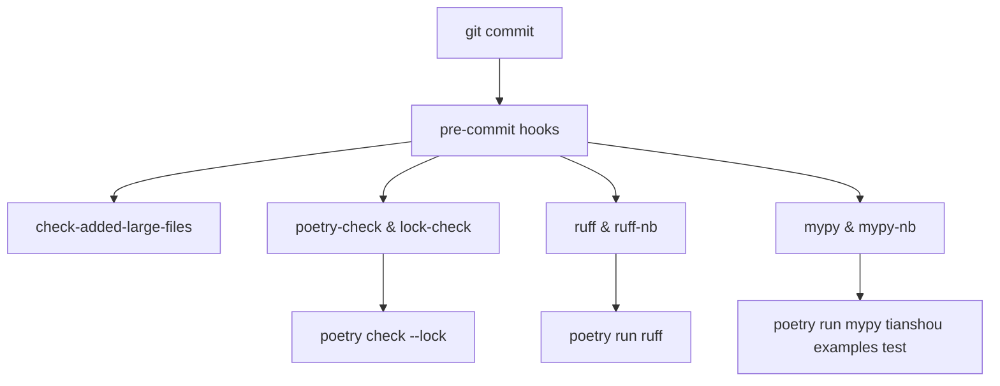
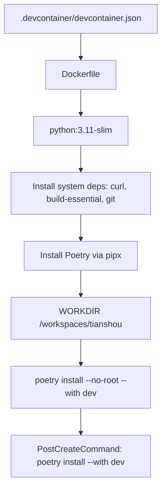
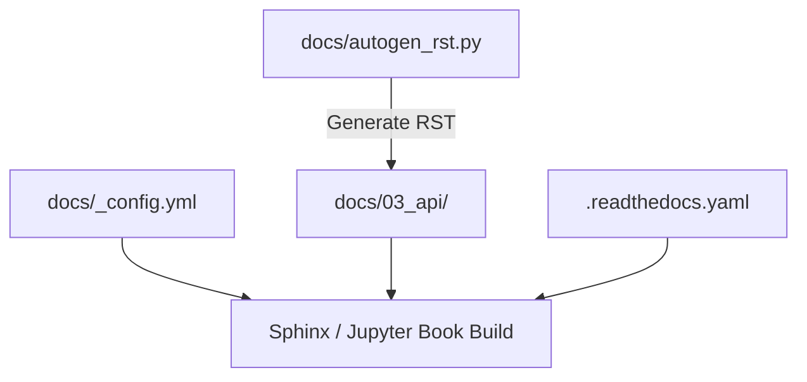

<!-- source: DeepWiki mcp.deepwiki.com · repo thu-ml/tianshou · page 9.1 Build System and Tooling · fetched 2026-10-30 -->

# Build System and Tooling

<details>
<summary>Relevant source files</summary>

The following files were used as context for generating this wiki page:

- [.devcontainer/devcontainer.json](.devcontainer/devcontainer.json)
- [.dockerignore](.dockerignore)
- [.gitignore](.gitignore)
- [.pre-commit-config.yaml](.pre-commit-config.yaml)
- [Dockerfile](Dockerfile)
- [docs/.gitignore](docs/.gitignore)
- [docs/_config.yml](docs/_config.yml)
- [docs/autogen_rst.py](docs/autogen_rst.py)
- [poetry.lock](poetry.lock)
- [pyproject.toml](pyproject.toml)

</details>


This section covers Tianshou's build system, dependency management via Poetry, code quality enforcement through Ruff and MyPy, pre-commit hooks, and containerized development environments using Docker and Devcontainers.

## Purpose and Scope

The build and tooling framework ensures reproducible installations, consistent code formatting, rigorous static type checking, and standardized developer workflows. Tianshou leverages `poetry` for dependency resolution [pyproject.toml:5-49](), `ruff` and `mypy` for code validation [pyproject.toml:131-185](), `pre-commit` for hook automation [.pre-commit-config.yaml:1-52](), and a containerized setup via `Dockerfile` and `devcontainer.json` [.devcontainer/devcontainer.json:1-22](), [Dockerfile:1-42]().

Sources: [pyproject.toml:1-185](), [.pre-commit-config.yaml:1-52](), [.devcontainer/devcontainer.json:1-22](), [Dockerfile:1-42]()

---

## Build System Architecture and Poetry Configuration

Tianshou uses Poetry as its primary build tool and package manager, specified in `pyproject.toml` using `poetry.core.masonry.api` [pyproject.toml:1-3](). The project metadata and core dependencies are declared under `[tool.poetry]` and `[tool.poetry.dependencies]`.



Sources: [pyproject.toml:1-89](), [pyproject.toml:131-185]()

### Core Dependencies

The core runtime dependencies are strictly version-pinned or bounded in `pyproject.toml`:
- Python: `^3.11` [pyproject.toml:27]()
- PyTorch: `^2.0.0, !=2.0.1, !=2.1.0` (avoiding known unstable releases) [pyproject.toml:41]()
- Gymnasium: `>=0.28.0` [pyproject.toml:29]()
- NumPy: `>=1.24.4` [pyproject.toml:33]()

Sources: [pyproject.toml:26-48]()

---

## Optional Dependencies and Extras

Because gymnasium optional dependencies cannot be seamlessly mapped directly through Poetry extras due to upstream constraint limitations, Tianshou maintains an explicit set of optional dependency groups [pyproject.toml:51-89]().



Sources: [pyproject.toml:78-89]()

To install specific optional extras, users invoke Poetry with the `-E` flag:
```bash
poetry install -E atari
poetry install -E mujoco
poetry install -E eval
```

Sources: [pyproject.toml:78-89]()

---

## Code Quality and Static Analysis

Tianshou enforces strict linting, formatting, and static typing rules configured in `pyproject.toml`.

### Ruff Configuration
Ruff is used as a fast linter and formatter, targeting Python 3.11 with a line length of 100 characters [pyproject.toml:159-161](). It selects a wide array of rule sets including `ASYNC`, `B`, `C4`, `E`, `F`, `I`, `UP`, and `W` [pyproject.toml:163-166]() while ignoring specific rule exceptions such as `E501` and specific logging f-string warnings `G004` [pyproject.toml:167-185]().

### MyPy Configuration
Static type checking is governed by `[tool.mypy]` [pyproject.toml:131-150]():
- `disallow_untyped_defs = true` [pyproject.toml:135]()
- `check_untyped_defs = true` [pyproject.toml:133]()
- `no_implicit_optional = true` [pyproject.toml:137]()
- `warn_unused_ignores = true` [pyproject.toml:148]()
- Excludes build and documentation directories [pyproject.toml:149]()

Sources: [pyproject.toml:131-185]()

---

## Pre-Commit Hooks

Local code quality checks are automated via `.pre-commit-config.yaml`, ensuring that code formatting, linting, lock file integrity, and type checks pass prior to commit [.pre-commit-config.yaml:1-52]().



Sources: [.pre-commit-config.yaml:1-52]()

---

## Docker and Devcontainer Integration

Tianshou provides a containerized development environment via a `Dockerfile` [Dockerfile:1-42]() and a `.devcontainer/devcontainer.json` configuration [.devcontainer/devcontainer.json:1-22]().



Sources: [.devcontainer/devcontainer.json:1-22](), [Dockerfile:1-42]()

The container uses a base image of `python:3.11-slim` [Dockerfile:2](), installs Poetry via `pipx` [Dockerfile:21-28](), configures shared memory or workspace directories, and automatically runs dependency installations post-creation [.devcontainer/devcontainer.json:5-20](), [Dockerfile:37-42]().

Sources: [.devcontainer/devcontainer.json:1-22](), [Dockerfile:1-42]()

---

## Documentation Build System

Documentation is generated using Sphinx and Jupyter Book, supported by helper scripts such as `docs/autogen_rst.py` [docs/autogen_rst.py:1-153]() and configuration files like `docs/_config.yml` [docs/_config.yml:1-129]().



Sources: [docs/autogen_rst.py:1-153](), [docs/_config.yml:1-129]()

Sources: [docs/autogen_rst.py:1-153](), [docs/_config.yml:1-129]()

---

