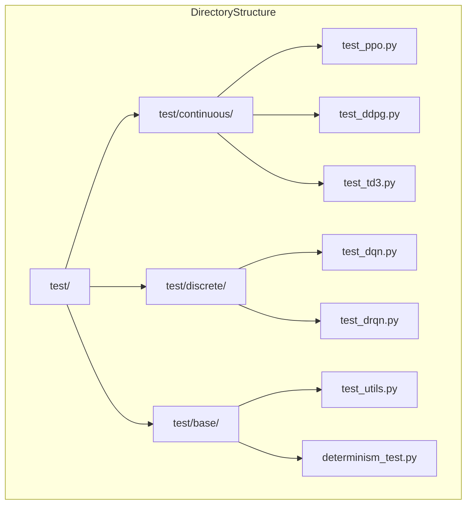
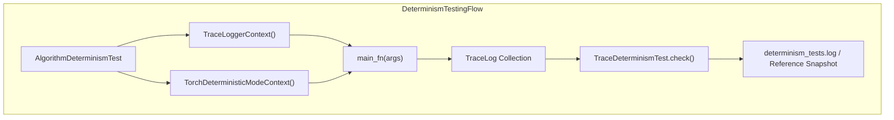

<!-- source: DeepWiki mcp.deepwiki.com · repo thu-ml/tianshou · page 9.2 Testing Framework · fetched 2026-10-30 -->

# Testing Framework

Relevant source files

The following files were used as context for generating this wiki page:

- [test/base/__init__.py](test/base/__init__.py)
- [test/base/test_action_space_sampling.py](test/base/test_action_space_sampling.py)
- [test/base/test_utils.py](test/base/test_utils.py)
- [test/continuous/__init__.py](test/continuous/__init__.py)
- [test/continuous/test_ddpg.py](test/continuous/test_ddpg.py)
- [test/continuous/test_ppo.py](test/continuous/test_ppo.py)
- [test/continuous/test_td3.py](test/continuous/test_td3.py)
- [test/determinism_test.py](test/determinism_test.py)
- [test/discrete/__init__.py](test/discrete/__init__.py)
- [test/discrete/test_dqn.py](test/discrete/test_dqn.py)
- [test/discrete/test_drqn.py](test/discrete/test_drqn.py)
- [tianshou/utils/__init__.py](tianshou/utils/__init__.py)
- [tianshou/utils/determinism.py](tianshou/utils/determinism.py)
- [tianshou/utils/torch_utils.py](tianshou/utils/torch_utils.py)
- [tianshou/utils/warning.py](tianshou/utils/warning.py)

This page documents the testing framework used in Tianshou v2, focusing on how tests are organized, structured, and implemented, with particular emphasis on algorithm regression tests and determinism testing utilities. For information about the build system, see [Build System and Tooling](#9.1), and for details on continuous integration, see [CI/CD Pipeline](#9.3).

## Test Suite Layout

Tianshou uses `pytest` as its testing framework to verify the correctness and performance of reinforcement learning algorithms and components [test/determinism_test.py:6](). Tests are structured into a directory hierarchy under `test/` based on action space types and core utility modules:

Sources: [test/continuous/test_ppo.py](), [test/discrete/test_dqn.py](), [test/base/test_utils.py](), [test/determinism_test.py]()

## Standard Algorithm Test Structure

Algorithm tests in Tianshou follow a declarative setup pattern where command-line arguments, environment vectors, networks, policies, and algorithms are initialized before executing training via `algorithm.run_training()` [test/discrete/test_dqn.py:154-170]().

```mermaid
flowchart TD
    subgraph "AlgorithmTestExecution"
        get_args["get_args()"] --> test_func["test_algorithm(args)"]
        
        subgraph "Environment Setup"
            test_func --> gym_make["gym.make(args.task)"]
            gym_make --> vec_envs["DummyVectorEnv / VectorReplayBuffer"]
        end
        
        subgraph "Policy and Algorithm"
            vec_envs --> net_setup["Net / ActorCritic / Optimizer"]
            net_setup --> policy_init["DiscreteQLearningPolicy / PPO / DDPG"]
            policy_init --> algo_init["Algorithm Initialization"]
        end
        
        subgraph "Execution and Verification"
            algo_init --> run_training["algorithm.run_training(OffPolicyTrainerParams)"]
            run_training --> assert_check["assert stop_fn(result.best_reward)"]
        end
    end
```

Sources: [test/continuous/test_ppo.py:63-130](), [test/discrete/test_dqn.py:62-170](), [test/continuous/test_ddpg.py:55-147]()

## Algorithm Regression and Determinism Testing

To ensure that refactoring or modifications do not inadvertently alter numerical or behavioral trajectories, Tianshou provides specialized determinism testing utilities in `test/determinism_test.py` and `tianshou/utils/determinism.py`.

### Determinism Testing Architecture

The determinism framework records execution traces via `TraceLoggerContext` and evaluates them against reference snapshots using `AlgorithmDeterminismTest` [test/determinism_test.py:26-123]().

Sources: [test/determinism_test.py:26-123](), [tianshou/utils/determinism.py:112-187]()

### Key Classes and Utilities

- `AlgorithmDeterminismTest`: Wraps algorithm test execution for snapshot comparison. It overrides epochs, steps, and device settings to ensure fast, CPU-safe comparisons [test/determinism_test.py:26-100]().
- `TorchDeterministicModeContext`: A context manager that sets PyTorch into deterministic debug mode via `torch.set_deterministic_debug_mode()` during test execution [test/determinism_test.py:12-24]().
- `TraceLoggerContext`: Enables behavioral trace logging and captures execution logs into a memory buffer (`StringIO`) for verification [tianshou/utils/determinism.py:188-198]().

Sources: [test/determinism_test.py:12-123](), [tianshou/utils/determinism.py:188-198]()

## Test Utilities and PyTorch Helpers

Tianshou includes supporting utilities designed for testing environment sampling, training/evaluation states, and metric tracking [test/base/test_utils.py](), [tianshou/utils/torch_utils.py]().

- `torch_train_mode`: A context manager that temporarily switches an `nn.Module`'s training flag, impacting modules like `BatchNorm` [tianshou/utils/torch_utils.py:15-22]().
- `policy_within_training_step`: Manages the `is_within_training_step` flag on policies, letting algorithms distinguish between online rollouts and gradient update steps [tianshou/utils/torch_utils.py:26-45]().
- `create_uniform_action_dist`: Generates uniform action distributions matching continuous (`Box`) or discrete (`Discrete`) action spaces for testing [tianshou/utils/torch_utils.py:58-77]().

Sources: [tianshou/utils/torch_utils.py:15-77](), [test/base/test_utils.py:114-128]()

## Best Practices for Writing Tests

1. **Deterministic Seeds**: Always fix random seeds across `numpy`, `torch`, and vector environments [test/continuous/test_ppo.py:83-86]().
2. **Lightweight Configurations**: Keep determinism and regression test parameters small (e.g., `epoch=3`, `epoch_num_steps=100`) to maintain fast CI execution [test/determinism_test.py:91-96]().
3. **Assertion Thresholds**: Utilize `stop_fn` assertions against algorithm result objects (`result.best_reward`) to verify convergence thresholds [test/discrete/test_dqn.py:172-173]().

Sources: [test/continuous/test_ppo.py:24-60](), [test/determinism_test.py:91-96](), [test/discrete/test_dqn.py:172-173]()

---

