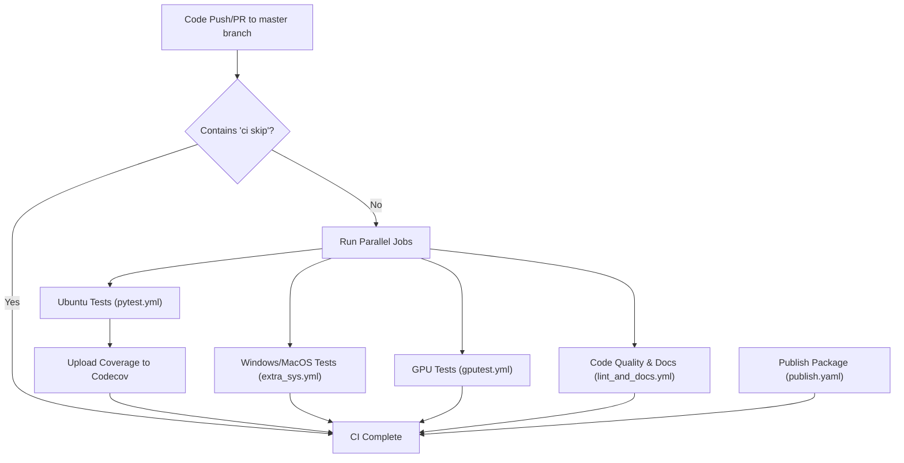
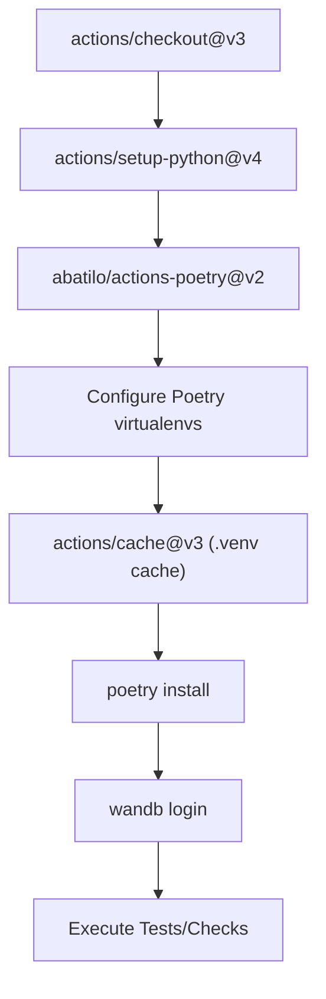
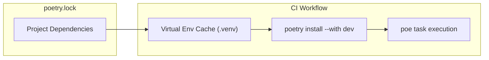

<!-- source: DeepWiki mcp.deepwiki.com · repo thu-ml/tianshou · page 9.3 CI/CD Pipeline · fetched 2026-10-30 -->

# CI/CD Pipeline

<details>
<summary>Relevant source files</summary>

The following files were used as context for generating this wiki page:

- [.github/ISSUE_TEMPLATE.md](.github/ISSUE_TEMPLATE.md)
- [.github/PULL_REQUEST_TEMPLATE.md](.github/PULL_REQUEST_TEMPLATE.md)
- [.github/workflows/extra_sys.yml](.github/workflows/extra_sys.yml)
- [.github/workflows/gputest.yml](.github/workflows/gputest.yml)
- [.github/workflows/lint_and_docs.yml](.github/workflows/lint_and_docs.yml)
- [.github/workflows/publish.yaml](.github/workflows/publish.yaml)
- [.github/workflows/pytest.yml](.github/workflows/pytest.yml)
- [CONTRIBUTING.md](CONTRIBUTING.md)

</details>


## Purpose and Scope

This document details the Continuous Integration and Continuous Deployment (CI/CD) pipeline used in the Tianshou reinforcement learning framework. It explains how automated testing, code quality checking, and documentation building are implemented across GitHub Actions workflows (`pytest.yml`, `extra_sys.yml`, `gputest.yml`, `lint_and_docs.yml`, `publish.yaml`), alongside pull request and issue templates. For information about the testing framework itself, see [Testing Framework](#9.2).

Sources: [.github/workflows/pytest.yml:1-109](), [.github/workflows/extra_sys.yml:1-57](), [.github/workflows/gputest.yml:1-55](), [.github/workflows/lint_and_docs.yml:1-57](), [.github/workflows/publish.yaml:1-28]()

## Pipeline Overview

Tianshou employs GitHub Actions to implement its CI/CD pipeline. The pipeline automatically runs tests and quality checks whenever code changes are pushed or pull requests are created. This ensures all contributions maintain the project's quality standards.



**Title: CI/CD Workflow Overview**

Sources: [.github/workflows/pytest.yml:3-9](), [.github/workflows/extra_sys.yml:3-9](), [.github/workflows/gputest.yml:3-9](), [.github/workflows/lint_and_docs.yml:3-9](), [.github/workflows/publish.yaml:3-6]()

## CI/CD Components

The pipeline consists of five main workflows, each defined in a separate YAML file:

| Workflow | File | Purpose |
|----------|------|---------|
| Ubuntu Tests | `pytest.yml` | Main test suite on Ubuntu across pinned and latest Python versions with coverage reporting |
| Windows/MacOS Tests | `extra_sys.yml` | Cross-platform compatibility testing running a reduced test suite |
| GPU Tests | `gputest.yml` | Tests requiring hardware GPU acceleration on self-hosted runners |
| Code Quality & Docs | `lint_and_docs.yml` | Linting, type checking, and documentation building via `poe` tasks |
| Publish Package | `publish.yaml` | Automated publishing to PyPI upon GitHub release creation |

All CI workflows are triggered on pull requests to the master branch, pushes to the master branch, and manual workflow dispatches. They can be bypassed by including `ci skip` in the commit message. The publishing workflow triggers specifically on release creation (`types: [created]`).

Sources: [.github/workflows/pytest.yml:3-16](), [.github/workflows/extra_sys.yml:3-16](), [.github/workflows/gputest.yml:3-16](), [.github/workflows/lint_and_docs.yml:3-16](), [.github/workflows/publish.yaml:3-6]()

## Workflow Details

### Common Setup Pattern

All workflows follow a similar setup pattern leveraging Poetry and caching:



**Title: Common Workflow Setup Process**

Sources: [.github/workflows/pytest.yml:50-93](), [.github/workflows/extra_sys.yml:33-55](), [.github/workflows/gputest.yml:30-52](), [.github/workflows/lint_and_docs.yml:29-48]()

### Ubuntu Tests (Main Workflow)

The main test workflow (`pytest.yml`) runs on Ubuntu using a matrix strategy covering two environments:
- `py_pinned`: Uses Python 3.11 with the stable `poetry.lock` file (`use_lock: true`), installing project extras `"envpool eval"` [.github/workflows/pytest.yml:33-35](). Runs `poetry run poe test` [.github/workflows/pytest.yml:97]() and uploads coverage XML to Codecov [.github/workflows/pytest.yml:101-109]().
- `py_latest`: Uses the latest Python version (3.13) without the lock file (`use_lock: false`), testing against upstream package versions by installing extras `"eval"` [.github/workflows/pytest.yml:36-38](). Runs `poetry run poe test-nocov` [.github/workflows/pytest.yml:99]().

Sources: [.github/workflows/pytest.yml:25-109]()

### Windows/MacOS Tests

This workflow (`extra_sys.yml`) ensures cross-platform compatibility by running on both `macos-latest` and `windows-latest` with Python 3.11 [.github/workflows/extra_sys.yml:18-24](). It executes a reduced test suite (`poetry run poe test-reduced`) to accommodate platform-specific limitations [.github/workflows/extra_sys.yml:57](). It also includes fallback execution for poetry installation issues [.github/workflows/extra_sys.yml:53]().

Sources: [.github/workflows/extra_sys.yml:18-57]()

### GPU Tests

The GPU test workflow (`gputest.yml`) runs on self-hosted Linux X64 runners with GPU capabilities [.github/workflows/gputest.yml:19-20](). It installs the project with the `"envpool"` extra and executes the full test suite via `poetry run poe test` [.github/workflows/gputest.yml:48-55]().

Sources: [.github/workflows/gputest.yml:18-55]()

### Code Quality and Documentation

The quality workflow (`lint_and_docs.yml`) enforces code style, type annotations, and documentation builds on Ubuntu with Python 3.11 [.github/workflows/lint_and_docs.yml:19-33](). It executes:
- Formatting/linting checks: `poetry run poe lint` [.github/workflows/lint_and_docs.yml:50]()
- Type checking: `poetry run poe type-check` [.github/workflows/lint_and_docs.yml:52]()
- Documentation building: `MYSTNB_DEBUG=1 poetry run poe doc-build` [.github/workflows/lint_and_docs.yml:54]()

Sources: [.github/workflows/lint_and_docs.yml:18-57]()

### Package Publication

The publishing workflow (`publish.yaml`) builds and publishes Tianshou to PyPI when a GitHub release is created [.github/workflows/publish.yaml:1-28](). It sets up Python 3.11, configures Poetry, and invokes `poetry publish --build` using the `POETRY_PYPI_TOKEN_PYPI` secret [.github/workflows/publish.yaml:12-28]().

Sources: [.github/workflows/publish.yaml:1-28]()

## Dependency Management and Poe Tasks

Tianshou uses Poetry for dependency management and Poe-the-Poet task runner scripts defined in `pyproject.toml`.



**Title: Poetry Dependency Management and Poe Tasks**

Sources: [.github/workflows/pytest.yml:69-84](), [.github/workflows/lint_and_docs.yml:41-54]()

Summary of Poe tasks executed across workflows:

| Poe Command | Purpose | Used In |
|-------------|---------|---------|
| `poetry run poe test` | Run full test suite with coverage | Ubuntu (`py_pinned`) & GPU workflows |
| `poetry run poe test-nocov` | Run test suite without coverage | Ubuntu (`py_latest`) workflow |
| `poetry run poe test-reduced` | Run reduced test suite | Windows/MacOS workflow |
| `poetry run poe lint` | Run style and linting checks | Lint & Docs workflow |
| `poetry run poe type-check` | Perform static type analysis (MyPy) | Lint & Docs workflow |
| `poetry run poe doc-build` | Build documentation (Sphinx/MyST-NB) | Lint & Docs workflow |

Sources: [.github/workflows/pytest.yml:97-99](), [.github/workflows/extra_sys.yml:57](), [.github/workflows/gputest.yml:55](), [.github/workflows/lint_and_docs.yml:50-54]()

## Pull Request and Issue Templates

To maintain consistency and catch issues prior to CI execution, Tianshou provides standardized templates for pull requests and bug reports.

### Pull Request Template (`.github/PULL_REQUEST_TEMPLATE.md`)
Contributors must verify checklist items before merging:
- Label assignment and issue linking [.github/PULL_REQUEST_TEMPLATE.md:1]()
- Change description and documentation / `CHANGELOG.md` updates [.github/PULL_REQUEST_TEMPLATE.md:3]()
- Test coverage additions and determinism verification (`poe test` without altering training determinism) [.github/PULL_REQUEST_TEMPLATE.md:4-5]()
- Code reformatting (`poe format`) and style/type validation (`poe lint`, `poe type-check`) [.github/PULL_REQUEST_TEMPLATE.md:6-7]()

Sources: [.github/PULL_REQUEST_TEMPLATE.md:1-10]()

### Issue Template (`.github/ISSUE_TEMPLATE.md`)
Bug reports and feature requests require categorizing the issue type (exception-raising bug, RL algorithm bug, documentation request, feature request, design request) [.github/PULL_REQUEST_TEMPLATE.md:1-6](), searching existing issues [.github/PULL_REQUEST_TEMPLATE.md:8](), and providing runtime environment details:
```python
import tianshou, gymnasium as gym, torch, numpy, sys
print(tianshou.__version__, gym.__version__, torch.__version__, numpy.__version__, sys.version, sys.platform)
```
Sources: [.github/ISSUE_TEMPLATE.md:1-13]()

## Debugging Support

All workflows support interactive debugging via GitHub Actions' `workflow_dispatch` trigger with `debug_enabled` boolean inputs configured for `mxschmitt/action-tmate@v3` [.github/workflows/pytest.yml:10-16](), [.github/workflows/pytest.yml:41-43](). This enables maintainers to inspect runners interactively via SSH when troubleshooting failed CI runs.

Sources: [.github/workflows/pytest.yml:10-16](), [.github/workflows/pytest.yml:41-43](), [.github/workflows/extra_sys.yml:10-16](), [.github/workflows/gputest.yml:10-16](), [.github/workflows/lint_and_docs.yml:10-16]()

Sources: [.github/workflows/pytest.yml](), [.github/workflows/extra_sys.yml](), [.github/workflows/gputest.yml](), [.github/workflows/lint_and_docs.yml](), [.github/workflows/publish.yaml](), [.github/PULL_REQUEST_TEMPLATE.md](), [.github/ISSUE_TEMPLATE.md]()

---

