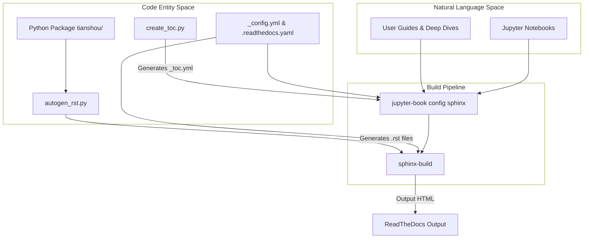
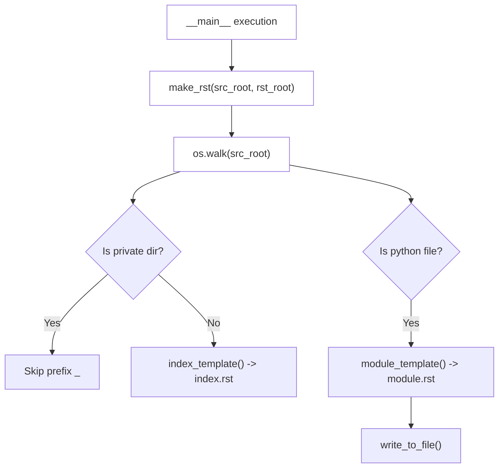

<!-- source: DeepWiki mcp.deepwiki.com · repo thu-ml/tianshou · page 9.4 Documentation System · fetched 2026-10-30 -->

# Documentation System

Relevant source files

The following files were used as context for generating this wiki page:

- [.readthedocs.yaml](.readthedocs.yaml)
- [docs/.gitignore](docs/.gitignore)
- [docs/01_user_guide/00_training_process.md](docs/01_user_guide/00_training_process.md)
- [docs/01_user_guide/01_apis.md](docs/01_user_guide/01_apis.md)
- [docs/01_user_guide/02_core_abstractions.md](docs/01_user_guide/02_core_abstractions.md)
- [docs/01_user_guide/index.rst](docs/01_user_guide/index.rst)
- [docs/02_deep_dives/0_intro.md](docs/02_deep_dives/0_intro.md)
- [docs/02_deep_dives/L1_Batch.ipynb](docs/02_deep_dives/L1_Batch.ipynb)
- [docs/_config.yml](docs/_config.yml)
- [docs/_static/css/style.css](docs/_static/css/style.css)
- [docs/_static/images/tianshou-favicon.png](docs/_static/images/tianshou-favicon.png)
- [docs/_static/images/tianshou-logo.png](docs/_static/images/tianshou-logo.png)
- [docs/_static/js/copybutton.js](docs/_static/js/copybutton.js)
- [docs/_static/js/v5.json](docs/_static/js/v5.json)
- [docs/_static/js/vega-embed@5.js](docs/_static/js/vega-embed@5.js)
- [docs/_static/js/vega-lite@5.js](docs/_static/js/vega-lite@5.js)
- [docs/_static/js/vega@5.js](docs/_static/js/vega@5.js)
- [docs/autogen_rst.py](docs/autogen_rst.py)
- [docs/create_toc.py](docs/create_toc.py)
- [docs/nbstripout.py](docs/nbstripout.py)
- [poetry.lock](poetry.lock)
- [pyproject.toml](pyproject.toml)

## Purpose and Scope
This page details Tianshou's documentation system, powered by **Jupyter Book** and **Sphinx**. It covers the automated generation of API reference documentation via `autogen_rst.py`, dynamic Table of Contents creation via `create_toc.py`, notebook cleaning through `nbstripout`, ReadTheDocs configuration (`.readthedocs.yaml`), book configuration (`_config.yml`), and static site assets (CSS styles and custom JavaScript widgets).

---

## 1. Overview and Architecture of the Documentation Pipeline
Tianshou's documentation bridges rich interactive notebooks, Markdown user guides, and automatically generated API references into a unified website hosted on ReadTheDocs. The build pipeline relies on Poetry development dependencies [pyproject.toml:91-130]() which include `jupyter-book`, `sphinx`, and associated extensions.

The following diagram illustrates the transformation flow from source code and markdown guides into the final HTML documentation, linking human-readable concepts to underlying Python and configuration entities.

Sources: `pyproject.toml:91-130](), [.readthedocs.yaml:1-23](), [docs/_config.yml:1-129]()`

---

## 2. Automatic API Reference Generation (`autogen_rst.py`)
To ensure documentation stays synchronized with the codebase, Tianshou utilizes the script `docs/autogen_rst.py` to recursively inspect the `tianshou/` package and generate Sphinx-compatible ReStructuredText (`.rst`) files.

### Key Functions and Classes
- `module_template(module_qualname: str)`: Generates the Sphinx `automodule` directive string for a given Python module [docs/autogen_rst.py:9-18]().
- `index_template(package_name: str, doc_references: list[str] | None, text_prefix: str)`: Creates package index pages containing `:doc:` cross-references [docs/autogen_rst.py:21-30]().
- `write_to_file(content: str, path: str)`: Handles safe directory creation and file writing with appropriate permissions [docs/autogen_rst.py:33-38]().
- `make_rst(src_root, rst_root, clean, overwrite, package_prefix)`: Traverses the source directory tree, skipping private files/directories prefixed with `_`, and produces `.rst` stub files [docs/autogen_rst.py:48-144]().

The generation workflow mapping is detailed below:

Sources: `[docs/autogen_rst.py:9-153]()`

---

## 3. Table of Contents Generation (`create_toc.py`)
The `docs/create_toc.py` script automatically constructs the navigation hierarchy (`_toc.yml`) required by Jupyter Book. It inspects the organizational structure of the documentation source directory, ensuring all Markdown guides, notebooks, and generated API modules appear in the sidebar navigation without requiring manual maintenance of the table of contents.

Sources: `[docs/_config.yml:16-18](), [docs/.gitignore:3]()`

---

## 4. Notebook Cleaning (`nbstripout` & `nbstripout.py`)
To prevent large binary cell outputs, execution counts, and transient execution artifacts from bloating version control history, Tianshou enforces notebook cleaning. 
- The project integrates `nbstripout` as a development dependency and pre-commit hook [pyproject.toml:101-105]().
- A custom utility script `docs/nbstripout.py` strips cell outputs prior to commits or documentation builds.

Sources: `[pyproject.toml:101-105]()`

---

## 5. Build Configuration and ReadTheDocs (`.readthedocs.yaml` & `_config.yml`)

### ReadTheDocs Configuration (`.readthedocs.yaml`)
ReadTheDocs executes a strict sequence of shell commands to provision the environment and compile the book [ .readthedocs.yaml:1-24]():
1. Selects Ubuntu 22.04 with Python 3.11 [ .readthedocs.yaml:10-12]().
2. Installs Poetry via official install scripts [ .readthedocs.yaml:15]() and installs dependencies including developer groups and evaluation extras: `poetry install --with dev -E eval` [ .readthedocs.yaml:17]().
3. Invokes API generation (`autogen_rst.py`) and TOC creation (`create_toc.py`) [ .readthedocs.yaml:19-21]().
4. Configures and builds the Sphinx book:
   - `poetry run jupyter-book config sphinx docs/` [ .readthedocs.yaml:22]()
   - `poetry run sphinx-build -W -b html docs $READTHEDOCS_OUTPUT/html` [ .readthedocs.yaml:23]()

### Jupyter Book Configuration (`_config.yml`)
The `docs/_config.yml` file controls book metadata, parsing extensions, and Sphinx overrides [docs/_config.yml:1-156](). Key configurations include:
- **Exclusions**: Skips build caches, checkpoints, and generation scripts [docs/_config.yml:16-18]().
- **MyST Parser Extensions**: Enables `amsmath`, `colon_fence`, `dollarmath`, `html_admonition`, `linkify`, `substitution`, and `tasklist` [docs/_config.yml:34-46]().
- **Sphinx Advanced Settings**: Configures autodoc member ordering (`bysource`), typehints formatting (`short`), signature options, and mock imports for optional dependencies like `cv2` [docs/_config.yml:95-129]().

Sources: `[.readthedocs.yaml:1-23](), [docs/_config.yml:1-156]()`

---

## 6. Static Assets and Theme Customization
Custom styling and interactive elements are injected into the Sphinx documentation build via static files located in `docs/_static/`:
- **Custom Styling (`docs/_static/css/style.css`)**: Overrides default ReadTheDocs / Sphinx Book Theme styles, adjusting font families (`Lato`), content container widths, and literal color accents (`#4692BC`) [docs/_static/css/style.css:1-146]().
- **Copy Button Widget (`docs/_static/js/copybutton.js`)**: Enhances code blocks by prepending a `[>>>]` interaction button that strips python interactive prompt indicators (`>>>` and `...`) to simplify code copying [docs/_static/js/copybutton.js:1-63]().

Sources: `[docs/_static/css/style.css:1-146](), [docs/_static/js/copybutton.js:1-63]()`

---

