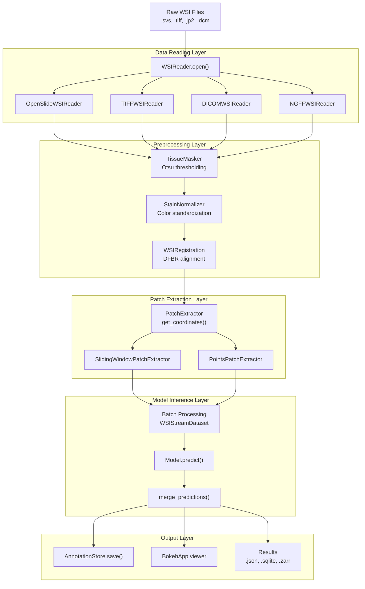
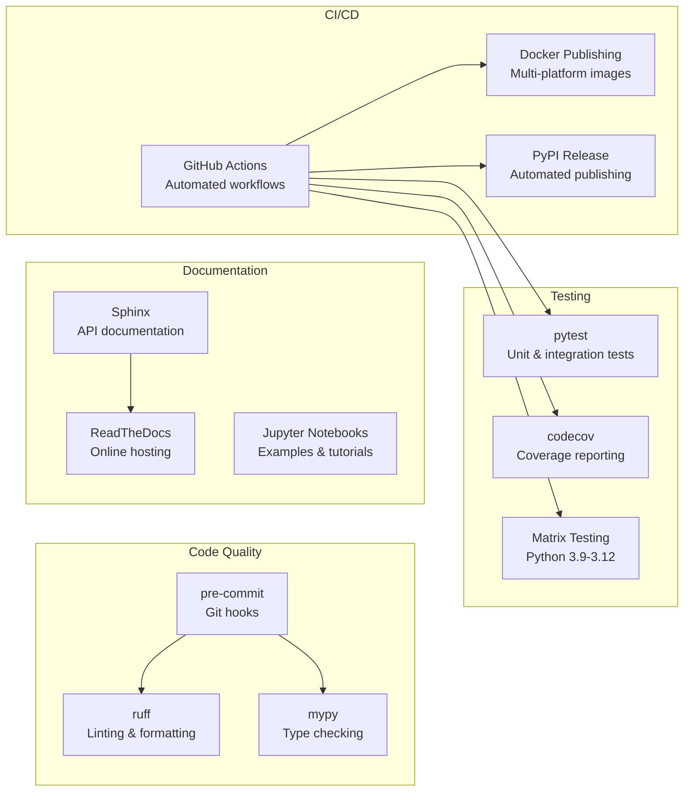

<!-- source: DeepWiki mcp.deepwiki.com · repo TissueImageAnalytics/tiatoolbox · page 1 Overview · fetched 2026-10-21 -->

# Overview

Relevant source files

The following files were used as context for generating this wiki page:

- [.github/workflows/conda-env-create.yml](.github/workflows/conda-env-create.yml)
- [.github/workflows/docker-publish.yml](.github/workflows/docker-publish.yml)
- [AUTHORS.md](AUTHORS.md)
- [CITATION.cff](CITATION.cff)
- [HISTORY.md](HISTORY.md)
- [README.md](README.md)
- [docs/conf.py](docs/conf.py)
- [docs/installation.rst](docs/installation.rst)
- [setup.py](setup.py)
- [tiatoolbox/__init__.py](tiatoolbox/__init__.py)

This document provides a comprehensive overview of TIAToolbox, a computational pathology toolkit developed by the TIA Centre. TIAToolbox is designed as an end-to-end solution for analyzing whole slide images (WSIs) and implementing state-of-the-art algorithms in digital pathology.

For specific installation procedures, see [Installation and Setup](#1.1). For fundamental concepts about WSIs and data processing, see [Core Concepts](#1.2). For detailed information about individual systems, refer to the specialized sections covering [Data Systems](#2), [Image Processing Pipeline](#3), [Model and Inference Systems](#4), and [Advanced Tools](#5).

## System Architecture

TIAToolbox is structured as a modular toolkit with several interconnected systems that work together to provide comprehensive pathology image analysis capabilities. The toolkit is built on PyTorch and follows best practices for scientific computing and machine learning workflows.

### High-Level Architecture

```mermaid
graph TB
    subgraph "Data Layer"
        WSIReader["WSIReader<br/>Multi-format support"]
        AnnotationStore["AnnotationStore<br/>SQLiteStore, DictionaryStore"]
    end
    
    subgraph "Processing Layer"
        PatchExtractor["PatchExtractor<br/>SlidingWindowPatchExtractor"]
        StainNormalizer["StainNormalizer<br/>Reinhard, Vahadane, Macenko"]
        TissueMasker["TissueMasker<br/>Otsu, Morphological"]
        WSIRegistration["WSIRegistration<br/>DFBR, B-spline"]
    end
    
    subgraph "Inference Layer"
        PatchPredictor["PatchPredictor<br/>Classification models"]
        SemanticSegmentor["SemanticSegmentor<br/>Pixel-wise segmentation"]
        NucleusInstanceSegmentor["NucleusInstanceSegmentor<br/>HoVer-Net, instance detection"]
        MultiTaskSegmentor["MultiTaskSegmentor<br/>Combined outputs"]
    end
    
    subgraph "Model Layer"
        PretrainedModels["Pretrained Models<br/>HoVer-Net, IDaRS, UNI"]
        TimmBackbone["TimmBackbone<br/>Foundation models"]
        CNNArchitectures["CNN Architectures<br/>ResNet, UNet, SCCNN"]
    end
    
    subgraph "Interface Layer"
        CLI["CLI Interface<br/>tiatoolbox command"]
        BokehApp["Bokeh Visualization<br/>Web-based viewer"]
        PythonAPI["Python API<br/>High-level imports"]
    end
    
    WSIReader --> PatchExtractor
    AnnotationStore --> PatchExtractor
    PatchExtractor --> PatchPredictor
    PatchExtractor --> SemanticSegmentor
    TissueMasker --> PatchExtractor
    StainNormalizer --> PatchExtractor
    
    PretrainedModels --> PatchPredictor
    PretrainedModels --> SemanticSegmentor
    PretrainedModels --> NucleusInstanceSegmentor
    TimmBackbone --> PatchPredictor
    CNNArchitectures --> PretrainedModels
    
    CLI --> PatchPredictor
    CLI --> SemanticSegmentor
    BokehApp --> WSIReader
    PythonAPI --> WSIReader
```

Sources: [tiatoolbox/__init__.py:1-135](), [setup.py:34-68](), [README.md:46-49]()

## Core Components

TIAToolbox is organized into several key modules, each providing specific functionality for pathology image analysis:

### Data Handling Systems

| Component | Primary Classes | Purpose |
|-----------|----------------|---------|
| **WSI Reading** | `WSIReader`, `OpenSlideWSIReader`, `TIFFWSIReader` | Read various whole slide image formats |
| **Annotation Management** | `AnnotationStore`, `SQLiteStore`, `DictionaryStore` | Store and query spatial annotations |
| **Data Loading** | `WSIStreamDataset`, `PatchDataset` | Efficient data loading for ML workflows |

### Image Processing Pipeline

| Component | Primary Classes | Purpose |
|-----------|----------------|---------|
| **Patch Extraction** | `PatchExtractor`, `SlidingWindowPatchExtractor` | Extract patches from WSIs |
| **Stain Processing** | `StainNormalizer`, `ReinhardNormalizer`, `VahadaneNormalizer` | Color normalization and augmentation |
| **Tissue Analysis** | `TissueMasker`, `MorphologyAnalyzer` | Identify tissue regions |
| **Registration** | `DFBRRegistration`, `WSIRegistration` | Align multiple WSIs |

### Model and Inference Systems

| Component | Primary Classes | Purpose |
|-----------|----------------|---------|
| **Inference Engines** | `PatchPredictor`, `SemanticSegmentor`, `NucleusInstanceSegmentor` | Run ML models on WSI data |
| **Model Architectures** | `HoVerNet`, `HoVerNetPlus`, `SCCNN`, `MapDe` | Deep learning model implementations |
| **Foundation Models** | `TimmBackbone`, `DeepFeatureExtractor` | Modern foundation model support |

Sources: [tiatoolbox/__init__.py:17-19](), [setup.py:61](), [HISTORY.md:7-18]()

## Data Processing Flow

The following diagram illustrates the typical data processing pipeline in TIAToolbox, showing how raw WSI files flow through various processing stages to produce analysis results:

### WSI Processing Pipeline

Sources: [tiatoolbox/__init__.py:101-110](), [setup.py:48](), [HISTORY.md:14-15]()

## Installation and Distribution

TIAToolbox is distributed through multiple channels to accommodate different user preferences and environments:

### Distribution Channels

| Method | Command | Platform Support |
|--------|---------|------------------|
| **PyPI** | `pip install tiatoolbox` | Cross-platform |
| **Conda-forge** | `conda install -c conda-forge tiatoolbox` | Linux, macOS, Windows* |
| **Docker** | `docker pull ghcr.io/tissueimageanalytics/tiatoolbox` | Containerized |
| **Source** | `git clone https://github.com/TissueImageAnalytics/tiatoolbox.git` | Development |

*Limited Windows support for conda-forge due to OpenSlide dependencies

### Python Version Support

TIAToolbox supports Python versions 3.9 through 3.12, with Python 3.8 support deprecated as of version 1.6.0. The toolkit requires several system dependencies including OpenSlide binaries and OpenJPEG.

Sources: [setup.py:37-46](), [docs/installation.rst:58](), [HISTORY.md:16-17]()

## Development Infrastructure

TIAToolbox follows modern software development practices with comprehensive testing, documentation, and continuous integration:

### Quality Assurance Pipeline

### Command Line Interface

TIAToolbox provides a comprehensive CLI through the `tiatoolbox` command, enabling batch processing and automation workflows. The CLI supports various operations including stain normalization, patch extraction, and model inference.

Sources: [setup.py:50-53](), [.github/workflows/docker-publish.yml:1-69](), [.github/workflows/conda-env-create.yml:1-51](), [HISTORY.md:50-61]()

## Research Foundation

TIAToolbox is developed by the TIA Centre at the University of Warwick and has been published in Communications Medicine. The toolkit incorporates state-of-the-art algorithms from the computational pathology research community and provides a standardized platform for reproducible research.

The toolkit's development is driven by the needs of computational, biomedical, and clinical researchers working in digital pathology. It provides both high-level interfaces for common tasks and low-level access for advanced users implementing custom algorithms.

Sources: [README.md:135-153](), [CITATION.cff:1-101](), [AUTHORS.md:1-30]()

---

