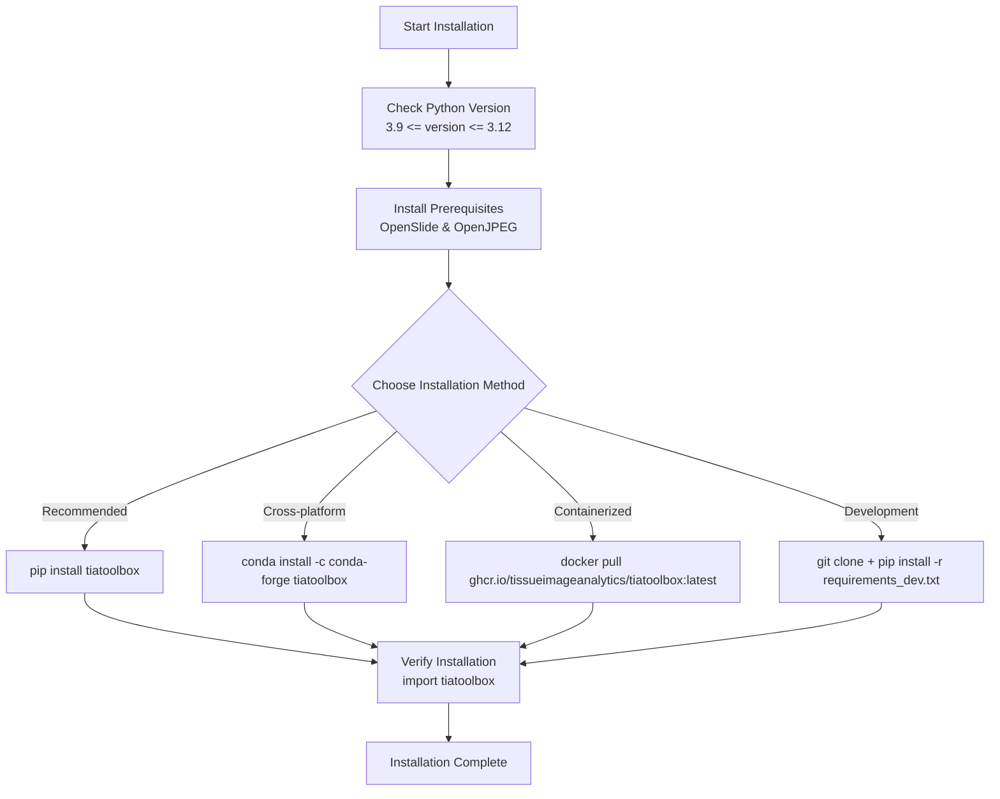
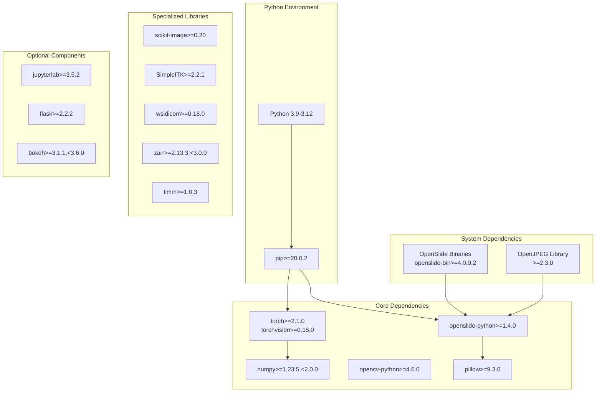
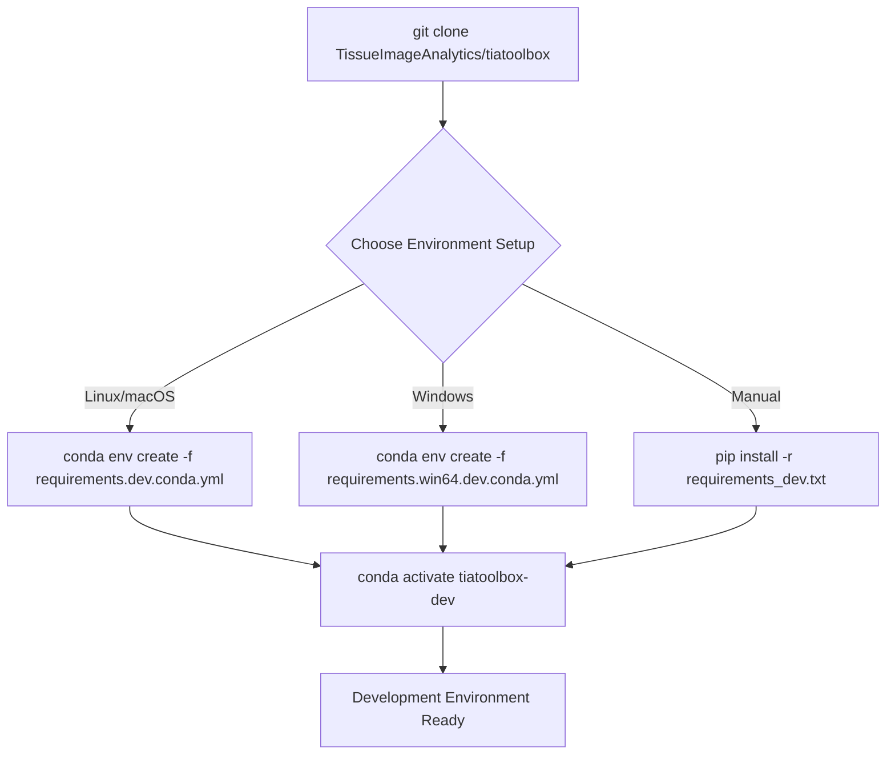
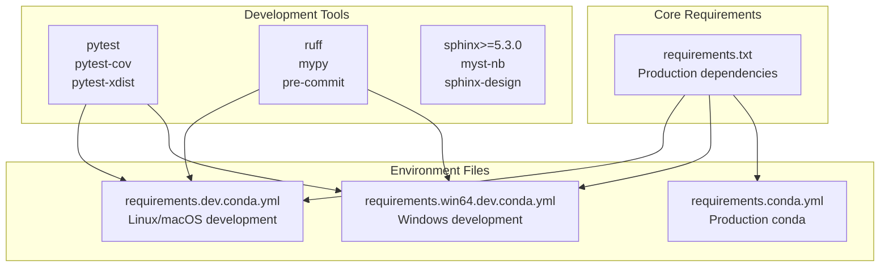

<!-- source: DeepWiki mcp.deepwiki.com · repo TissueImageAnalytics/tiatoolbox · page 1.1 Installation and Setup · fetched 2026-10-21 -->

# Installation and Setup

<details>
<summary>Relevant source files</summary>

The following files were used as context for generating this wiki page:

- [.github/workflows/pip-install.yml](.github/workflows/pip-install.yml)
- [README.md](README.md)
- [docs/conf.py](docs/conf.py)
- [docs/installation.rst](docs/installation.rst)
- [docs/requirements.txt](docs/requirements.txt)
- [requirements/requirements.conda.yml](requirements/requirements.conda.yml)
- [requirements/requirements.dev.conda.yml](requirements/requirements.dev.conda.yml)
- [requirements/requirements.txt](requirements/requirements.txt)
- [requirements/requirements.win64.conda.yml](requirements/requirements.win64.conda.yml)
- [requirements/requirements.win64.dev.conda.yml](requirements/requirements.win64.dev.conda.yml)

</details>


This document provides comprehensive instructions for installing TIAToolbox across different platforms and environments. It covers prerequisite software installation, multiple installation methods, platform-specific considerations, and development environment setup.

For information about core concepts and architectural overview, see [Core Concepts](#1.2). For development and contributing guidelines, see [Contributing Guidelines](#8.1).

## Installation Overview

TIAToolbox supports Python versions 3.9 through 3.12 and runs on Linux, Windows, and macOS. The installation process involves two main phases: installing prerequisite system libraries and installing the TIAToolbox package itself.

### Installation Flow



**Sources:** [README.md:72-127](), [docs/installation.rst:1-199]()

### Dependency Architecture



**Sources:** [requirements/requirements.txt:1-40](), [requirements/requirements.conda.yml:7-15]()

## Prerequisites

### System Library Requirements

TIAToolbox requires OpenSlide binaries and OpenJPEG version 2.3.0 or higher for reading whole slide images in various formats.

#### Linux (Ubuntu/Debian)

```bash
sudo apt-get update
sudo apt-get install -y libopenjp2-7-dev libopenjp2-tools
```

#### Windows

Use conda to install OpenJPEG:

```cmd
conda install -c conda-forge openjpeg
```

For complete Windows support, consider using WSL2 with CUDA support for better performance.

#### macOS

**Using Homebrew:**
```bash
brew install openjpeg
```

**Using MacPorts:**
```bash
port install openjpeg
```

**Sources:** [docs/installation.rst:9-54](), [.github/workflows/pip-install.yml:24-46]()

### Python Environment

TIAToolbox supports Python versions 3.9, 3.10, 3.11, and 3.12. Verify your Python version:

```bash
python --version
```

**Sources:** [docs/installation.rst:58](), [.github/workflows/pip-install.yml:17]()

## Installation Methods

### Method 1: pip (Recommended)

The simplest installation method using the Python Package Index:

```bash
# Fresh installation
pip install tiatoolbox

# Upgrade existing installation
pip install --ignore-installed --upgrade tiatoolbox

# Install without dependencies (if already installed separately)
pip install --no-deps tiatoolbox
```

This method installs from PyPI and includes all required dependencies automatically.

**Sources:** [README.md:74-75](), [docs/installation.rst:63-88]()

### Method 2: Conda/Mamba

For cross-platform package management with automatic dependency resolution:

```bash
# Using conda
conda install -c conda-forge tiatoolbox

# Using mamba (faster alternative)
mamba install tiatoolbox
```

**Note:** Windows conda-forge support is limited due to OpenSlide binary availability. Consider WSL2 for Windows installations.

**Sources:** [docs/installation.rst:97-112](), [README.md:117-119]()

### Method 3: Docker

For isolated, containerized environments:

```bash
# Pull pre-built image
docker pull ghcr.io/tissueimageanalytics/tiatoolbox:latest

# Run container
docker run -it --rm ghcr.io/tissueimageanalytics/tiatoolbox:latest

# Use as base image in Dockerfile
FROM ghcr.io/tissueimageanalytics/tiatoolbox:latest
```

**Sources:** [docs/installation.rst:140-199]()

### Method 4: From Source (Development)

For development or latest features:

```bash
# Clone repository
git clone https://github.com/TissueImageAnalytics/tiatoolbox.git
cd tiatoolbox

# Install in development mode
python setup.py install
```

**Sources:** [README.md:94-104](), [docs/installation.rst:114-138]()

## Development Environment Setup

### Environment Configuration



### Creating Development Environment

**Option 1: Using Conda Environment Files**

```bash
# For Linux/macOS
conda env create -f requirements/requirements.dev.conda.yml
conda activate tiatoolbox-dev

# For Windows
conda env create -f requirements/requirements.win64.dev.conda.yml
conda activate tiatoolbox-dev
```

**Option 2: Manual Setup**

```bash
# Create new environment
conda create -n tiatoolbox-dev python=3.9
conda activate tiatoolbox-dev

# Install development dependencies
pip install -r requirements/requirements_dev.txt
```

**Sources:** [README.md:105-124](), [requirements/requirements.dev.conda.yml:1-15](), [requirements/requirements.win64.dev.conda.yml:1-15]()

### Development Dependencies Structure



**Sources:** [requirements/requirements_dev.txt](), [requirements/requirements.dev.conda.yml:1-15]()

## Platform-Specific Considerations

### Linux Installations

Linux installations typically work smoothly with minimal configuration. The CI/CD pipeline tests on `ubuntu-24.04`:

```bash
# Prerequisites
sudo apt update
sudo apt-get install -y libopenjp2-7 libopenjp2-tools

# Install TIAToolbox
pip install tiatoolbox
```

**Sources:** [.github/workflows/pip-install.yml:25-29]()

### Windows Installations

Windows requires special handling for OpenSlide and OpenJPEG:

1. **Conda Method (Recommended):**
   ```cmd
   conda install -c conda-forge openjpeg
   conda install -c conda-forge tiatoolbox
   ```

2. **WSL2 Method (Performance):**
   - Install Windows Subsystem for Linux 2
   - Follow Linux installation instructions within WSL2
   - Optionally enable CUDA support for GPU acceleration

**Sources:** [docs/installation.rst:112](), [.github/workflows/pip-install.yml:36-50]()

### macOS Installations

macOS supports both Homebrew and MacPorts package managers:

```bash
# Install OpenJPEG
brew install openjpeg  # or: port install openjpeg

# Install TIAToolbox
pip install tiatoolbox
```

**Sources:** [docs/installation.rst:33-53](), [.github/workflows/pip-install.yml:30-34]()

## Verification and Testing

### Basic Import Test

```python
import tiatoolbox
print(tiatoolbox.__version__)

import openslide
print(openslide.__version__)

import torch
print(torch.__version__)
```

### Component Verification

```python
# Test core modules
from tiatoolbox.wsicore.wsireader import WSIReader
from tiatoolbox.models.engine.semantic_segmentor import SemanticSegmentor
from tiatoolbox.tools.patchextraction import PatchExtractor

# Test CLI availability
import subprocess
result = subprocess.run(['tiatoolbox', '--help'], capture_output=True, text=True)
print("CLI available:", result.returncode == 0)
```

**Sources:** [.github/workflows/pip-install.yml:64-72]()

### Installation Validation Matrix

| Platform | Python Version | Installation Method | Status |
|----------|----------------|-------------------|---------|
| Ubuntu 24.04 | 3.9, 3.10, 3.11, 3.12 | pip, conda | ✅ Full Support |
| Windows Latest | 3.9, 3.10, 3.11, 3.12 | pip, conda* | ⚠️ Limited conda-forge |
| macOS Latest | 3.9, 3.10, 3.11, 3.12 | pip, conda | ✅ Full Support |

*Windows conda installations require OpenJPEG from conda-forge or WSL2 setup.

**Sources:** [.github/workflows/pip-install.yml:14-18](), [docs/installation.rst:112]()

## Troubleshooting Common Issues

### OpenSlide Import Errors

If you encounter OpenSlide import errors, ensure prerequisites are correctly installed:

```python
# Test OpenSlide availability
try:
    import openslide
    print("OpenSlide version:", openslide.__version__)
except ImportError as e:
    print("OpenSlide not found:", str(e))
```

### Dependency Conflicts

For environments with existing packages, use isolated installation:

```bash
# Create clean environment
conda create -n tiatoolbox-clean python=3.9
conda activate tiatoolbox-clean
pip install tiatoolbox
```

### Memory and Performance

For large WSI processing, consider:
- Using Docker with memory limits
- WSL2 on Windows for better performance
- GPU acceleration where available

**Sources:** [docs/installation.rst:112](), [README.md:61]()

---

