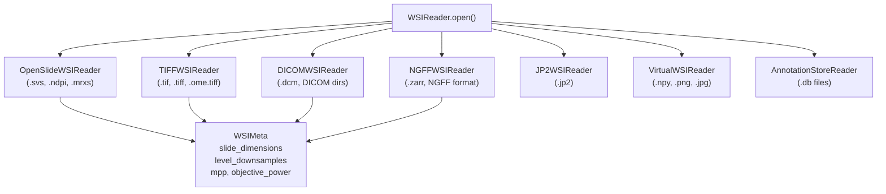
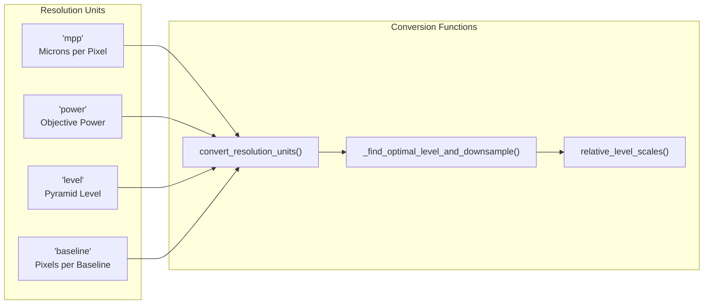
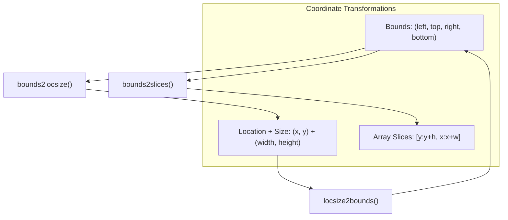
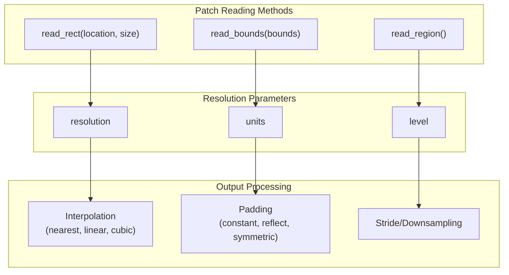
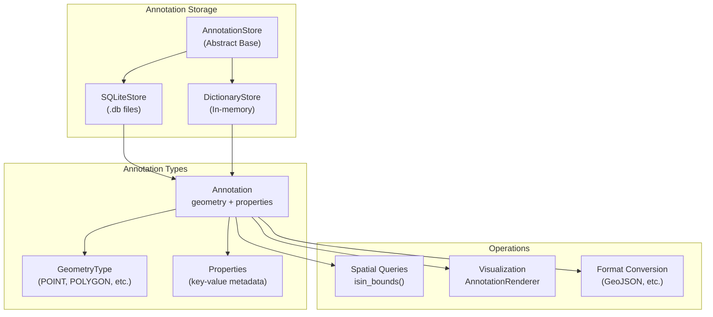
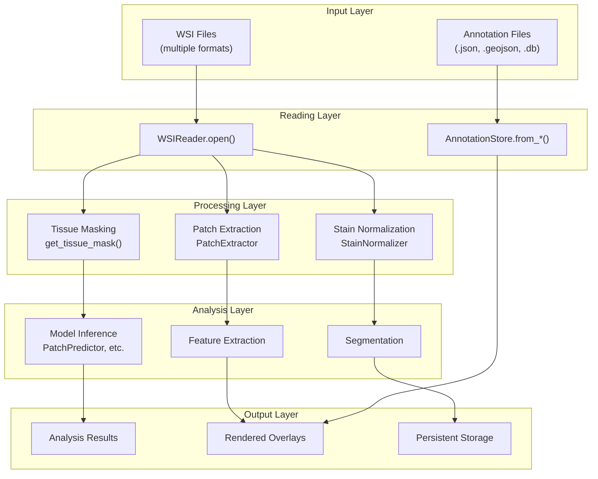

<!-- source: DeepWiki mcp.deepwiki.com · repo TissueImageAnalytics/tiatoolbox · page 1.2 Core Concepts · fetched 2026-10-21 -->

# Core Concepts

<details>
<summary>Relevant source files</summary>

The following files were used as context for generating this wiki page:

- [tests/test_utils.py](tests/test_utils.py)
- [tests/test_wsireader.py](tests/test_wsireader.py)
- [tiatoolbox/utils/image.py](tiatoolbox/utils/image.py)
- [tiatoolbox/utils/misc.py](tiatoolbox/utils/misc.py)
- [tiatoolbox/utils/transforms.py](tiatoolbox/utils/transforms.py)
- [tiatoolbox/wsicore/wsireader.py](tiatoolbox/wsicore/wsireader.py)
- [whitelist.txt](whitelist.txt)

</details>


This page introduces the fundamental concepts that underlie TIAToolbox's computational pathology system. It covers the core data structures, coordinate systems, and processing paradigms that form the foundation for all analysis workflows.

For specific implementation details about data systems, see [Data Systems](#2). For information about processing pipelines, see [Image Processing Pipeline](#3). For model inference concepts, see [Model and Inference Systems](#4).

## Whole Slide Images (WSIs)

Whole Slide Images represent the primary data type in computational pathology - digitized microscopy slides that can contain gigapixel-resolution images with multiple resolution levels.

### WSI Formats and Readers

TIAToolbox supports multiple WSI formats through a unified `WSIReader` interface that automatically detects and handles different file types:



**WSI Format Detection and Factory Pattern**
TIAToolbox uses automatic format detection to instantiate the appropriate reader:

Sources: [tiatoolbox/wsicore/wsireader.py:324-415]()

### WSI Metadata and Properties

Every WSI contains essential metadata accessible through the `WSIMeta` class:

| Property | Description | Code Reference |
|----------|-------------|----------------|
| `slide_dimensions` | Width and height at baseline resolution | `WSIMeta.slide_dimensions` |
| `level_count` | Number of resolution levels | `WSIMeta.level_count` |
| `level_dimensions` | Dimensions at each level | `WSIMeta.level_dimensions` |
| `level_downsamples` | Downsample factors for each level | `WSIMeta.level_downsamples` |
| `mpp` | Microns per pixel | `WSIMeta.mpp` |
| `objective_power` | Microscope objective power | `WSIMeta.objective_power` |

Sources: [tiatoolbox/wsicore/wsireader.py:484-502](), [tiatoolbox/wsicore/wsimeta.py]()

## Resolution and Units System

TIAToolbox provides a flexible resolution system supporting multiple units for specifying magnification and scale:



### Resolution Conversion Examples

The system automatically converts between units and finds optimal read parameters:

- **MPP to Power**: `0.25 mpp ≈ 40x objective power`
- **Level to Scale**: `level=1` corresponds to specific downsample factor
- **Baseline Scale**: `0.5 baseline` means half the original resolution

Sources: [tiatoolbox/wsicore/wsireader.py:993-1033](), [tiatoolbox/utils/misc.py:279-388]()

## Coordinate Systems and Bounds

TIAToolbox uses consistent coordinate conventions across all operations:

### Coordinate Format
All spatial coordinates follow the **(left, top, right, bottom)** or **(start_x, start_y, end_x, end_y)** format, with origin at the top-left corner.



### Multi-Resolution Coordinate Handling

The system automatically handles coordinate transformations between different resolution levels:

Sources: [tiatoolbox/utils/transforms.py:259-334](), [tiatoolbox/wsicore/wsireader.py:590-671]()

## Patches and Regions

Patches represent rectangular regions extracted from WSIs at specific resolutions. TIAToolbox supports various patch extraction strategies:

### Patch Reading Operations



### Sub-Pixel Reading

TIAToolbox supports sub-pixel coordinate reads with interpolation:

```python
# Example: Reading at fractional coordinates
bounds = (10.5, 20.3, 50.7, 60.8)
region = wsi.read_bounds(bounds, resolution=0.5, units="mpp")
```

Sources: [tiatoolbox/utils/image.py:443-738](), [tiatoolbox/wsicore/wsireader.py:1034-1200]()

## Annotation System

The annotation system manages spatial annotations and metadata associated with WSIs:



### Annotation Storage Backends

- **SQLiteStore**: Persistent storage with spatial indexing for large datasets
- **DictionaryStore**: In-memory storage for temporary annotations
- **AnnotationStoreReader**: Treats annotation databases as readable image sources

Sources: [tiatoolbox/annotation/storage.py](), [tiatoolbox/wsicore/wsireader.py:417-453]()

## Data Processing Pipeline

The core data flow in TIAToolbox follows a standardized pipeline:



### Processing Paradigms

1. **Patch-Based Processing**: Extract and process small regions independently
2. **Streaming Processing**: Process large WSIs without loading entire images into memory
3. **Multi-Resolution Processing**: Leverage image pyramids for efficient analysis
4. **Annotation-Guided Processing**: Use spatial annotations to focus analysis

Sources: [tiatoolbox/wsicore/wsireader.py:1-100](), [tiatoolbox/utils/image.py:1-50](), [tiatoolbox/utils/transforms.py:1-50]()

## Memory and Performance Considerations

TIAToolbox is designed to handle large-scale WSI data efficiently:

### Lazy Loading and Streaming
- WSI readers use lazy loading - metadata is read immediately, pixel data on-demand
- Patch extraction supports streaming to process arbitrarily large images
- Memory usage is controlled through configurable patch sizes and batch processing

### Multi-Resolution Optimization
- Automatic selection of optimal resolution levels for reading
- Pyramid-aware algorithms that work at appropriate scales
- Resolution conversion with minimal interpolation artifacts

Sources: [tiatoolbox/wsicore/wsireader.py:530-588](), [tiatoolbox/utils/image.py:296-441]()

---

