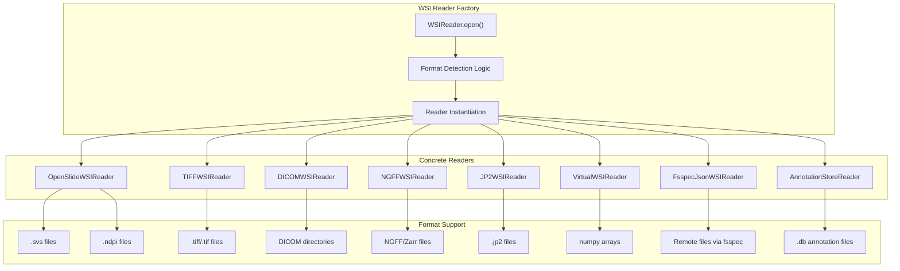
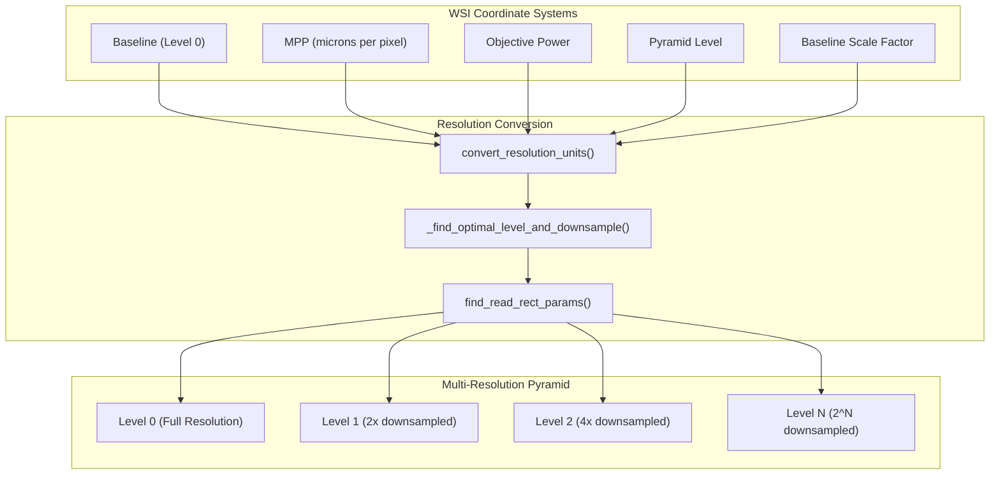
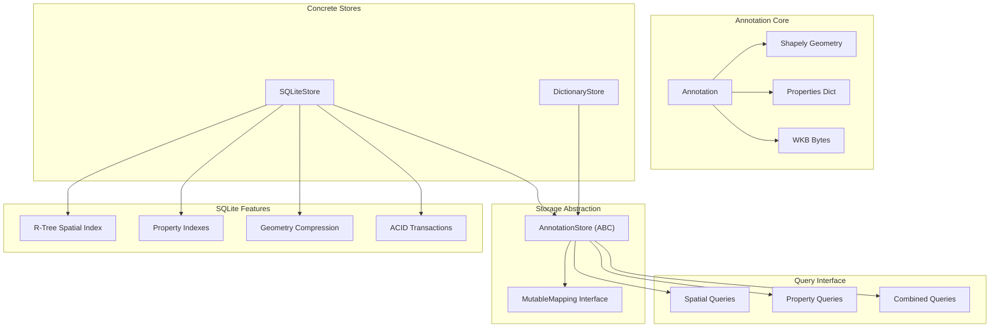
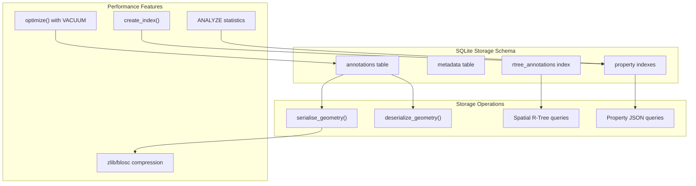
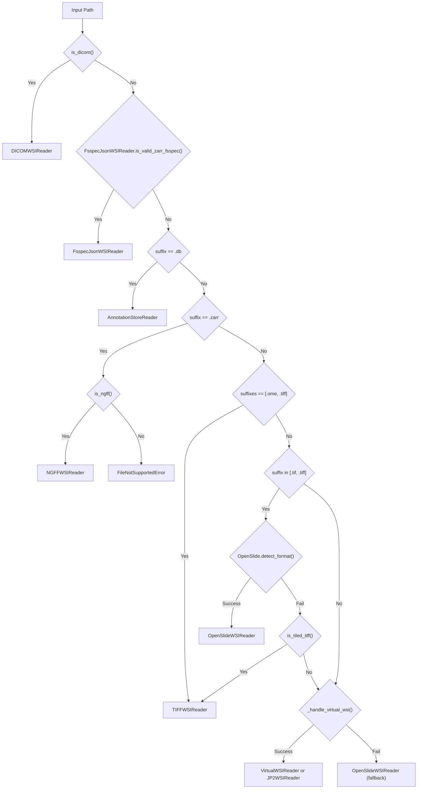
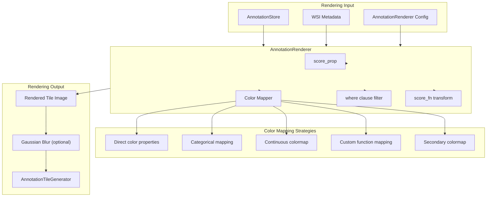

<!-- source: DeepWiki mcp.deepwiki.com · repo TissueImageAnalytics/tiatoolbox · page 2 Data Systems · fetched 2026-10-21 -->

# Data Systems

Relevant source files

The following files were used as context for generating this wiki page:

- [tests/test_annotation_stores.py](tests/test_annotation_stores.py)
- [tests/test_annotation_tilerendering.py](tests/test_annotation_tilerendering.py)
- [tests/test_visualization.py](tests/test_visualization.py)
- [tests/test_wsireader.py](tests/test_wsireader.py)
- [tiatoolbox/annotation/storage.py](tiatoolbox/annotation/storage.py)
- [tiatoolbox/utils/visualization.py](tiatoolbox/utils/visualization.py)
- [tiatoolbox/wsicore/wsireader.py](tiatoolbox/wsicore/wsireader.py)
- [whitelist.txt](whitelist.txt)

## Purpose and Scope

This document covers TIAToolbox's data handling systems for whole slide images (WSIs) and spatial annotations. The data systems provide unified interfaces for reading medical imaging data from various formats, managing spatial annotations with efficient storage and querying capabilities, and rendering annotations for visualization.

For information about image processing operations on this data, see [Image Processing Pipeline](#3). For machine learning inference using this data, see [Model and Inference Systems](#4).

## WSI Reading Architecture

The WSI reading system provides format-agnostic access to whole slide images through the `WSIReader` factory pattern. The system automatically detects file formats and instantiates appropriate readers, handling multi-resolution pyramids and coordinate system conversions.

### WSI Reader Factory and Format Detection

**WSI Reader Selection Logic**

Sources: [tiatoolbox/wsicore/wsireader.py:324-414]()

The `WSIReader.open()` method [tiatoolbox/wsicore/wsireader.py:324-414]() implements a cascading detection system:

| Format Check | Detection Method | Reader Class |
|--------------|------------------|--------------|
| DICOM | `is_dicom()` checks for `.dcm` files | `DICOMWSIReader` |
| NGFF | `is_ngff()` validates zarr metadata | `NGFFWSIReader` |
| OME-TIFF | Suffix pattern matching | `TIFFWSIReader` |
| OpenSlide | `OpenSlide.detect_format()` | `OpenSlideWSIReader` |
| Tiled TIFF | `is_tiled_tiff()` validation | `TIFFWSIReader` |
| Virtual formats | Extension-based routing | `VirtualWSIReader`/`JP2WSIReader` |

### Multi-Resolution and Coordinate Systems

Sources: [tiatoolbox/wsicore/wsireader.py:530-759](), [tiatoolbox/wsicore/wsireader.py:993-1034]()

The system supports multiple coordinate systems and automatically converts between them using `convert_resolution_units()` [tiatoolbox/wsicore/wsireader.py:993-1034](). The `_find_optimal_level_and_downsample()` method [tiatoolbox/wsicore/wsireader.py:530-588]() determines the most efficient resolution level to read from based on the requested output resolution.

## Annotation Storage and Management

The annotation system provides persistent storage and efficient spatial querying of geometric annotations through an abstract `AnnotationStore` interface with multiple concrete implementations.

### Annotation Storage Architecture

Sources: [tiatoolbox/annotation/storage.py:110-438](), [tiatoolbox/annotation/storage.py:443-460]()

### Annotation Data Model

The `Annotation` class [tiatoolbox/annotation/storage.py:110-438]() provides a unified representation:

| Component | Type | Purpose |
|-----------|------|---------|
| `geometry` | Shapely Geometry | Point, LineString, or Polygon |
| `properties` | Dict | Key-value metadata |
| `wkb` | bytes | Well-Known Binary serialization |

The class implements lazy geometry loading - Shapely objects are only created when first accessed, improving memory efficiency for large annotation sets.

### SQLite Storage Implementation

Sources: [tiatoolbox/annotation/storage.py:2025-2685]()

The `SQLiteStore` [tiatoolbox/annotation/storage.py:2025-2685]() provides enterprise-grade features:

- **Spatial Indexing**: R-Tree index for efficient geometric queries
- **Property Indexing**: Custom indexes on annotation properties for fast filtering
- **Compression**: Configurable geometry compression (zlib, blosc, or none)
- **ACID Compliance**: Full transaction support with rollback capabilities

## Data Format Support

TIAToolbox supports reading WSIs from multiple medical imaging formats through format-specific readers that handle the unique characteristics of each format.

### Supported WSI Formats

| Format | Extensions | Reader Class | Key Features |
|--------|-----------|--------------|--------------|
| Aperio SVS | `.svs` | `OpenSlideWSIReader` | Pyramid levels, associated images |
| Hamamatsu NDPI | `.ndpi` | `OpenSlideWSIReader` | Multi-focal planes, metadata |
| MIRAX | `.mrxs` | `OpenSlideWSIReader` | Hierarchical structure |
| Generic TIFF | `.tiff`, `.tif` | `TIFFWSIReader` | Tiled TIFF support |
| OME-TIFF | `.ome.tiff` | `TIFFWSIReader` | OME metadata, multi-channel |
| DICOM WSI | `.dcm`, directories | `DICOMWSIReader` | DICOM metadata, series |
| NGFF/Zarr | `.zarr` | `NGFFWSIReader` | Cloud-native, chunked storage |
| JPEG2000 | `.jp2` | `JP2WSIReader` | Wavelet compression |
| Virtual | `.npy`, `.png`, `.jpg` | `VirtualWSIReader` | In-memory arrays, single images |

Sources: [tiatoolbox/wsicore/wsireader.py:434-452]()

### Format Detection Logic

Sources: [tiatoolbox/wsicore/wsireader.py:375-414]()

## Visualization and Rendering

The visualization system renders spatial annotations onto image tiles through the `AnnotationRenderer` class, supporting various color mapping strategies and rendering optimizations.

### Annotation Rendering Pipeline

Sources: [tiatoolbox/utils/visualization.py:570-877]()

### Color Mapping Configuration

| Mapping Strategy | Configuration | Use Case |
|------------------|---------------|----------|
| Direct Color | `score_prop="color"` | Pre-defined RGBA values in properties |
| Categorical | `mapper=["cat1", "cat2", ...]` | Discrete categories with random colors |
| Continuous | `mapper="viridis"` | Numerical values with matplotlib colormap |
| Dictionary | `mapper={value: color, ...}` | Explicit value-to-color mapping |
| Function | `function_mapper=lambda props: color` | Custom color computation |

Sources: [tiatoolbox/utils/visualization.py:630-644](), [tiatoolbox/utils/visualization.py:693-770]()

The rendering system optimizes performance through:
- **Scale-based simplification**: Polygons rendered as bounding boxes at high zoom levels
- **Decimation strategies**: Selective rendering of annotations when zoomed out
- **Lazy tile generation**: On-demand rendering with caching
- **GPU acceleration**: OpenCV-based rendering operations

Sources: [tiatoolbox/utils/visualization.py:600-610](), [tiatoolbox/tools/pyramid.py]()

---

