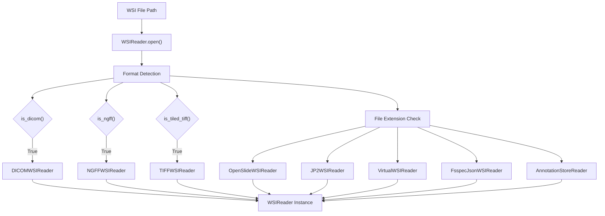
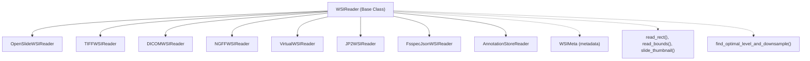
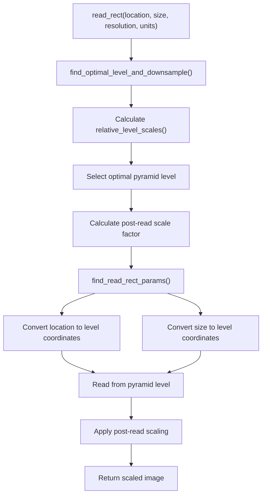

<!-- source: DeepWiki mcp.deepwiki.com · repo TissueImageAnalytics/tiatoolbox · page 2.1 WSI Reading and Formats · fetched 2026-10-21 -->

# WSI Reading and Formats

<details>
<summary>Relevant source files</summary>

The following files were used as context for generating this wiki page:

- [examples/01-wsi-reading.ipynb](examples/01-wsi-reading.ipynb)
- [examples/02-stain-normalization.ipynb](examples/02-stain-normalization.ipynb)
- [examples/03-tissue-masking.ipynb](examples/03-tissue-masking.ipynb)
- [examples/04-patch-extraction.ipynb](examples/04-patch-extraction.ipynb)
- [tests/test_wsireader.py](tests/test_wsireader.py)
- [tiatoolbox/wsicore/wsireader.py](tiatoolbox/wsicore/wsireader.py)
- [whitelist.txt](whitelist.txt)

</details>


This document covers TIAToolbox's whole slide image (WSI) reading capabilities, including supported formats, reader implementations, and core reading operations. The WSI reading system provides a unified interface for accessing pixel data from various proprietary and open formats used in digital pathology.

For information about patch extraction strategies, see [Patch Extraction](#3.1). For annotation management, see [Annotation Management](#2.2).

## Overview

TIAToolbox supports reading WSI files from multiple vendors and formats through a unified `WSIReader` interface. The system uses a factory pattern to automatically detect file formats and instantiate the appropriate reader implementation.

### Supported Formats

| Format | File Extensions | Reader Class | Notes |
|--------|----------------|--------------|-------|
| Aperio SVS | `.svs` | `OpenSlideWSIReader` | Via OpenSlide library |
| Hamamatsu NDPI | `.ndpi` | `OpenSlideWSIReader` | Via OpenSlide library |  
| 3DHistech MRXS | `.mrxs` | `OpenSlideWSIReader` | Via OpenSlide library |
| TIFF/BigTIFF | `.tif`, `.tiff` | `TIFFWSIReader` | Tiled TIFF support |
| OME-TIFF | `.ome.tiff`, `.ome.tif` | `TIFFWSIReader` | Bio-Formats standard |
| DICOM | `.dcm`, directories | `DICOMWSIReader` | Medical imaging standard |
| JPEG 2000 | `.jp2` | `JP2WSIReader` | Via Glymur library |
| NGFF/Zarr | `.zarr` | `NGFFWSIReader` | OME-NGFF v0.4 |
| SQLite Annotations | `.db` | `AnnotationStoreReader` | Annotation databases |
| Virtual formats | `.npy`, `.png`, `.jpg` | `VirtualWSIReader` | Single images as WSI |
| Fsspec JSON | `.json` | `FsspecJsonWSIReader` | Remote file access |

Sources: [tiatoolbox/wsicore/wsireader.py:434-448](), [tiatoolbox/wsicore/wsireader.py:254-262]()

## Architecture

### WSIReader Factory Pattern



Sources: [tiatoolbox/wsicore/wsireader.py:324-414](), [tiatoolbox/wsicore/wsireader.py:57-216]()

### Reader Class Hierarchy



Sources: [tiatoolbox/wsicore/wsireader.py:302-528]()

## Format Detection

The format detection process follows a priority hierarchy to determine the appropriate reader:

1. **Special Format Checks**: DICOM, NGFF/Zarr, Fsspec JSON
2. **Extension-Based Detection**: File suffix analysis  
3. **Content-Based Detection**: Tiled TIFF validation, OpenSlide compatibility
4. **Fallback**: OpenSlide as default reader

### Detection Functions

- `is_dicom(path)` - Detects DICOM files or directories [tiatoolbox/wsicore/wsireader.py:57-72]()
- `is_tiled_tiff(path)` - Validates tiled TIFF structure [tiatoolbox/wsicore/wsireader.py:75-92]()
- `is_zarr(path)` - Checks Zarr format compatibility [tiatoolbox/wsicore/wsireader.py:95-113]()
- `is_ngff(path)` - Validates NGFF v0.4 specification [tiatoolbox/wsicore/wsireader.py:116-215]()

Sources: [tiatoolbox/wsicore/wsireader.py:375-414]()

## Core Reading Operations

### Metadata Access

Every WSIReader instance provides standardized metadata through the `info` property:

```python
reader = WSIReader.open("slide.svs")
metadata = reader.info

# Access common properties
dimensions = metadata.slide_dimensions  # (width, height)
mpp = metadata.mpp  # microns per pixel
levels = metadata.level_count
objective_power = metadata.objective_power
```

Sources: [tiatoolbox/wsicore/wsireader.py:484-502]()

### Reading Methods

| Method | Purpose | Parameters |
|--------|---------|------------|
| `read_rect()` | Read rectangular region | location, size, resolution, units |
| `read_bounds()` | Read bounded region | bounds, resolution, units |
| `slide_thumbnail()` | Generate thumbnail | resolution, units |
| `slide_dimensions()` | Get slide size at resolution | resolution, units |

### Resolution Units

TIAToolbox supports multiple resolution unit systems:

- **`mpp`**: Microns per pixel (physical resolution)
- **`power`**: Objective power (e.g., 20x, 40x)
- **`level`**: Pyramid level (0 = highest resolution)
- **`baseline`**: Pixels per baseline pixel

```python
# Read at 0.5 microns per pixel
region = reader.read_rect((1000, 1000), (512, 512), resolution=0.5, units="mpp")

# Read at 20x objective power  
region = reader.read_rect((1000, 1000), (512, 512), resolution=20, units="power")

# Read at pyramid level 2
region = reader.read_rect((1000, 1000), (512, 512), resolution=2, units="level")
```

Sources: [tiatoolbox/wsicore/wsireader.py:590-671](), [tiatoolbox/wsicore/wsireader.py:993-1042]()

## Resolution Handling Workflow



Sources: [tiatoolbox/wsicore/wsireader.py:530-589](), [tiatoolbox/wsicore/wsireader.py:672-759]()

## Usage Examples

### Basic WSI Reading

```python
from tiatoolbox.wsicore.wsireader import WSIReader

# Open any supported format
reader = WSIReader.open("sample.svs")

# Get thumbnail
thumbnail = reader.slide_thumbnail(resolution=1.25, units="power")

# Read a patch at baseline resolution
patch = reader.read_rect(location=(1000, 1000), size=(512, 512), 
                        resolution=0, units="level")
```

### Multi-Resolution Reading

```python
# Read same region at different resolutions
for level in range(reader.info.level_count):
    patch = reader.read_rect((1000, 1000), (512, 512), 
                           resolution=level, units="level")
    print(f"Level {level}: {patch.shape}")
```

### Resolution Conversion

```python
# Convert between resolution units
mpp_resolution = reader.convert_resolution_units(
    input_res=20, input_unit="power", output_unit="mpp"
)
```

Sources: [examples/01-wsi-reading.ipynb:217-298](), [tests/test_wsireader.py:296-320]()

## Error Handling

The WSI reading system includes validation and error handling:

- **Format Validation**: `verify_supported_wsi()` checks file format support
- **Path Validation**: Ensures input files exist before processing  
- **Resolution Validation**: Warns when requested resolution exceeds baseline
- **Interpolation Warnings**: Alerts when upsampling will occur

Sources: [tiatoolbox/wsicore/wsireader.py:416-452](), [tiatoolbox/wsicore/wsireader.py:580-587]()

---

