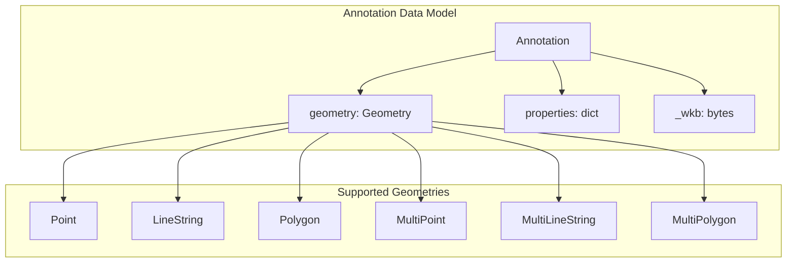
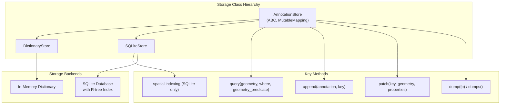
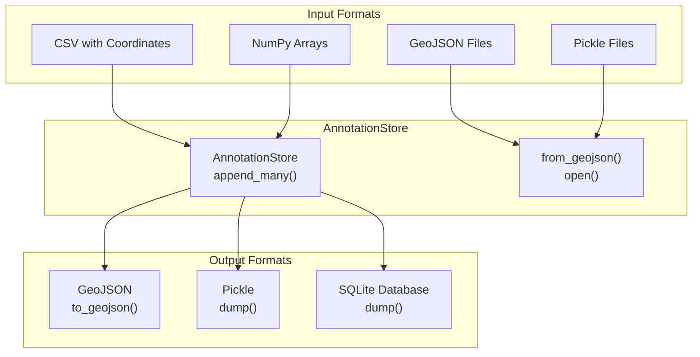
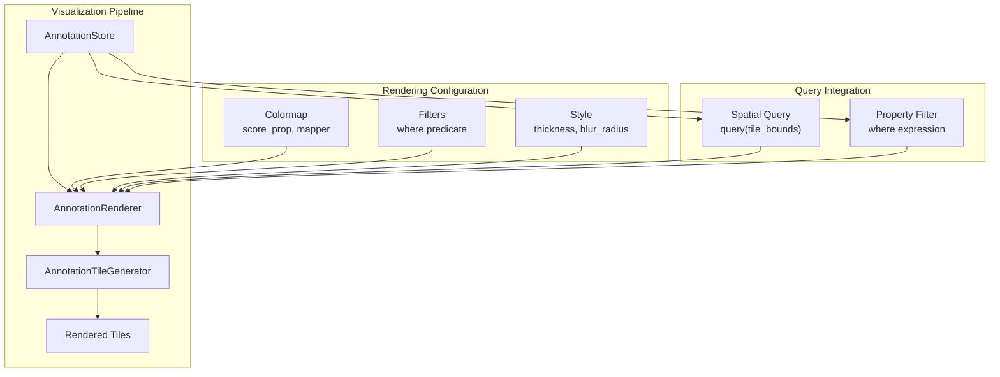

<!-- source: DeepWiki mcp.deepwiki.com · repo TissueImageAnalytics/tiatoolbox · page 2.2 Annotation Management · fetched 2026-10-21 -->

# Annotation Management

<details>
<summary>Relevant source files</summary>

The following files were used as context for generating this wiki page:

- [.github/workflows/python-package.yml](.github/workflows/python-package.yml)
- [.pre-commit-config.yaml](.pre-commit-config.yaml)
- [benchmarks/annotation_store.ipynb](benchmarks/annotation_store.ipynb)
- [benchmarks/annotation_store_alloc.py](benchmarks/annotation_store_alloc.py)
- [pyproject.toml](pyproject.toml)
- [requirements/requirements_dev.txt](requirements/requirements_dev.txt)
- [tests/test_annotation_stores.py](tests/test_annotation_stores.py)
- [tests/test_annotation_tilerendering.py](tests/test_annotation_tilerendering.py)
- [tests/test_visualization.py](tests/test_visualization.py)
- [tiatoolbox/annotation/storage.py](tiatoolbox/annotation/storage.py)
- [tiatoolbox/utils/env_detection.py](tiatoolbox/utils/env_detection.py)
- [tiatoolbox/utils/visualization.py](tiatoolbox/utils/visualization.py)

</details>


This document covers TIAToolbox's annotation management system, which provides storage, querying, and manipulation of spatial annotations with associated properties. The system handles geometric annotations (points, lines, polygons) and their metadata for whole slide image analysis workflows.

For information about reading and processing whole slide images themselves, see [WSI Reading and Formats](#2.1). For visualization of annotations, see [Visualization and Rendering](#5.3).

## Core Annotation Model

TIAToolbox represents annotations using the `Annotation` class, which combines a spatial geometry with associated properties. Each annotation consists of a Shapely geometry object and a dictionary of JSON-serializable properties.



**Sources:** [tiatoolbox/annotation/storage.py:110-280]()

The `Annotation` class provides lazy loading of geometries through Well-Known Binary (WKB) representation, enabling efficient memory usage when working with large numbers of annotations. Properties can store classification results, confidence scores, or any other metadata associated with the spatial region.

## Storage System Architecture

TIAToolbox provides two main storage implementations following the `MutableMapping` interface, allowing them to be used like Python dictionaries while providing specialized functionality for spatial data.



**Sources:** [tiatoolbox/annotation/storage.py:443-460](), [tiatoolbox/annotation/storage.py:1205-1450](), [tiatoolbox/annotation/storage.py:1451-2100]()

### DictionaryStore

The `DictionaryStore` provides a simple in-memory implementation suitable for smaller annotation collections. It stores all annotations in a Python dictionary and performs linear scans for queries.

| Feature | Implementation |
|---------|----------------|
| Storage | Python `dict` in memory |
| Querying | Linear scan with Python predicates |
| Persistence | Serialization to GeoJSON/pickle |
| Performance | O(n) queries, fast for small datasets |

### SQLiteStore

The `SQLiteStore` uses SQLite with spatial extensions for efficient storage and querying of large annotation collections. It provides spatial indexing through R-tree indexes and supports complex queries.

| Feature | Implementation |
|---------|----------------|
| Storage | SQLite database (memory or disk) |
| Spatial Index | R-tree index via `rtree` extension |
| Querying | SQL with spatial predicates |
| Compression | Optional zlib compression for geometries |
| Performance | O(log n) spatial queries |

**Sources:** [tiatoolbox/annotation/storage.py:1451-1500](), [tests/test_annotation_stores.py:575-600]()

## Querying and Filtering

Both storage implementations support rich querying capabilities combining spatial and property-based filters.

```mermaid
graph LR
    subgraph "Query Types"
        Spatial["Spatial Queries"]
        Property["Property Queries"]
        Combined["Combined Queries"]
    end
    
    subgraph "Spatial Predicates"
        Intersects["intersects"]
        Contains["contains"]
        Within["within"]
        Touches["touches"]
        BBox["bbox_intersects"]
    end
    
    subgraph "Property Filters"
        StringPred["String expressions:<br/>'props[\"class\"] == 1'"]
        CallablePred["Callable functions"]
        PickledPred["Pickled functions"]
    end
    
    Spatial --> Intersects
    Spatial --> Contains
    Spatial --> Within
    Spatial --> Touches
    Spatial --> BBox
    
    Property --> StringPred
    Property --> CallablePred
    Property --> PickledPred
    
    Combined --> Spatial
    Combined --> Property
```

**Sources:** [tiatoolbox/annotation/storage.py:1070-1100](), [tiatoolbox/annotation/storage.py:922-957]()

### Spatial Query Examples

```python
# Find annotations intersecting a region
results = store.query(Polygon.from_bounds(0, 0, 100, 100))

# Find annotations contained within a region  
results = store.query(
    Polygon.from_bounds(0, 0, 100, 100),
    geometry_predicate="contains"
)
```

### Property-Based Filtering

```python
# Filter by classification
results = store.query(where='props["class"] == "tumor"')

# Combine spatial and property filters
results = store.query(
    Polygon.from_bounds(0, 0, 100, 100),
    where='props["confidence"] > 0.8'
)
```

**Sources:** [tiatoolbox/annotation/storage.py:1070-1200]()

## Serialization and Data Interchange

The annotation storage system supports multiple serialization formats for data exchange and persistence.



**Sources:** [tiatoolbox/annotation/storage.py:2101-2200](), [tests/test_annotation_stores.py:800-900]()

### Format Support

| Format | Read | Write | Use Case |
|--------|------|-------|----------|
| GeoJSON | ✓ | ✓ | Interoperability with GIS tools |
| Pickle | ✓ | ✓ | Python-specific serialization |
| SQLite | ✓ | ✓ | Persistent database storage |
| WKT/WKB | ✓ | ✓ | Geometry interchange |

## Integration with Visualization

The annotation management system integrates with TIAToolbox's visualization components through the `AnnotationRenderer` class.



**Sources:** [tiatoolbox/utils/visualization.py:570-650](), [tiatoolbox/tools/pyramid.py:1-100]()

The `AnnotationRenderer` supports:
- **Color mapping** based on annotation properties
- **Filtering** using the same query syntax as storage
- **Multi-scale rendering** with different strategies for zoomed-out views
- **Style customization** including line thickness and blur effects

## Performance Characteristics

The choice between storage implementations depends on dataset size and access patterns:

| Dataset Size | Recommended Store | Rationale |
|--------------|------------------|-----------|
| < 1,000 annotations | `DictionaryStore` | Simple, fast for small datasets |
| 1,000 - 10,000 | Either | Depends on query patterns |
| > 10,000 annotations | `SQLiteStore` | Spatial indexing provides better performance |
| Complex spatial queries | `SQLiteStore` | R-tree index optimizes spatial operations |

**Sources:** [benchmarks/annotation_store.ipynb:145-158](), [tests/test_annotation_stores.py:575-600]()

For large datasets, `SQLiteStore` with spatial indexing can provide orders of magnitude better query performance compared to linear scanning approaches.

---

