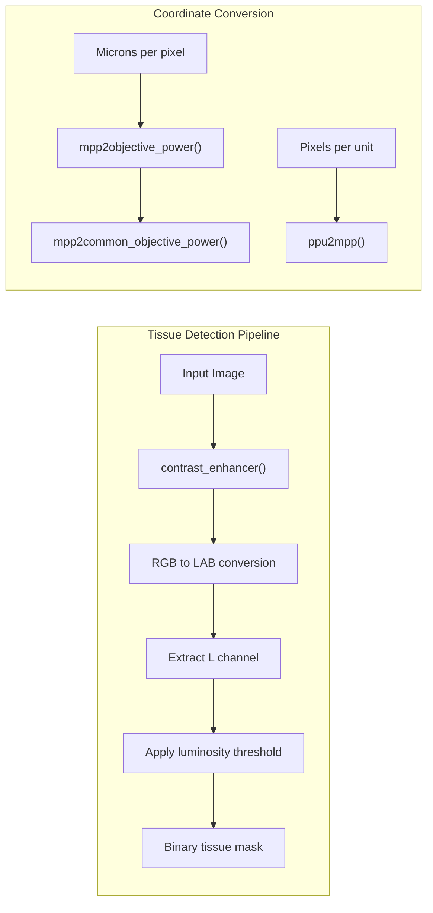
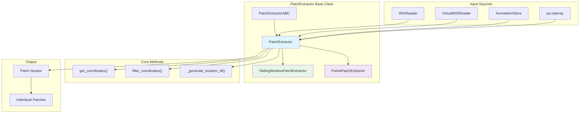
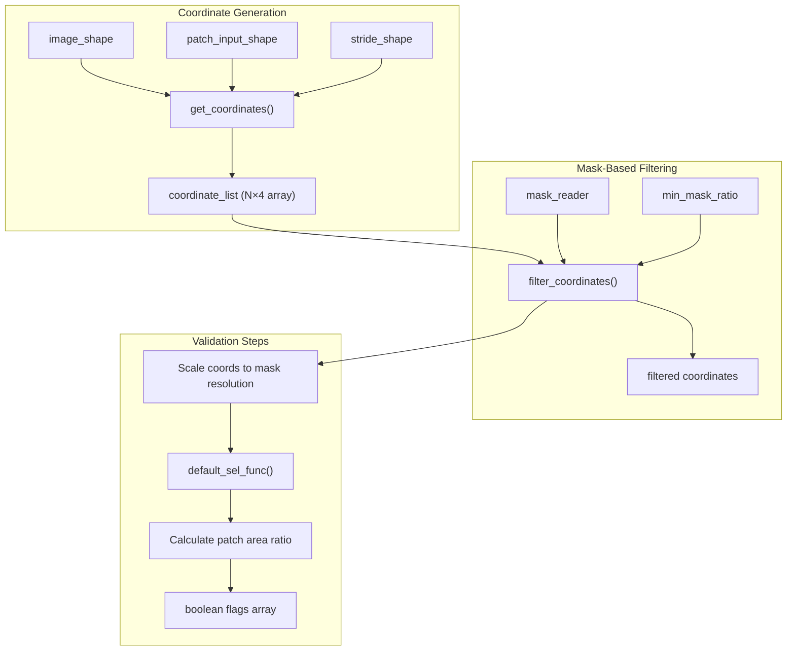
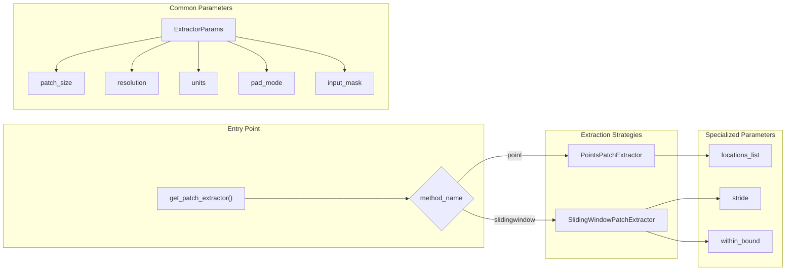
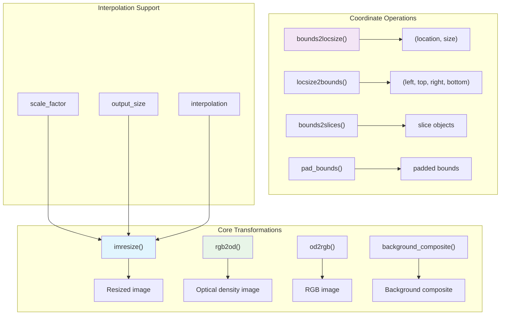
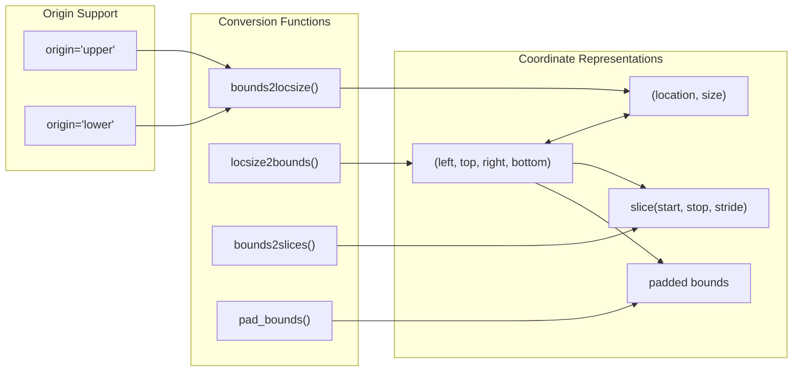
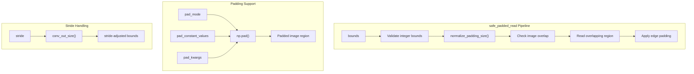
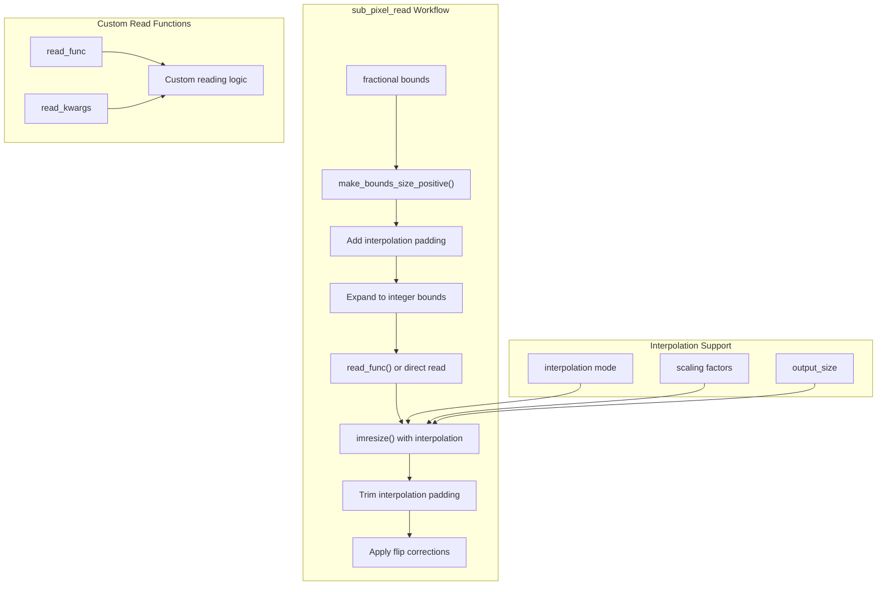
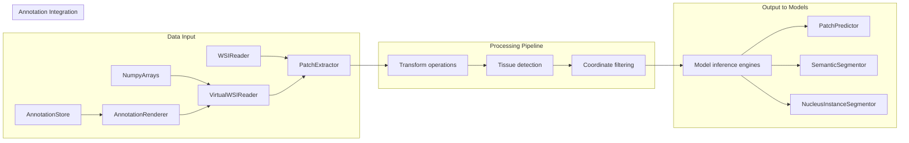
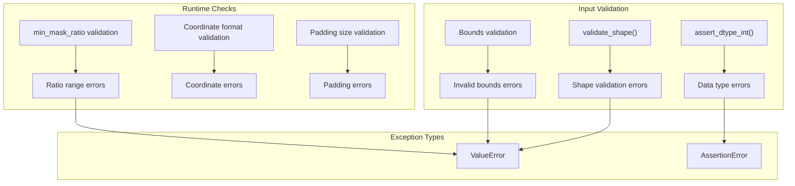

<!-- source: DeepWiki mcp.deepwiki.com · repo TissueImageAnalytics/tiatoolbox · page 3 Image Processing Pipeline · fetched 2026-10-21 -->

# Image Processing Pipeline

<details>
<summary>Relevant source files</summary>

The following files were used as context for generating this wiki page:

- [tests/test_patch_extraction.py](tests/test_patch_extraction.py)
- [tests/test_utils.py](tests/test_utils.py)
- [tiatoolbox/tools/patchextraction.py](tiatoolbox/tools/patchextraction.py)
- [tiatoolbox/utils/image.py](tiatoolbox/utils/image.py)
- [tiatoolbox/utils/misc.py](tiatoolbox/utils/misc.py)
- [tiatoolbox/utils/transforms.py](tiatoolbox/utils/transforms.py)

</details>


## Purpose and Scope

The Image Processing Pipeline provides a comprehensive suite of preprocessing and image analysis tools that operate on whole slide images (WSIs) and standard images. This system handles fundamental image operations including I/O, transformations, patch extraction, and coordinate management. It serves as the foundation for preparing image data before feeding it to machine learning models and analysis engines.

For information about reading WSI formats, see [WSI Reading and Formats](#2.1). For model inference operations that consume processed images, see [Prediction Engines](#4.1). For stain-specific processing techniques, see [Stain Processing](#3.2).

## Core Image Processing Utilities

The foundation of image processing is built around basic I/O operations, contrast enhancement, and tissue detection utilities in the `misc` module.

### Basic Image Operations

```mermaid
graph TB
    subgraph "Image I/O Operations"
        imread["imread()"]
        imwrite["imwrite()"]
        load_stain_matrix["load_stain_matrix()"]
    end
    
    subgraph "Image Enhancement"
        contrast_enhancer["contrast_enhancer()"]
        get_luminosity_tissue_mask["get_luminosity_tissue_mask()"]
    end
    
    subgraph "Coordinate Utilities"
        mpp2objective_power["mpp2objective_power()"]
        objective_power2mpp["objective_power2mpp()"]
        ppu2mpp["ppu2mpp()"]
    end
    
    subgraph "Data Loading"
        read_locations["read_locations()"]
        grab_files_from_dir["grab_files_from_dir()"]
    end
    
    imread --> "NumPy arrays"
    imwrite --> "Image files"
    contrast_enhancer --> "Enhanced images"
    get_luminosity_tissue_mask --> "Binary tissue masks"
    
    style imread fill:#e1f5fe
    style imwrite fill:#e8f5e8
    style contrast_enhancer fill:#f3e5f5
```

**Core Image Processing Functions**
The `misc` module provides essential image processing functions that handle basic I/O and preprocessing operations. The `imread` and `imwrite` functions support multiple formats including standard images and NumPy arrays, while `contrast_enhancer` applies percentile-based intensity adjustment for improved visualization.

Sources: [tiatoolbox/utils/misc.py:142-201](), [tiatoolbox/utils/misc.py:391-431](), [tiatoolbox/utils/misc.py:247-276]()

### Tissue Detection and Masking



**Tissue Masking Workflow**
The `get_luminosity_tissue_mask` function implements a luminosity-based approach to identify tissue regions. It first enhances contrast using percentile normalization, converts to LAB color space, and applies thresholding on the L channel to separate tissue from background.

Sources: [tiatoolbox/utils/misc.py:247-276](), [tiatoolbox/utils/misc.py:391-431](), [tiatoolbox/utils/misc.py:279-331]()

## Patch Extraction System

The patch extraction system provides two main strategies for extracting regions from images: sliding window extraction and point-based extraction. Both approaches support mask-based filtering and various padding modes.

### Patch Extraction Architecture



**Patch Extraction Hierarchy**
The patch extraction system is built around an abstract base class `PatchExtractorABC` with concrete implementations for different extraction strategies. The base `PatchExtractor` class provides common functionality for coordinate generation, mask filtering, and WSI integration.

Sources: [tiatoolbox/tools/patchextraction.py:97-200](), [tiatoolbox/tools/patchextraction.py:612-712](), [tiatoolbox/tools/patchextraction.py:714-785]()

### Coordinate Generation and Filtering



**Coordinate Processing Pipeline**
The `get_coordinates` method generates patch locations using a sliding window approach with configurable stride and boundary handling. The `filter_coordinates` method then validates these coordinates against a tissue mask, rejecting patches with insufficient tissue content based on the `min_mask_ratio` parameter.

Sources: [tiatoolbox/tools/patchextraction.py:483-609](), [tiatoolbox/tools/patchextraction.py:354-457](), [tiatoolbox/tools/patchextraction.py:436-453]()

### Factory Pattern and Extraction Methods



**Factory Pattern Implementation**
The `get_patch_extractor` function serves as a factory that instantiates the appropriate extractor class based on the specified method. It uses TypedDict classes (`ExtractorParams`, `PointsPatchExtractorParams`, `SlidingWindowPatchExtractorParams`) to define parameter interfaces for type safety.

Sources: [tiatoolbox/tools/patchextraction.py:35-96](), [tiatoolbox/tools/patchextraction.py:58-73](), [tiatoolbox/tools/patchextraction.py:75-95]()

## Image Transformations and Coordinate Management

The transforms module provides essential image manipulation and coordinate conversion utilities that support the broader image processing pipeline.

### Image Transformation Operations



**Transformation Pipeline**
The `imresize` function supports multiple interpolation modes and automatic dtype conversion to maintain numerical precision. The optical density conversion functions (`rgb2od`, `od2rgb`) enable stain separation workflows by converting between RGB and OD color spaces.

Sources: [tiatoolbox/utils/transforms.py:94-207](), [tiatoolbox/utils/transforms.py:209-257](), [tiatoolbox/utils/transforms.py:259-421]()

### Coordinate System Management



**Coordinate Conversion System**
The coordinate management system provides bidirectional conversion between different representations. The `bounds2locsize` function supports both upper and lower origin conventions, while `bounds2slices` enables direct indexing into NumPy arrays with optional stride support.

Sources: [tiatoolbox/utils/transforms.py:259-305](), [tiatoolbox/utils/transforms.py:307-334](), [tiatoolbox/utils/transforms.py:336-380](), [tiatoolbox/utils/transforms.py:382-421]()

## Advanced Image Reading Operations

The image module provides sophisticated reading capabilities that handle edge cases, sub-pixel coordinates, and various padding modes.

### Safe Padded Reading



**Safe Reading Implementation**
The `safe_padded_read` function handles reading from image regions that may extend beyond image boundaries. It normalizes padding specifications, calculates overlapping regions, and applies appropriate padding using NumPy's padding modes.

Sources: [tiatoolbox/utils/image.py:296-441](), [tiatoolbox/utils/image.py:32-72](), [tiatoolbox/utils/image.py:74-114]()

### Sub-Pixel Reading with Interpolation



**Sub-Pixel Reading Pipeline**
The `sub_pixel_read` function enables reading at fractional coordinates with various interpolation modes. It handles negative bounds by tracking flip operations, applies temporary padding to avoid interpolation artifacts, and supports custom read functions for specialized image sources.

Sources: [tiatoolbox/utils/image.py:443-739](), [tiatoolbox/utils/image.py:153-191](), [tiatoolbox/utils/image.py:193-294]()

## Integration with WSI Pipeline

The image processing pipeline integrates seamlessly with the broader TIAToolbox architecture, particularly with WSI readers and model inference engines.

### Pipeline Integration Flow



**System Integration**
The image processing pipeline serves as a bridge between raw WSI data and machine learning models. It integrates with the `WSIReader` system to access multi-resolution image data, supports annotation-based masking through `AnnotationStore` integration, and provides processed patches to various inference engines.

Sources: [tiatoolbox/tools/patchextraction.py:202-276](), [tiatoolbox/tools/patchextraction.py:238-258](), [tiatoolbox/tools/patchextraction.py:317-352]()

### Error Handling and Validation



**Error Handling Framework**
The pipeline implements comprehensive validation at multiple levels, from basic shape and data type checking to complex coordinate and parameter validation. Custom validation functions like `validate_shape` and `assert_dtype_int` provide consistent error handling across the system.

Sources: [tiatoolbox/tools/patchextraction.py:26-33](), [tiatoolbox/utils/misc.py:643-662](), [tiatoolbox/utils/image.py:153-191]()

---

