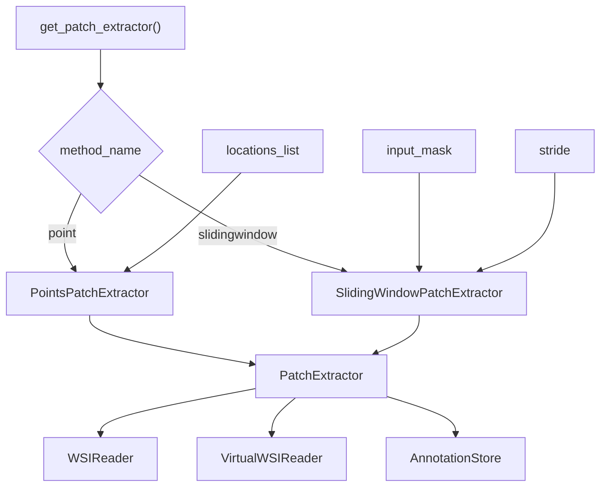
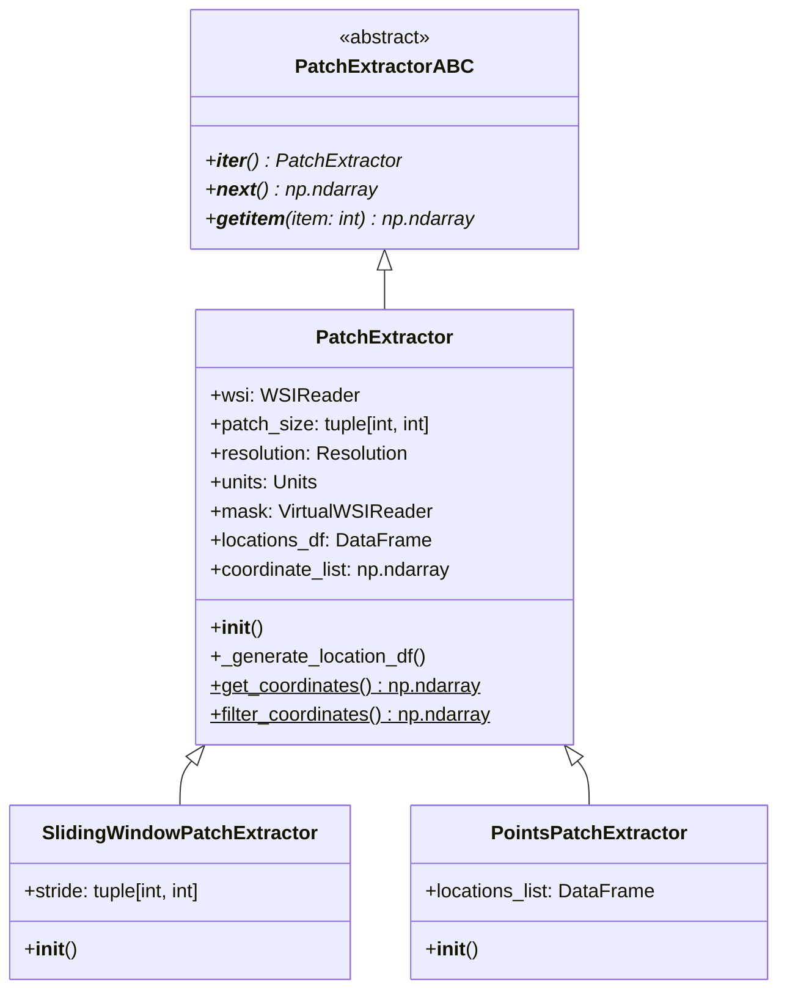
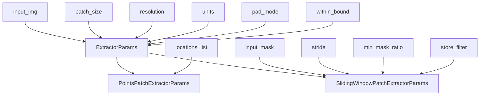
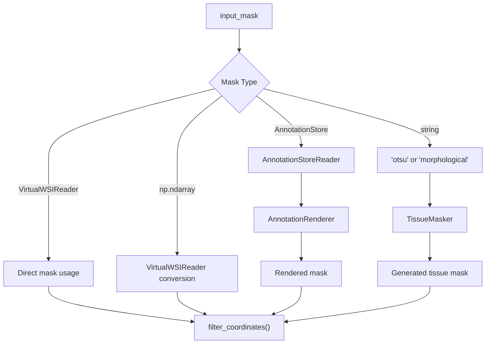
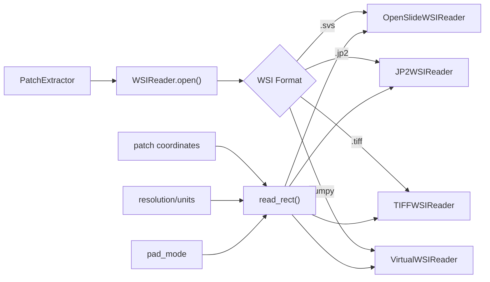

<!-- source: DeepWiki mcp.deepwiki.com · repo TissueImageAnalytics/tiatoolbox · page 3.1 Patch Extraction · fetched 2026-10-21 -->

# Patch Extraction

Relevant source files

The following files were used as context for generating this wiki page:

- [examples/01-wsi-reading.ipynb](examples/01-wsi-reading.ipynb)
- [examples/02-stain-normalization.ipynb](examples/02-stain-normalization.ipynb)
- [examples/03-tissue-masking.ipynb](examples/03-tissue-masking.ipynb)
- [examples/04-patch-extraction.ipynb](examples/04-patch-extraction.ipynb)
- [tests/test_patch_extraction.py](tests/test_patch_extraction.py)
- [tiatoolbox/tools/patchextraction.py](tiatoolbox/tools/patchextraction.py)

## Purpose and Scope

The patch extraction system provides tools for extracting image patches from whole slide images (WSIs) using different strategies including sliding window and point-based approaches. This system is essential for preparing data for deep learning models that cannot process large WSIs directly. For information about WSI reading, see [WSI Reading and Formats](#2.1). For stain processing of extracted patches, see [Stain Processing](#3.2).

## System Overview

The patch extraction system is built around a factory pattern with different extraction strategies. The main entry point is the `get_patch_extractor` function which returns appropriate extractor instances based on the specified method.

**Diagram: Patch Extraction Factory Pattern**

Sources: [tiatoolbox/tools/patchextraction.py:796-854]()

## Core Classes and Architecture

The patch extraction system follows an inheritance hierarchy with abstract base classes and concrete implementations for different extraction strategies.

**Diagram: Patch Extraction Class Hierarchy**

Sources: [tiatoolbox/tools/patchextraction.py:97-115](), [tiatoolbox/tools/patchextraction.py:116-276](), [tiatoolbox/tools/patchextraction.py:612-712](), [tiatoolbox/tools/patchextraction.py:714-794]()

## Extraction Strategies

### Sliding Window Extraction

The `SlidingWindowPatchExtractor` extracts patches using a regular grid pattern across the WSI. It supports configurable stride and optional mask-based filtering.

| Parameter | Type | Description |
|-----------|------|-------------|
| `patch_size` | `int \| tuple[int, int]` | Size of patches to extract |
| `stride` | `int \| tuple[int, int] \| None` | Step size between patches |
| `input_mask` | Various mask types | Mask for filtering patch locations |
| `min_mask_ratio` | `float` | Minimum mask overlap required |

Key methods:
- `get_coordinates()` - Calculates patch tiling coordinates [tiatoolbox/tools/patchextraction.py:484-609]()
- `filter_coordinates()` - Validates coordinates against mask [tiatoolbox/tools/patchextraction.py:354-457]()

### Point-Based Extraction  

The `PointsPatchExtractor` extracts patches centered at specified coordinate locations. This is useful for extracting patches around detected objects or regions of interest.

| Parameter | Type | Description |
|-----------|------|-------------|
| `locations_list` | `np.ndarray \| DataFrame \| str \| Path` | Coordinates for patch centers |
| `patch_size` | `int \| tuple[int, int]` | Size of patches to extract |

The locations are adjusted to center patches properly: [tiatoolbox/tools/patchextraction.py:788-793]()

Sources: [tiatoolbox/tools/patchextraction.py:671-689](), [tiatoolbox/tools/patchextraction.py:759-771]()

## Configuration and Parameters

The system uses TypedDict classes to define parameter schemas for type safety and documentation:

**Diagram: Parameter Configuration Structure**

### Resolution and Units

The system supports multiple resolution specifications:
- `level` - Pyramid level (0 = highest resolution)
- `mpp` - Microns per pixel  
- `power` - Objective power magnification

### Padding Modes

When patches extend beyond image boundaries, different padding strategies are available:
- `constant` - Pad with constant values
- `reflect` - Reflect image at boundaries
- Other modes supported by `numpy.pad`

Sources: [tiatoolbox/tools/patchextraction.py:35-95](), [tiatoolbox/tools/patchextraction.py:147-161]()

## Mask-Based Filtering

The system supports sophisticated mask-based filtering to extract patches only from regions of interest:

**Diagram: Mask Processing Pipeline**

The `filter_coordinates` method validates patch locations based on mask overlap using a configurable `min_mask_ratio` threshold. The method scales coordinates to match mask resolution and applies a selection function to determine valid patches.

Sources: [tiatoolbox/tools/patchextraction.py:238-275](), [tiatoolbox/tools/patchextraction.py:354-457]()

## Integration with WSI Reading System

Patch extraction integrates closely with the WSI reading system through the `WSIReader` interface:

**Diagram: WSI Reader Integration**

The extraction process uses `WSIReader.read_rect()` to extract individual patches at specified coordinates and resolution, with appropriate padding handling.

Sources: [tiatoolbox/tools/patchextraction.py:231](), [tiatoolbox/tools/patchextraction.py:307-315]()

## Iterator Protocol Implementation

All patch extractors implement Python's iterator protocol for efficient batch processing:

| Method | Purpose | Returns |
|--------|---------|---------|
| `__iter__()` | Initialize iterator | `PatchExtractor` |
| `__next__()` | Get next patch | `np.ndarray` |
| `__getitem__()` | Random access | `np.ndarray` |
| `__len__()` | Number of patches | `int` |

This allows extractors to be used in loops and with other Python iteration tools.

Sources: [tiatoolbox/tools/patchextraction.py:277-315]()

## Usage Examples

The system is demonstrated in several example notebooks showing different use cases:

### Basic Sliding Window Extraction
From [examples/04-patch-extraction.ipynb](), the notebook shows creating a sliding window extractor and iterating through patches.

### Point-Based Extraction  
The same notebook demonstrates extracting patches at specific coordinate locations, useful for nuclei detection and analysis.

### Mask-Based Filtering
Examples show using tissue masks, annotation stores, and custom masks to filter patch locations.

Sources: [examples/04-patch-extraction.ipynb:267-283](), [examples/04-patch-extraction.ipynb:157-195](), [tests/test_patch_extraction.py:514-666]()

---

