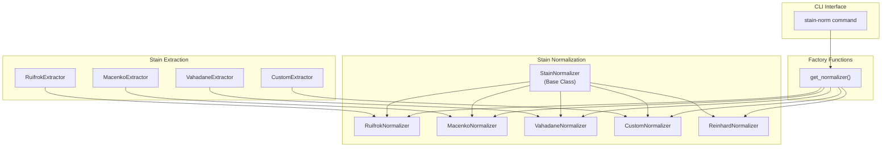
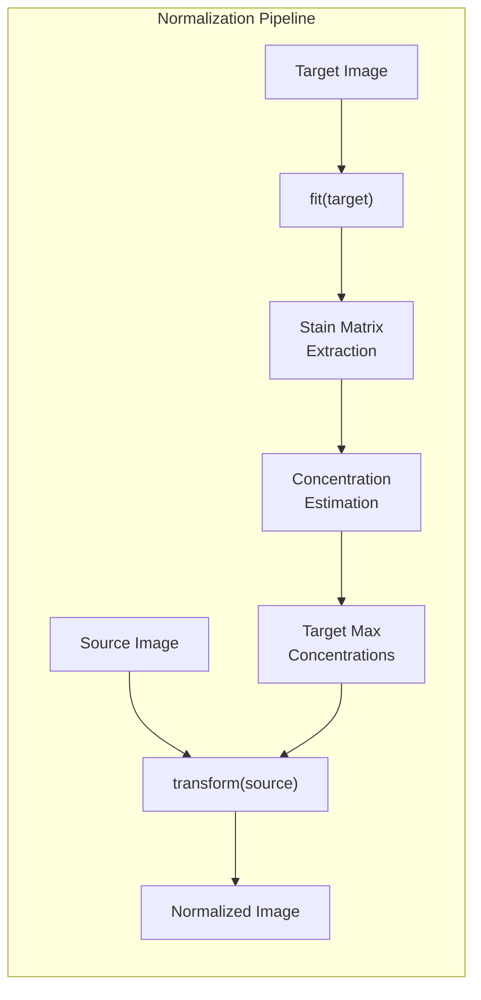
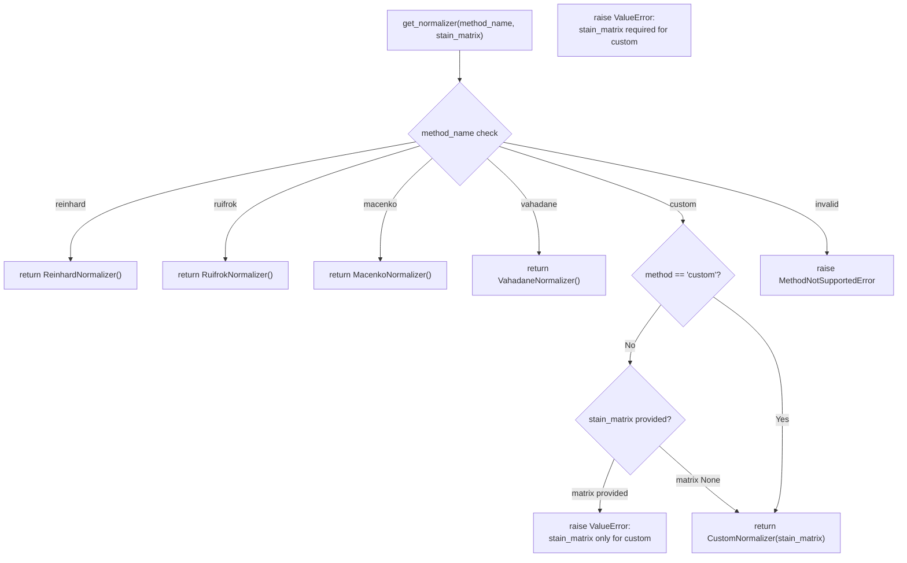
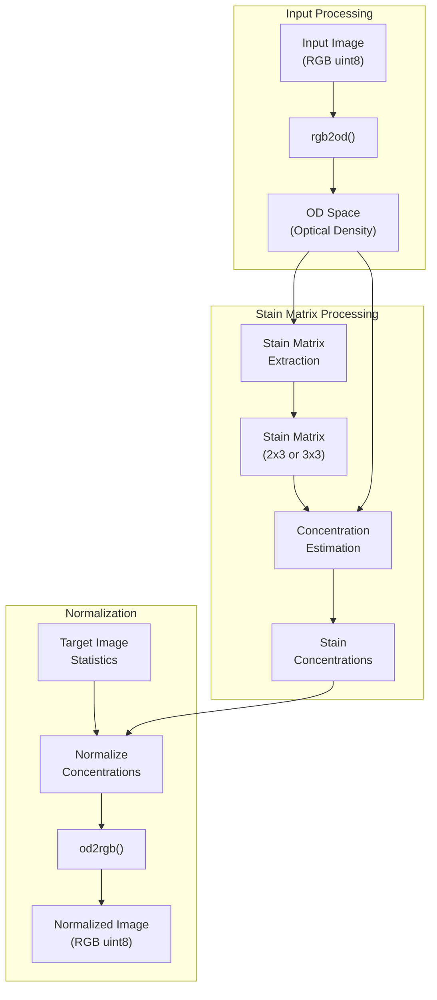

<!-- source: DeepWiki mcp.deepwiki.com · repo TissueImageAnalytics/tiatoolbox · page 3.2 Stain Processing · fetched 2026-10-21 -->

# Stain Processing

<details>
<summary>Relevant source files</summary>

The following files were used as context for generating this wiki page:

- [.github/workflows/mypy-type-check.yml](.github/workflows/mypy-type-check.yml)
- [examples/01-wsi-reading.ipynb](examples/01-wsi-reading.ipynb)
- [examples/02-stain-normalization.ipynb](examples/02-stain-normalization.ipynb)
- [examples/03-tissue-masking.ipynb](examples/03-tissue-masking.ipynb)
- [examples/04-patch-extraction.ipynb](examples/04-patch-extraction.ipynb)
- [tests/test_save_tiles.py](tests/test_save_tiles.py)
- [tests/test_slide_info.py](tests/test_slide_info.py)
- [tests/test_slide_thumbnail.py](tests/test_slide_thumbnail.py)
- [tests/test_stainnorm.py](tests/test_stainnorm.py)
- [tests/test_tissuemask.py](tests/test_tissuemask.py)
- [tests/test_wsimeta.py](tests/test_wsimeta.py)
- [tiatoolbox/tools/stainextract.py](tiatoolbox/tools/stainextract.py)
- [tiatoolbox/tools/stainnorm.py](tiatoolbox/tools/stainnorm.py)

</details>


This document covers the stain normalization and extraction capabilities in TIAToolbox. Stain processing addresses the critical challenge of color variation in histopathology images due to differences in staining protocols, scanner variations, and laboratory conditions. The system provides multiple algorithms for both extracting stain matrices and normalizing images to a consistent appearance.

For information about image preprocessing pipelines more broadly, see [Image Processing Pipeline](#3). For tissue masking and other preprocessing utilities, see [Tissue Masking and Utilities](#3.4).

## System Architecture

The stain processing system consists of two main components: stain extraction and stain normalization. Stain extraction algorithms estimate the stain matrix from images, while stain normalization uses these matrices to transform images to match a target appearance.



**Stain Processing System Architecture**

Sources: [tiatoolbox/tools/stainnorm.py:1-424](), [tiatoolbox/tools/stainextract.py:1-278]()

## Stain Normalization Methods

The core normalization functionality is provided by the `StainNormalizer` base class and its derived implementations. Each normalizer follows a fit-transform pattern where you first fit to a target image, then transform source images.

### Base StainNormalizer Class

The `StainNormalizer` class provides the common interface and shared functionality:

| Method | Purpose |
|--------|---------|
| `fit(target)` | Fit the normalizer to a target image |
| `transform(img)` | Transform an image using the fitted parameters |
| `get_concentrations()` | Estimate stain concentrations from image and stain matrix |

### Available Normalization Methods

| Method | Class | Description |
|--------|-------|-------------|
| `"ruifrok"` | `RuifrokNormalizer` | Uses predefined H&E stain matrix from Ruifrok & Johnston (2001) |
| `"macenko"` | `MacenkoNormalizer` | Estimates stain matrix using Macenko et al. (2009) method |
| `"vahadane"` | `VahadaneNormalizer` | Uses sparse dictionary learning approach from Vahadane et al. (2016) |
| `"reinhard"` | `ReinhardNormalizer` | LAB color space transfer method from Reinhard et al. (2001) |
| `"custom"` | `CustomNormalizer` | Uses user-provided stain matrix |



**Stain Normalization Pipeline**

Sources: [tiatoolbox/tools/stainnorm.py:68-114](), [tiatoolbox/tools/stainnorm.py:19-48]()

## Stain Extraction Algorithms

Stain extraction classes estimate the stain matrix from input images. These are used internally by the corresponding normalizers.

### Extraction Methods

| Extractor | Algorithm | Key Parameters |
|-----------|-----------|----------------|
| `RuifrokExtractor` | Fixed H&E matrix | `[[0.65, 0.70, 0.29], [0.07, 0.99, 0.11]]` |
| `MacenkoExtractor` | PCA-based method | `luminosity_threshold`, `angular_percentile` |
| `VahadaneExtractor` | Dictionary learning | `luminosity_threshold`, `regularizer` |
| `CustomExtractor` | User-defined matrix | User-provided stain matrix |

### Utility Functions

The extraction process uses several utility functions for matrix processing:

- `vectors_in_correct_direction()` - Ensures eigenvectors point in correct direction
- `h_and_e_in_right_order()` - Orders H&E stain vectors correctly (H first)
- `dl_output_for_h_and_e()` - Processes dictionary learning output for H&E

Sources: [tiatoolbox/tools/stainextract.py:71-278](), [tiatoolbox/tools/stainextract.py:13-68]()

## Usage Patterns

### Basic Normalization Workflow

```python
from tiatoolbox.tools.stainnorm import get_normalizer

# Get a normalizer instance
norm = get_normalizer("macenko")

# Fit to target image
norm.fit(target_img)

# Transform source image
normalized_img = norm.transform(source_img)
```

### Factory Function

The `get_normalizer()` function provides a unified interface for creating normalizer instances:

| Parameter | Type | Description |
|-----------|------|-------------|
| `method_name` | `str` | One of: `"reinhard"`, `"ruifrok"`, `"macenko"`, `"vahadane"`, `"custom"` |
| `stain_matrix` | `np.ndarray` | Required only for `"custom"` method |



**get_normalizer() Function Logic**

Sources: [tiatoolbox/tools/stainnorm.py:368-423]()

## Reinhard Color Normalization

The `ReinhardNormalizer` implements a different approach using LAB color space statistics matching rather than stain matrix estimation.

### Key Methods

| Method | Purpose |
|--------|---------|
| `lab_split(img)` | Convert RGB to LAB and split channels |
| `get_mean_std(img)` | Compute mean and standard deviation for each LAB channel |
| `merge_back(chan1, chan2, chan3)` | Merge LAB channels back to RGB |

The algorithm transfers color statistics from target to source image in LAB color space, avoiding the need for stain matrix estimation.

Sources: [tiatoolbox/tools/stainnorm.py:222-366]()

## Command Line Interface

The stain normalization functionality is available through the CLI using the `stain-norm` command:

```bash
tiatoolbox stain-norm --img-input SOURCE --target-input TARGET --output-path OUTPUT --method METHOD
```

### CLI Parameters

| Parameter | Description | Valid Values |
|-----------|-------------|--------------|
| `--img-input` | Source image path or directory | File or directory path |
| `--target-input` | Target image path | File path |
| `--output-path` | Output directory | Directory path |
| `--method` | Normalization method | `"reinhard"`, `"ruifrok"`, `"macenko"`, `"vahadane"` |

The CLI supports both single file and directory batch processing for the `--img-input` parameter.

Sources: [tests/test_stainnorm.py:173-318]()

## Data Flow and Transforms



**Stain Processing Data Flow**

Sources: [tiatoolbox/tools/stainnorm.py:50-67](), [tiatoolbox/tools/stainnorm.py:89-113](), [tiatoolbox/utils/transforms.py]()

---

