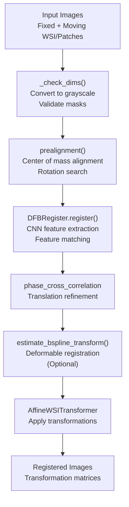
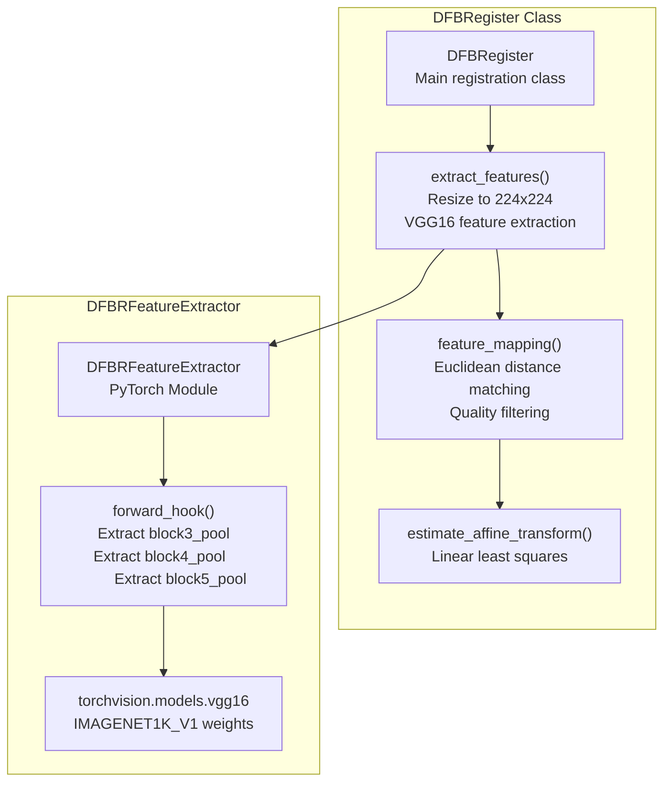
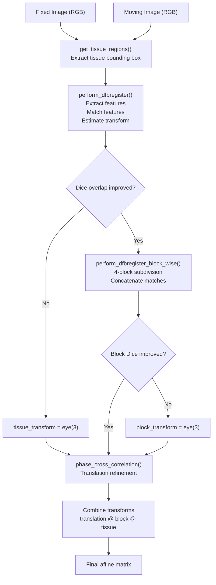
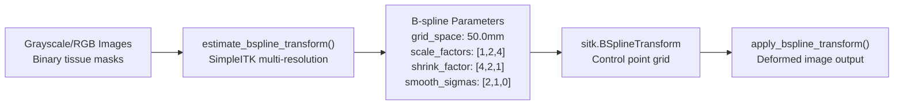
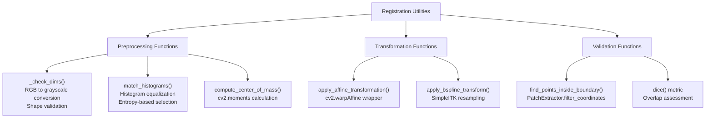
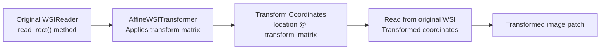

<!-- source: DeepWiki mcp.deepwiki.com · repo TissueImageAnalytics/tiatoolbox · page 3.3 Image Registration · fetched 2026-10-21 -->

# Image Registration

<details>
<summary>Relevant source files</summary>

The following files were used as context for generating this wiki page:

- [tests/conftest.py](tests/conftest.py)
- [tests/test_wsi_registration.py](tests/test_wsi_registration.py)
- [tiatoolbox/data/remote_samples.yaml](tiatoolbox/data/remote_samples.yaml)
- [tiatoolbox/tools/registration/wsi_registration.py](tiatoolbox/tools/registration/wsi_registration.py)

</details>


## Purpose and Scope

This page covers the image registration functionality in TIAToolbox, which provides methods for aligning whole slide images (WSIs) and image patches. The registration system supports both rigid and deformable alignment techniques, with a focus on histopathology image registration challenges.

For patch extraction from registered images, see [Patch Extraction](#3.1). For tissue masking used in registration workflows, see [Tissue Masking and Utilities](#3.4).

## Registration Methods Overview

TIAToolbox implements two primary registration approaches: Deep Feature Based Registration (DFBR) for affine alignment and B-spline registration for deformable alignment. The system handles multi-step registration workflows with preprocessing, coarse alignment, feature-based refinement, and optional deformable registration.



**Sources**: [tiatoolbox/tools/registration/wsi_registration.py:1-1400]()

## Deep Feature Based Registration (DFBR)

The DFBR system uses VGG16 CNN features for robust image alignment, particularly effective for histopathology images with varying staining and artifacts.

### Core Architecture



**Sources**: [tiatoolbox/tools/registration/wsi_registration.py:327-409](), [tiatoolbox/tools/registration/wsi_registration.py:411-1251]()

### DFBR Workflow Components

| Component | Function | Key Parameters |
|-----------|----------|----------------|
| `DFBRFeatureExtractor` | Extracts multiscale CNN features | VGG16 layers 16, 23, 30 |
| `extract_features()` | Preprocesses images and extracts features | `patch_size=(224, 224)` |
| `feature_mapping()` | Matches features between images | `num_matching_points=128` |
| `compute_feature_distances()` | Calculates Euclidean distances | Multi-scale feature combination |
| `filtering_matching_points()` | Removes duplicates and out-of-tissue points | Uses tissue masks |
| `perform_dfbregister()` | Main registration pipeline | Tissue region extraction |
| `perform_dfbregister_block_wise()` | Block-wise registration | 4-block subdivision |

### Registration Pipeline



**Sources**: [tiatoolbox/tools/registration/wsi_registration.py:1083-1251]()

## B-spline Deformable Registration

For non-rigid alignment, TIAToolbox provides B-spline registration using SimpleITK, enabling deformable registration for complex tissue deformations.

### B-spline Components



### B-spline Parameters

| Parameter | Default | Description |
|-----------|---------|-------------|
| `grid_space` | 50.0 | Control point spacing (mm) |
| `scale_factors` | [1, 2, 4] | B-spline scaling per level |
| `shrink_factor` | [4, 2, 1] | Image downsampling per level |
| `smooth_sigmas` | [2, 1, 0] | Gaussian smoothing per level |
| `num_iterations` | 100 | Maximum iterations |
| `sampling_percent` | 0.1 | Fraction of pixels for metric |
| `learning_rate` | 1.0 | Optimization step size |

**Sources**: [tiatoolbox/tools/registration/wsi_registration.py:1253-1400]()

## Utility Functions and Transformations

### Preprocessing and Alignment Utilities

The registration system includes several utility functions for image preprocessing and geometric transformations:



### Prealignment Process

The `prealignment()` function performs coarse registration using center of mass alignment and rotation search:

| Step | Function | Description |
|------|----------|-------------|
| 1 | Center of mass calculation | `compute_center_of_mass()` on masked images |
| 2 | Translation alignment | Align center of mass coordinates |  
| 3 | Rotation search | Test rotations in `rotation_step` increments |
| 4 | Dice evaluation | Select rotation with highest mask overlap |
| 5 | Transform validation | Apply transform if dice > `dice_overlap` threshold |

**Sources**: [tiatoolbox/tools/registration/wsi_registration.py:131-274](), [tiatoolbox/tools/registration/wsi_registration.py:80-129]()

## WSI Transformation Interface

### AffineWSITransformer

The `AffineWSITransformer` class provides a `WSIReader`-compatible interface for reading from transformed WSIs:



The transformer handles coordinate transformation at the WSI level, enabling seamless integration with existing TIAToolbox workflows.

**Sources**: [tiatoolbox/tools/registration/wsi_registration.py:1400-1600]()

## Usage Patterns

### Basic DFBR Registration

```python
# Initialize DFBR
dfbr = DFBRegister(patch_size=(224, 224))

# Perform registration  
transform_matrix = dfbr.register(
    fixed_img,      # RGB image (H, W, 3)
    moving_img,     # RGB image (H, W, 3) 
    fixed_mask,     # Binary mask (H, W)
    moving_mask     # Binary mask (H, W)
)

# Apply transformation
registered_img = apply_affine_transformation(
    fixed_img, moving_img, transform_matrix
)
```

### B-spline Deformable Registration

```python
# Estimate B-spline transform
bspline_transform = estimate_bspline_transform(
    fixed_img,     # Grayscale (H, W) or RGB (H, W, 3)
    moving_img,    # Grayscale (H, W) or RGB (H, W, 3)
    fixed_mask,    # Binary mask (H, W)
    moving_mask,   # Binary mask (H, W)
    grid_space=50.0,
    num_iterations=100
)

# Apply deformable transformation
deformed_img = apply_bspline_transform(
    fixed_img, moving_img, bspline_transform
)
```

**Sources**: [tests/test_wsi_registration.py:387-449](), [tests/test_wsi_registration.py:513-552]()

---

