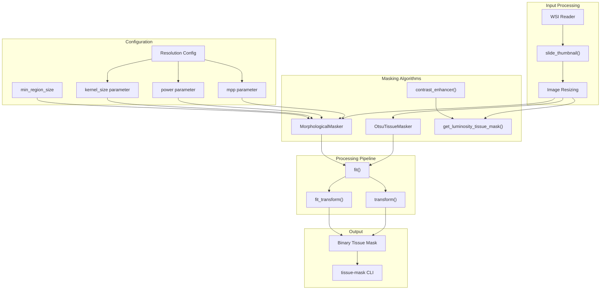
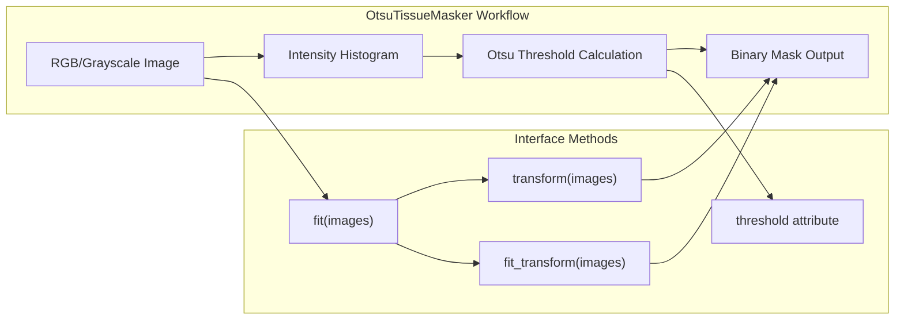
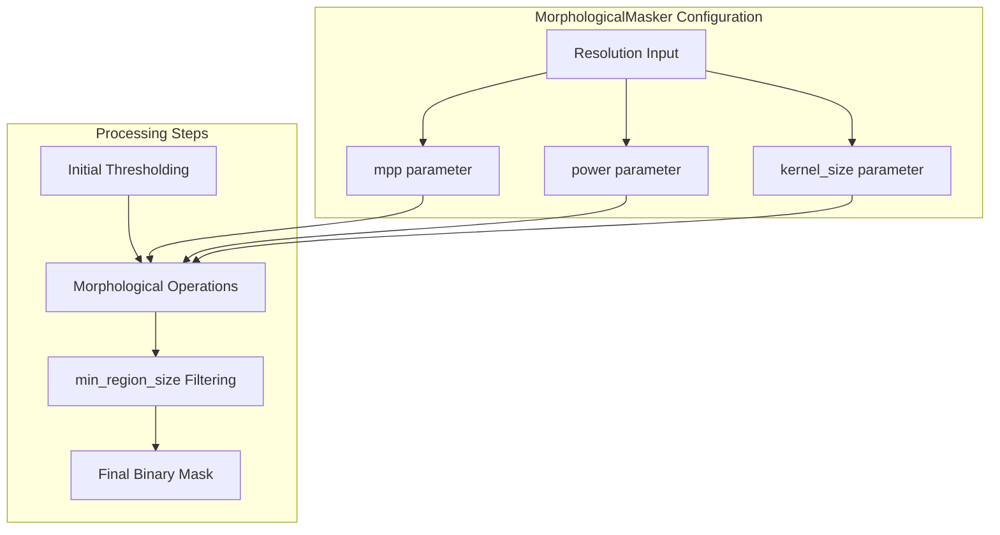
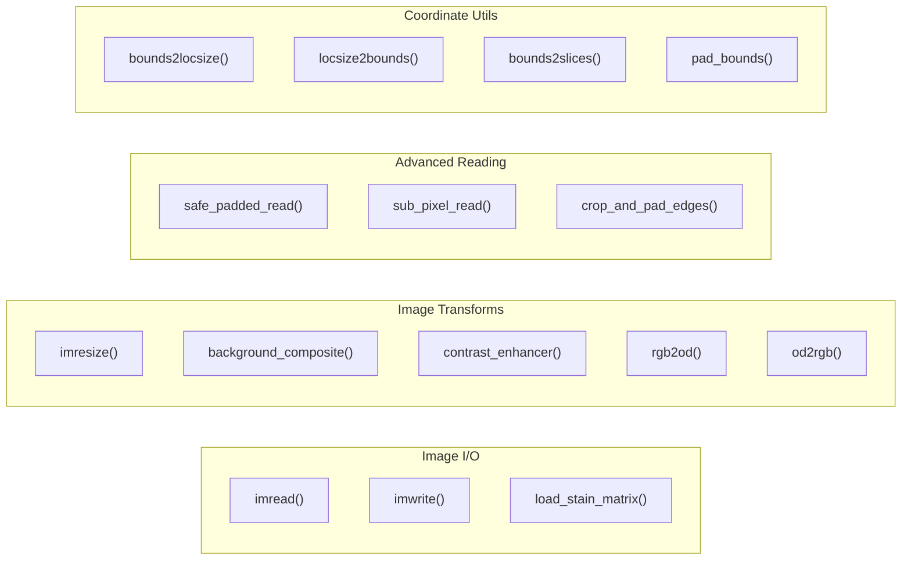
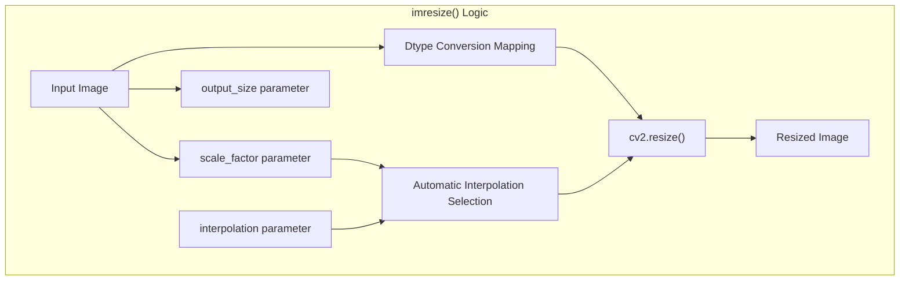
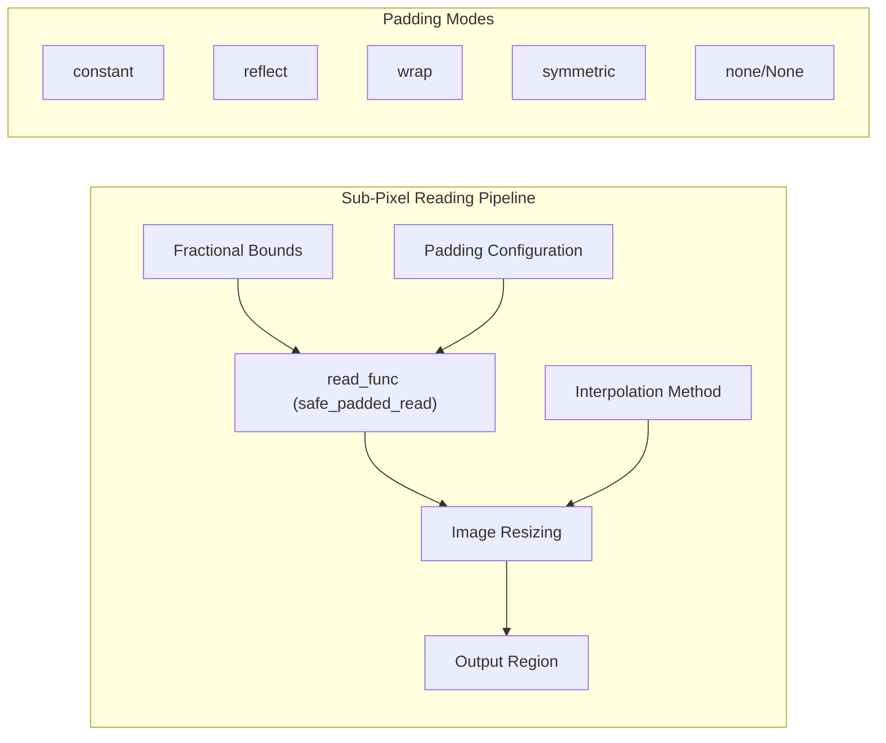
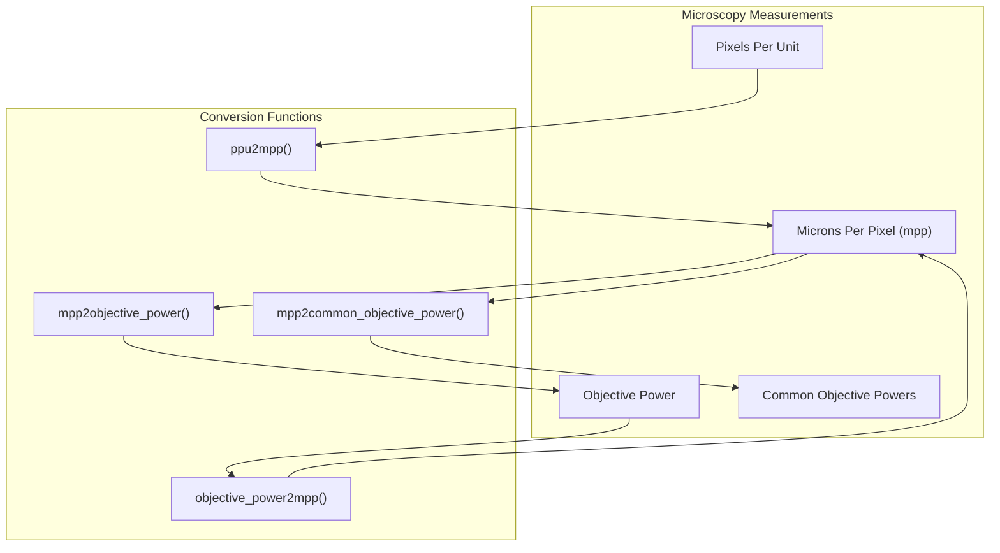
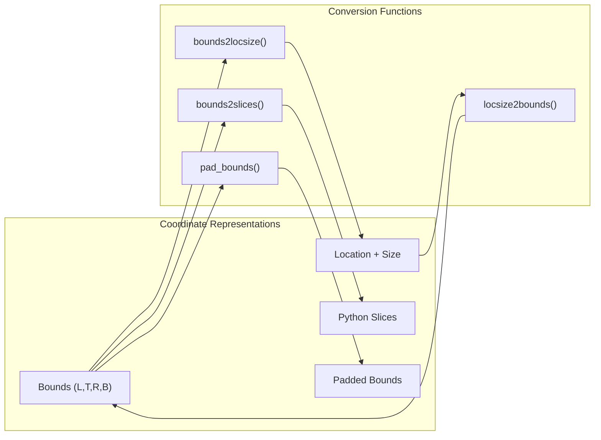
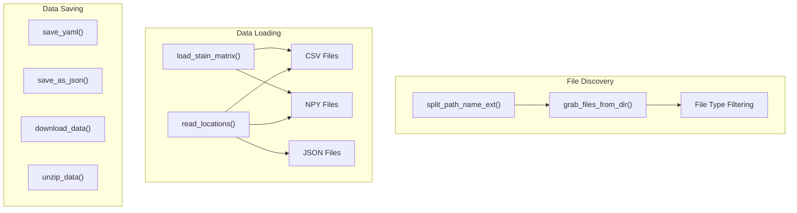

<!-- source: DeepWiki mcp.deepwiki.com · repo TissueImageAnalytics/tiatoolbox · page 3.4 Tissue Masking and Utilities · fetched 2026-10-21 -->

# Tissue Masking and Utilities

<details>
<summary>Relevant source files</summary>

The following files were used as context for generating this wiki page:

- [tests/test_save_tiles.py](tests/test_save_tiles.py)
- [tests/test_slide_info.py](tests/test_slide_info.py)
- [tests/test_slide_thumbnail.py](tests/test_slide_thumbnail.py)
- [tests/test_stainnorm.py](tests/test_stainnorm.py)
- [tests/test_tissuemask.py](tests/test_tissuemask.py)
- [tests/test_utils.py](tests/test_utils.py)
- [tests/test_wsimeta.py](tests/test_wsimeta.py)
- [tiatoolbox/utils/image.py](tiatoolbox/utils/image.py)
- [tiatoolbox/utils/misc.py](tiatoolbox/utils/misc.py)
- [tiatoolbox/utils/transforms.py](tiatoolbox/utils/transforms.py)

</details>


This document covers tissue masking functionality for identifying tissue regions in whole slide images (WSIs) and the broader collection of image processing utilities provided by TIAToolbox. This includes binary mask generation, image transformations, coordinate conversions, and various helper functions for WSI analysis workflows.

For stain normalization and color processing, see [Stain Processing](#3.2). For patch extraction workflows, see [Patch Extraction](#3.1).

## Tissue Masking System

TIAToolbox provides automated tissue masking capabilities to identify tissue regions and exclude background areas from analysis. The system implements multiple masking algorithms through a consistent scikit-learn-style interface.

### Tissue Masking Architecture



**Sources:** [tests/test_tissuemask.py:21-213](), [tiatoolbox/utils/misc.py:247-276]()

### Otsu Tissue Masker

The `OtsuTissueMasker` uses Otsu's automatic thresholding method to separate tissue from background. It analyzes the intensity histogram to find an optimal threshold.



**Sources:** [tests/test_tissuemask.py:21-55](), [tests/test_tissuemask.py:148-153]()

### Morphological Tissue Masker

The `MorphologicalMasker` combines thresholding with morphological operations to create robust tissue masks. It supports multiple resolution specifications and can filter small regions.

| Parameter | Type | Description |
|-----------|------|-------------|
| `mpp` | float or tuple | Microns per pixel for resolution |
| `power` | float | Objective lens power (magnification) |
| `kernel_size` | int or tuple | Morphological kernel size in pixels |
| `min_region_size` | int | Minimum region size to keep in mask |



**Sources:** [tests/test_tissuemask.py:57-146](), [tests/test_tissuemask.py:172-213]()

### Luminosity-Based Masking

The `get_luminosity_tissue_mask()` function provides a simple luminosity-based approach for tissue detection using LAB color space conversion.

**Sources:** [tiatoolbox/utils/misc.py:247-276](), [tests/test_utils.py:918-922]()

## Image Processing Utilities

TIAToolbox provides comprehensive image processing utilities covering transformations, I/O operations, and coordinate manipulations.

### Core Image Operations



**Sources:** [tiatoolbox/utils/misc.py:142-201](), [tiatoolbox/utils/transforms.py:94-207](), [tiatoolbox/utils/image.py:296-440]()

### Image Resizing and Interpolation

The `imresize()` function provides robust image resizing with automatic interpolation method selection and dtype preservation.

| Parameter | Type | Description |
|-----------|------|-------------|
| `scale_factor` | float or tuple | Scaling factor for resize |
| `output_size` | int or tuple | Target output dimensions |
| `interpolation` | str | Interpolation method or "optimise" |



**Sources:** [tiatoolbox/utils/transforms.py:94-207](), [tests/test_utils.py:67-143]()

### Sub-Pixel Reading

The `sub_pixel_read()` function enables reading image regions with sub-pixel coordinates and various padding modes.



**Sources:** [tiatoolbox/utils/image.py:443-667](), [tests/test_utils.py:380-794]()

## Coordinate and Measurement Utilities

TIAToolbox provides utilities for coordinate system conversions and measurement transformations commonly needed in microscopy.

### Resolution and Power Conversions



**Sources:** [tiatoolbox/utils/misc.py:279-388](), [tests/test_utils.py:168-214]()

### Coordinate System Utilities

The coordinate utilities handle transformations between different coordinate representations used in image processing.

| Function | Purpose |
|----------|---------|
| `bounds2locsize()` | Convert (left, top, right, bottom) to (location, size) |
| `locsize2bounds()` | Convert (location, size) to bounds format |
| `bounds2slices()` | Convert bounds to Python slice objects |
| `pad_bounds()` | Add padding to bounds coordinates |



**Sources:** [tiatoolbox/utils/transforms.py:259-421](), [tests/test_utils.py:796-865]()

## File and Data Utilities

TIAToolbox includes utilities for file operations, data loading, and format conversions commonly needed in computational pathology workflows.

### File Operations



**Sources:** [tiatoolbox/utils/misc.py:65-103](), [tiatoolbox/utils/misc.py:485-548](), [tiatoolbox/utils/misc.py:106-139]()

### Annotation Data Handling

The system provides specialized utilities for loading and managing annotation data from various formats.

**Sources:** [tiatoolbox/utils/misc.py:975-1197](), [tests/test_utils.py:924-1050]()

## Command Line Interface

Tissue masking functionality is accessible through the CLI with the `tissue-mask` command, supporting both Otsu and Morphological methods.

```bash
# Otsu tissue masking
tiatoolbox tissue-mask --img-input slide.svs --method Otsu --mode save

# Morphological masking with resolution
tiatoolbox tissue-mask --img-input slide.svs --method Morphological \
  --resolution 32 --units mpp --mode save
```

**Sources:** [tests/test_tissuemask.py:220-488]()

---

