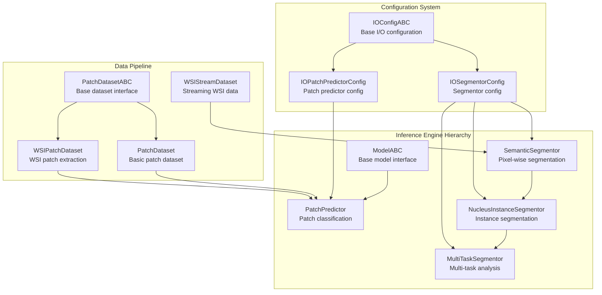
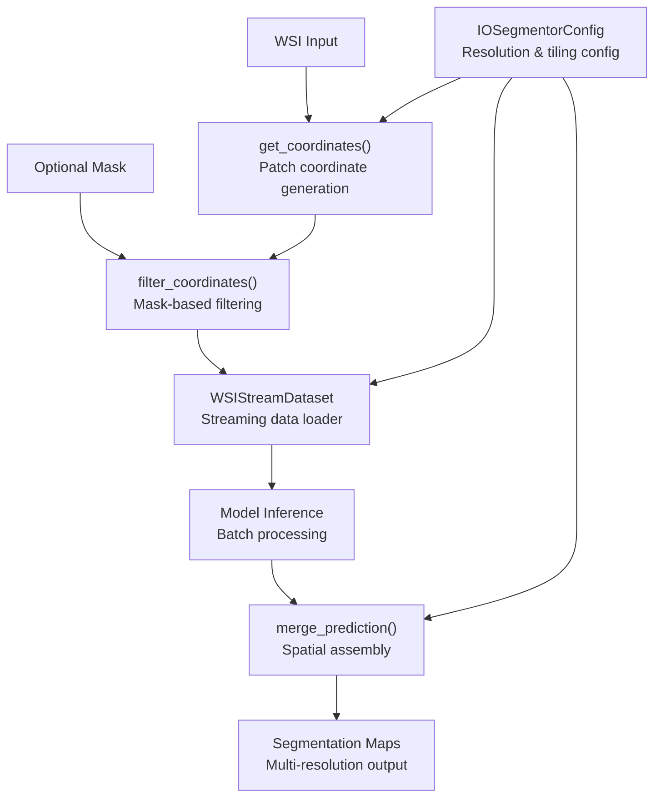
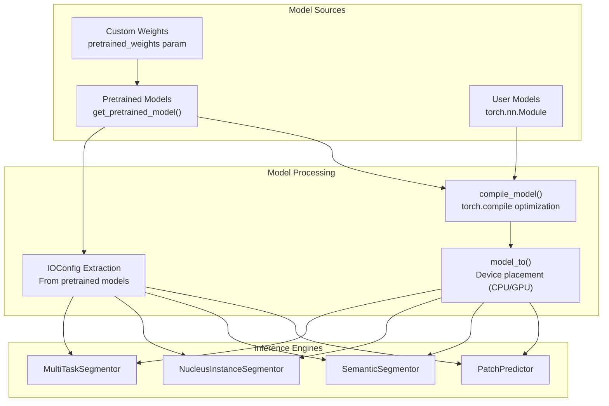
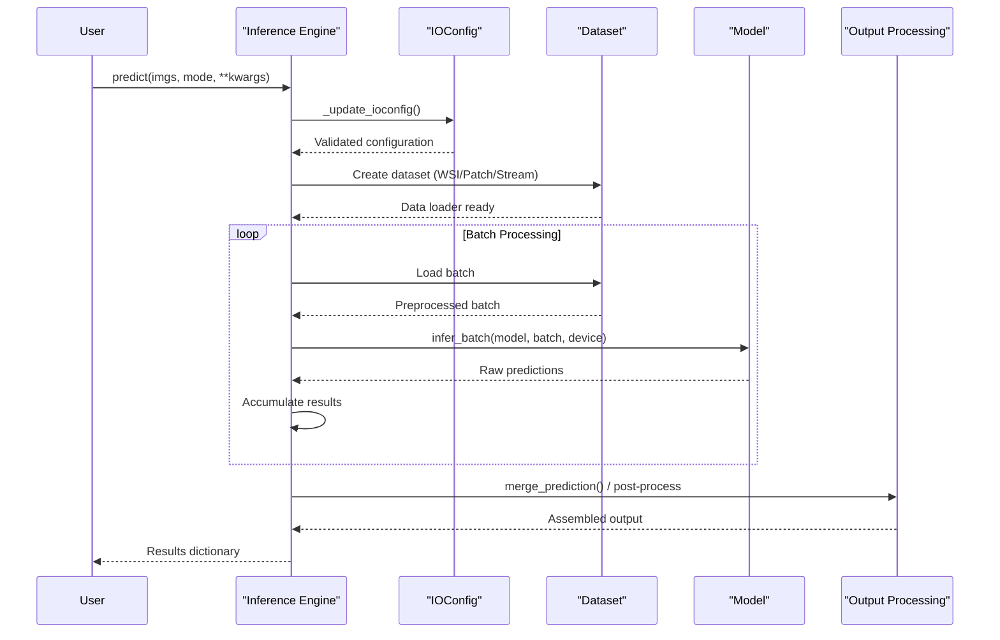

<!-- source: DeepWiki mcp.deepwiki.com · repo TissueImageAnalytics/tiatoolbox · page 4 Model and Inference Systems · fetched 2026-10-21 -->

# Model and Inference Systems

<details>
<summary>Relevant source files</summary>

The following files were used as context for generating this wiki page:

- [tests/models/test_abc.py](tests/models/test_abc.py)
- [tests/models/test_dataset.py](tests/models/test_dataset.py)
- [tests/models/test_multi_task_segmentor.py](tests/models/test_multi_task_segmentor.py)
- [tests/models/test_nucleus_instance_segmentor.py](tests/models/test_nucleus_instance_segmentor.py)
- [tests/models/test_patch_predictor.py](tests/models/test_patch_predictor.py)
- [tests/models/test_semantic_segmentation.py](tests/models/test_semantic_segmentation.py)
- [tiatoolbox/models/dataset/classification.py](tiatoolbox/models/dataset/classification.py)
- [tiatoolbox/models/dataset/info.py](tiatoolbox/models/dataset/info.py)
- [tiatoolbox/models/engine/multi_task_segmentor.py](tiatoolbox/models/engine/multi_task_segmentor.py)
- [tiatoolbox/models/engine/nucleus_instance_segmentor.py](tiatoolbox/models/engine/nucleus_instance_segmentor.py)
- [tiatoolbox/models/engine/patch_predictor.py](tiatoolbox/models/engine/patch_predictor.py)
- [tiatoolbox/models/engine/semantic_segmentor.py](tiatoolbox/models/engine/semantic_segmentor.py)
- [tiatoolbox/wsicore/wsimeta.py](tiatoolbox/wsicore/wsimeta.py)

</details>


This document covers TIAToolbox's machine learning inference infrastructure, including the various prediction engines, model architectures, and configuration systems that enable analysis of whole slide images and image patches. This system provides unified interfaces for patch classification, semantic segmentation, instance segmentation, and multi-task analysis.

For information about the underlying image processing pipeline that feeds these models, see [Image Processing Pipeline](#3). For details about pretrained model architectures and weights, see [Pretrained Models](#4.3).

## System Architecture Overview

The model and inference systems in TIAToolbox are built around several core inference engines that provide different types of analysis capabilities. Each engine handles the complete pipeline from data loading through model inference to result assembly.

### Core Inference Engines



**Sources:** [tiatoolbox/models/engine/patch_predictor.py:50-225](), [tiatoolbox/models/engine/semantic_segmentor.py:435-518](), [tiatoolbox/models/engine/nucleus_instance_segmentor.py:304-400](), [tiatoolbox/models/engine/multi_task_segmentor.py:182-244]()

## Inference Engine Details

### PatchPredictor

The `PatchPredictor` class handles patch-level classification tasks, processing individual image patches or extracting patches from whole slide images and tiles. It supports various pretrained models for different classification tasks.

**Key Features:**
- Supports both individual model instances and pretrained models by name
- Handles patch, tile, and WSI processing modes
- Configurable batch processing and parallel data loading
- Built-in prediction merging for spatial assembly

**Core Methods:**
- `predict()` - Main inference method supporting multiple input modes
- `merge_predictions()` - Static method for assembling patch predictions into spatial maps
- `_predict_engine()` - Internal batch processing engine

### SemanticSegmentor

The `SemanticSegmentor` provides pixel-wise segmentation capabilities, processing images to generate dense prediction maps where each pixel is assigned a class label.

**Key Features:**
- Multi-resolution input and output support
- Configurable patch tiling with overlap handling
- Automatic tissue masking integration
- Memory-efficient processing with optional disk caching

**Core Processing Flow:**


**Sources:** [tiatoolbox/models/engine/semantic_segmentor.py:435-518](), [tiatoolbox/models/engine/semantic_segmentor.py:578-633](), [tiatoolbox/models/engine/semantic_segmentor.py:292-433]()

### NucleusInstanceSegmentor

The `NucleusInstanceSegmentor` specializes in detecting and segmenting individual nucleus instances, extending the semantic segmentor with post-processing for instance separation and boundary refinement.

**Key Features:**
- Instance-aware tiling with boundary handling
- Parallel post-processing workers for performance
- Instance tracking across tile boundaries
- Output in structured format with bounding boxes, centroids, and contours

**Instance Processing Pipeline:**


**Sources:** [tiatoolbox/models/engine/nucleus_instance_segmentor.py:304-400](), [tiatoolbox/models/engine/nucleus_instance_segmentor.py:25-183]()

### MultiTaskSegmentor

The `MultiTaskSegmentor` extends nucleus instance segmentation to handle models that produce multiple output types simultaneously, such as both instance segmentation and semantic segmentation maps.

**Key Features:**
- Support for models with multiple output heads
- Configurable output type specification (`output_types` parameter)
- Parallel processing of different output streams
- Unified storage format for mixed output types

## Configuration System

### IOSegmentorConfig

The `IOSegmentorConfig` class defines input/output specifications for segmentation models, handling multi-resolution processing and coordinate transformations.

**Key Configuration Parameters:**

| Parameter | Type | Description |
|-----------|------|-------------|
| `input_resolutions` | `list[dict]` | Resolution specs for each model input |
| `output_resolutions` | `list[dict]` | Resolution specs for each model output |
| `patch_input_shape` | `IntPair` | Input patch dimensions (H, W) |
| `patch_output_shape` | `IntPair` | Output patch dimensions (H, W) |
| `stride_shape` | `IntPair` | Stride for patch extraction |
| `save_resolution` | `dict` | Target resolution for final output |

**Resolution Format:**
```python
resolution_spec = {
    "resolution": 0.25,  # Numeric resolution value
    "units": "mpp"       # Units: "mpp", "power", "baseline"
}
```

**Sources:** [tiatoolbox/models/engine/semantic_segmentor.py:114-290]()

### IOPatchPredictorConfig

The `IOPatchPredictorConfig` specializes the base configuration for patch classification tasks, simplifying the interface by assuming single-resolution processing.

**Sources:** [tiatoolbox/models/engine/patch_predictor.py:27-48]()

## Data Handling System

### Dataset Classes Architecture

```mermaid
classDiagram
    class PatchDatasetABC {
        <<abstract>>
        +inputs
        +labels
        +preproc_func
        +__getitem__(idx)
        +__len__()
        +_preproc(patch)
        +_check_input_integrity(mode)
    }
    
    class PatchDataset {
        +inputs: list|ndarray
        +labels: list
        +data_is_npy_alike: bool
        +__getitem__(idx)
        +load_img(path)
    }
    
    class WSIPatchDataset {
        +reader: WSIReader
        +patch_input_shape: IntPair
        +resolution: Resolution
        +units: Units
        +__getitem__(idx)
    }
    
    class WSIStreamDataset {
        +ioconfig: IOSegmentorConfig
        +mp_shared_space: Namespace
        +wsi_paths: list
        +mode: str
        +__getitem__(idx)
        +collate_fn(batch)
    }
    
    PatchDatasetABC <|-- PatchDataset
    PatchDatasetABC <|-- WSIPatchDataset
    PatchDatasetABC <|.. WSIStreamDataset
    
    PatchDataset --> "loads" PatchImages["Image Files<br/>(.jpg, .png, .tif, .npy)"]
    WSIPatchDataset --> "reads from" WSIReader["WSIReader<br/>(pyramidal images)"]
    WSIStreamDataset --> "streams from" WSIFiles["WSI Files<br/>(multi-worker processing)"]
```

**Sources:** [tiatoolbox/models/dataset/classification.py:77-139](), [tiatoolbox/models/dataset/classification.py:141-363](), [tiatoolbox/models/engine/semantic_segmentor.py:292-433]()

### Dataset Specializations

#### PatchDataset
Handles pre-extracted image patches stored as individual files or numpy arrays. Supports various image formats and provides configurable preprocessing.

#### WSIPatchDataset  
Dynamically extracts patches from whole slide images during training/inference. Integrates with tissue masking and supports both WSI and large tile processing modes.

#### WSIStreamDataset
Designed for efficient parallel processing of multiple WSIs with persistent workers. Uses shared memory for coordination and supports multi-resolution patch extraction.

## Model Architecture Integration

### Model Loading and Management



**Sources:** [tiatoolbox/models/architecture/__init__.py](), [tiatoolbox/models/architecture/utils.py](), [tiatoolbox/models/models_abc.py:17-60]()

### ModelABC Interface

The `ModelABC` class provides the base interface that all TIAToolbox models must implement:

**Required Methods:**
- `forward()` - PyTorch forward pass implementation
- `infer_batch()` - Static method for batch inference with device handling
- `postproc_func` - Post-processing function for model outputs

**Optional Methods:**
- `preproc_func` - Preprocessing function for model inputs (defaults to identity)

## Prediction Workflow

### End-to-End Processing Pipeline



**Sources:** [tiatoolbox/models/engine/patch_predictor.py:384-478](), [tiatoolbox/models/engine/semantic_segmentor.py:741-900]()

This system provides a comprehensive and flexible framework for applying machine learning models to histopathology images, supporting everything from simple patch classification to complex multi-task analysis of whole slide images.

---

