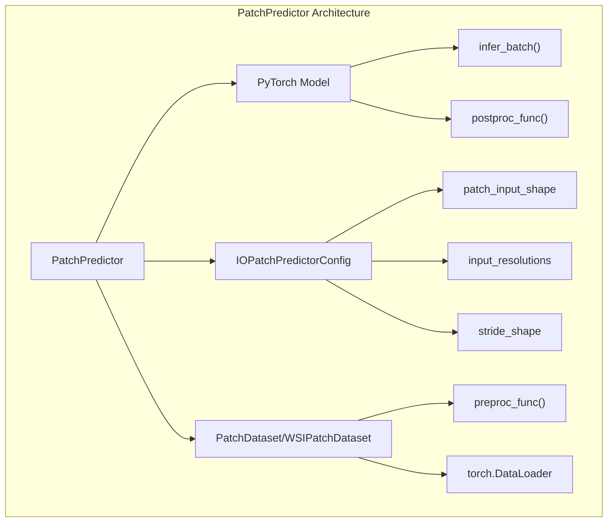
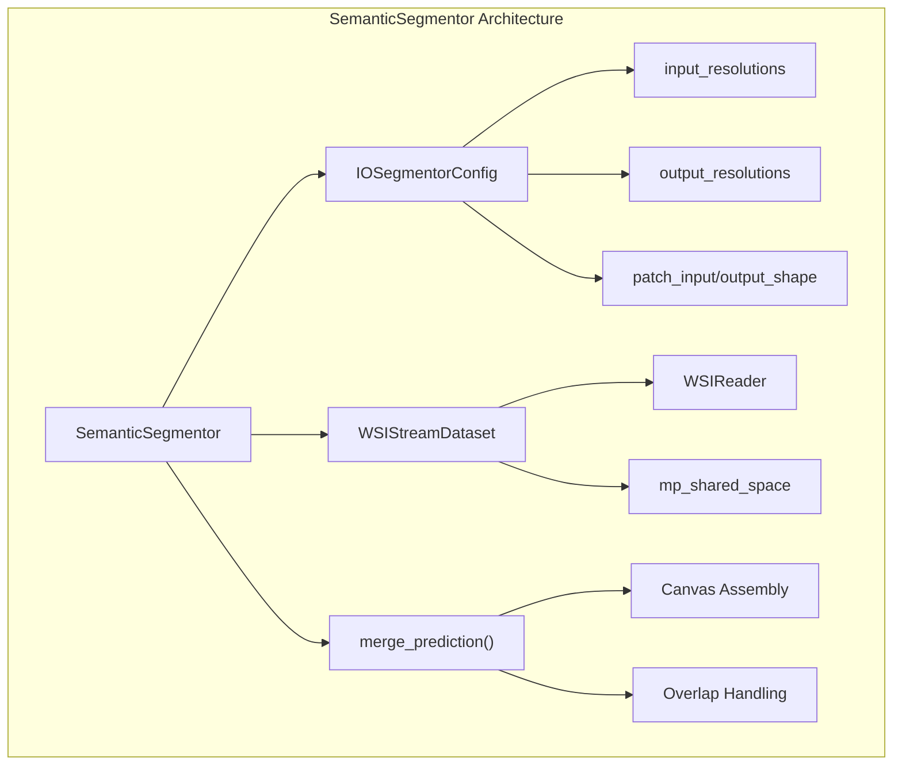
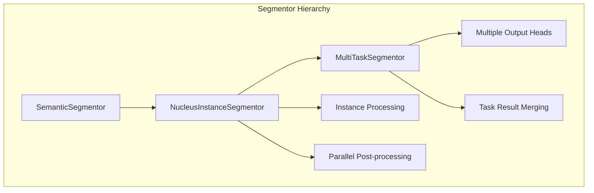
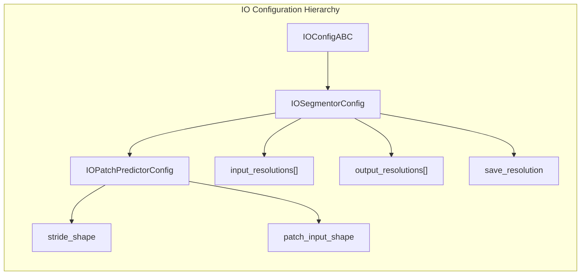
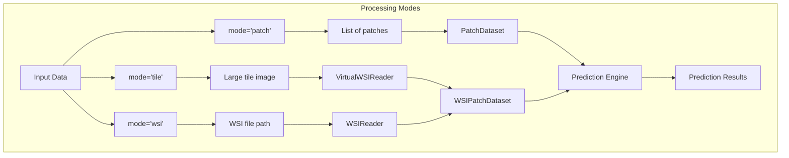
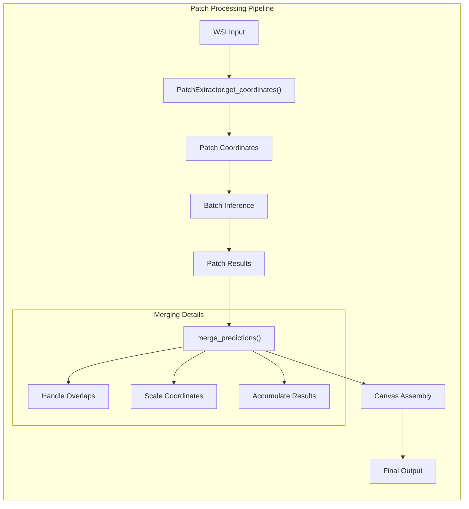
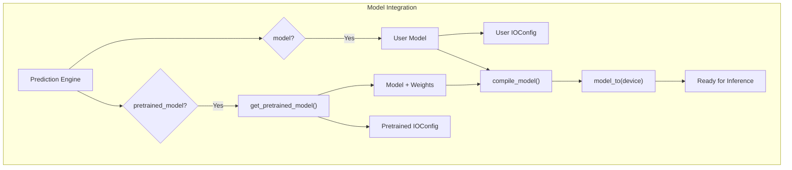
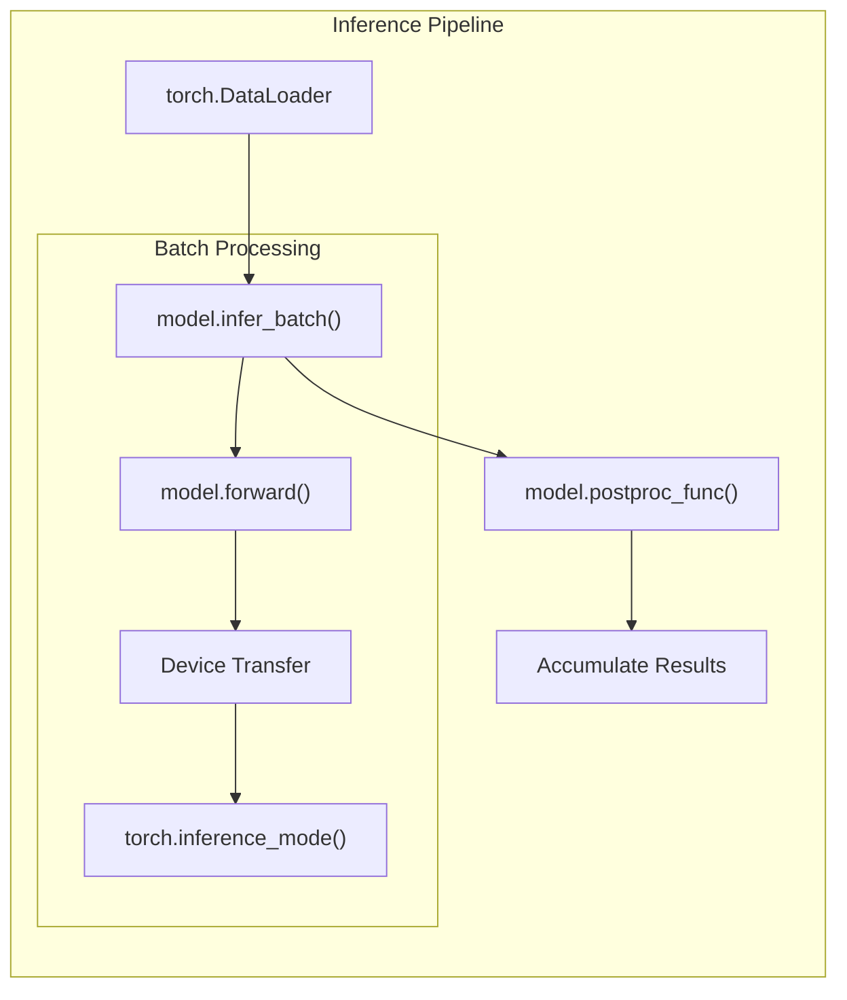
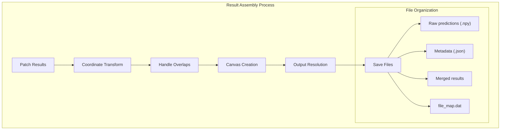

<!-- source: DeepWiki mcp.deepwiki.com · repo TissueImageAnalytics/tiatoolbox · page 4.1 Prediction Engines · fetched 2026-10-21 -->

# Prediction Engines

Relevant source files

The following files were used as context for generating this wiki page:

- [examples/05-patch-prediction.ipynb](examples/05-patch-prediction.ipynb)
- [examples/06-semantic-segmentation.ipynb](examples/06-semantic-segmentation.ipynb)
- [examples/08-nucleus-instance-segmentation.ipynb](examples/08-nucleus-instance-segmentation.ipynb)
- [examples/09-multi-task-segmentation.ipynb](examples/09-multi-task-segmentation.ipynb)
- [examples/10-wsi-registration.ipynb](examples/10-wsi-registration.ipynb)
- [tests/models/test_abc.py](tests/models/test_abc.py)
- [tests/models/test_dataset.py](tests/models/test_dataset.py)
- [tests/models/test_multi_task_segmentor.py](tests/models/test_multi_task_segmentor.py)
- [tests/models/test_nucleus_instance_segmentor.py](tests/models/test_nucleus_instance_segmentor.py)
- [tests/models/test_patch_predictor.py](tests/models/test_patch_predictor.py)
- [tests/models/test_semantic_segmentation.py](tests/models/test_semantic_segmentation.py)
- [tiatoolbox/models/dataset/classification.py](tiatoolbox/models/dataset/classification.py)
- [tiatoolbox/models/dataset/info.py](tiatoolbox/models/dataset/info.py)
- [tiatoolbox/models/engine/multi_task_segmentor.py](tiatoolbox/models/engine/multi_task_segmentor.py)
- [tiatoolbox/models/engine/nucleus_instance_segmentor.py](tiatoolbox/models/engine/nucleus_instance_segmentor.py)
- [tiatoolbox/models/engine/patch_predictor.py](tiatoolbox/models/engine/patch_predictor.py)
- [tiatoolbox/models/engine/semantic_segmentor.py](tiatoolbox/models/engine/semantic_segmentor.py)
- [tiatoolbox/wsicore/wsimeta.py](tiatoolbox/wsicore/wsimeta.py)

Prediction engines are the core inference components in TIAToolbox that handle machine learning model execution on medical imaging data. These engines provide a unified interface for running different types of models (classification, segmentation, instance detection) across various input scales from individual patches to whole slide images.

For information about the underlying model architectures, see [Model Architectures](#4.2). For details about pretrained models and the model registry, see [Pretrained Models](#4.3).

## Engine Types and Capabilities

TIAToolbox provides four main prediction engine classes, each specialized for different tasks:

| Engine | Primary Use Case | Input Types | Output Types |
|--------|------------------|-------------|--------------|
| `PatchPredictor` | Patch classification | Patches, tiles, WSIs | Class predictions, probabilities |
| `SemanticSegmentor` | Pixel-wise segmentation | Tiles, WSIs | Segmentation maps |
| `NucleusInstanceSegmentor` | Nucleus detection/classification | Tiles, WSIs | Instance masks, classifications |
| `MultiTaskSegmentor` | Combined semantic + instance tasks | Tiles, WSIs | Multiple output types |

### PatchPredictor

The `PatchPredictor` class handles patch-level classification tasks, supporting models trained on datasets like Kather100K and PCam. It can process individual patches or extract patches from larger images automatically.

Sources: [tiatoolbox/models/engine/patch_predictor.py:50-225](), [tests/models/test_patch_predictor.py:1-1087]()

### SemanticSegmentor

The `SemanticSegmentor` provides pixel-wise segmentation capabilities with support for multi-resolution processing and overlapping patch strategies to handle boundary artifacts.

Sources: [tiatoolbox/models/engine/semantic_segmentor.py:435-577](), [tiatoolbox/models/engine/semantic_segmentor.py:292-433]()

### Specialized Segmentors

Both `NucleusInstanceSegmentor` and `MultiTaskSegmentor` extend the base segmentation architecture with additional post-processing capabilities for instance detection and multi-task outputs.

Sources: [tiatoolbox/models/engine/nucleus_instance_segmentor.py:256-418](), [tiatoolbox/models/engine/multi_task_segmentor.py:144-312]()

## IO Configuration System

All prediction engines use IO configuration objects to define input/output parameters, resolutions, and processing strategies. This system provides consistent handling of multi-scale processing across different engine types.

### Configuration Classes

### Resolution Handling

The IO configuration system supports multiple resolution specifications and automatic scaling between coordinate systems:

| Resolution Units | Description | Use Case |
|------------------|-------------|----------|
| `"mpp"` | Microns per pixel | Physical resolution matching |
| `"power"` | Objective power | Magnification-based processing |
| `"baseline"` | Relative to level 0 | Direct pyramid level access |

Sources: [tiatoolbox/models/engine/semantic_segmentor.py:114-290](), [tiatoolbox/models/engine/patch_predictor.py:27-48]()

## Processing Modes and Data Flow

Prediction engines support three main processing modes that determine how input data is handled and patches are extracted.

### Processing Mode Architecture

### Patch Extraction and Merging

For tile and WSI modes, engines automatically extract patches using the `PatchExtractor` and merge results back to the original image space:

Sources: [tiatoolbox/models/engine/semantic_segmentor.py:578-709](), [tiatoolbox/models/engine/patch_predictor.py:266-382]()

## Model Integration and Inference

Prediction engines support both pretrained models from the TIAToolbox registry and custom user models. The engines handle model loading, device placement, and batch processing automatically.

### Model Loading Process

### Batch Inference Pipeline

The inference process follows a consistent pattern across all engines:

Sources: [tiatoolbox/models/engine/patch_predictor.py:384-478](), [tiatoolbox/models/architecture/__init__.py:85-109]()

## Output Handling and Post-processing

Different engines produce different output formats, but all follow consistent patterns for saving and returning results.

### Output Formats by Engine

| Engine | Output Format | File Extensions | Content |
|--------|---------------|-----------------|---------|
| `PatchPredictor` | Dictionary | `.json` | Predictions, probabilities, coordinates |
| `SemanticSegmentor` | NumPy arrays | `.npy` | Segmentation maps per output head |
| `NucleusInstanceSegmentor` | Joblib files | `.dat` | Instance dictionaries with contours |
| `MultiTaskSegmentor` | Multiple formats | `.npy`, `.dat` | Combined outputs from multiple tasks |

### Result Merging and Assembly

For WSI processing, engines handle coordinate transformation and result assembly:

Sources: [tiatoolbox/models/engine/semantic_segmentor.py:1044-1224](), [tiatoolbox/models/engine/patch_predictor.py:553-659]()

---

