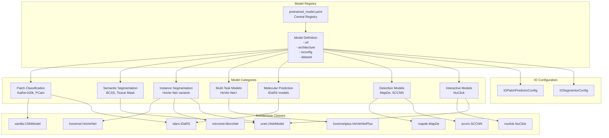
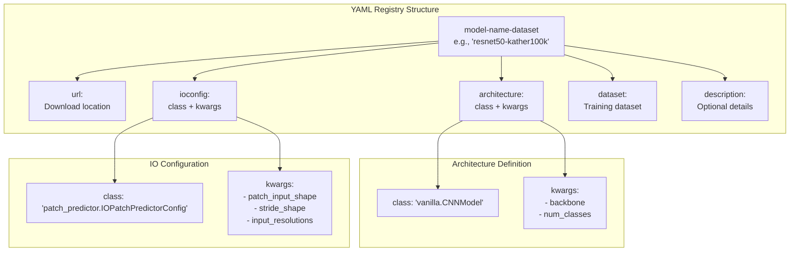
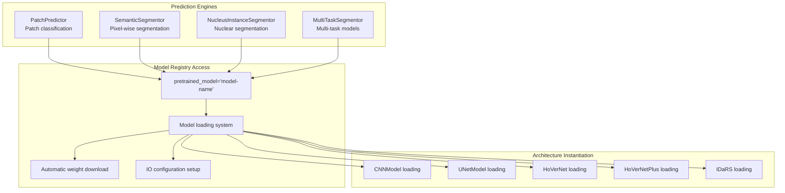
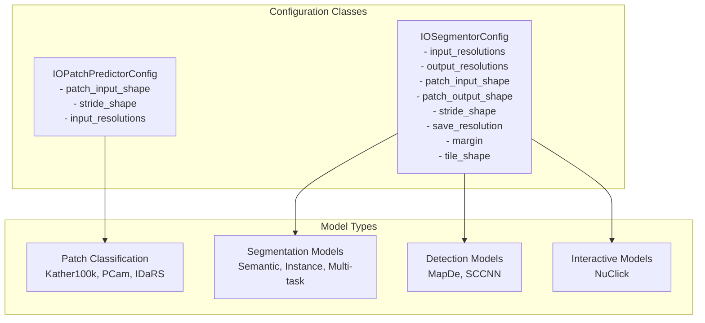

<!-- source: DeepWiki mcp.deepwiki.com · repo TissueImageAnalytics/tiatoolbox · page 4.3 Pretrained Models · fetched 2026-10-21 -->

# Pretrained Models

Relevant source files

The following files were used as context for generating this wiki page:

- [LICENSE](LICENSE)
- [docs/pretrained.rst](docs/pretrained.rst)
- [examples/05-patch-prediction.ipynb](examples/05-patch-prediction.ipynb)
- [examples/06-semantic-segmentation.ipynb](examples/06-semantic-segmentation.ipynb)
- [examples/08-nucleus-instance-segmentation.ipynb](examples/08-nucleus-instance-segmentation.ipynb)
- [examples/09-multi-task-segmentation.ipynb](examples/09-multi-task-segmentation.ipynb)
- [examples/10-wsi-registration.ipynb](examples/10-wsi-registration.ipynb)
- [tiatoolbox/data/pretrained_model.yaml](tiatoolbox/data/pretrained_model.yaml)
- [tiatoolbox/models/architecture/hovernet.py](tiatoolbox/models/architecture/hovernet.py)
- [tiatoolbox/models/architecture/hovernetplus.py](tiatoolbox/models/architecture/hovernetplus.py)
- [tiatoolbox/models/architecture/idars.py](tiatoolbox/models/architecture/idars.py)

This document covers TIAToolbox's pretrained model system, which provides a comprehensive registry of pre-trained neural network models for various computational pathology tasks. The system includes models for patch classification, semantic segmentation, nucleus instance segmentation, and specialized tasks like molecular pathway prediction.

For information about using these models in prediction workflows, see [Prediction Engines](#4.1). For details about the underlying model architectures, see [Model Architectures](#4.2).

## Model Registry System

TIAToolbox maintains a centralized registry of pretrained models in YAML format that defines model metadata, download URLs, architecture specifications, and input/output configurations.

**Sources:** [tiatoolbox/data/pretrained_model.yaml:1-937]()

## Model Registry Structure

The pretrained model registry follows a standardized structure where each model is defined with specific metadata and configuration parameters.

**Sources:** [tiatoolbox/data/pretrained_model.yaml:1-50](), [tiatoolbox/data/pretrained_model.yaml:479-492]()

## Model Categories and Architectures

TIAToolbox provides pretrained models across multiple computational pathology domains, each utilizing specific neural network architectures optimized for their respective tasks.

### Patch Classification Models

| Model Family | Dataset | Architecture | Input Size | Classes | Resolution |
|--------------|---------|--------------|------------|---------|------------|
| Kather100k Models | Kather100k | `vanilla.CNNModel` | 224×224 | 9 | 0.5 mpp |
| PCam Models | PCam | `vanilla.CNNModel` | 96×96 | 2 | 1.0 mpp |
| IDaRS Models | TCGA-CRC | `idars.IDaRS` | 224×224 or 512×512 | 2 | 0.5-1.0 mpp |

**Kather100k Models:** `alexnet-kather100k`, `resnet18-kather100k`, `resnet34-kather100k`, `resnet50-kather100k`, `resnet101-kather100k`, `resnext50_32x4d-kather100k`, `resnext101_32x8d-kather100k`, `wide_resnet50_2-kather100k`, `wide_resnet101_2-kather100k`, `densenet121-kather100k`, `densenet161-kather100k`, `densenet169-kather100k`, `densenet201-kather100k`, `mobilenet_v2-kather100k`, `mobilenet_v3_large-kather100k`, `mobilenet_v3_small-kather100k`, `googlenet-kather100k`

**PCam Models:** Same backbone variants as Kather100k but with `-pcam` suffix

**IDaRS Models:** `resnet18-idars-tumour`, `resnet34-idars-msi`, `resnet34-idars-braf`, `resnet34-idars-cimp`, `resnet34-idars-cin`, `resnet34-idars-tp53`, `resnet34-idars-hm`

**Sources:** [tiatoolbox/data/pretrained_model.yaml:1-239](), [tiatoolbox/data/pretrained_model.yaml:240-477](), [tiatoolbox/data/pretrained_model.yaml:479-570]()

### Semantic Segmentation Models

| Model | Architecture | Input Size | Output Classes | Resolution |
|-------|--------------|------------|---------------|------------|
| `fcn-tissue_mask` | `unet.UNetModel` | 1024×1024 | 2 | 2.0 mpp |
| `fcn_resnet50_unet-bcss` | `unet.UNetModel` | 1024×1024 | 5 | 0.25 mpp |
| `unet_tissue_mask_tsef` | `unet.UNetModel` | 1024×1024 | 3 | baseline |

**Sources:** [tiatoolbox/data/pretrained_model.yaml:572-637]()

### Instance Segmentation Models

| Model | Architecture | Dataset | Input Size | Nucleus Types | Resolution |
|-------|--------------|---------|------------|---------------|------------|
| `hovernet_fast-pannuke` | `hovernet.HoVerNet` | PanNuke | 256×256 | 6 | 0.25 mpp |
| `hovernet_fast-monusac` | `hovernet.HoVerNet` | MoNuSAC | 256×256 | 5 | 0.25 mpp |
| `hovernet_original-consep` | `hovernet.HoVerNet` | CoNSeP | 270×270 | 5 | 0.25 mpp |
| `hovernet_original-kumar` | `hovernet.HoVerNet` | Kumar | 270×270 | N/A | 0.25 mpp |
| `micronet-consep` | `micronet.MicroNet` | CoNSeP | 252×252 | 2 | 0.25 mpp |

**Sources:** [tiatoolbox/data/pretrained_model.yaml:639-806]()

### Multi-Task Segmentation Models

| Model | Architecture | Tasks | Input Size | Resolution |
|-------|--------------|-------|------------|------------|
| `hovernetplus-oed` | `hovernetplus.HoVerNetPlus` | Nuclear + Layer Segmentation | 256×256 | 0.50 mpp |

**Sources:** [tiatoolbox/data/pretrained_model.yaml:752-786]()

### Detection Models

| Model | Architecture | Dataset | Detection Target | Resolution |
|-------|--------------|---------|------------------|------------|
| `mapde-crchisto` | `mapde.MapDe` | CRC-Histo | Nuclei | 0.5 mpp |
| `mapde-conic` | `mapde.MapDe` | CoNIC | Nuclei | 0.5 mpp |
| `sccnn-crchisto` | `sccnn.SCCNN` | CRC-Histo | Nuclei | 0.5 mpp |
| `sccnn-conic` | `sccnn.SCCNN` | CoNIC | Nuclei | 0.5 mpp |

**Sources:** [tiatoolbox/data/pretrained_model.yaml:808-896]()

### Interactive Segmentation Models

| Model | Architecture | Input Channels | Output | Resolution |
|-------|--------------|----------------|--------|------------|
| `nuclick_original-pannuke` | `nuclick.NuClick` | 5 | 1 | 0.25 baseline |
| `nuclick_light-pannuke` | `unet.UNetModel` | 5 | 1 | 0.25 baseline |

**Sources:** [tiatoolbox/data/pretrained_model.yaml:898-936]()

## Integration with Prediction Engines

Pretrained models are accessed through various prediction engines that handle model loading, inference, and post-processing. The model registry provides the necessary configuration for each engine to properly utilize the models.

**Sources:** [examples/05-patch-prediction.ipynb:184-187](), [examples/06-semantic-segmentation.ipynb:365-369](), [examples/08-nucleus-instance-segmentation.ipynb:134-135](), [examples/09-multi-task-segmentation.ipynb:381-386]()

## Configuration System

Each pretrained model includes detailed configuration specifications that define input/output requirements, processing parameters, and resolution settings.

### IO Configuration Classes

### Resolution and Scale Configuration

Models are configured with specific resolution requirements that must match the expected input characteristics:

- **Kather100k models**: 0.5 mpp (microns per pixel)
- **PCam models**: 1.0 mpp
- **IDaRS models**: 0.5-1.0 mpp depending on target
- **Segmentation models**: 0.25-2.0 mpp depending on task
- **HoVer-Net+ models**: 0.50 mpp

**Sources:** [tiatoolbox/data/pretrained_model.yaml:8-13](), [tiatoolbox/data/pretrained_model.yaml:486-491](), [tiatoolbox/data/pretrained_model.yaml:584-591](), [tiatoolbox/data/pretrained_model.yaml:656-668]()

---

