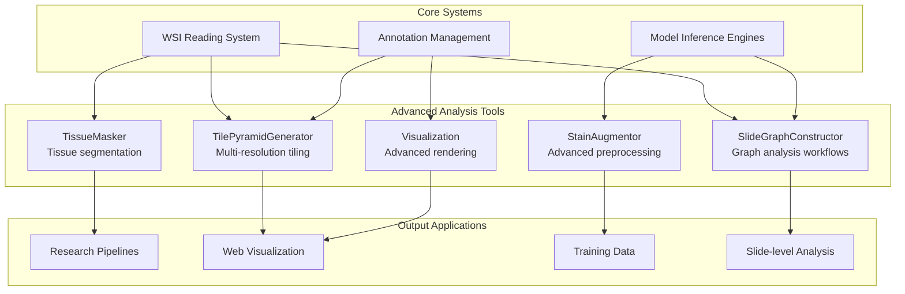
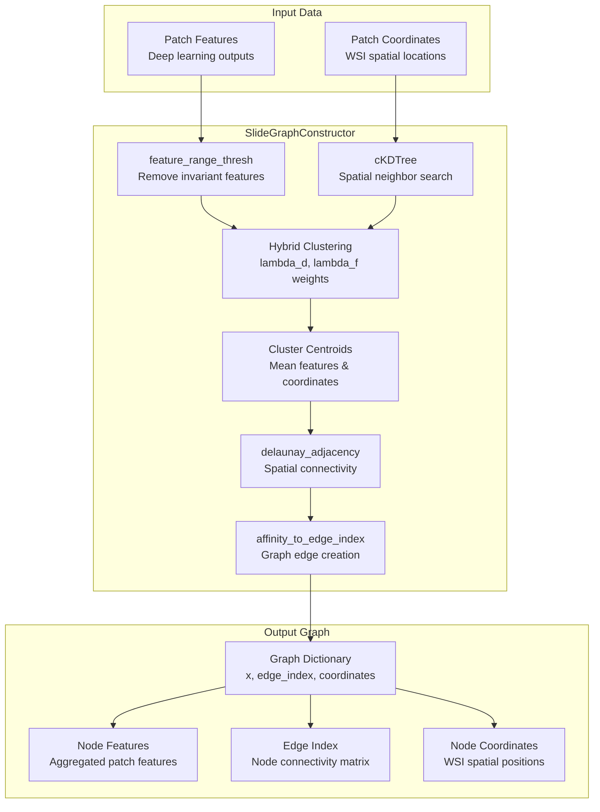
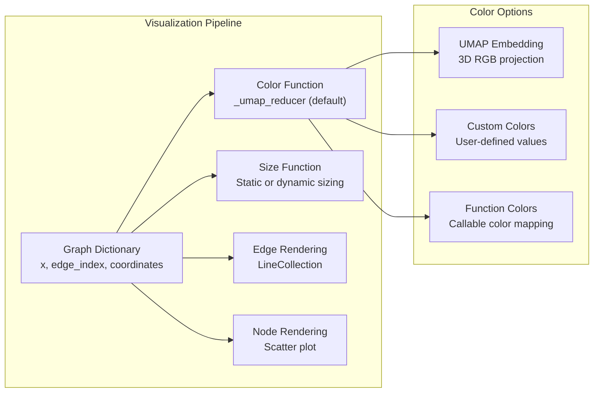
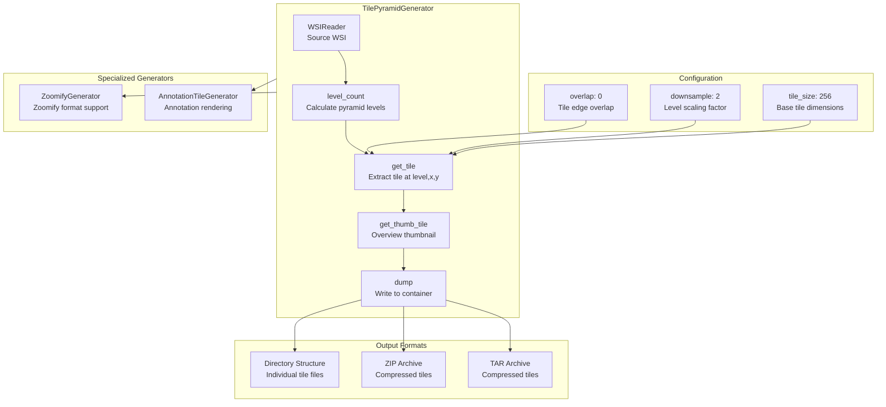
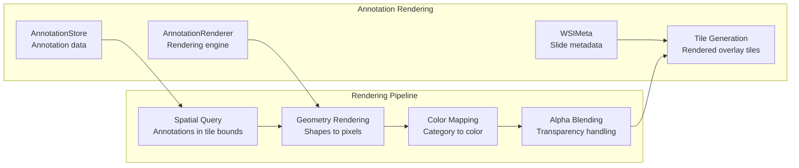
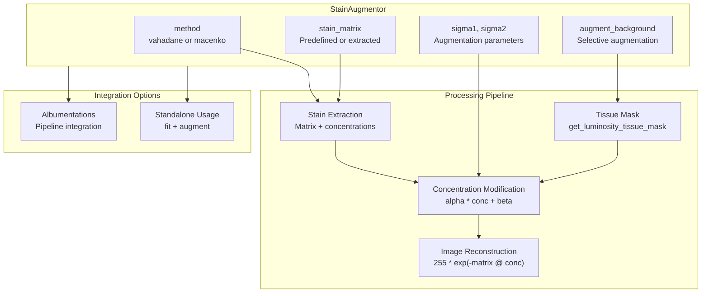
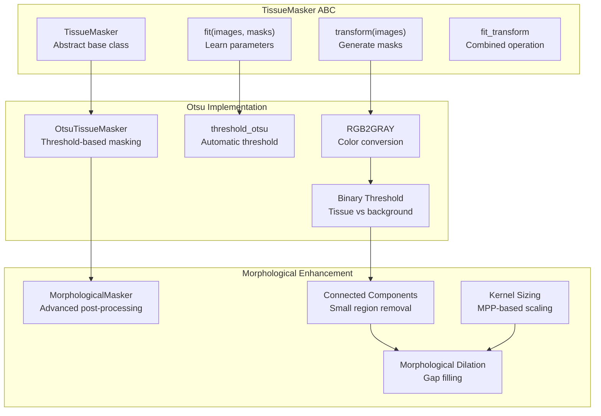
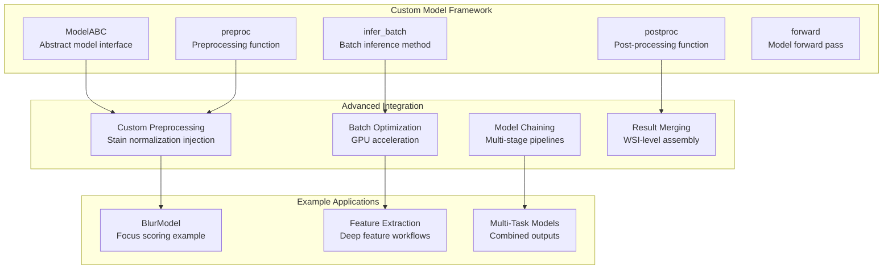

<!-- source: DeepWiki mcp.deepwiki.com · repo TissueImageAnalytics/tiatoolbox · page 5 Advanced Tools · fetched 2026-10-21 -->

# Advanced Tools

Relevant source files

The following files were used as context for generating this wiki page:

- [examples/07-advanced-modeling.ipynb](examples/07-advanced-modeling.ipynb)
- [examples/full-pipelines/slide-graph.ipynb](examples/full-pipelines/slide-graph.ipynb)
- [examples/inference-pipelines/idars.ipynb](examples/inference-pipelines/idars.ipynb)
- [examples/inference-pipelines/slide-graph.ipynb](examples/inference-pipelines/slide-graph.ipynb)
- [tiatoolbox/tools/graph.py](tiatoolbox/tools/graph.py)
- [tiatoolbox/tools/pyramid.py](tiatoolbox/tools/pyramid.py)
- [tiatoolbox/tools/stainaugment.py](tiatoolbox/tools/stainaugment.py)
- [tiatoolbox/tools/tissuemask.py](tiatoolbox/tools/tissuemask.py)

This document covers specialized tools and advanced workflows in TIAToolbox that extend beyond basic WSI reading and model inference. These tools enable sophisticated analysis pipelines including graph-based slide representation, multi-resolution tile pyramid generation, advanced image preprocessing, and specialized visualization capabilities.

For basic WSI processing and model inference, see [Model and Inference Systems](#4). For fundamental image processing operations, see [Image Processing Pipeline](#3).

## Overview

TIAToolbox's advanced tools provide specialized functionality for complex computational pathology workflows. These tools operate at a higher level than basic image processing, enabling researchers to implement cutting-edge methods and create custom analysis pipelines.

Sources: [tiatoolbox/tools/graph.py:200-521](), [tiatoolbox/tools/pyramid.py:39-521](), [tiatoolbox/tools/stainaugment.py:15-250](), [tiatoolbox/tools/tissuemask.py:14-307]()

## Graph Construction and Analysis

The graph construction system enables slide-level analysis by representing WSIs as graphs where nodes correspond to tissue regions and edges encode spatial relationships. This approach is particularly useful for molecular prediction and understanding tissue architecture.

### SlideGraphConstructor Architecture

Sources: [tiatoolbox/tools/graph.py:200-417](), [examples/full-pipelines/slide-graph.ipynb:583-1387]()

The `SlideGraphConstructor.build` method implements hybrid hierarchical clustering that combines spatial and feature-space distances:

- **Spatial Distance**: Computed using coordinates in WSI space with `lambda_d` weighting
- **Feature Distance**: Computed using deep learning features with `lambda_f` weighting  
- **Hybrid Similarity**: `1 - exp(-lambda_d * spatial_dist) * exp(-lambda_f * feature_dist)`
- **Clustering**: Hierarchical clustering with threshold `lambda_h`
- **Connectivity**: Delaunay triangulation of cluster centroids with distance threshold `connectivity_distance`

### Graph Construction Parameters

| Parameter | Default | Purpose |
|-----------|---------|---------|
| `lambda_d` | 3.0e-3 | Spatial distance weighting |
| `lambda_f` | 1.0e-3 | Feature distance weighting |
| `lambda_h` | 0.8 | Clustering threshold |
| `connectivity_distance` | 4000 | Maximum spatial connection distance |
| `neighbour_search_radius` | 2000 | Spatial neighbor search radius |
| `feature_range_thresh` | 1e-4 | Minimum feature variance threshold |

Sources: [tiatoolbox/tools/graph.py:234-417]()

### Graph Visualization

The `SlideGraphConstructor.visualise` method provides sophisticated graph visualization with customizable node coloring and sizing:

Sources: [tiatoolbox/tools/graph.py:418-521]()

## Tile Pyramid Generation

The tile pyramid system creates multi-resolution tiled representations of WSIs for efficient web viewing and progressive loading. It supports multiple output formats including generic pyramids, DeepZoom, and Zoomify.

### Pyramid Generator Architecture

Sources: [tiatoolbox/tools/pyramid.py:39-402](), [tiatoolbox/tools/pyramid.py:403-483](), [tiatoolbox/tools/pyramid.py:485-521]()

### Tile Generation Process

The `get_tile` method implements the core tile extraction logic:

1. **Level Validation**: Verify requested level exists in pyramid
2. **Coordinate Calculation**: Convert tile indices to WSI baseline coordinates
3. **Scale Computation**: Calculate downsample factor for level
4. **Bounds Calculation**: Determine tile bounds with overlap
5. **Image Reading**: Extract image data via `WSIReader.read_rect`
6. **Format Conversion**: Convert to PIL Image for output

### ZoomifyGenerator Enhancements

The `ZoomifyGenerator` extends the base pyramid generator with Zoomify-specific features:

- **Tile Grouping**: Groups tiles into folders of 256 tiles each via `tile_group`
- **Path Generation**: Creates Zoomify-compatible paths via `tile_path`
- **Naming Convention**: Uses `TileGroup{g}/{z}-{x}-{y}.jpg` format

Sources: [tiatoolbox/tools/pyramid.py:403-483]()

### AnnotationTileGenerator

The `AnnotationTileGenerator` creates tile pyramids that render annotations overlaid on transparent backgrounds:

Sources: [tiatoolbox/tools/pyramid.py:485-521]()

## Stain Augmentation

The `StainAugmentor` provides advanced stain normalization and augmentation capabilities for improving model robustness and training data diversity.

### StainAugmentor Architecture

Sources: [tiatoolbox/tools/stainaugment.py:15-250]()

### Augmentation Parameters

The stain augmentation process modifies stain concentrations using random parameters:

- **Alpha (Scale)**: Random value in `[1-sigma1, 1+sigma1]` range
- **Beta (Shift)**: Random value in `[-sigma2, sigma2]` range
- **Per-Stain**: Applied independently to each stain channel
- **Tissue-Selective**: Can be limited to tissue regions only

The augmented concentrations are computed as: `augmented_conc = alpha * original_conc + beta`

Sources: [tiatoolbox/tools/stainaugment.py:177-206]()

## Tissue Masking

The tissue masking system provides automated tissue detection and background removal capabilities essential for WSI analysis workflows.

### TissueMasker Hierarchy

Sources: [tiatoolbox/tools/tissuemask.py:14-307]()

### MorphologicalMasker Features

The `MorphologicalMasker` extends Otsu's method with spatial processing:

- **Scale-Aware Processing**: Kernel size computed from MPP or objective power
- **Small Region Removal**: Connected component analysis with size thresholding  
- **Morphological Dilation**: Gap filling using elliptical structuring elements
- **Automatic Scaling**: Default kernel size of `64/mpp` pixels

Sources: [tiatoolbox/tools/tissuemask.py:167-307]()

## Advanced Modeling Integration

The advanced tools integrate seamlessly with TIAToolbox's modeling framework to enable sophisticated analysis workflows.

### Custom Model Integration

Sources: [examples/07-advanced-modeling.ipynb:343-577](), [tiatoolbox/models/models_abc.py]()

### Pipeline Workflows

Advanced tools enable complex multi-stage analysis pipelines:

1. **Feature Extraction**: Extract deep features or cellular composition from WSI patches
2. **Graph Construction**: Build slide-level graphs from extracted features and coordinates  
3. **Graph Analysis**: Apply graph neural networks for slide-level prediction
4. **Visualization**: Render results as overlays or interactive visualizations
5. **Export**: Generate tile pyramids for web viewing or further analysis

Sources: [examples/full-pipelines/slide-graph.ipynb:583-1387](), [examples/inference-pipelines/slide-graph.ipynb:448-1165]()

---

