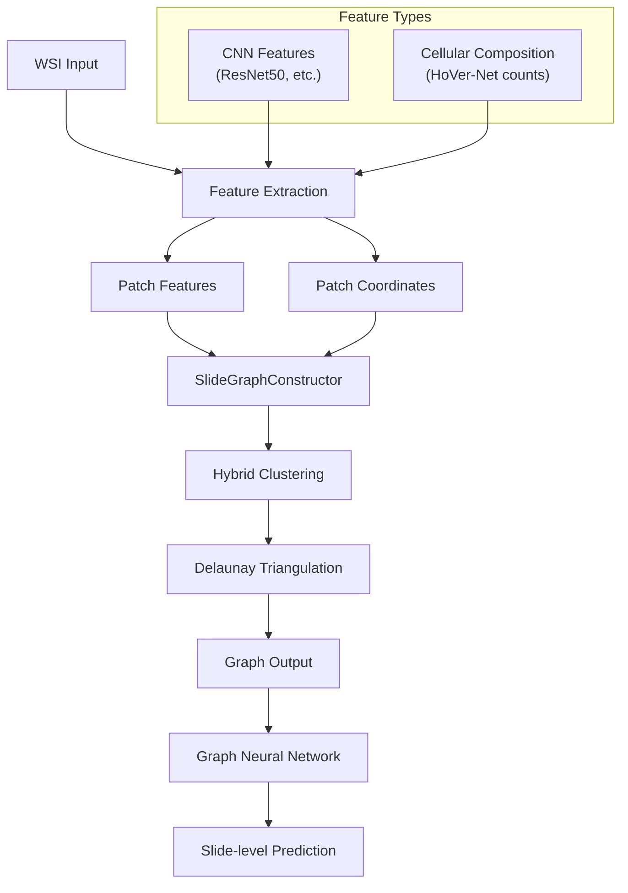
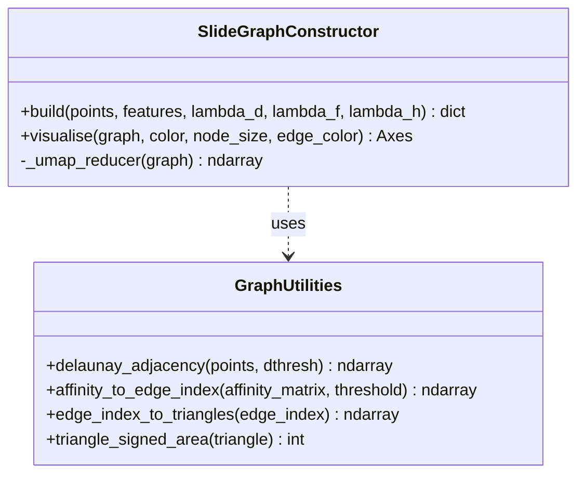
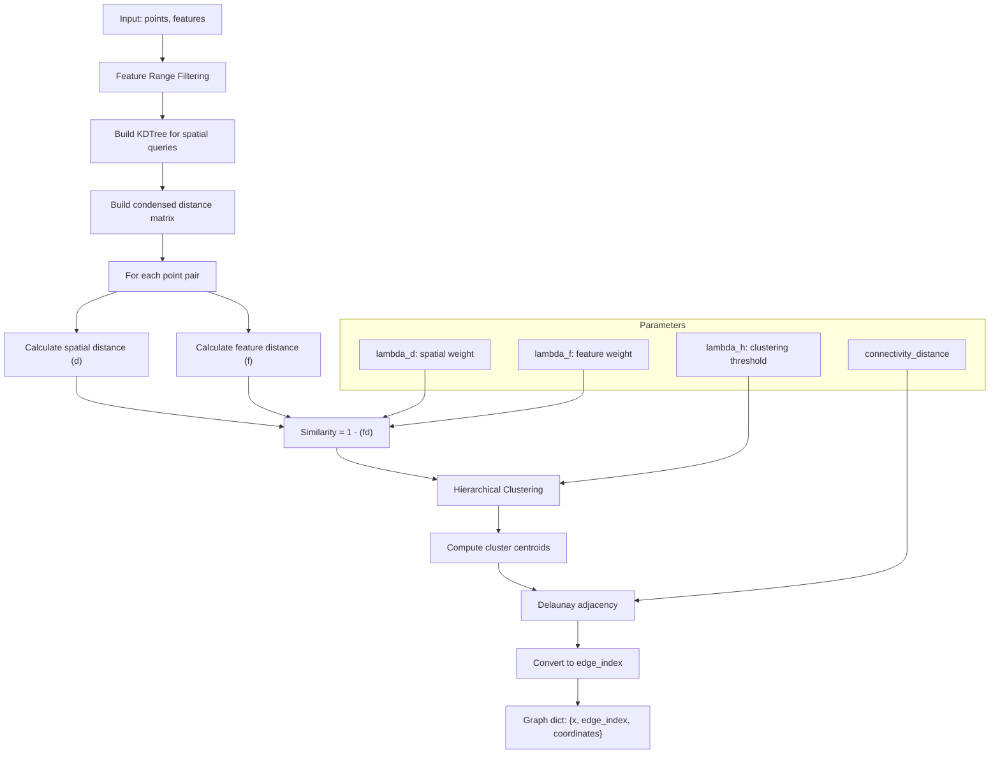
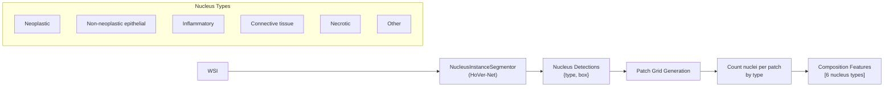
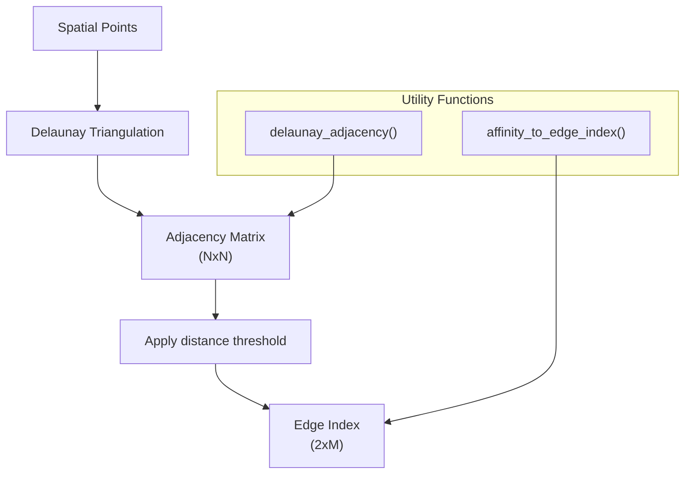
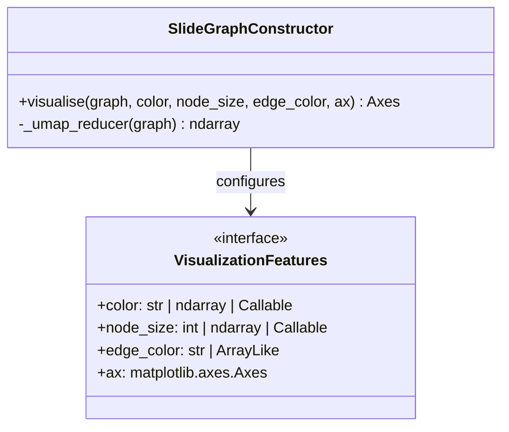
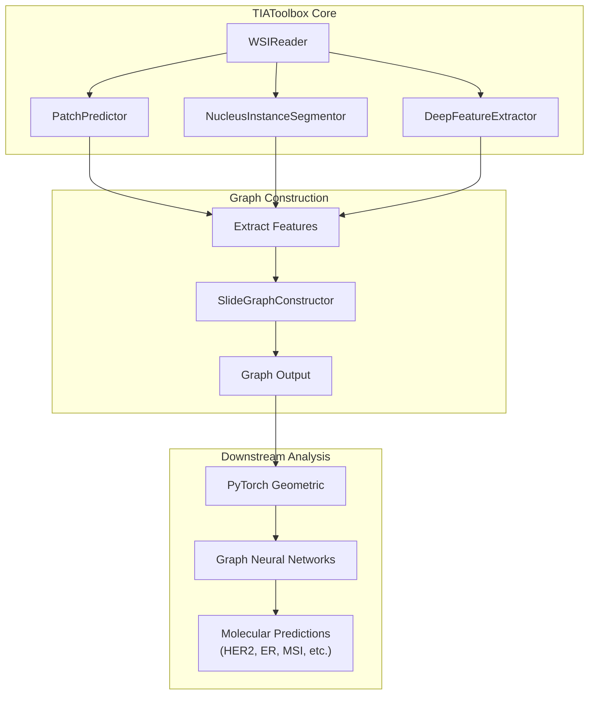

<!-- source: DeepWiki mcp.deepwiki.com · repo TissueImageAnalytics/tiatoolbox · page 5.1 Graph Construction and Analysis · fetched 2026-10-21 -->

# Graph Construction and Analysis

Relevant source files

The following files were used as context for generating this wiki page:

- [examples/07-advanced-modeling.ipynb](examples/07-advanced-modeling.ipynb)
- [examples/full-pipelines/slide-graph.ipynb](examples/full-pipelines/slide-graph.ipynb)
- [examples/inference-pipelines/idars.ipynb](examples/inference-pipelines/idars.ipynb)
- [examples/inference-pipelines/slide-graph.ipynb](examples/inference-pipelines/slide-graph.ipynb)
- [tiatoolbox/tools/graph.py](tiatoolbox/tools/graph.py)
- [tiatoolbox/tools/pyramid.py](tiatoolbox/tools/pyramid.py)
- [tiatoolbox/tools/stainaugment.py](tiatoolbox/tools/stainaugment.py)
- [tiatoolbox/tools/tissuemask.py](tiatoolbox/tools/tissuemask.py)

This document covers TIAToolbox's graph construction and analysis tools for whole slide image (WSI) level analysis. The system enables construction of spatial-feature graphs from WSI data, primarily using the SlideGraph+ methodology for molecular prediction and other slide-level classification tasks.

For patch-level feature extraction methods, see [4.1 Prediction Engines](#4.1). For visualization tools, see [5.3 Visualization and Rendering](#5.3).

## Purpose and Workflow

The graph construction system transforms WSI data into graph representations where nodes represent local tissue regions and edges encode spatial-feature relationships. This enables slide-level predictions using graph neural networks.

### Overall Graph Construction Pipeline

Sources: [tiatoolbox/tools/graph.py:200-521](), [examples/full-pipelines/slide-graph.ipynb:583-1862]()

## Core Components

### SlideGraphConstructor

The `SlideGraphConstructor` class implements the SlideGraph+ methodology for building graphs from spatial coordinates and features.

Sources: [tiatoolbox/tools/graph.py:200-245](), [tiatoolbox/tools/graph.py:21-86]()

### Graph Construction Process

The `SlideGraphConstructor.build()` method performs hybrid clustering in spatial and feature space:

Sources: [tiatoolbox/tools/graph.py:234-416]()

## Feature Extraction for Graphs

The graph construction pipeline supports two primary feature types extracted from WSI patches:

### CNN Deep Features

Deep features are extracted using pretrained CNN models through `DeepFeatureExtractor`:

| Component | Function | Configuration |
|-----------|----------|---------------|
| `CNNBackbone` | Feature extraction model | ResNet50, EfficientNet, etc. |
| `IOSegmentorConfig` | Patch extraction config | 512x512 patches at 0.25 mpp |
| `DeepFeatureExtractor` | Extraction engine | Batch processing with GPU support |

Sources: [examples/full-pipelines/slide-graph.ipynb:664-714]()

### Cellular Composition Features

Cellular composition features count nucleus types within patches using `NucleusInstanceSegmentor`:

Sources: [examples/full-pipelines/slide-graph.ipynb:751-860](), [examples/inference-pipelines/slide-graph.ipynb:613-722]()

## Graph Structure and Output

### Graph Dictionary Format

The `SlideGraphConstructor.build()` method returns a dictionary with standardized keys for PyTorch Geometric compatibility:

| Key | Type | Description |
|-----|------|-------------|
| `"x"` | `np.ndarray` | Node features (cluster centroids) |
| `"edge_index"` | `np.ndarray` | Edge connectivity (2×M matrix) |
| `"coordinates"` | `np.ndarray` | Spatial coordinates of nodes |

Sources: [tiatoolbox/tools/graph.py:299-317]()

### Adjacency and Edge Conversion

Sources: [tiatoolbox/tools/graph.py:21-86](), [tiatoolbox/tools/graph.py:159-197]()

## Graph Visualization

The visualization system provides spatial plotting of graphs with customizable node and edge rendering:

The default coloring uses UMAP reduction of node features to RGB space for intuitive visualization.

Sources: [tiatoolbox/tools/graph.py:418-521](), [tiatoolbox/utils/visualization.py:947-984]()

## Integration with Prediction Pipelines

### SlideGraph Pipeline Integration

The graph construction integrates with TIAToolbox's prediction infrastructure:

Sources: [examples/full-pipelines/slide-graph.ipynb:1-100](), [examples/inference-pipelines/slide-graph.ipynb:1-50]()

### Molecular Prediction Example

The system supports various molecular prediction tasks through graph neural networks:

| Prediction Target | Model Type | Features Used |
|------------------|------------|---------------|
| HER2 Status | Cell Composition | HoVer-Net nucleus counts |
| ER Status | Deep Features | ResNet50 features |
| MSI Status | Mixed | IDaRS pipeline integration |

Sources: [examples/full-pipelines/slide-graph.ipynb:36-66](), [examples/inference-pipelines/slide-graph.ipynb:87-95]()

## Configuration Parameters

### SlideGraphConstructor Parameters

Key parameters for controlling graph construction behavior:

| Parameter | Default | Purpose |
|-----------|---------|---------|
| `lambda_d` | 3.0e-3 | Spatial distance weighting |
| `lambda_f` | 1.0e-3 | Feature distance weighting |
| `lambda_h` | 0.8 | Clustering distance threshold |
| `connectivity_distance` | 4000 | Max spatial connection distance |
| `neighbour_search_radius` | 2000 | Spatial neighbor search radius |
| `feature_range_thresh` | 1e-4 | Minimum feature variance threshold |

Sources: [tiatoolbox/tools/graph.py:234-243]()

## Example Usage

The slide-graph notebooks demonstrate complete workflows from WSI input to graph-based predictions, including feature extraction, graph construction, and integration with graph neural networks for molecular biomarker prediction.

Sources: [examples/full-pipelines/slide-graph.ipynb](), [examples/inference-pipelines/slide-graph.ipynb]()

---

