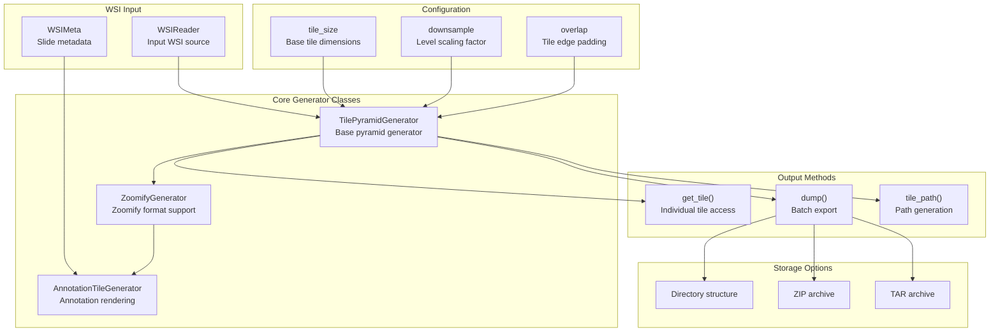
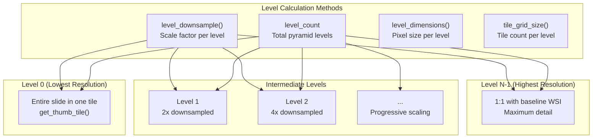
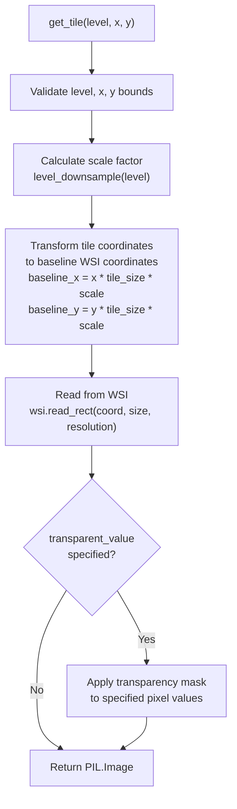
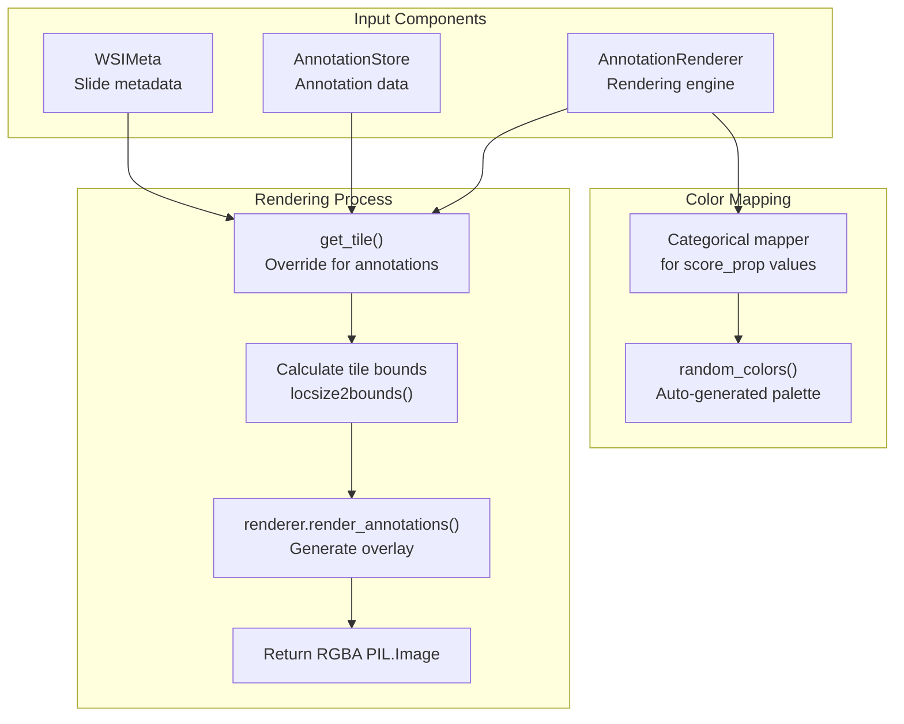
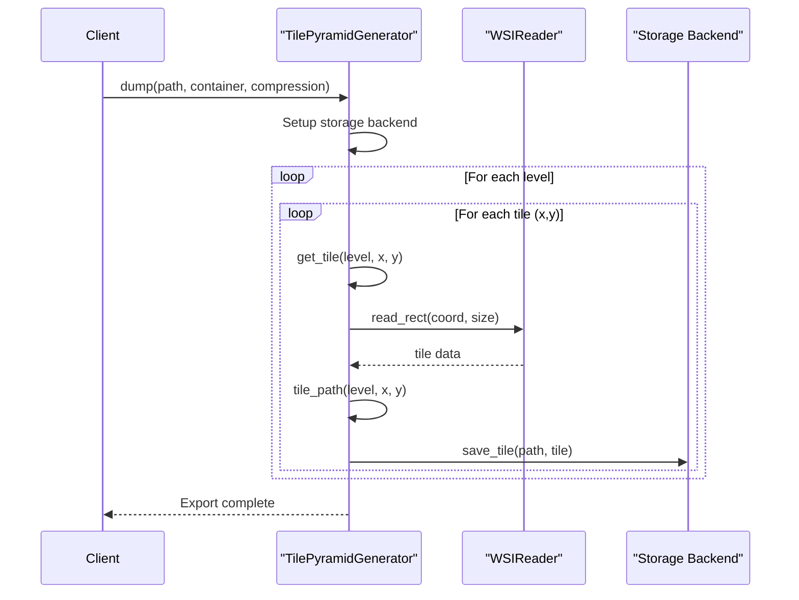

<!-- source: DeepWiki mcp.deepwiki.com · repo TissueImageAnalytics/tiatoolbox · page 5.2 Tile Pyramid Generation · fetched 2026-10-21 -->

# Tile Pyramid Generation

Relevant source files

The following files were used as context for generating this wiki page:

- [tiatoolbox/tools/graph.py](tiatoolbox/tools/graph.py)
- [tiatoolbox/tools/pyramid.py](tiatoolbox/tools/pyramid.py)
- [tiatoolbox/tools/stainaugment.py](tiatoolbox/tools/stainaugment.py)
- [tiatoolbox/tools/tissuemask.py](tiatoolbox/tools/tissuemask.py)

This page covers TIAToolbox's tile pyramid generation system, which creates multi-resolution tile pyramids from WSI data for web viewing and efficient processing. The system supports multiple output formats including Zoomify, DeepZoom, and generic pyramids, with options for annotation overlay rendering.

For information about WSI reading and formats, see [WSI Reading and Formats](#2.1). For visualization tools beyond tile generation, see [Visualization and Rendering](#5.3).

## Overview

Tile pyramid generation converts large WSIs into hierarchical sets of smaller tiles at multiple resolution levels. This enables efficient web-based viewing where users can zoom in and out smoothly, loading only the tiles needed for the current view. The system also supports rendering annotations directly onto tiles for overlay visualization.

## Core Architecture

The tile pyramid system is built around three main generator classes that handle different output formats and use cases:

Sources: [tiatoolbox/tools/pyramid.py:39-401]()

## Pyramid Level Structure

The tile pyramid system uses a reverse level numbering scheme where level 0 represents the lowest resolution (entire slide in one tile) and higher levels represent progressively higher resolutions:

Sources: [tiatoolbox/tools/pyramid.py:80-133]()

## Tile Generation Process

The core tile generation workflow involves coordinate transformation, WSI reading, and optional post-processing:

Sources: [tiatoolbox/tools/pyramid.py:153-252]()

## Format-Specific Generators

### ZoomifyGenerator

The `ZoomifyGenerator` extends the base generator with Zoomify-specific tile organization using tile groups:

| Method | Purpose | Implementation |
|--------|---------|----------------|
| `tile_group()` | Groups tiles into sets of 256 | ZXY axis ordering |
| `tile_path()` | Generates Zoomify paths | `TileGroup{g}/{z}-{x}-{y}.jpg` |

The tile group calculation follows Zoomify's convention of numbering tiles sequentially across all levels and grouping every 256 tiles together due to historical file system limitations.

Sources: [tiatoolbox/tools/pyramid.py:403-483]()

### AnnotationTileGenerator

The `AnnotationTileGenerator` renders annotation overlays instead of WSI data:

Sources: [tiatoolbox/tools/pyramid.py:485-681]()

## Export and Serialization

The `dump()` method provides flexible export options with compression support:

| Container | Compression Options | File Structure |
|-----------|-------------------|----------------|
| Directory | None | File system hierarchy |
| ZIP | deflate, bz2, lzma | Single archive file |
| TAR | gzip, bz2, lzma | Single archive file |

The export process iterates through all pyramid levels and tile coordinates, calling `get_tile()` for each position and saving according to the `tile_path()` format:

Sources: [tiatoolbox/tools/pyramid.py:273-387]()

## Integration with WSI Processing

Tile pyramid generators integrate with the broader TIAToolbox WSI processing pipeline by accepting `WSIReader` instances and leveraging their multi-resolution capabilities. The generators handle coordinate transformations between pyramid tile coordinates and WSI baseline coordinates, enabling seamless integration with existing WSI analysis workflows.

The system supports various WSI reader types through the common `WSIReader` interface, including OpenSlide, TIFF, DICOM, and NGFF formats, making it compatible with most digital pathology image formats.

Sources: [tiatoolbox/tools/pyramid.py:39-70](), [tiatoolbox/utils/transforms.py:27](), [tiatoolbox/utils/visualization.py:28]()

---

