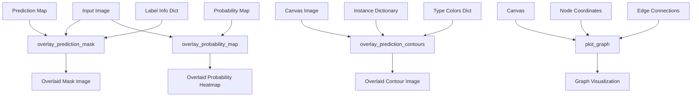
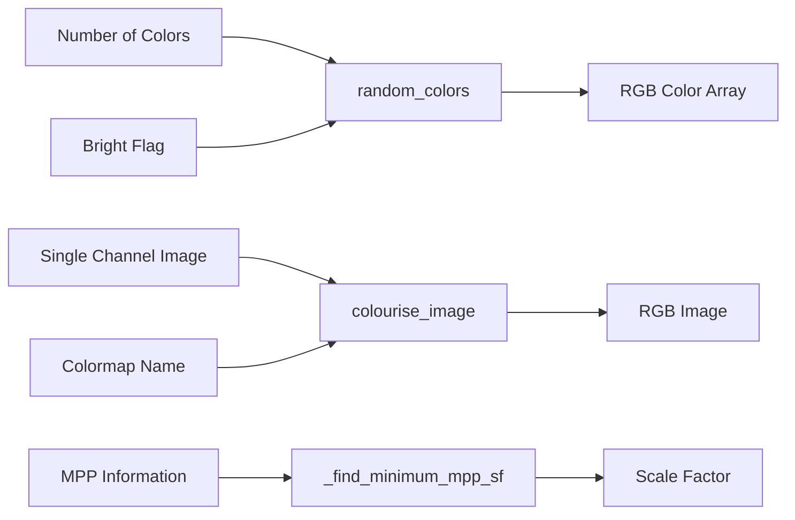
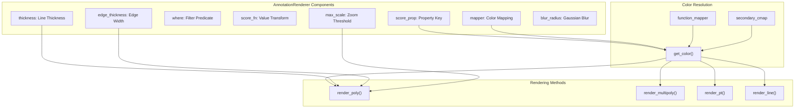
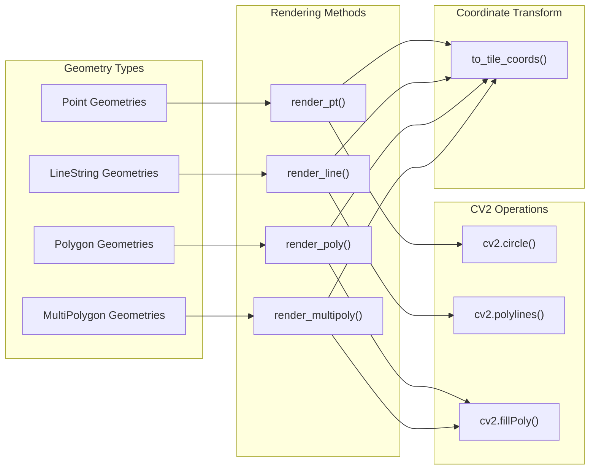
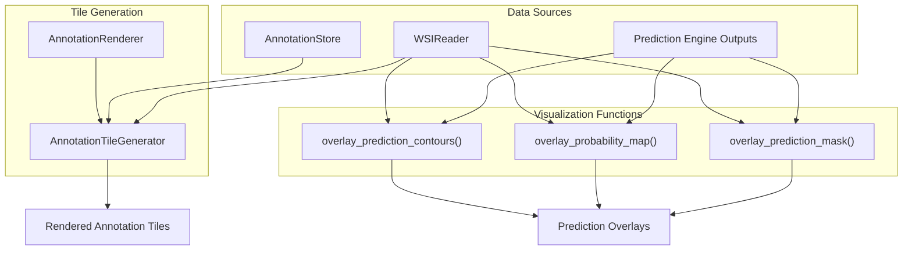
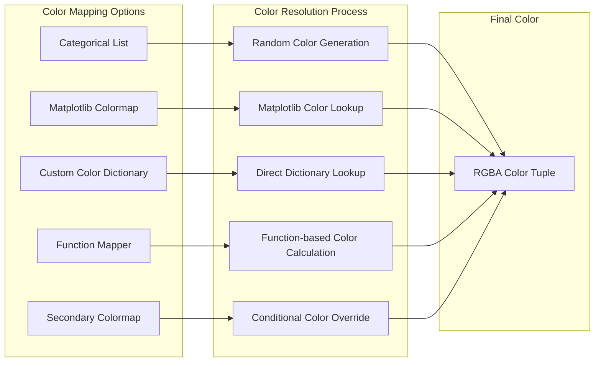
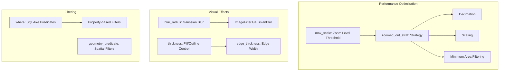

<!-- source: DeepWiki mcp.deepwiki.com · repo TissueImageAnalytics/tiatoolbox · page 5.3 Visualization and Rendering · fetched 2026-10-21 -->

# Visualization and Rendering

<details>
<summary>Relevant source files</summary>

The following files were used as context for generating this wiki page:

- [examples/05-patch-prediction.ipynb](examples/05-patch-prediction.ipynb)
- [examples/06-semantic-segmentation.ipynb](examples/06-semantic-segmentation.ipynb)
- [examples/08-nucleus-instance-segmentation.ipynb](examples/08-nucleus-instance-segmentation.ipynb)
- [examples/09-multi-task-segmentation.ipynb](examples/09-multi-task-segmentation.ipynb)
- [examples/10-wsi-registration.ipynb](examples/10-wsi-registration.ipynb)
- [tests/test_annotation_stores.py](tests/test_annotation_stores.py)
- [tests/test_annotation_tilerendering.py](tests/test_annotation_tilerendering.py)
- [tests/test_visualization.py](tests/test_visualization.py)
- [tiatoolbox/annotation/storage.py](tiatoolbox/annotation/storage.py)
- [tiatoolbox/utils/visualization.py](tiatoolbox/utils/visualization.py)

</details>


TIAToolbox provides comprehensive visualization and rendering capabilities for displaying analysis results, annotations, and predictions on histology images. This system enables users to overlay semantic segmentation masks, instance segmentation contours, probability heatmaps, and spatial annotations onto WSI tiles or image patches. The visualization tools integrate seamlessly with TIAToolbox's prediction engines and annotation storage systems to provide immediate visual feedback on computational pathology workflows.

For information about generating tile pyramids for web viewing, see [Tile Pyramid Generation](#5.2). For details about the annotation storage system that feeds into these visualization tools, see [Annotation Management](#2.2).

## Core Visualization Functions

The primary visualization functionality is provided through several overlay functions in the `utils.visualization` module. These functions handle the most common visualization tasks in computational pathology:

### Prediction Overlay Functions



**Core Overlay Functions**

| Function | Purpose | Input Format | Output |
|----------|---------|--------------|---------|
| `overlay_prediction_mask` | Semantic segmentation overlays | Class predictions (H×W) | RGB overlay with colorbar |
| `overlay_probability_map` | Probability heatmaps | Float probabilities (H×W) | RGB heatmap overlay |
| `overlay_prediction_contours` | Instance segmentation contours | Instance dictionary with contours | Contour-overlaid image |
| `plot_graph` | Graph structure visualization | Nodes and edges arrays | Graph-overlaid canvas |

Sources: [tiatoolbox/utils/visualization.py:88-208](), [tiatoolbox/utils/visualization.py:274-351](), [tiatoolbox/utils/visualization.py:419-497](), [tiatoolbox/utils/visualization.py:499-561]()

### Color Management and Utilities

The visualization system includes utilities for color generation and image preprocessing:



Sources: [tiatoolbox/utils/visualization.py:43-85](), [tiatoolbox/utils/visualization.py:563-568]()

## Annotation Rendering System

The annotation rendering system provides sophisticated capabilities for visualizing stored annotations on WSI tiles. This system is built around the `AnnotationRenderer` class which converts annotation geometries into visual overlays.

### AnnotationRenderer Architecture



**Annotation Rendering Pipeline**

The `AnnotationRenderer` processes annotations through several configurable stages:

1. **Filtering**: Apply `where` predicates to select annotations
2. **Color Mapping**: Resolve colors using `mapper`, `score_prop`, and `function_mapper`
3. **Geometry Rendering**: Render different geometry types with appropriate methods
4. **Coordinate Transformation**: Convert from WSI coordinates to tile coordinates
5. **Styling**: Apply thickness, blur, and other visual effects

Sources: [tiatoolbox/utils/visualization.py:570-666](), [tiatoolbox/utils/visualization.py:693-762](), [tiatoolbox/utils/visualization.py:763-893]()

### Geometry-Specific Rendering



Sources: [tiatoolbox/utils/visualization.py:826-857](), [tiatoolbox/utils/visualization.py:859-893](), [tiatoolbox/utils/visualization.py:763-811](), [tiatoolbox/utils/visualization.py:812-825]()

## Integration with TIAToolbox Components

The visualization system integrates with multiple TIAToolbox components to provide seamless visual feedback throughout analysis workflows.

### WSI and Annotation Integration



### Prediction Engine Integration

The visualization system is designed to work seamlessly with TIAToolbox's prediction engines:

| Prediction Engine | Compatible Visualization | Output Format |
|------------------|-------------------------|---------------|
| `PatchPredictor` | `overlay_prediction_mask` | Class predictions per patch |
| `SemanticSegmentor` | `overlay_prediction_mask` | Pixel-wise class maps |
| `NucleusInstanceSegmentor` | `overlay_prediction_contours` | Instance dictionaries with contours |
| `MultiTaskSegmentor` | Both mask and contour overlays | Combined semantic + instance outputs |

Sources: [examples/05-patch-prediction.ipynb:184-190](), [examples/06-semantic-segmentation.ipynb:138-146](), [examples/08-nucleus-instance-segmentation.ipynb:134-141](), [examples/09-multi-task-segmentation.ipynb:145-153]()

## Configuration and Customization

### Color Mapping Strategies

The visualization system supports multiple color mapping approaches:



**Color Mapping Configuration Examples**

```python
# Categorical mapping with random colors
renderer = AnnotationRenderer(
    score_prop="type",
    mapper=["epithelial", "inflammatory", "connective"]
)

# Continuous mapping with matplotlib colormap
renderer = AnnotationRenderer(
    score_prop="probability",
    mapper="viridis",
    score_fn=lambda x: x / 100.0  # Normalize to [0,1]
)

# Custom color dictionary
renderer = AnnotationRenderer(
    score_prop="class",
    mapper={0: (1, 0, 0, 1), 1: (0, 1, 0, 1), 2: (0, 0, 1, 1)}
)
```

Sources: [tiatoolbox/utils/visualization.py:894-914](), [tests/test_annotation_tilerendering.py:302-321](), [tests/test_annotation_tilerendering.py:336-350]()

### Advanced Rendering Options



Sources: [tiatoolbox/utils/visualization.py:630-666](), [tests/test_annotation_tilerendering.py:175-195](), [tests/test_annotation_tilerendering.py:197-210]()

## Usage Examples and Integration Patterns

### Basic Overlay Usage

The most common usage pattern involves overlaying prediction results onto WSI thumbnails or patches:

```python
# Semantic segmentation overlay
overlaid_image = overlay_prediction_mask(
    img=wsi_thumbnail,
    prediction=semantic_predictions,
    label_info=class_color_mapping,
    alpha=0.5
)

# Instance segmentation overlay  
overlaid_image = overlay_prediction_contours(
    canvas=wsi_patch,
    inst_dict=nucleus_instances,
    type_colours=nucleus_type_colors,
    draw_dot=True
)
```

### Advanced Annotation Rendering

For complex annotation visualization workflows:

```python
# Create renderer with sophisticated color mapping
renderer = AnnotationRenderer(
    score_prop="confidence",
    mapper="jet",
    where='props["type"] == "tumor"',
    max_scale=8,
    zoomed_out_strat="decimate"
)

# Generate annotation tiles
tile_generator = AnnotationTileGenerator(
    wsi_info=wsi.info,
    store=annotation_store,
    renderer=renderer,
    tile_size=256
)
```

Sources: [examples/05-patch-prediction.ipynb:184-190](), [examples/08-nucleus-instance-segmentation.ipynb:134-141](), [tests/test_annotation_tilerendering.py:114-124]()

---

