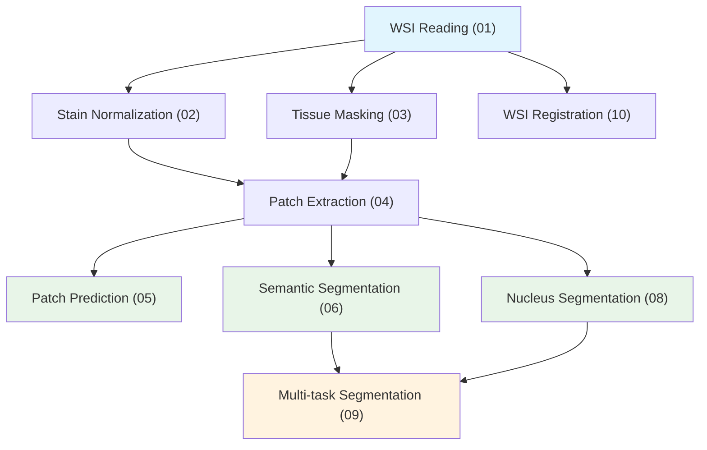
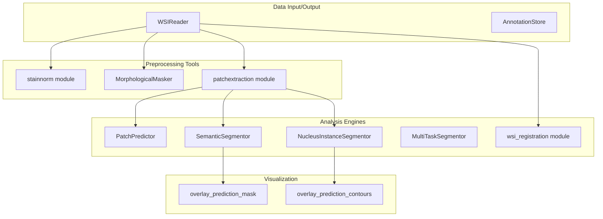

<!-- source: DeepWiki mcp.deepwiki.com · repo TissueImageAnalytics/tiatoolbox · page 6 Examples and Tutorials · fetched 2026-10-21 -->

# Examples and Tutorials

<details>
<summary>Relevant source files</summary>

The following files were used as context for generating this wiki page:

- [examples/01-wsi-reading.ipynb](examples/01-wsi-reading.ipynb)
- [examples/02-stain-normalization.ipynb](examples/02-stain-normalization.ipynb)
- [examples/03-tissue-masking.ipynb](examples/03-tissue-masking.ipynb)
- [examples/04-patch-extraction.ipynb](examples/04-patch-extraction.ipynb)
- [examples/05-patch-prediction.ipynb](examples/05-patch-prediction.ipynb)
- [examples/06-semantic-segmentation.ipynb](examples/06-semantic-segmentation.ipynb)
- [examples/08-nucleus-instance-segmentation.ipynb](examples/08-nucleus-instance-segmentation.ipynb)
- [examples/09-multi-task-segmentation.ipynb](examples/09-multi-task-segmentation.ipynb)
- [examples/10-wsi-registration.ipynb](examples/10-wsi-registration.ipynb)

</details>


This section provides practical examples demonstrating TIAToolbox capabilities through Jupyter notebooks and step-by-step tutorials. The examples progress from basic WSI operations to advanced analysis pipelines, covering all major functionality including patch extraction, model inference, segmentation, and registration.

For information about the underlying model architectures and inference engines, see [Model and Inference Systems](#4). For details about the command-line interface tools, see [Command Line Interface](#7).

## Overview of Tutorial Structure

The TIAToolbox examples are organized as interactive Jupyter notebooks that demonstrate progressively complex workflows. Each notebook can be run in Google Colab without local installation, making them accessible for learning and experimentation.

### Tutorial Learning Path



Sources: [examples/01-wsi-reading.ipynb:1-400](), [examples/02-stain-normalization.ipynb:1-300](), [examples/03-tissue-masking.ipynb:1-250](), [examples/04-patch-extraction.ipynb:1-300](), [examples/05-patch-prediction.ipynb:1-400](), [examples/06-semantic-segmentation.ipynb:1-400](), [examples/08-nucleus-instance-segmentation.ipynb:1-400](), [examples/09-multi-task-segmentation.ipynb:1-400](), [examples/10-wsi-registration.ipynb:1-400]()

### Core Components Demonstrated



Sources: [examples/01-wsi-reading.ipynb:175-180](), [examples/02-stain-normalization.ipynb:183-185](), [examples/03-tissue-masking.ipynb:155-157](), [examples/04-patch-extraction.ipynb:128-130](), [examples/05-patch-prediction.ipynb:184-191](), [examples/06-semantic-segmentation.ipynb:138-146](), [examples/08-nucleus-instance-segmentation.ipynb:134-142](), [examples/09-multi-task-segmentation.ipynb:145-154](), [examples/10-wsi-registration.ipynb:157-165]()

## Basic Usage Examples

### WSI Reading and Visualization

The foundational example demonstrates reading WSIs using `WSIReader.open()` and extracting basic metadata and thumbnails. This example uses the `small_svs()` function from `tiatoolbox.data` to download a sample WSI.

**Key Classes:**
- `WSIReader`: Universal interface for reading different WSI formats
- `WSIReader.info`: Metadata access including magnification, dimensions, and vendor information
- `slide_thumbnail()`: Method for generating overview images

**Example Workflow:**
1. Open WSI using `WSIReader.open(file_path)`
2. Extract metadata with `reader.info.as_dict()`
3. Generate thumbnail with `reader.slide_thumbnail()`
4. Extract regions using `read_rect()` method

Sources: [examples/01-wsi-reading.ipynb:217-220](), [examples/01-wsi-reading.ipynb:252-254](), [examples/01-wsi-reading.ipynb:295-298]()

### Stain Normalization

Demonstrates color standardization across different imaging conditions using the `stainnorm` module. Multiple normalization methods are available including Reinhard, Vahadane, and Macenko techniques.

**Key Classes:**
- `stainnorm.ReinhardNormalizer`: Statistical color transfer
- `stainnorm.VahadaneNormalizer`: Sparse non-negative matrix factorization
- `stainnorm.MacenkoNormalizer`: Singular value decomposition approach

Sources: [examples/02-stain-normalization.ipynb:183-185]()

### Tissue Masking

Shows automatic tissue detection using `MorphologicalMasker` with Otsu thresholding and morphological operations to separate tissue regions from background glass areas.

**Key Classes:**
- `MorphologicalMasker`: Primary tissue masking class
- `get_mask()`: Method for generating binary tissue masks

Sources: [examples/03-tissue-masking.ipynb:155-157]()

### Patch Extraction

Demonstrates extracting image patches using different strategies through the `patchextraction` module. Supports point-based, fixed-window, and variable-window extraction methods.

**Key Functions:**
- `get_patch_extractor()`: Factory function for creating extractors
- `extract()`: Main extraction method
- Point-based extraction using coordinate lists
- Grid-based sliding window extraction

Sources: [examples/04-patch-extraction.ipynb:128-130]()

## Advanced Analysis Pipelines

### Patch-Level Prediction

Demonstrates classification of image patches using pre-trained models through `PatchPredictor`. Includes models trained on Kather 100k dataset for tissue type classification.

**Key Classes:**
- `PatchPredictor`: Engine for patch classification
- `IOPatchPredictorConfig`: Configuration for input/output handling
- Multiple CNN architectures: ResNet, DenseNet, MobileNet variants

**Available Models:**
- `alexnet-kather100k`, `resnet18-kather100k`, `resnet34-kather100k`
- `resnet50-kather100k`, `resnet101-kather100k`
- `densenet121-kather100k`, `densenet161-kather100k`
- `mobilenet_v2-kather100k`, `mobilenet_v3_large-kather100k`

Sources: [examples/05-patch-prediction.ipynb:184-191](), [examples/05-patch-prediction.ipynb:42-62]()

### Semantic Segmentation

Demonstrates pixel-wise tissue classification using `SemanticSegmentor` with models trained on breast cancer datasets for tissue type segmentation.

**Key Classes:**
- `SemanticSegmentor`: Engine for semantic segmentation
- `IOSegmentorConfig`: Configuration for segmentation parameters
- `fcn_resnet50_unet-bcss`: Pre-trained UNet model with ResNet50 encoder

**Tissue Classes:**
- Tumour, Stroma, Inflammatory, Necrosis, Others

Sources: [examples/06-semantic-segmentation.ipynb:138-146](), [examples/06-semantic-segmentation.ipynb:364-382]()

### Nucleus Instance Segmentation

Shows nuclear detection and classification using `NucleusInstanceSegmentor` with HoVer-Net architecture for simultaneous segmentation and classification.

**Key Classes:**
- `NucleusInstanceSegmentor`: Engine for nucleus instance segmentation  
- `hovernet_fast-pannuke`: Pre-trained HoVer-Net model
- `overlay_prediction_contours`: Visualization function for instance masks

**Nuclear Classes:**
- Background, Neoplastic Epithelial, Non-Neoplastic Epithelial
- Inflammatory, Connective, Dead

Sources: [examples/08-nucleus-instance-segmentation.ipynb:134-142](), [examples/08-nucleus-instance-segmentation.ipynb:346-361]()

### Multi-Task Segmentation

Demonstrates simultaneous nuclear instance segmentation and tissue layer classification using `MultiTaskSegmentor` with HoVer-Net+ architecture.

**Key Classes:**
- `MultiTaskSegmentor`: Engine for multi-task segmentation
- `hovernetplus-oed`: Pre-trained HoVer-Net+ model for oral epithelial dysplasia

**Simultaneous Tasks:**
1. Nuclear instance segmentation (epithelial vs. other nuclei)
2. Tissue layer segmentation (keratin, epithelial, basal epithelial, other, background)

Sources: [examples/09-multi-task-segmentation.ipynb:145-154](), [examples/09-multi-task-segmentation.ipynb:380-395]()

### WSI Registration

Shows registration of histology image pairs using Deep Feature Based Registration (DFBR) followed by non-rigid alignment with B-spline transforms.

**Key Classes:**
- `DFBRegister`: Deep feature-based registration engine
- `AffineWSITransformer`: Affine transformation application
- `estimate_bspline_transform`: Non-rigid registration
- `apply_bspline_transform`: Transform application

**Registration Pipeline:**
1. Pre-alignment using tissue masks
2. Feature extraction with deep networks
3. Feature matching and transform estimation
4. Non-rigid refinement with B-splines

Sources: [examples/10-wsi-registration.ipynb:157-165]()

## Tutorial Execution Environment

### Colab Integration

All tutorials include installation cells for Google Colab compatibility:

```bash
%%bash
apt-get -y install libopenjp2-7-dev libopenjp2-tools openslide-tools libpixman-1-dev
pip install git+https://github.com/TissueImageAnalytics/tiatoolbox.git@develop
```

### Device Configuration

Examples support both CPU and GPU execution with device selection:

```python
device = "cuda"  # or "cpu"
```

### Data Management

Tutorials follow consistent patterns for data handling:
- Download sample data to temporary directories
- Clean up previous runs automatically
- Provide paths for user data substitution

Sources: [examples/05-patch-prediction.ipynb:83-97](), [examples/06-semantic-segmentation.ipynb:74-87](), [examples/08-nucleus-instance-segmentation.ipynb:70-83]()

---

