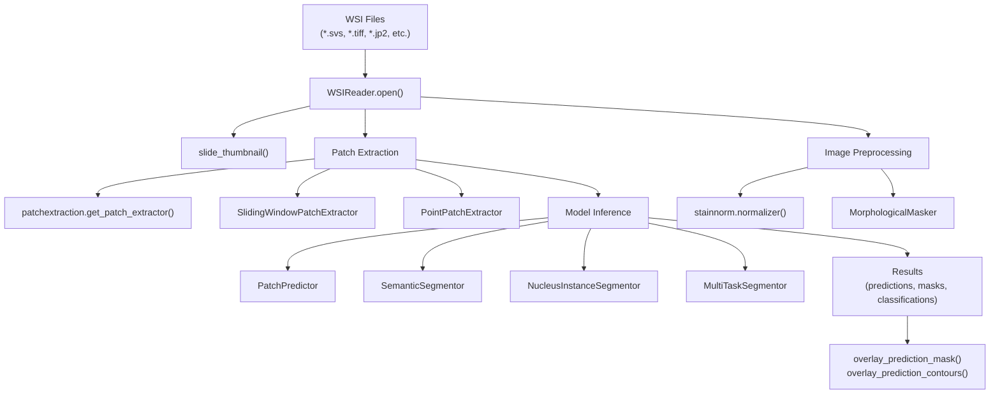
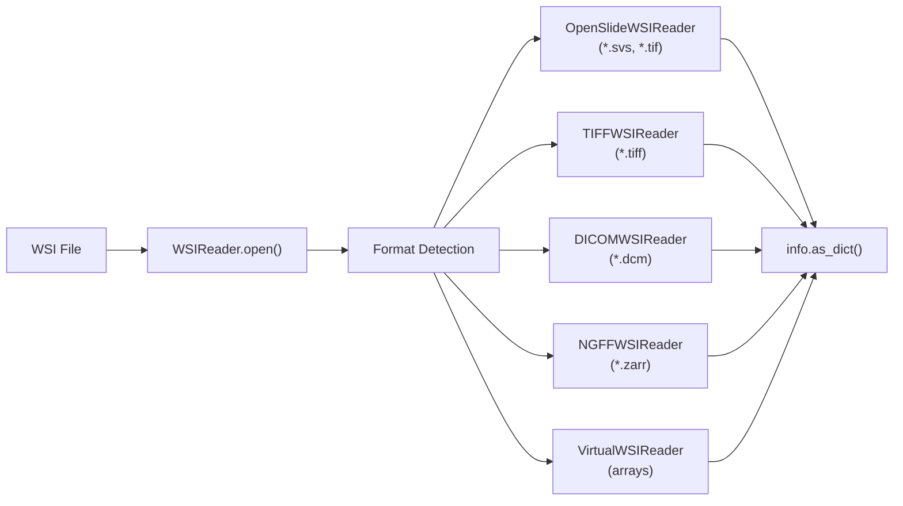
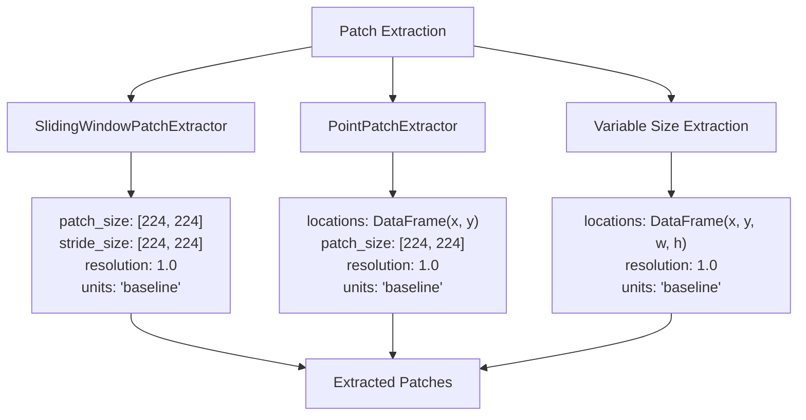
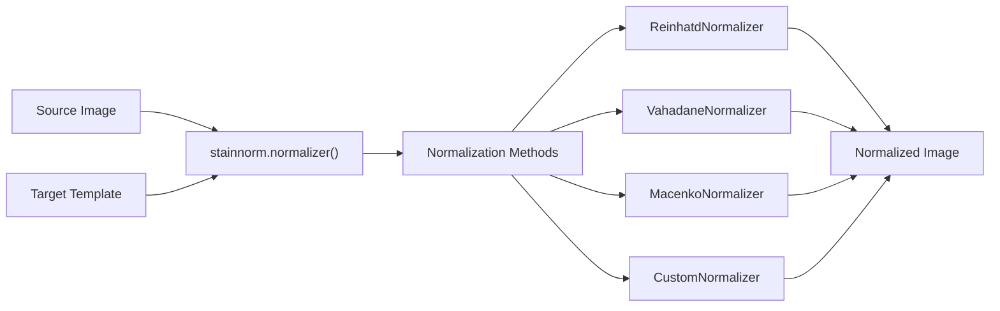
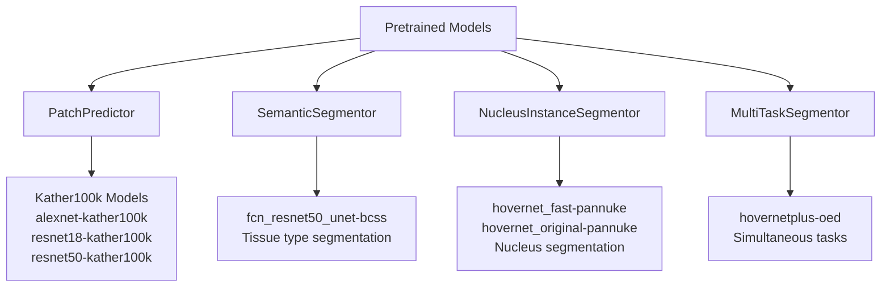
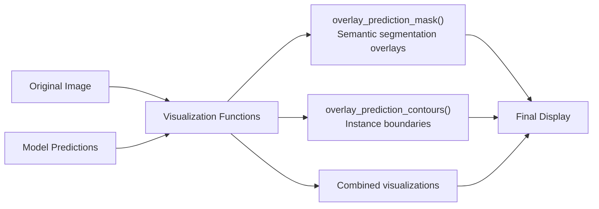

<!-- source: DeepWiki mcp.deepwiki.com · repo TissueImageAnalytics/tiatoolbox · page 6.1 Basic Usage Examples · fetched 2026-10-21 -->

# Basic Usage Examples

Relevant source files

The following files were used as context for generating this wiki page:

- [examples/01-wsi-reading.ipynb](examples/01-wsi-reading.ipynb)
- [examples/02-stain-normalization.ipynb](examples/02-stain-normalization.ipynb)
- [examples/03-tissue-masking.ipynb](examples/03-tissue-masking.ipynb)
- [examples/04-patch-extraction.ipynb](examples/04-patch-extraction.ipynb)
- [examples/05-patch-prediction.ipynb](examples/05-patch-prediction.ipynb)
- [examples/06-semantic-segmentation.ipynb](examples/06-semantic-segmentation.ipynb)
- [examples/08-nucleus-instance-segmentation.ipynb](examples/08-nucleus-instance-segmentation.ipynb)
- [examples/09-multi-task-segmentation.ipynb](examples/09-multi-task-segmentation.ipynb)
- [examples/10-wsi-registration.ipynb](examples/10-wsi-registration.ipynb)

This page provides step-by-step tutorials for the most common WSI analysis tasks in TIAToolbox. It covers fundamental workflows that most users will need, including reading WSIs, extracting patches, basic preprocessing, and running pretrained models. For more complex analysis pipelines involving SlideGraph and molecular prediction, see [Advanced Analysis Pipelines](#6.2).

## Overview of Basic WSI Analysis Workflow

The typical basic workflow in TIAToolbox follows a standard pattern from data input to analysis output:

Sources: [examples/01-wsi-reading.ipynb:1-500](), [examples/04-patch-extraction.ipynb:1-500](), [examples/05-patch-prediction.ipynb:1-500]()

## Basic WSI Reading and Metadata Access

### Reading WSI Files

The `WSIReader` class provides a unified interface for reading different WSI formats. The factory method `WSIReader.open()` automatically detects the file format and returns the appropriate reader:

Key methods for basic WSI access:
- `reader.info.as_dict()` - Get WSI metadata including dimensions, magnification, vendor
- `reader.slide_thumbnail()` - Generate overview thumbnail
- `reader.read_rect()` - Read rectangular regions at specified coordinates and resolution

Sources: [examples/01-wsi-reading.ipynb:195-300](), [tiatoolbox/wsicore/wsireader.py:1-100]()

### Essential WSI Information

The most commonly accessed metadata includes:

| Property | Description | Usage |
|----------|-------------|--------|
| `slide_dimensions` | Full resolution dimensions (width, height) | Planning patch extraction grids |
| `level_dimensions` | Dimensions at each pyramid level | Multi-resolution processing |
| `level_downsamples` | Downsample factors for each level | Resolution calculations |
| `mpp` | Microns per pixel (x, y) | Physical measurements |
| `objective_power` | Scanning magnification | Standardizing across datasets |

Sources: [examples/01-wsi-reading.ipynb:260-300]()

## Patch Extraction Fundamentals

### Patch Extraction Strategies

TIAToolbox supports three main patch extraction approaches:

### Basic Sliding Window Extraction

The most common approach uses `SlidingWindowPatchExtractor` for systematic grid-based sampling:

Key parameters:
- `patch_size` - Dimensions of extracted patches (typically [224, 224] or [512, 512])
- `stride_size` - Step size between patches (equal to patch_size for non-overlapping)
- `resolution` - Magnification level (1.0 = baseline, 0.5 = half resolution)
- `units` - Resolution units ('baseline', 'mpp', 'power')

Sources: [examples/04-patch-extraction.ipynb:100-400](), [tiatoolbox/tools/patchextraction.py:1-200]()

### Point-Based Extraction

For targeted sampling at specific locations (e.g., annotated regions):

The `PointPatchExtractor` requires a pandas DataFrame with columns:
- `x`, `y` - Patch center coordinates  
- `class` - Optional classification label
- Additional metadata columns as needed

Sources: [examples/04-patch-extraction.ipynb:200-300]()

## Image Preprocessing

### Stain Normalization

Stain normalization reduces color variation between different scanners and staining protocols:

Common stain normalization workflow:
1. Initialize normalizer with target template
2. Fit normalizer to source image statistics
3. Apply transformation to normalize colors

Sources: [examples/02-stain-normalization.ipynb:150-400](), [tiatoolbox/tools/stainnorm.py:1-200]()

### Tissue Masking

Tissue masking identifies regions containing tissue vs. background glass:

The `MorphologicalMasker` uses Otsu thresholding and morphological operations:
- `get_mask()` - Generate binary tissue mask
- Configurable kernel sizes and morphological operations
- Automatic threshold selection via Otsu's method

Sources: [examples/03-tissue-masking.ipynb:150-300](), [tiatoolbox/tools/tissuemask.py:1-200]()

## Running Pretrained Models

### Model Architecture Overview

TIAToolbox provides several inference engines for different analysis tasks:

### Patch Classification

The `PatchPredictor` classifies extracted patches using pretrained CNN models:

Basic usage pattern:
1. Initialize predictor with model name
2. Configure batch size and device
3. Call `predict()` with list of image paths
4. Results saved as structured output files

Common models:
- `resnet18-kather100k` - 9-class tissue classification
- `resnet50-kather100k` - Higher capacity version
- Models trained on Kather 100k colorectal cancer dataset

Sources: [examples/05-patch-prediction.ipynb:300-500](), [tiatoolbox/models/engine/patch_predictor.py:1-200]()

### Semantic Segmentation

The `SemanticSegmentor` performs pixel-wise tissue classification:

Key configuration:
- `pretrained_model` - Model identifier (e.g., "fcn_resnet50_unet-bcss")
- `patch_input_shape` - Input patch dimensions 
- `patch_output_shape` - Output prediction dimensions
- `stride_shape` - Overlap between predictions

Output classes for BCSS model:
- Tumor, Stroma, Inflammatory, Necrosis, Others

Sources: [examples/06-semantic-segmentation.ipynb:300-600](), [tiatoolbox/models/engine/semantic_segmentor.py:1-200]()

### Nucleus Instance Segmentation

The `NucleusInstanceSegmentor` detects and classifies individual nuclei using HoVer-Net:

Nucleus classes (PanNuke dataset):
- Neoplastic Epithelial, Non-Neoplastic Epithelial  
- Inflammatory, Connective, Dead, Background

Output format includes:
- Instance segmentation masks
- Nucleus centroids and boundaries
- Classification labels per instance

Sources: [examples/08-nucleus-instance-segmentation.ipynb:300-600](), [tiatoolbox/models/engine/nucleus_instance_segmentor.py:1-200]()

## Basic Visualization

### Overlay Functions

TIAToolbox provides utilities for visualizing predictions on original images:

Key visualization functions:
- `overlay_prediction_mask()` - Color-coded semantic segmentation
- `overlay_prediction_contours()` - Instance boundaries and labels
- Configurable transparency, colors, and label display

Sources: [examples/06-semantic-segmentation.ipynb:400-600](), [examples/08-nucleus-instance-segmentation.ipynb:400-600](), [tiatoolbox/utils/visualization.py:1-200]()

### Common Workflow Integration

A typical basic analysis combines multiple components:

1. Load WSI with `WSIReader.open()`
2. Extract patches using `SlidingWindowPatchExtractor`
3. Apply preprocessing (stain normalization, tissue masking)
4. Run inference with appropriate model (PatchPredictor, SemanticSegmentor, etc.)
5. Visualize results using overlay functions
6. Save outputs for downstream analysis

This workflow forms the foundation for more complex analysis pipelines covered in [Advanced Analysis Pipelines](#6.2).

Sources: [examples/05-patch-prediction.ipynb:1-500](), [examples/06-semantic-segmentation.ipynb:1-600](), [examples/08-nucleus-instance-segmentation.ipynb:1-600]()

---

