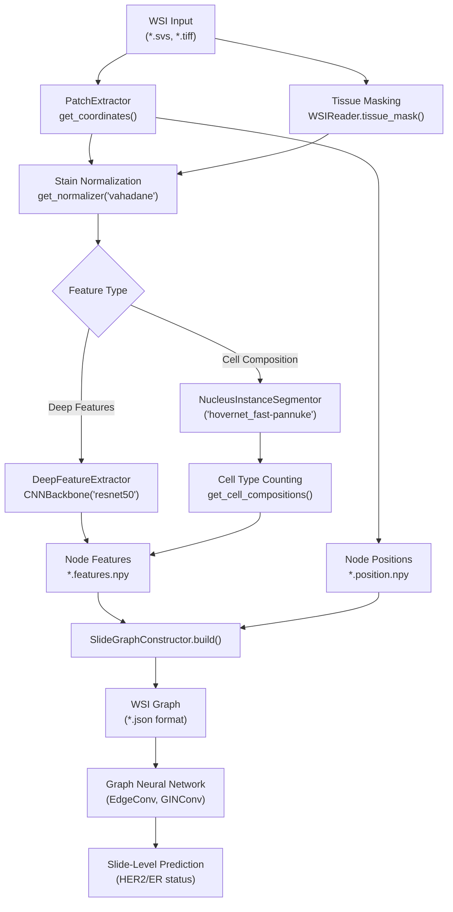
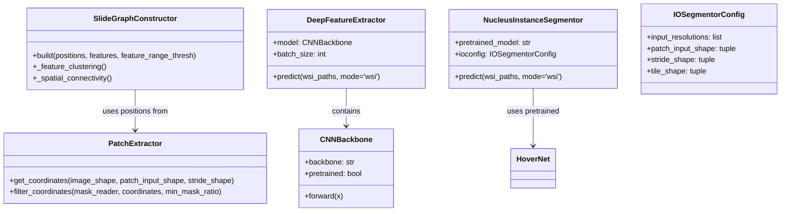
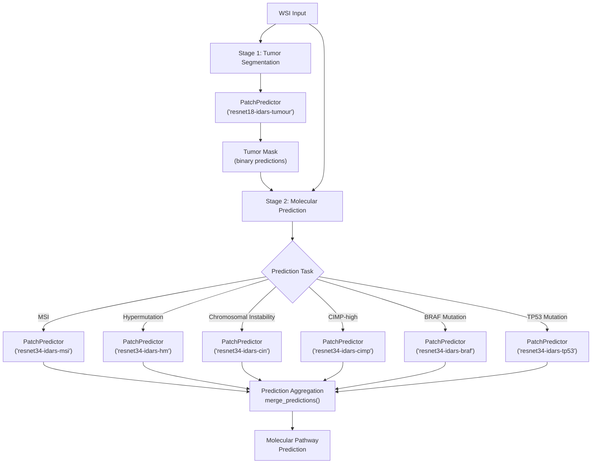
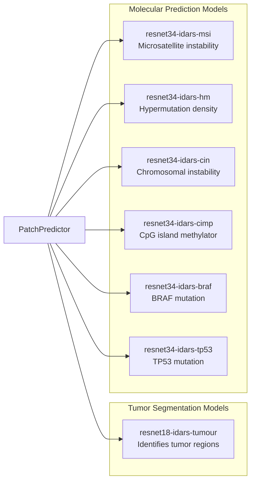
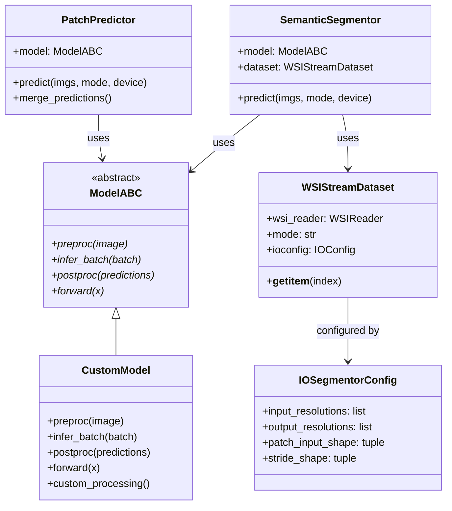

<!-- source: DeepWiki mcp.deepwiki.com · repo TissueImageAnalytics/tiatoolbox · page 6.2 Advanced Analysis Pipelines · fetched 2026-10-21 -->

# Advanced Analysis Pipelines

Relevant source files

The following files were used as context for generating this wiki page:

- [examples/07-advanced-modeling.ipynb](examples/07-advanced-modeling.ipynb)
- [examples/full-pipelines/slide-graph.ipynb](examples/full-pipelines/slide-graph.ipynb)
- [examples/inference-pipelines/idars.ipynb](examples/inference-pipelines/idars.ipynb)
- [examples/inference-pipelines/slide-graph.ipynb](examples/inference-pipelines/slide-graph.ipynb)

This document covers sophisticated end-to-end analysis workflows that combine multiple TIAToolbox components to solve complex computational pathology problems. These pipelines demonstrate how to orchestrate various TIAToolbox tools including WSI processing, deep learning inference, graph construction, and result visualization for tasks like molecular prediction and slide-level classification.

For basic usage examples of individual components, see [Basic Usage Examples](#6.1). For information about individual model architectures and prediction engines, see [Model Architectures](#4.2) and [Prediction Engines](#4.1).

## Pipeline Overview

Advanced analysis pipelines in TIAToolbox implement complete research methodologies from recent computational pathology papers. These workflows typically involve:

- Multi-stage processing with different models and resolutions
- Integration of patch extraction, feature computation, and aggregation
- Graph-based representations of whole slide images
- Molecular and phenotypic prediction from histology

The primary advanced pipelines available are:

| Pipeline | Purpose | Key Paper | Main Classes |
|----------|---------|-----------|--------------|
| SlideGraph | HER2/ER status prediction via graph neural networks | Lu et al. (2021) | `SlideGraphConstructor`, `DeepFeatureExtractor`, `NucleusInstanceSegmentor` |
| IDaRS | Molecular pathway prediction with iterative sampling | Bilal et al. (2021) | `PatchPredictor` with tumor segmentation models |

## SlideGraph Pipeline Architecture

The SlideGraph pipeline converts whole slide images into graph representations where nodes correspond to tissue regions and edges represent spatial relationships.

### SlideGraph Workflow

### SlideGraph Code Architecture

The SlideGraph implementation creates graphs where clustering is performed both in feature space and spatial coordinates, connecting nearby clusters to form the final graph structure.

Sources: [examples/full-pipelines/slide-graph.ipynb:990-1066](), [examples/inference-pipelines/slide-graph.ipynb:849-889](), [tiatoolbox/tools/graph.py]()

## IDaRS Pipeline Architecture

The IDaRS (Iterative Draw and Rank Sampling) pipeline performs molecular pathway prediction through a two-stage approach: tumor region identification followed by task-specific prediction.

### IDaRS Workflow

### IDaRS Implementation Details

The IDaRS pipeline uses the `PatchPredictor` engine with different pretrained models for each task:

Each model in the IDaRS pipeline uses consistent processing parameters but different neural network weights trained for specific molecular targets.

Sources: [examples/inference-pipelines/idars.ipynb:386-423](), [examples/inference-pipelines/idars.ipynb:63-76]()

## Advanced Model Integration

TIAToolbox provides extensive capabilities for integrating custom models and data processing workflows through the `ModelABC` abstract base class and related infrastructure.

### Custom Model Integration Pattern

### Pipeline Configuration and Execution

Advanced pipelines leverage TIAToolbox's configuration system to manage complex multi-stage workflows:

| Configuration Class | Purpose | Key Parameters |
|---------------------|---------|----------------|
| `IOSegmentorConfig` | Controls patch extraction and processing | `input_resolutions`, `patch_input_shape`, `stride_shape` |
| `IOPatchPredictorConfig` | Configures patch-level prediction | `patch_input_shape`, `stride_shape` |
| Resolution objects | Defines processing magnifications | `units` ('mpp', 'power'), `resolution` values |

The configuration system enables precise control over processing parameters while maintaining consistency across different stages of complex pipelines.

Sources: [examples/07-advanced-modeling.ipynb:388-419](), [tiatoolbox/models/models_abc.py](), [tiatoolbox/models/engine/semantic_segmentor.py:165-169]()

## Pipeline Execution and Results

Advanced analysis pipelines typically follow this execution pattern:

1. **Data Preparation**: Load WSIs, apply tissue masking, configure processing parameters
2. **Feature Extraction**: Extract patches and compute representations (deep features or cellular composition)
3. **Aggregation**: Combine patch-level information into slide-level representations (graphs or summary statistics)
4. **Prediction**: Apply trained models to generate molecular or phenotypic predictions
5. **Visualization**: Create overlay maps, graphs, and summary outputs

The modular design allows researchers to adapt individual components while leveraging the robust infrastructure for WSI processing, model inference, and result management that TIAToolbox provides.

Sources: [examples/full-pipelines/slide-graph.ipynb:964-983](), [examples/inference-pipelines/idars.ipynb:477-498]()

---

