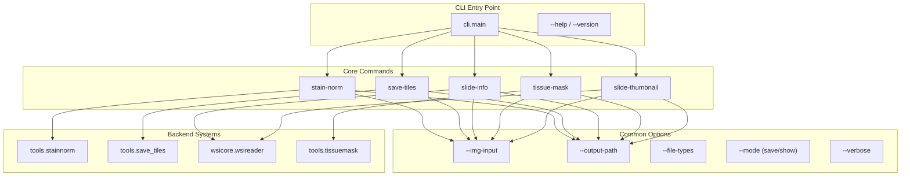
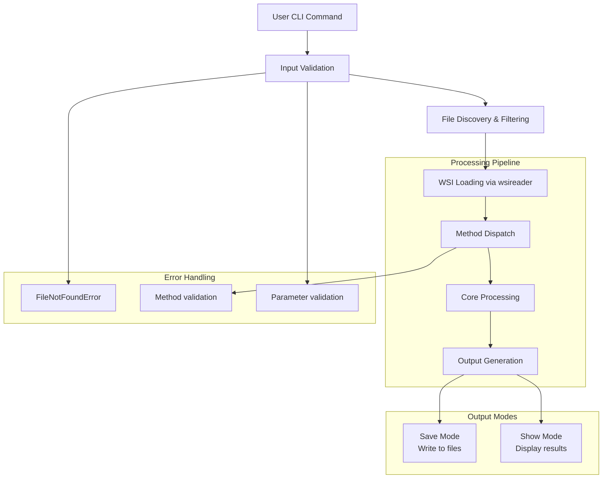

<!-- source: DeepWiki mcp.deepwiki.com · repo TissueImageAnalytics/tiatoolbox · page 7 Command Line Interface · fetched 2026-10-21 -->

# Command Line Interface

<details>
<summary>Relevant source files</summary>

The following files were used as context for generating this wiki page:

- [tests/test_save_tiles.py](tests/test_save_tiles.py)
- [tests/test_slide_info.py](tests/test_slide_info.py)
- [tests/test_slide_thumbnail.py](tests/test_slide_thumbnail.py)
- [tests/test_stainnorm.py](tests/test_stainnorm.py)
- [tests/test_tiatoolbox.py](tests/test_tiatoolbox.py)
- [tests/test_tissuemask.py](tests/test_tissuemask.py)
- [tests/test_wsimeta.py](tests/test_wsimeta.py)
- [tiatoolbox/utils/exceptions.py](tiatoolbox/utils/exceptions.py)

</details>


The Command Line Interface (CLI) provides command-line tools for batch processing and automation of common computational pathology tasks in TIAToolbox. The CLI offers five main commands for processing whole slide images, each designed for specific analysis workflows including stain normalization, tile extraction, metadata extraction, tissue masking, and thumbnail generation.

For information about the underlying Python APIs that power these CLI commands, see the relevant sections: [Image Processing Pipeline](#3), [Data Systems](#2), and [Advanced Tools](#5).

## CLI Architecture Overview

The TIAToolbox CLI is built using the Click framework and provides a unified interface for accessing core functionality through command-line operations.



Sources: [tests/test_tiatoolbox.py:15-32](), [tests/test_stainnorm.py:173-245](), [tests/test_save_tiles.py:14-44](), [tests/test_slide_info.py:14-38](), [tests/test_tissuemask.py:220-488](), [tests/test_slide_thumbnail.py:31-54]()

## Main CLI Entry Point

The primary CLI interface is accessed through `tiatoolbox.cli.main` and provides version information and help functionality.

| Option | Description | Example |
|--------|-------------|---------|
| `--version`, `-v` | Display TIAToolbox version | `tiatoolbox --version` |
| `--help` | Show help message | `tiatoolbox --help` |

The main CLI displays: "Computational pathology toolbox by TIA Centre." when invoked with help.

Sources: [tests/test_tiatoolbox.py:15-32]()

## Stain Normalization Command

The `stain-norm` command provides stain normalization functionality for histopathology images using various algorithms.

### Usage
```bash
tiatoolbox stain-norm --img-input <input> --target-input <target> --output-path <output> --method <method>
```

### Options

| Option | Required | Description | Valid Values |
|--------|----------|-------------|--------------|
| `--img-input` | Yes | Input image file or directory | File or directory path |
| `--target-input` | Yes | Target image for normalization | Image file path |
| `--output-path` | Yes | Output directory | Directory path |
| `--method` | Yes | Stain normalization method | `reinhard`, `ruifrok`, `macenko`, `vahadane` |

### Supported Methods

- **reinhard**: Reinhard color normalization
- **ruifrok**: Ruifrok & Johnston stain separation
- **macenko**: Macenko stain normalization  
- **vahadane**: Vahadane stain separation

### Examples

```bash
# Single image normalization
tiatoolbox stain-norm --img-input input.svs --target-input target.png --output-path ./output --method reinhard

# Directory processing
tiatoolbox stain-norm --img-input ./images/ --target-input target.png --output-path ./output --method macenko
```

Sources: [tests/test_stainnorm.py:173-268]()

## Tile Extraction Command

The `save-tiles` command extracts and saves image tiles from whole slide images at specified objective magnifications.

### Usage
```bash
tiatoolbox save-tiles --img-input <input> --tile-objective-value <objective> --output-path <output>
```

### Options

| Option | Required | Description | Default |
|--------|----------|-------------|---------|
| `--img-input` | Yes | Input WSI file or directory | - |
| `--tile-objective-value` | Yes | Objective magnification for tiles | - |
| `--output-path` | Yes | Output directory | - |
| `--file-types` | No | File type filter | `"*.ndpi, *.svs"` |
| `--verbose` | No | Enable verbose output | `False` |

### Output Structure

For each processed slide, the command creates:
- `slide_thumbnail.jpg` - Overview thumbnail
- `Tile_{objective}_{x}_{y}.jpg` - Individual tiles
- `Output.csv` - Tile metadata and coordinates

Sources: [tests/test_save_tiles.py:14-85]()

## Slide Information Command  

The `slide-info` command extracts and displays metadata from whole slide images.

### Usage
```bash
tiatoolbox slide-info --img-input <input> --mode <mode> [--output-path <output>]
```

### Options

| Option | Required | Description | Valid Values |
|--------|----------|-------------|--------------|
| `--img-input` | Yes | Input WSI file or directory | File or directory path |
| `--mode` | Yes | Operation mode | `save`, `show` |
| `--output-path` | No* | Output directory | Directory path |
| `--file-types` | No | File type filter | `"*.ndpi, *.svs"` |
| `--verbose` | No | Enable verbose output | `True`/`False` |

*Required when `--mode save`

### Output

When using `--mode save`, metadata is saved as YAML files with the same basename as input images. Default output location is `<input_directory>/meta-data/` when no output path specified.

Sources: [tests/test_slide_info.py:14-149]()

## Tissue Masking Command

The `tissue-mask` command generates binary tissue masks to identify tissue regions in whole slide images.

### Usage
```bash
tiatoolbox tissue-mask --img-input <input> --method <method> --mode <mode> [options]
```

### Core Options

| Option | Required | Description | Valid Values |
|--------|----------|-------------|--------------|
| `--img-input` | Yes | Input WSI file or directory | File or directory path |
| `--method` | Yes | Masking algorithm | `Otsu`, `Morphological` |
| `--mode` | Yes | Operation mode | `save`, `show` |
| `--output-path` | No* | Output directory | Directory path |

*Required when `--mode save`

### Method-Specific Options

#### Morphological Method Additional Options

| Option | Description | Valid Values |
|--------|-------------|--------------|
| `--resolution` | Resolution value | Numeric value |
| `--units` | Resolution units | `mpp`, `power` |
| `--kernel-size` | Morphological kernel size | Two integers |

### Examples

```bash
# Basic Otsu masking
tiatoolbox tissue-mask --img-input slide.svs --method Otsu --mode save --output-path ./masks

# Morphological with custom resolution
tiatoolbox tissue-mask --img-input slide.svs --method Morphological --mode save --resolution 32 --units mpp

# Directory processing
tiatoolbox tissue-mask --img-input ./slides/ --method Otsu --mode save --output-path ./masks
```

Sources: [tests/test_tissuemask.py:220-488]()

## Slide Thumbnail Command

The `slide-thumbnail` command generates thumbnail images from whole slide images.

### Usage
```bash
tiatoolbox slide-thumbnail --img-input <input> --mode <mode> [--output-path <output>]
```

### Options

| Option | Required | Description | Valid Values |
|--------|----------|-------------|--------------|
| `--img-input` | Yes | Input WSI file | File path |
| `--mode` | Yes | Operation mode | `save`, `show` |
| `--output-path` | No* | Output directory | Directory path |

*Required when `--mode save`

### Output

Thumbnails are saved as JPEG files with the same basename as the input slide. Default output location is `<input_directory>/slide-thumbnail/` when no output path specified.

Sources: [tests/test_slide_thumbnail.py:31-81]()

## CLI Command Processing Flow



Sources: [tests/test_stainnorm.py:270-317](), [tests/test_save_tiles.py:87-110](), [tests/test_slide_info.py:86-149](), [tests/test_tissuemask.py:429-488](), [tests/test_slide_thumbnail.py:110-133]()

## Error Handling

The CLI implements consistent error handling patterns across all commands:

### Common Error Types

| Error Type | Trigger | CLI Behavior |
|------------|---------|--------------|
| `FileNotFoundError` | Invalid input path | Exit code 1, empty output |
| `SystemExit` | Invalid parameter values | Exit code != 0, error message |
| Method validation | Unsupported method name | Exit code != 0, "Invalid value" message |

### Input Validation

All commands validate:
- Input file/directory existence
- Method parameter validity  
- Required parameter presence
- Output path accessibility (for save mode)

Sources: [tests/test_stainnorm.py:270-317](), [tests/test_save_tiles.py:87-110](), [tests/test_slide_info.py:86-149](), [tests/test_tissuemask.py:429-488](), [tests/test_slide_thumbnail.py:110-133]()

## Common Usage Patterns

### Batch Processing
Most commands support directory input for batch processing multiple slides:

```bash
# Process all slides in directory
tiatoolbox stain-norm --img-input ./slides/ --target-input target.png --output-path ./normalized --method reinhard
tiatoolbox tissue-mask --img-input ./slides/ --method Otsu --mode save --output-path ./masks
```

### File Type Filtering
Use `--file-types` to process specific formats:

```bash
tiatoolbox slide-info --img-input ./data/ --file-types "*.svs, *.ndpi" --mode save
```

### Output Organization
Commands create organized output structures with meaningful filenames and metadata preservation.

Sources: [tests/test_stainnorm.py:247-268](), [tests/test_save_tiles.py:14-44](), [tests/test_slide_info.py:14-63](), [tests/test_tissuemask.py:264-286]()

---

