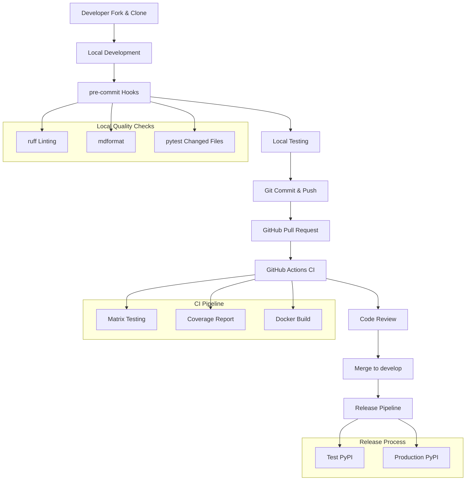
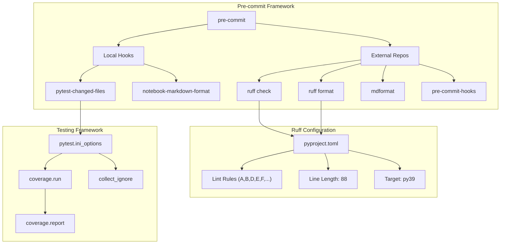
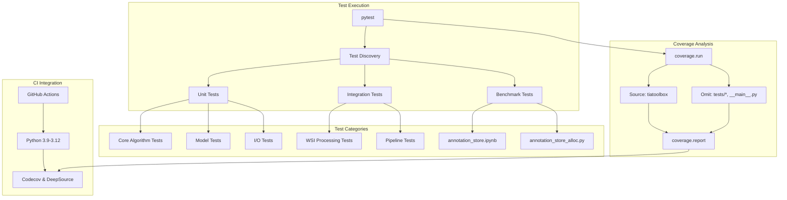
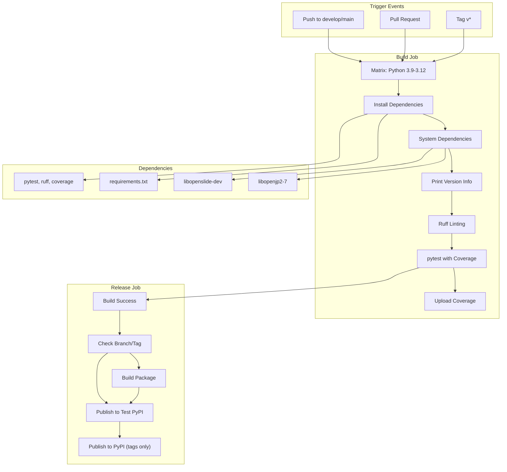
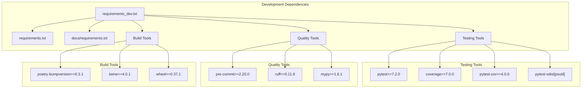
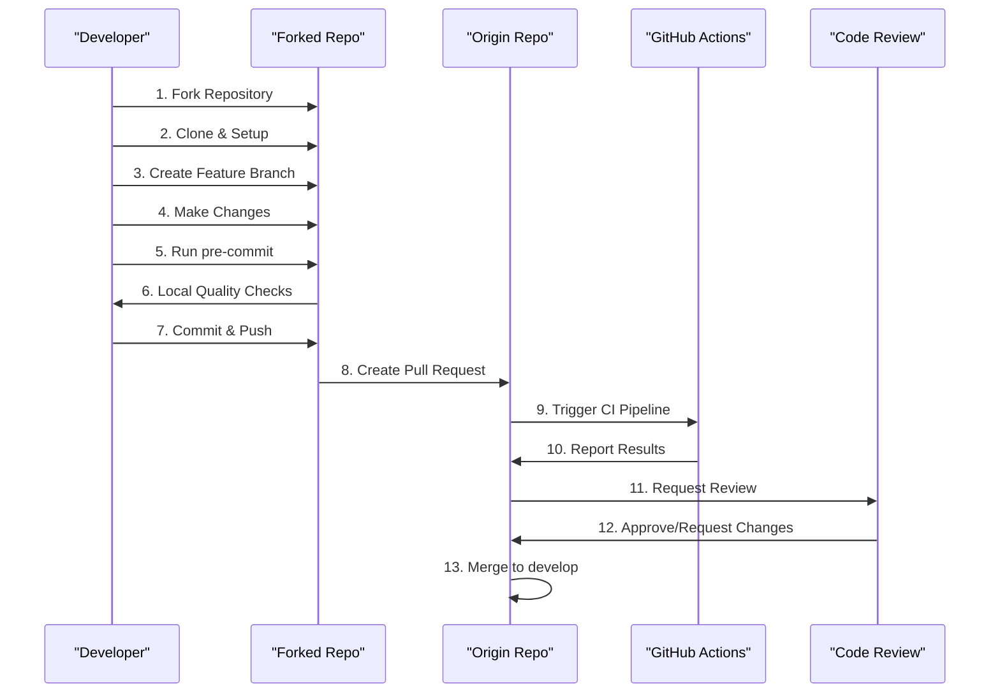

<!-- source: DeepWiki mcp.deepwiki.com · repo TissueImageAnalytics/tiatoolbox · page 8 Development and Contributing · fetched 2026-10-21 -->

# Development and Contributing

Relevant source files

The following files were used as context for generating this wiki page:

- [.github/workflows/python-package.yml](.github/workflows/python-package.yml)
- [.pre-commit-config.yaml](.pre-commit-config.yaml)
- [CONTRIBUTING.rst](CONTRIBUTING.rst)
- [benchmarks/annotation_store.ipynb](benchmarks/annotation_store.ipynb)
- [benchmarks/annotation_store_alloc.py](benchmarks/annotation_store_alloc.py)
- [pyproject.toml](pyproject.toml)
- [requirements/requirements_dev.txt](requirements/requirements_dev.txt)
- [tiatoolbox/utils/env_detection.py](tiatoolbox/utils/env_detection.py)

This document provides comprehensive information for developers who want to contribute to TIAToolbox, including development workflow, code quality tools, testing infrastructure, and CI/CD processes. This covers the technical aspects of contributing code, running tests, and maintaining code quality.

For information about using TIAToolbox's features and APIs, see [Core Concepts](#1.2) and [Examples and Tutorials](#6). For CI/CD and development infrastructure details, see [CI/CD and Development Infrastructure](#8.3).

## Development Workflow Overview

TIAToolbox follows a structured development workflow that emphasizes code quality, automated testing, and collaborative development through GitHub. The development process integrates multiple tools and stages to ensure code reliability and maintainability.

### Development Process Flow

Sources: [.pre-commit-config.yaml:1-71](), [.github/workflows/python-package.yml:1-118](), [CONTRIBUTING.rst:52-93]()

## Code Quality Infrastructure

TIAToolbox employs a comprehensive code quality infrastructure built around modern Python tooling. The system uses `ruff` as the primary linter and formatter, `pytest` for testing, and `pre-commit` for automated quality checks.

### Code Quality Tools Architecture

The code quality system is configured through several key files:

- **Pre-commit Configuration**: [.pre-commit-config.yaml:1-71]() defines all automated checks
- **Ruff Settings**: [pyproject.toml:52-178]() configures linting rules and formatting
- **Test Configuration**: [pyproject.toml:1-17]() sets up pytest and coverage

### Linting and Formatting Rules

TIAToolbox uses an extensive set of linting rules through `ruff`, covering code style, security, performance, and documentation standards:

| Category | Rules | Purpose |
|----------|-------|---------|
| Core | A, B, E, F, W | flake8-builtins, bugbear, pycodestyle, pyflakes |
| Documentation | D | pydocstyle with Google convention |
| Security | S | flake8-bandit security checks |
| Performance | PERF | Performance optimizations |
| Modern Python | UP | pyupgrade compatibility |

Sources: [pyproject.toml:53-106](), [pyproject.toml:147-149]()

## Testing Framework

The testing infrastructure uses `pytest` with comprehensive coverage reporting and parallel execution capabilities. Tests are automatically triggered by pre-commit hooks for changed files and run in full during CI.

### Testing Architecture

### Test Configuration

The test system is configured with specific collection and coverage rules:

- **Test Collection**: [pyproject.toml:2]() excludes setup files and benchmarks
- **Coverage Tracking**: [pyproject.toml:4-7]() monitors source code with branch coverage
- **Excluded Files**: [pyproject.toml:7]() omits tests, main modules, and typing files

Sources: [pyproject.toml:1-17](), [.github/workflows/python-package.yml:56-62]()

## CI/CD Pipeline

The CI/CD system uses GitHub Actions to provide automated testing, building, and deployment across multiple Python versions and platforms. The pipeline ensures code quality and compatibility before merging changes.

### GitHub Actions Workflow

### CI Configuration Details

The CI pipeline configuration includes:

- **Platform Support**: [.github/workflows/python-package.yml:16]() runs on ubuntu-24.04
- **Python Matrix**: [.github/workflows/python-package.yml:20]() tests Python 3.9, 3.10, 3.11, 3.12
- **System Dependencies**: [.github/workflows/python-package.yml:30-31]() installs OpenJPEG and OpenSlide
- **Coverage Reporting**: [.github/workflows/python-package.yml:63-78]() uploads to Codecov and DeepSource

Sources: [.github/workflows/python-package.yml:1-118]()

## Development Dependencies

TIAToolbox maintains separate dependency sets for development and production environments. Development dependencies include testing tools, documentation generators, and code quality utilities.

### Development Dependency Structure

Key development dependencies include:

- **Testing**: `pytest` with coverage and parallel execution support
- **Linting**: `ruff` for comprehensive code analysis
- **Type Checking**: `mypy` for static type analysis
- **Documentation**: Sphinx and related tools
- **Build**: Poetry and wheel building tools

Sources: [requirements/requirements_dev.txt:1-17]()

## Contributing Process

The contribution process follows GitHub's fork-and-pull-request model with additional quality gates and review requirements. Contributors must follow coding standards and pass all automated checks.

### Contribution Workflow

### Setup Instructions

To set up a development environment:

1. **Fork and Clone**: [CONTRIBUTING.rst:56-59]() describes the initial setup
2. **Virtual Environment**: [CONTRIBUTING.rst:61-65]() shows environment creation
3. **Install Dependencies**: Install from `requirements_dev.txt`
4. **Pre-commit Setup**: [CONTRIBUTING.rst:78-84]() configures git hooks

### Pull Request Requirements

All pull requests must meet these requirements:

- **Tests**: [CONTRIBUTING.rst:99]() requires test coverage for new functionality
- **Documentation**: [CONTRIBUTING.rst:100]() requires documentation updates
- **Python Compatibility**: [CONTRIBUTING.rst:101]() must work on Python 3.9-3.12
- **Quality Checks**: All pre-commit hooks and CI checks must pass

Sources: [CONTRIBUTING.rst:94-102]()

## Development Environment Detection

TIAToolbox includes sophisticated environment detection capabilities to adapt behavior based on the runtime context. This helps optimize performance and user experience across different platforms and environments.

### Environment Detection System

```mermaid
graph TB
    subgraph "Environment Detection"
        EnvDetection["env_detection.py"] --> InteractiveCheck["is_interactive()"]
        EnvDetection --> NotebookCheck["is_notebook()"]
        EnvDetection --> CondaCheck["in_conda_env()"]
        EnvDetection --> CICheck["running_on_ci()"]
        EnvDetection --> GPUCheck["has_gpu()"]
        EnvDetection --> NetworkCheck["has_network()"]
    end
    
    subgraph "CI Platform Detection"
        CICheck --> TravisCheck["running_on_travis()"]
        CICheck --> GitHubCheck["running_on_github()"]
        CICheck --> CircleCICheck["running_on_circleci()"]
        CICheck --> KaggleCheck["running_on_kaggle()"]
        CICheck --> ColabCheck["running_on_colab()"]
    end
    
    subgraph "System Analysis"
        GPUCheck --> TorchCUDA["torch.cuda.is_available()"]
        NetworkCheck --> SocketTest["Socket Connection Test"]
        CondaCheck --> EnvVars["CONDA_DEFAULT_ENV, CONDA_PREFIX"]
    end
    
    subgraph "Dependency Checking"
        EnvDetection --> PixmanCheck["pixman_versions()"]
        PixmanCheck --> CondaPixman["check_pixman_using_anaconda()"]
        PixmanCheck --> DpkgPixman["check_pixman_using_dpkg()"]
        PixmanCheck --> BrewPixman["check_pixman_using_brew()"]
    end
```

The environment detection system provides:

- **Interactive Detection**: [tiatoolbox/utils/env_detection.py:50-81]() detects REPL and notebook environments
- **CI Platform Detection**: [tiatoolbox/utils/env_detection.py:125-177]() identifies various CI services
- **Hardware Detection**: [tiatoolbox/utils/env_detection.py:34-47]() checks for GPU availability
- **Dependency Verification**: [tiatoolbox/utils/env_detection.py:249-380]() validates system libraries

Sources: [tiatoolbox/utils/env_detection.py:1-452]()

---

