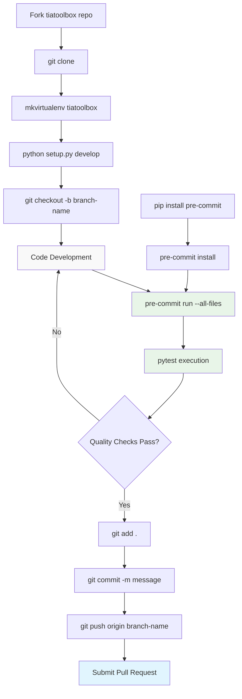
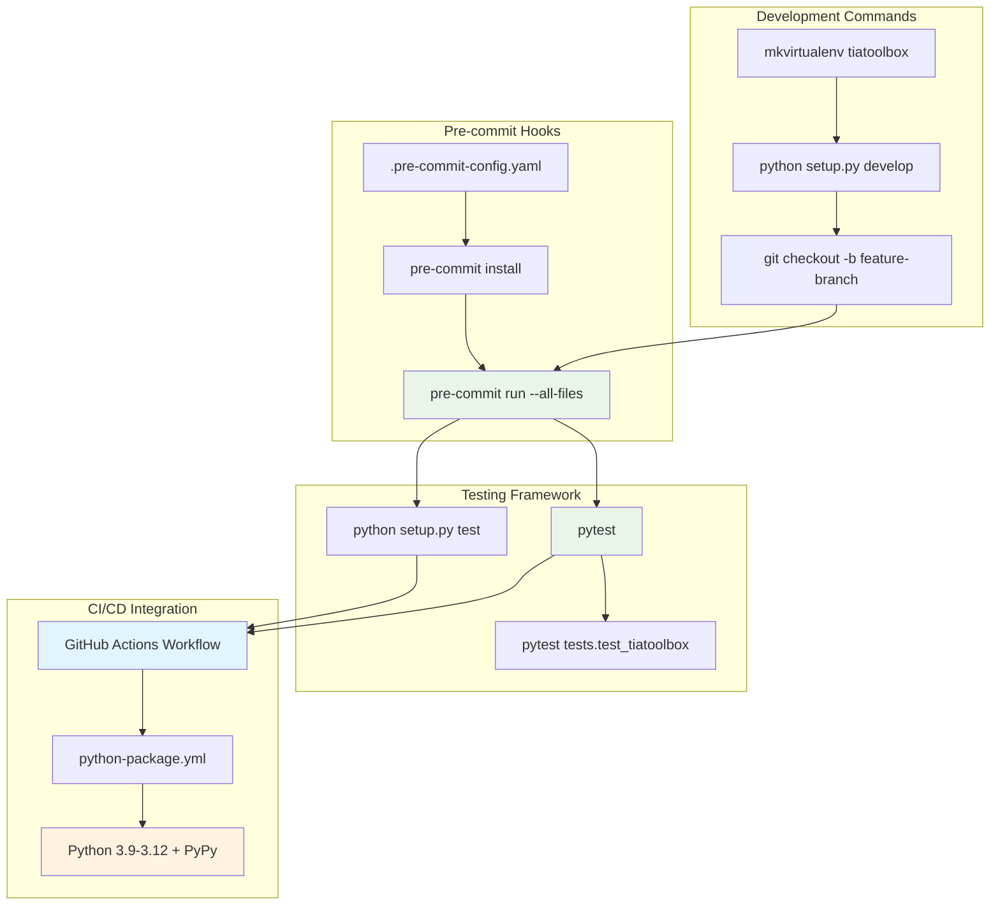

<!-- source: DeepWiki mcp.deepwiki.com · repo TissueImageAnalytics/tiatoolbox · page 8.1 Contributing Guidelines · fetched 2026-10-21 -->

# Contributing Guidelines

<details>
<summary>Relevant source files</summary>

The following files were used as context for generating this wiki page:

- [CONTRIBUTING.rst](CONTRIBUTING.rst)

</details>


## Purpose and Scope

This document provides comprehensive guidelines for contributing to TIAToolbox, covering the complete developer workflow from initial setup through code submission. It details the processes for reporting bugs, implementing features, writing documentation, and submitting pull requests. For information about the testing framework and test development, see [Testing Framework](#8.2). For details about continuous integration pipelines and development infrastructure, see [CI/CD and Development Infrastructure](#8.3).

## Types of Contributions

TIAToolbox welcomes various forms of contributions from the community:

### Bug Reports
Bug reports should be submitted via GitHub Issues with comprehensive details including:
- Operating system name and version
- Local setup configuration details  
- Detailed reproduction steps

### Feature Implementation
Features can be implemented by:
- Reviewing GitHub issues tagged with "enhancement" and "help wanted"
- Following the development workflow outlined below
- Ensuring proper documentation and testing

### Documentation Improvements
Documentation contributions include:
- Official documentation updates
- Docstring improvements in source code
- External articles and blog posts

### Feedback Submission
Feature proposals should include:
- Detailed implementation descriptions
- Narrow scope for easier implementation
- Recognition of volunteer-driven development model

Sources: [CONTRIBUTING.rst:11-50]()

## Development Setup Workflow

The following diagram shows the complete development setup process with specific tools and commands:

**Development Environment Setup Process**



Sources: [CONTRIBUTING.rst:54-93]()

## Code Quality Infrastructure

The development infrastructure relies on several integrated tools for maintaining code quality:

**Quality Assurance Pipeline**



Sources: [CONTRIBUTING.rst:73-84](), [CONTRIBUTING.rst:106-109]()

## Pull Request Requirements

Pull requests must satisfy the following criteria before submission:

| Requirement | Description | Verification Method |
|-------------|-------------|-------------------|
| **Tests Included** | All new functionality must include comprehensive tests | `pytest` execution |
| **Documentation Updated** | New features require docstring documentation and feature description | Manual review |
| **Python Compatibility** | Support for Python 3.9, 3.10, 3.11, 3.12, and PyPy | GitHub Actions validation |
| **Quality Checks** | Code must pass pre-commit hooks and linting | `pre-commit run --all-files` |

The continuous integration system validates compatibility across multiple Python versions through the GitHub Actions workflow at `python-package.yml`.

Sources: [CONTRIBUTING.rst:94-102]()

## Testing Guidelines

### Running Tests

The testing framework supports various execution modes:

- **Full test suite**: `python setup.py test` or `pytest`
- **Subset execution**: `pytest tests.test_tiatoolbox`
- **Quality validation**: `pre-commit run --all-files`

### Test Development

When implementing new features:
1. Include unit tests for individual functions
2. Add integration tests for complex workflows  
3. Ensure tests cover edge cases and error conditions
4. Validate functionality across supported Python versions

Sources: [CONTRIBUTING.rst:73-76](), [CONTRIBUTING.rst:106-109]()

## Deployment Process

### Version Management

The deployment process uses Poetry for version management:

```bash
poetry version patch  # or minor/major
git push
git push --tags
```

### Automated Deployment

GitHub Actions automatically deploys to PyPI when:
1. All tests pass across supported Python versions
2. Version tags are properly pushed to the repository
3. Changes are documented in `HISTORY.rst`

The deployment pipeline integrates with the existing CI/CD infrastructure to ensure quality before release.

Sources: [CONTRIBUTING.rst:110-122]()

## Development Environment Setup

### Prerequisites

- Python 3.9+ (supports 3.9, 3.10, 3.11, 3.12, and PyPy)
- Git for version control
- Virtual environment management tool (`virtualenvwrapper` recommended)

### Installation Steps

1. **Repository Setup**:
   ```bash
   git clone git@github.com:your_name_here/tiatoolbox.git
   cd tiatoolbox/
   ```

2. **Environment Configuration**:
   ```bash
   mkvirtualenv tiatoolbox
   python setup.py develop
   ```

3. **Development Tools**:
   ```bash
   pip install pre-commit
   pre-commit install
   ```

This setup enables the complete development workflow with integrated quality assurance and testing capabilities.

Sources: [CONTRIBUTING.rst:54-85]()

---

