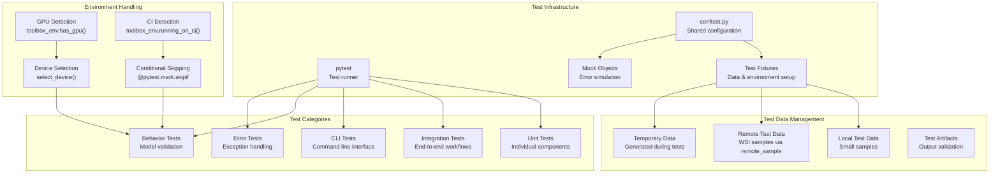
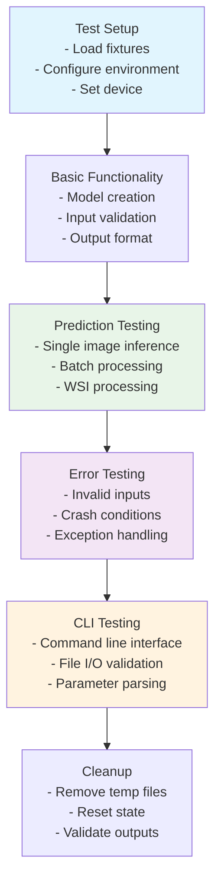

<!-- source: DeepWiki mcp.deepwiki.com · repo TissueImageAnalytics/tiatoolbox · page 8.2 Testing Framework · fetched 2026-10-21 -->

# Testing Framework

<details>
<summary>Relevant source files</summary>

The following files were used as context for generating this wiki page:

- [tests/models/test_abc.py](tests/models/test_abc.py)
- [tests/models/test_dataset.py](tests/models/test_dataset.py)
- [tests/models/test_multi_task_segmentor.py](tests/models/test_multi_task_segmentor.py)
- [tests/models/test_nucleus_instance_segmentor.py](tests/models/test_nucleus_instance_segmentor.py)
- [tests/models/test_patch_predictor.py](tests/models/test_patch_predictor.py)
- [tests/models/test_semantic_segmentation.py](tests/models/test_semantic_segmentation.py)
- [tests/test_save_tiles.py](tests/test_save_tiles.py)
- [tests/test_slide_info.py](tests/test_slide_info.py)
- [tests/test_slide_thumbnail.py](tests/test_slide_thumbnail.py)
- [tests/test_stainnorm.py](tests/test_stainnorm.py)
- [tests/test_tissuemask.py](tests/test_tissuemask.py)
- [tests/test_wsimeta.py](tests/test_wsimeta.py)
- [tiatoolbox/models/dataset/info.py](tiatoolbox/models/dataset/info.py)

</details>


## Purpose and Scope

The TIAToolbox testing framework provides comprehensive test coverage for all components of the computational pathology toolkit. This document covers the test infrastructure, organization, patterns, and best practices for maintaining and extending the test suite. The framework ensures reliability across different environments, validates model behavior, and provides regression testing for all core functionality.

For information about CI/CD processes and development workflows, see [CI/CD and Development Infrastructure](#8.3). For contributing guidelines including how to submit tests, see [Contributing Guidelines](#8.1).

## Testing Architecture Overview

The testing framework is built on pytest and provides multiple layers of validation, from unit tests for individual components to integration tests for complete workflows.



Sources: [tests/models/test_patch_predictor.py:1-33](), [tests/models/test_semantic_segmentation.py:1-45](), [tests/test_stainnorm.py:1-15]()

## Test Organization Structure

Tests are organized hierarchically to mirror the codebase structure, with specialized directories for different component types.

```mermaid
graph TD
    TestsRoot["tests/"]
    
    TestsRoot --> Models["models/"]
    TestsRoot --> Tools["tools/ (implied)"]
    TestsRoot --> Core["core tests"]
    
    Models --> PatchPred["test_patch_predictor.py<br/>PatchPredictor validation"]
    Models --> SemanticSeg["test_semantic_segmentation.py<br/>SemanticSegmentor testing"]
    Models --> NucleusSeg["test_nucleus_instance_segmentor.py<br/>NucleusInstanceSegmentor tests"]
    Models --> MultiTask["test_multi_task_segmentor.py<br/>MultiTaskSegmentor validation"]
    Models --> Dataset["test_dataset.py<br/>Dataset classes testing"]
    Models --> ABC["test_abc.py<br/>Abstract base classes"]
    
    Core --> StainNorm["test_stainnorm.py<br/>Stain normalization tools"]
    Core --> TissueMask["test_tissuemask.py<br/>Tissue masking algorithms"]
    Core --> SaveTiles["test_save_tiles.py<br/>Tile extraction CLI"]
    Core --> SlideInfo["test_slide_info.py<br/>Metadata extraction"]
    Core --> SlideThumbnail["test_slide_thumbnail.py<br/>Thumbnail generation"]
    Core --> WSIMeta["test_wsimeta.py<br/>WSI metadata handling"]
    
    style PatchPred fill:#e1f5fe
    style SemanticSeg fill:#e8f5e8
    style NucleusSeg fill:#f3e5f5
    style MultiTask fill:#fff3e0
```



Sources: [tests/models/test_patch_predictor.py:1](), [tests/models/test_semantic_segmentation.py:1](), [tests/models/test_nucleus_instance_segmentor.py:1](), [tests/test_stainnorm.py:1]()

## Core Testing Components

### Test Fixtures and Data Management

The testing framework uses a comprehensive fixture system to provide test data and environment setup.

| Fixture Type | Purpose | Examples |
|--------------|---------|----------|
| Sample Data | Small test images and WSIs | `sample_patch1`, `sample_svs`, `sample_ndpi` |
| Remote Data | Large WSI samples downloaded on demand | `remote_sample("wsi2_4k_4k_svs")` |
| Temporary Paths | Isolated test environments | `tmp_path` |
| Environment Setup | Test configuration | `chdir`, `caplog` |

**Key Test Data Fixtures:**
- `sample_patch1`, `sample_patch2`: Small image patches for quick testing
- `sample_svs`, `sample_ndpi`: Local WSI files
- `remote_sample`: Function to download larger test WSIs
- `sample_wsi_dict`: Dictionary of various WSI formats

Sources: [tests/models/test_patch_predictor.py:39-53](), [tests/models/test_semantic_segmentation.py:206-210](), [tests/test_stainnorm.py:71-83]()

### Mock Classes and Error Testing

The framework includes specialized mock classes to test error conditions and edge cases:

```python
# Example mock classes for testing
class _CNNTo1(ModelABC):  # Semantic segmentation mock
class Proto(ModelABC):     # ABC testing mock
class _crash_func():       # Crash simulation
```

These mocks enable testing of:
- Abstract base class validation
- Error propagation in parallel processing
- Exception handling in inference pipelines
- Model interface compliance

Sources: [tests/models/test_semantic_segmentation.py:55-111](), [tests/models/test_abc.py:24-75](), [tests/models/test_nucleus_instance_segmentor.py:41-45]()

### Environment Detection and Conditional Testing

The framework adapts to different execution environments:

```python
ON_GPU = toolbox_env.has_gpu()
RUNNING_ON_CI = toolbox_env.running_on_ci()

@pytest.mark.skipif(ON_GPU or RUNNING_ON_CI, reason="Local test only")
def test_local_functionality():
    # Test that only runs locally with GPU
```

**Environment Variables:**
- `ON_GPU`: Determines if GPU testing is available
- `BATCH_SIZE`: Adapts batch size based on available resources
- `NUM_POSTPROC_WORKERS`: CPU core count for parallel processing tests

Sources: [tests/models/test_patch_predictor.py:31-32](), [tests/models/test_semantic_segmentation.py:38-44](), [tests/models/test_nucleus_instance_segmentor.py:34-36]()

## Testing Patterns and Strategies

### Model Testing Pattern

All model components follow a consistent testing pattern:



Sources: [tests/models/test_patch_predictor.py:633-731](), [tests/models/test_semantic_segmentation.py:466-613]()

### Command Line Interface Testing

CLI tests use the `CliRunner` pattern to validate command-line tools:

```python
from click.testing import CliRunner

def test_command_line_tool():
    runner = CliRunner()
    result = runner.invoke(cli.main, [
        "tool-name",
        "--input", "path/to/input",
        "--output", "path/to/output"
    ])
    assert result.exit_code == 0
```

**CLI Test Coverage:**
- Parameter validation
- File I/O operations
- Error message handling
- Exit code verification
- Output file validation

Sources: [tests/models/test_patch_predictor.py:1075-1100](), [tests/test_stainnorm.py:173-245](), [tests/test_save_tiles.py:14-44]()

### Dataset Testing Strategy

Dataset tests validate data loading and processing pipelines:

| Test Type | Purpose | Implementation |
|-----------|---------|----------------|
| Input Validation | Various input formats | `PatchDataset([paths])`, `PatchDataset(arrays)` |
| Error Handling | Malformed inputs | Invalid paths, mixed dtypes, wrong shapes |
| Preprocessing | Data transformation | Custom `preproc_func` validation |
| WSI Datasets | Large image handling | `WSIPatchDataset` with various modes |

Sources: [tests/models/test_patch_predictor.py:39-230](), [tests/models/test_dataset.py:89-119]()

## Inference Engine Testing

### Prediction Accuracy Validation

The framework includes reference implementations to validate model outputs:

```python
def _test_predictor_output(inputs, pretrained_model, 
                          probabilities_check=None, 
                          predictions_check=None):
    predictor = PatchPredictor(pretrained_model=pretrained_model)
    output = predictor.predict(inputs, return_probabilities=True)
    
    # Validate predictions match expected values
    assert predictions[idx] == predictions_check[idx]
    assert abs(probabilities_max - probabilities_check[idx]) <= 1e-3
```

**Validation Datasets:**
- Kather100K: Colorectal tissue classification
- PCam: Patch-based metastasis detection
- Custom validation sets for each pretrained model

Sources: [tests/models/test_patch_predictor.py:957-995](), [tests/models/test_patch_predictor.py:997-1067]()

### Parallel Processing Testing

Tests validate parallel processing and worker management:

```python
# Test with different worker configurations
segmentor = SemanticSegmentor(num_postproc_workers=2)
segmentor = NucleusInstanceSegmentor(num_postproc_workers=0)

# Crash propagation testing
segmentor.model.postproc_func = _crash_func
with pytest.raises(ValueError, match="Propagation Crash"):
    segmentor.predict(inputs, crash_on_exception=True)
```

Sources: [tests/models/test_semantic_segmentation.py:334-357](), [tests/models/test_nucleus_instance_segmentor.py:240-286]()

## GPU and Performance Testing

### Device Selection Testing

The framework tests model behavior across different compute devices:

```python
device = select_device(on_gpu=ON_GPU)
output = predictor.predict(inputs, device=device)

# GPU-specific tests (local only)
@pytest.mark.skipif(not ON_GPU, reason="GPU required")
def test_gpu_functionality():
    model = model.to(device="cuda")
    assert model.dummy_param.device.type == "cuda"
```

### Batch Size Adaptation

Tests adapt batch sizes based on available resources:
- CI environments: `BATCH_SIZE = 1`
- GPU environments: `BATCH_SIZE = 8-16`
- Memory-constrained testing with smaller inputs

Sources: [tests/models/test_patch_predictor.py:645-649](), [tests/models/test_abc.py:91-100](), [tests/models/test_semantic_segmentation.py:38-44]()

## Writing New Tests

### Test File Structure

Follow the established pattern when creating new test files:

```python
"""Test for [Component Name]."""

from __future__ import annotations
import pytest
from pathlib import Path
from typing import Callable

from tiatoolbox import [imports]
from tests.conftest import timed

# Constants
ON_GPU = toolbox_env.has_gpu()
BATCH_SIZE = 1 if not ON_GPU else 16

# Test functions
def test_basic_functionality():
    """Test basic component functionality."""
    
def test_error_conditions():
    """Test error handling."""
    
def test_cli_interface():
    """Test command line interface."""
```

### Adding Model Tests

When adding tests for new models:

1. **Basic functionality**: Model creation, input validation, output format
2. **Prediction testing**: Single images, batches, WSI processing
3. **Error handling**: Invalid inputs, crash conditions
4. **CLI testing**: Command-line interface validation
5. **Performance testing**: Device compatibility, batch processing

### Test Data Management

- Use existing fixtures when possible
- Add new fixtures to `conftest.py` for reusable test data
- Use `tmp_path` for temporary file operations
- Clean up generated files in test teardown

Sources: [tests/models/test_patch_predictor.py:1-30](), [tests/models/test_semantic_segmentation.py:1-50](), [tests/test_stainnorm.py:1-20]()

---

