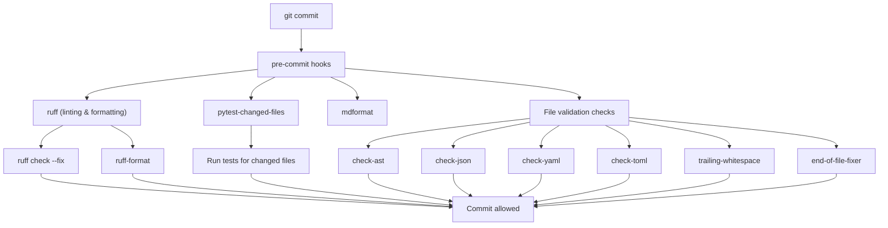
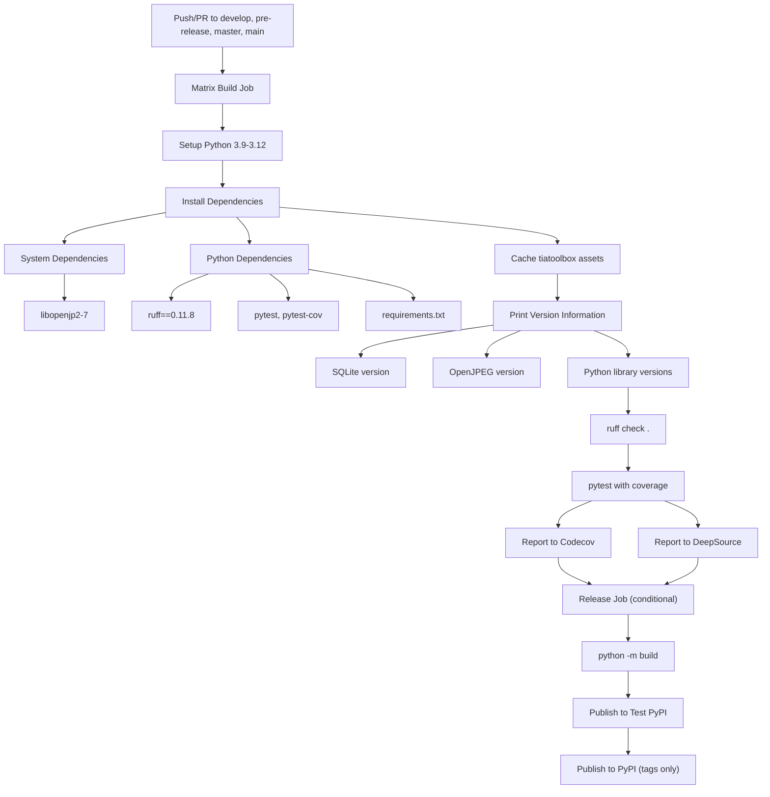
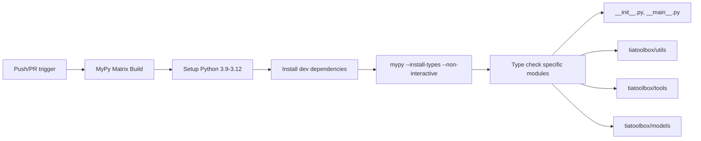
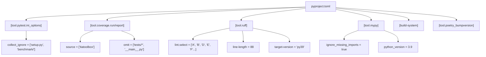
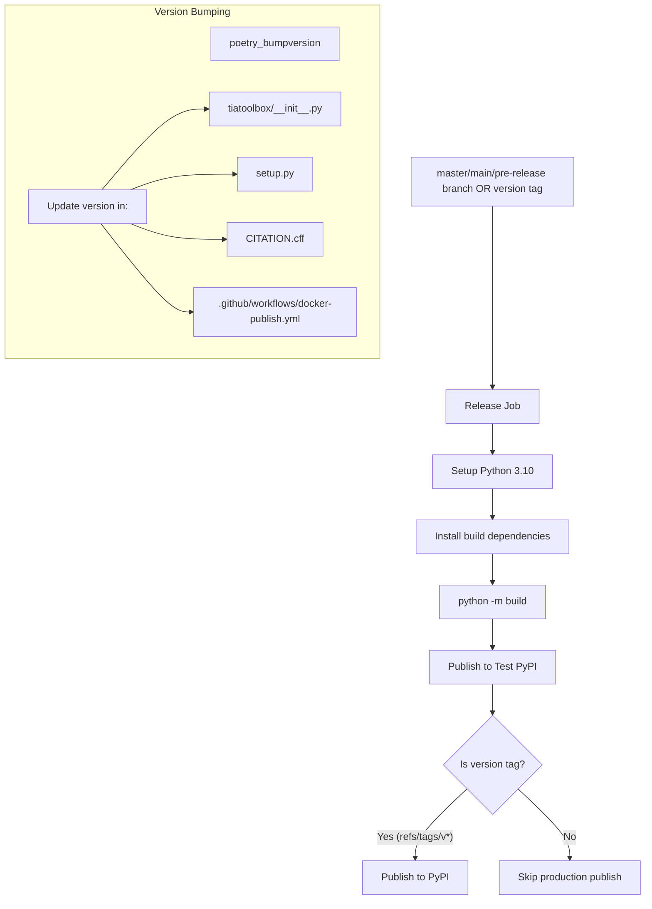
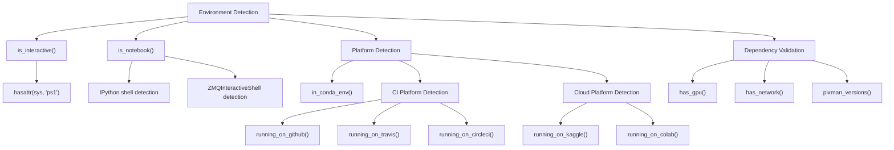
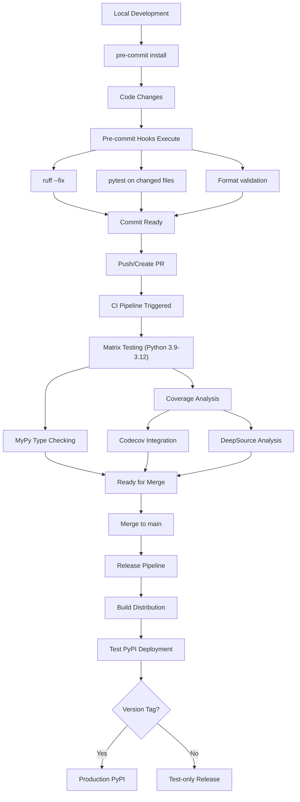
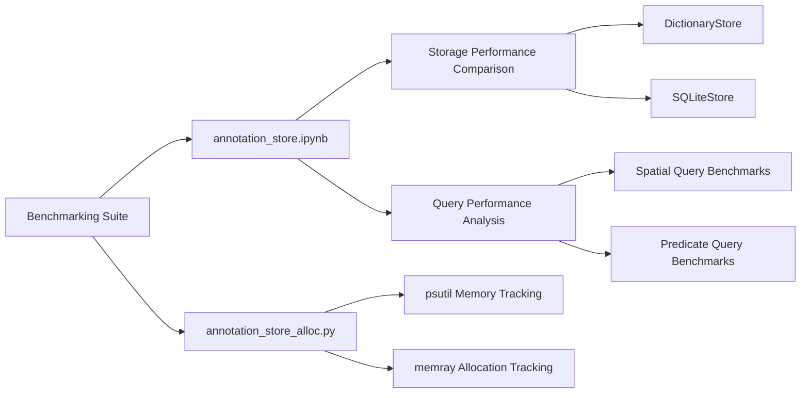

<!-- source: DeepWiki mcp.deepwiki.com · repo TissueImageAnalytics/tiatoolbox · page 8.3 CI/CD and Development Infrastructure · fetched 2026-10-21 -->

# CI/CD and Development Infrastructure

Relevant source files

The following files were used as context for generating this wiki page:

- [.github/workflows/mypy-type-check.yml](.github/workflows/mypy-type-check.yml)
- [.github/workflows/python-package.yml](.github/workflows/python-package.yml)
- [.pre-commit-config.yaml](.pre-commit-config.yaml)
- [benchmarks/annotation_store.ipynb](benchmarks/annotation_store.ipynb)
- [benchmarks/annotation_store_alloc.py](benchmarks/annotation_store_alloc.py)
- [pyproject.toml](pyproject.toml)
- [requirements/requirements_dev.txt](requirements/requirements_dev.txt)
- [tiatoolbox/tools/stainextract.py](tiatoolbox/tools/stainextract.py)
- [tiatoolbox/tools/stainnorm.py](tiatoolbox/tools/stainnorm.py)
- [tiatoolbox/utils/env_detection.py](tiatoolbox/utils/env_detection.py)

This document covers the continuous integration, continuous deployment, and development infrastructure systems used in TIAToolbox. This includes code quality enforcement, automated testing pipelines, release automation, and developer workflow tools.

For information about the testing framework and adding new tests, see [Testing Framework](#8.2). For contributing guidelines and development processes, see [Contributing Guidelines](#8.1).

## Overview

TIAToolbox employs a comprehensive development infrastructure built around GitHub Actions, pre-commit hooks, and automated quality assurance tools. The system ensures code quality, runs extensive tests across multiple Python versions and platforms, and automates the release process to PyPI and other distribution channels.

## Pre-commit Hooks and Code Quality

### Pre-commit Configuration

The repository uses pre-commit hooks defined in [.pre-commit-config.yaml:1-71]() to enforce code quality standards before commits are made. The configuration includes multiple stages of validation:

**Pre-commit Hook Categories:**

Sources: [.pre-commit-config.yaml:6-71]()

### Ruff Integration

TIAToolbox uses Ruff as its primary linting and formatting tool, configured in [pyproject.toml:52-178](). Ruff replaces multiple traditional tools (flake8, black, isort, etc.) with a single fast implementation:

| Rule Category | Description | Ruff Code |
|---------------|-------------|-----------|
| Code Style | pycodestyle errors and warnings | `E`, `W` |
| Import Sorting | isort-style import organization | `I` |
| Code Complexity | McCabe complexity analysis | `C90` |
| Security | bandit-style security checks | `S` |
| Type Annotations | flake8-annotations checks | `ANN` |
| Performance | Performance anti-patterns | `PERF` |

Sources: [pyproject.toml:53-106](), [.pre-commit-config.yaml:61-70]()

## Continuous Integration Pipeline

### Main CI/CD Workflow

The primary CI/CD pipeline is defined in [.github/workflows/python-package.yml:1-118]() and runs on pushes to main branches and pull requests:

**Build Matrix Configuration:**
- **Python Versions:** 3.9, 3.10, 3.11, 3.12
- **Operating System:** Ubuntu 24.04
- **Parallel Execution:** All combinations run concurrently

Sources: [.github/workflows/python-package.yml:14-21](), [.github/workflows/python-package.yml:28-62]()

### Type Checking Workflow

A separate workflow handles static type checking using MyPy:

Sources: [.github/workflows/mypy-type-check.yml:1-54]()

## Development Dependencies and Tools

### Development Environment Setup

Development dependencies are managed through [requirements/requirements_dev.txt:1-17]():

| Category | Tools | Purpose |
|----------|-------|---------|
| Testing | `pytest`, `pytest-cov`, `pytest-xdist` | Test execution and coverage |
| Linting | `ruff==0.11.8`, `mypy>=1.6.1` | Code quality and type checking |
| Publishing | `twine>=4.0.1`, `wheel>=0.37.1` | Package distribution |
| Documentation | `docutils>=0.18.1` | Documentation generation |
| Pre-commit | `pre-commit>=2.20.0` | Git hook management |

Sources: [requirements/requirements_dev.txt:1-17]()

### Configuration Management

All tool configurations are centralized in [pyproject.toml:1-178]():

Sources: [pyproject.toml:1-178]()

## Release Automation

### Version Management and Publishing

The release process is automated through the main CI pipeline with conditional publishing based on branch and tag patterns:

**Publishing Targets:**
- **Test PyPI:** All qualifying branches for pre-release testing
- **Production PyPI:** Only version tags starting with `v`
- **Authentication:** Uses repository secrets for API tokens

Sources: [.github/workflows/python-package.yml:80-118](), [pyproject.toml:32-50]()

## Environment Detection and Platform Support

### Runtime Environment Detection

TIAToolbox includes comprehensive environment detection capabilities in [tiatoolbox/utils/env_detection.py:1-452]():

**Key Detection Functions:**
- `running_on_github()`: Detects GitHub Actions environment via `GITHUB_ACTIONS=true`
- `running_on_ci()`: Aggregates multiple CI platform detections
- `pixman_versions()`: Validates pixman dependency across package managers
- `has_gpu()`: GPU availability through `torch.cuda.is_available()`

Sources: [tiatoolbox/utils/env_detection.py:137-177](), [tiatoolbox/utils/env_detection.py:349-380]()

## Development Workflow Integration

### Complete Development Lifecycle

The development infrastructure supports the full lifecycle from local development to production deployment:

Sources: [.pre-commit-config.yaml:1-71](), [.github/workflows/python-package.yml:1-118](), [.github/workflows/mypy-type-check.yml:1-54]()

## Benchmarking and Performance Testing

### Annotation Store Benchmarking

The repository includes comprehensive benchmarking infrastructure for performance-critical components like annotation storage:

**Benchmark Capabilities:**
- Memory allocation tracking with `psutil` and `memray`
- Performance comparison between `DictionaryStore` and `SQLiteStore`
- Spatial query performance analysis
- File system usage measurements

Sources: [benchmarks/annotation_store.ipynb:1-400](), [benchmarks/annotation_store_alloc.py:1-366]()