# Page: Overview

# Overview

<details>
<summary>Relevant source files</summary>

The following files were used as context for generating this wiki page:

- [.github/workflows/conda-env-create.yml](.github/workflows/conda-env-create.yml)
- [.github/workflows/docker-publish.yml](.github/workflows/docker-publish.yml)
- [AUTHORS.md](AUTHORS.md)
- [CITATION.cff](CITATION.cff)
- [HISTORY.md](HISTORY.md)
- [README.md](README.md)
- [docs/conf.py](docs/conf.py)
- [docs/installation.rst](docs/installation.rst)
- [setup.py](setup.py)
- [tiatoolbox/__init__.py](tiatoolbox/__init__.py)

</details>


This document provides a comprehensive overview of TIAToolbox, a computational pathology toolkit developed by the TIA Centre. TIAToolbox is designed as an end-to-end solution for analyzing whole slide images (WSIs) and implementing state-of-the-art algorithms in digital pathology.

For specific installation procedures, see [Installation and Setup](#1.1). For fundamental concepts about WSIs and data processing, see [Core Concepts](#1.2). For detailed information about individual systems, refer to the specialized sections covering [Data Systems](#2), [Image Processing Pipeline](#3), [Model and Inference Systems](#4), and [Advanced Tools](#5).

## System Architecture

TIAToolbox is structured as a modular toolkit with several interconnected systems that work together to provide comprehensive pathology image analysis capabilities. The toolkit is built on PyTorch and follows best practices for scientific computing and machine learning workflows.

### High-Level Architecture

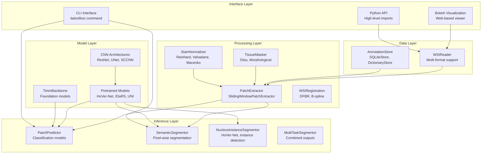

Sources: [tiatoolbox/__init__.py:1-135](), [setup.py:34-68](), [README.md:46-49]()

## Core Components

TIAToolbox is organized into several key modules, each providing specific functionality for pathology image analysis:

### Data Handling Systems

| Component | Primary Classes | Purpose |
|-----------|----------------|---------|
| **WSI Reading** | `WSIReader`, `OpenSlideWSIReader`, `TIFFWSIReader` | Read various whole slide image formats |
| **Annotation Management** | `AnnotationStore`, `SQLiteStore`, `DictionaryStore` | Store and query spatial annotations |
| **Data Loading** | `WSIStreamDataset`, `PatchDataset` | Efficient data loading for ML workflows |

### Image Processing Pipeline

| Component | Primary Classes | Purpose |
|-----------|----------------|---------|
| **Patch Extraction** | `PatchExtractor`, `SlidingWindowPatchExtractor` | Extract patches from WSIs |
| **Stain Processing** | `StainNormalizer`, `ReinhardNormalizer`, `VahadaneNormalizer` | Color normalization and augmentation |
| **Tissue Analysis** | `TissueMasker`, `MorphologyAnalyzer` | Identify tissue regions |
| **Registration** | `DFBRRegistration`, `WSIRegistration` | Align multiple WSIs |

### Model and Inference Systems

| Component | Primary Classes | Purpose |
|-----------|----------------|---------|
| **Inference Engines** | `PatchPredictor`, `SemanticSegmentor`, `NucleusInstanceSegmentor` | Run ML models on WSI data |
| **Model Architectures** | `HoVerNet`, `HoVerNetPlus`, `SCCNN`, `MapDe` | Deep learning model implementations |
| **Foundation Models** | `TimmBackbone`, `DeepFeatureExtractor` | Modern foundation model support |

Sources: [tiatoolbox/__init__.py:17-19](), [setup.py:61](), [HISTORY.md:7-18]()

## Data Processing Flow

The following diagram illustrates the typical data processing pipeline in TIAToolbox, showing how raw WSI files flow through various processing stages to produce analysis results:

### WSI Processing Pipeline

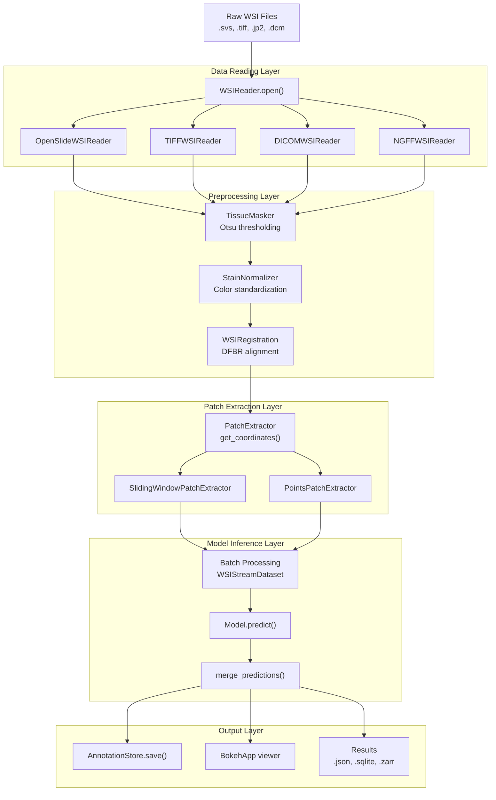

Sources: [tiatoolbox/__init__.py:101-110](), [setup.py:48](), [HISTORY.md:14-15]()

## Installation and Distribution

TIAToolbox is distributed through multiple channels to accommodate different user preferences and environments:

### Distribution Channels

| Method | Command | Platform Support |
|--------|---------|------------------|
| **PyPI** | `pip install tiatoolbox` | Cross-platform |
| **Conda-forge** | `conda install -c conda-forge tiatoolbox` | Linux, macOS, Windows* |
| **Docker** | `docker pull ghcr.io/tissueimageanalytics/tiatoolbox` | Containerized |
| **Source** | `git clone https://github.com/TissueImageAnalytics/tiatoolbox.git` | Development |

*Limited Windows support for conda-forge due to OpenSlide dependencies

### Python Version Support

TIAToolbox supports Python versions 3.9 through 3.12, with Python 3.8 support deprecated as of version 1.6.0. The toolkit requires several system dependencies including OpenSlide binaries and OpenJPEG.

Sources: [setup.py:37-46](), [docs/installation.rst:58](), [HISTORY.md:16-17]()

## Development Infrastructure

TIAToolbox follows modern software development practices with comprehensive testing, documentation, and continuous integration:

### Quality Assurance Pipeline

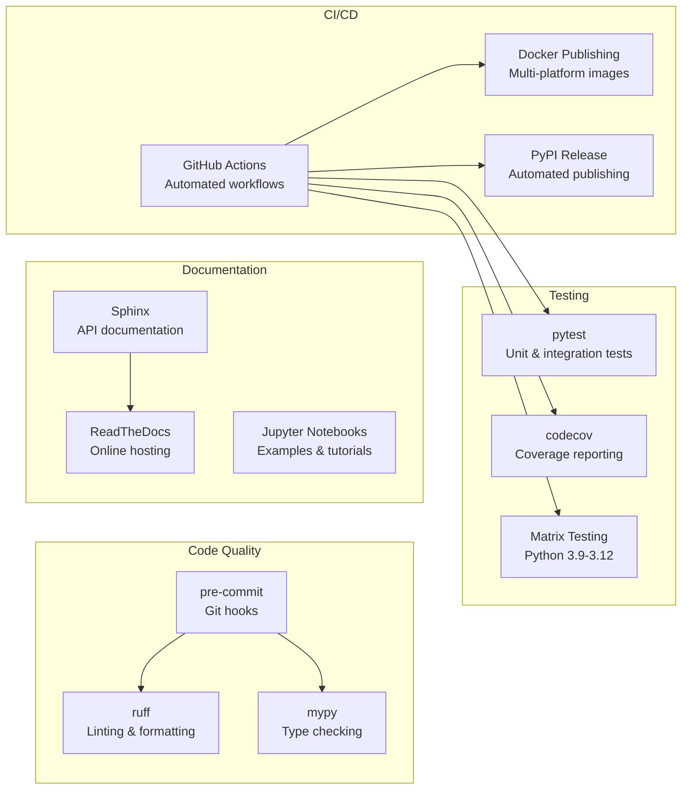

### Command Line Interface

TIAToolbox provides a comprehensive CLI through the `tiatoolbox` command, enabling batch processing and automation workflows. The CLI supports various operations including stain normalization, patch extraction, and model inference.

Sources: [setup.py:50-53](), [.github/workflows/docker-publish.yml:1-69](), [.github/workflows/conda-env-create.yml:1-51](), [HISTORY.md:50-61]()

## Research Foundation

TIAToolbox is developed by the TIA Centre at the University of Warwick and has been published in Communications Medicine. The toolkit incorporates state-of-the-art algorithms from the computational pathology research community and provides a standardized platform for reproducible research.

The toolkit's development is driven by the needs of computational, biomedical, and clinical researchers working in digital pathology. It provides both high-level interfaces for common tasks and low-level access for advanced users implementing custom algorithms.

Sources: [README.md:135-153](), [CITATION.cff:1-101](), [AUTHORS.md:1-30]()

---

# Page: Installation and Setup

# Installation and Setup

<details>
<summary>Relevant source files</summary>

The following files were used as context for generating this wiki page:

- [.github/workflows/pip-install.yml](.github/workflows/pip-install.yml)
- [README.md](README.md)
- [docs/conf.py](docs/conf.py)
- [docs/installation.rst](docs/installation.rst)
- [docs/requirements.txt](docs/requirements.txt)
- [requirements/requirements.conda.yml](requirements/requirements.conda.yml)
- [requirements/requirements.dev.conda.yml](requirements/requirements.dev.conda.yml)
- [requirements/requirements.txt](requirements/requirements.txt)
- [requirements/requirements.win64.conda.yml](requirements/requirements.win64.conda.yml)
- [requirements/requirements.win64.dev.conda.yml](requirements/requirements.win64.dev.conda.yml)

</details>


This document provides comprehensive instructions for installing TIAToolbox across different platforms and environments. It covers prerequisite software installation, multiple installation methods, platform-specific considerations, and development environment setup.

For information about core concepts and architectural overview, see [Core Concepts](#1.2). For development and contributing guidelines, see [Contributing Guidelines](#8.1).

## Installation Overview

TIAToolbox supports Python versions 3.9 through 3.12 and runs on Linux, Windows, and macOS. The installation process involves two main phases: installing prerequisite system libraries and installing the TIAToolbox package itself.

### Installation Flow

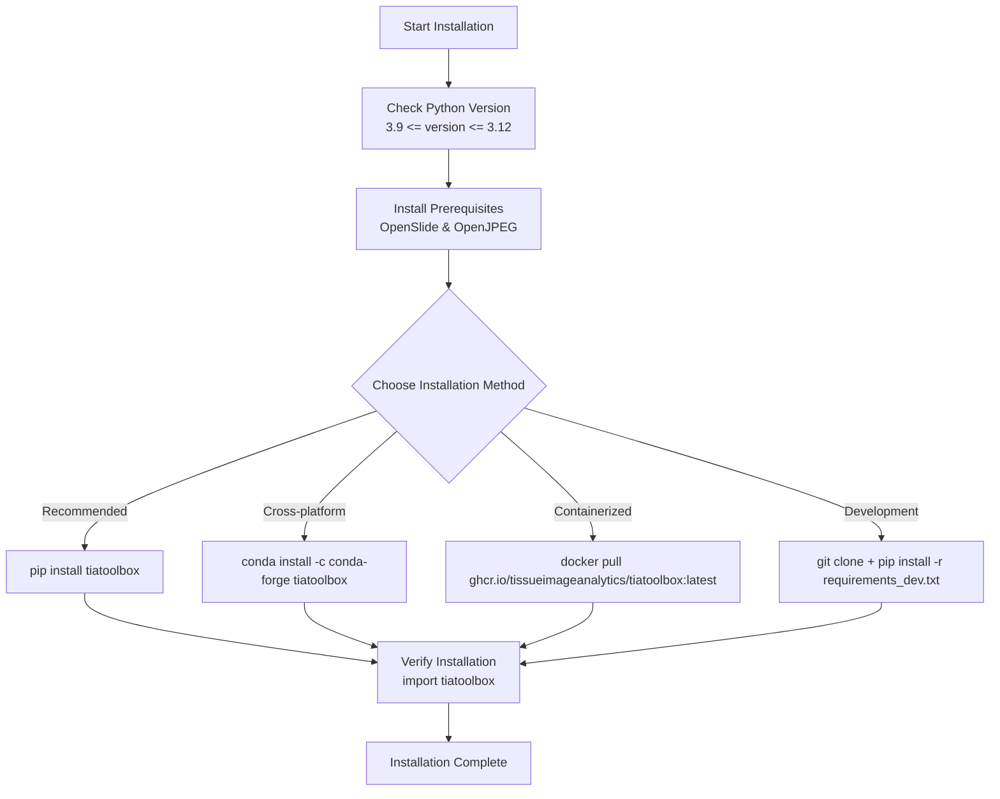

**Sources:** [README.md:72-127](), [docs/installation.rst:1-199]()

### Dependency Architecture

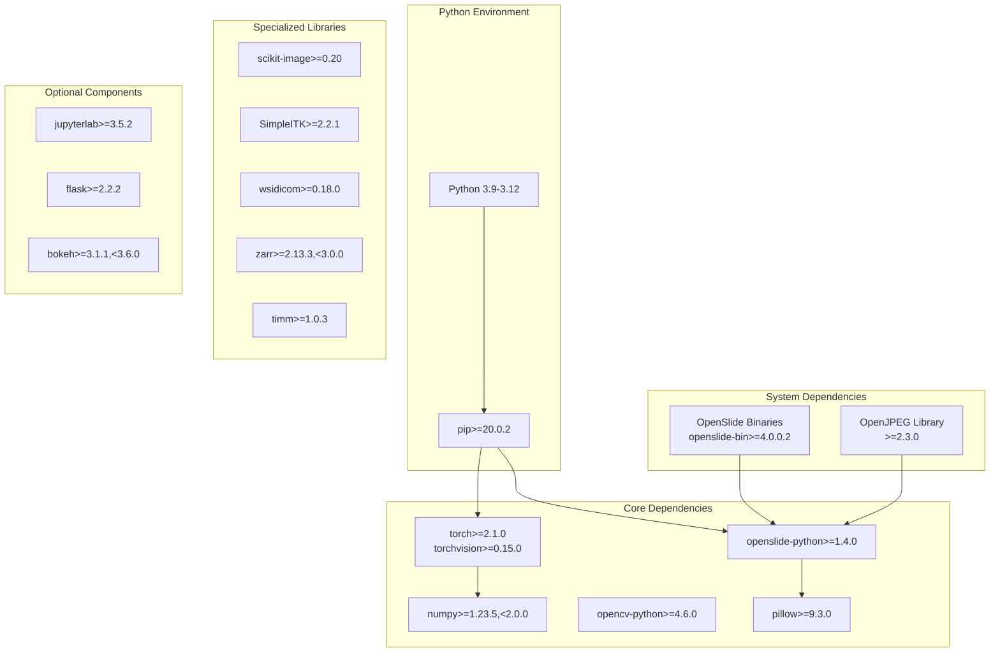

**Sources:** [requirements/requirements.txt:1-40](), [requirements/requirements.conda.yml:7-15]()

## Prerequisites

### System Library Requirements

TIAToolbox requires OpenSlide binaries and OpenJPEG version 2.3.0 or higher for reading whole slide images in various formats.

#### Linux (Ubuntu/Debian)

```bash
sudo apt-get update
sudo apt-get install -y libopenjp2-7-dev libopenjp2-tools
```

#### Windows

Use conda to install OpenJPEG:

```cmd
conda install -c conda-forge openjpeg
```

For complete Windows support, consider using WSL2 with CUDA support for better performance.

#### macOS

**Using Homebrew:**
```bash
brew install openjpeg
```

**Using MacPorts:**
```bash
port install openjpeg
```

**Sources:** [docs/installation.rst:9-54](), [.github/workflows/pip-install.yml:24-46]()

### Python Environment

TIAToolbox supports Python versions 3.9, 3.10, 3.11, and 3.12. Verify your Python version:

```bash
python --version
```

**Sources:** [docs/installation.rst:58](), [.github/workflows/pip-install.yml:17]()

## Installation Methods

### Method 1: pip (Recommended)

The simplest installation method using the Python Package Index:

```bash
# Fresh installation
pip install tiatoolbox

# Upgrade existing installation
pip install --ignore-installed --upgrade tiatoolbox

# Install without dependencies (if already installed separately)
pip install --no-deps tiatoolbox
```

This method installs from PyPI and includes all required dependencies automatically.

**Sources:** [README.md:74-75](), [docs/installation.rst:63-88]()

### Method 2: Conda/Mamba

For cross-platform package management with automatic dependency resolution:

```bash
# Using conda
conda install -c conda-forge tiatoolbox

# Using mamba (faster alternative)
mamba install tiatoolbox
```

**Note:** Windows conda-forge support is limited due to OpenSlide binary availability. Consider WSL2 for Windows installations.

**Sources:** [docs/installation.rst:97-112](), [README.md:117-119]()

### Method 3: Docker

For isolated, containerized environments:

```bash
# Pull pre-built image
docker pull ghcr.io/tissueimageanalytics/tiatoolbox:latest

# Run container
docker run -it --rm ghcr.io/tissueimageanalytics/tiatoolbox:latest

# Use as base image in Dockerfile
FROM ghcr.io/tissueimageanalytics/tiatoolbox:latest
```

**Sources:** [docs/installation.rst:140-199]()

### Method 4: From Source (Development)

For development or latest features:

```bash
# Clone repository
git clone https://github.com/TissueImageAnalytics/tiatoolbox.git
cd tiatoolbox

# Install in development mode
python setup.py install
```

**Sources:** [README.md:94-104](), [docs/installation.rst:114-138]()

## Development Environment Setup

### Environment Configuration

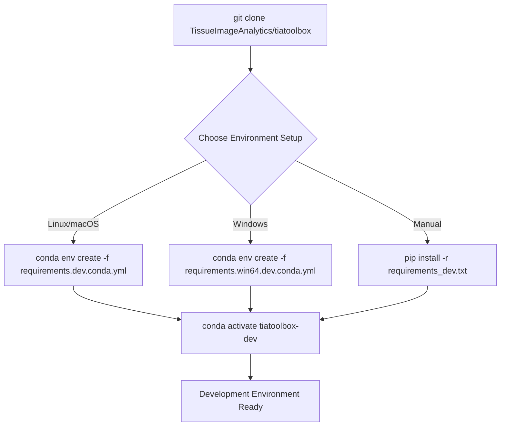

### Creating Development Environment

**Option 1: Using Conda Environment Files**

```bash
# For Linux/macOS
conda env create -f requirements/requirements.dev.conda.yml
conda activate tiatoolbox-dev

# For Windows
conda env create -f requirements/requirements.win64.dev.conda.yml
conda activate tiatoolbox-dev
```

**Option 2: Manual Setup**

```bash
# Create new environment
conda create -n tiatoolbox-dev python=3.9
conda activate tiatoolbox-dev

# Install development dependencies
pip install -r requirements/requirements_dev.txt
```

**Sources:** [README.md:105-124](), [requirements/requirements.dev.conda.yml:1-15](), [requirements/requirements.win64.dev.conda.yml:1-15]()

### Development Dependencies Structure

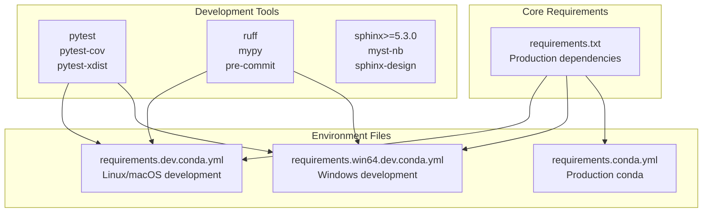

**Sources:** [requirements/requirements_dev.txt](), [requirements/requirements.dev.conda.yml:1-15]()

## Platform-Specific Considerations

### Linux Installations

Linux installations typically work smoothly with minimal configuration. The CI/CD pipeline tests on `ubuntu-24.04`:

```bash
# Prerequisites
sudo apt update
sudo apt-get install -y libopenjp2-7 libopenjp2-tools

# Install TIAToolbox
pip install tiatoolbox
```

**Sources:** [.github/workflows/pip-install.yml:25-29]()

### Windows Installations

Windows requires special handling for OpenSlide and OpenJPEG:

1. **Conda Method (Recommended):**
   ```cmd
   conda install -c conda-forge openjpeg
   conda install -c conda-forge tiatoolbox
   ```

2. **WSL2 Method (Performance):**
   - Install Windows Subsystem for Linux 2
   - Follow Linux installation instructions within WSL2
   - Optionally enable CUDA support for GPU acceleration

**Sources:** [docs/installation.rst:112](), [.github/workflows/pip-install.yml:36-50]()

### macOS Installations

macOS supports both Homebrew and MacPorts package managers:

```bash
# Install OpenJPEG
brew install openjpeg  # or: port install openjpeg

# Install TIAToolbox
pip install tiatoolbox
```

**Sources:** [docs/installation.rst:33-53](), [.github/workflows/pip-install.yml:30-34]()

## Verification and Testing

### Basic Import Test

```python
import tiatoolbox
print(tiatoolbox.__version__)

import openslide
print(openslide.__version__)

import torch
print(torch.__version__)
```

### Component Verification

```python
# Test core modules
from tiatoolbox.wsicore.wsireader import WSIReader
from tiatoolbox.models.engine.semantic_segmentor import SemanticSegmentor
from tiatoolbox.tools.patchextraction import PatchExtractor

# Test CLI availability
import subprocess
result = subprocess.run(['tiatoolbox', '--help'], capture_output=True, text=True)
print("CLI available:", result.returncode == 0)
```

**Sources:** [.github/workflows/pip-install.yml:64-72]()

### Installation Validation Matrix

| Platform | Python Version | Installation Method | Status |
|----------|----------------|-------------------|---------|
| Ubuntu 24.04 | 3.9, 3.10, 3.11, 3.12 | pip, conda | ✅ Full Support |
| Windows Latest | 3.9, 3.10, 3.11, 3.12 | pip, conda* | ⚠️ Limited conda-forge |
| macOS Latest | 3.9, 3.10, 3.11, 3.12 | pip, conda | ✅ Full Support |

*Windows conda installations require OpenJPEG from conda-forge or WSL2 setup.

**Sources:** [.github/workflows/pip-install.yml:14-18](), [docs/installation.rst:112]()

## Troubleshooting Common Issues

### OpenSlide Import Errors

If you encounter OpenSlide import errors, ensure prerequisites are correctly installed:

```python
# Test OpenSlide availability
try:
    import openslide
    print("OpenSlide version:", openslide.__version__)
except ImportError as e:
    print("OpenSlide not found:", str(e))
```

### Dependency Conflicts

For environments with existing packages, use isolated installation:

```bash
# Create clean environment
conda create -n tiatoolbox-clean python=3.9
conda activate tiatoolbox-clean
pip install tiatoolbox
```

### Memory and Performance

For large WSI processing, consider:
- Using Docker with memory limits
- WSL2 on Windows for better performance
- GPU acceleration where available

**Sources:** [docs/installation.rst:112](), [README.md:61]()

---

# Page: Core Concepts

# Core Concepts

<details>
<summary>Relevant source files</summary>

The following files were used as context for generating this wiki page:

- [tests/test_utils.py](tests/test_utils.py)
- [tests/test_wsireader.py](tests/test_wsireader.py)
- [tiatoolbox/utils/image.py](tiatoolbox/utils/image.py)
- [tiatoolbox/utils/misc.py](tiatoolbox/utils/misc.py)
- [tiatoolbox/utils/transforms.py](tiatoolbox/utils/transforms.py)
- [tiatoolbox/wsicore/wsireader.py](tiatoolbox/wsicore/wsireader.py)
- [whitelist.txt](whitelist.txt)

</details>


This page introduces the fundamental concepts that underlie TIAToolbox's computational pathology system. It covers the core data structures, coordinate systems, and processing paradigms that form the foundation for all analysis workflows.

For specific implementation details about data systems, see [Data Systems](#2). For information about processing pipelines, see [Image Processing Pipeline](#3). For model inference concepts, see [Model and Inference Systems](#4).

## Whole Slide Images (WSIs)

Whole Slide Images represent the primary data type in computational pathology - digitized microscopy slides that can contain gigapixel-resolution images with multiple resolution levels.

### WSI Formats and Readers

TIAToolbox supports multiple WSI formats through a unified `WSIReader` interface that automatically detects and handles different file types:

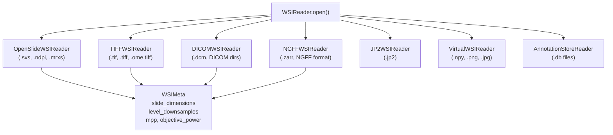

**WSI Format Detection and Factory Pattern**
TIAToolbox uses automatic format detection to instantiate the appropriate reader:

Sources: [tiatoolbox/wsicore/wsireader.py:324-415]()

### WSI Metadata and Properties

Every WSI contains essential metadata accessible through the `WSIMeta` class:

| Property | Description | Code Reference |
|----------|-------------|----------------|
| `slide_dimensions` | Width and height at baseline resolution | `WSIMeta.slide_dimensions` |
| `level_count` | Number of resolution levels | `WSIMeta.level_count` |
| `level_dimensions` | Dimensions at each level | `WSIMeta.level_dimensions` |
| `level_downsamples` | Downsample factors for each level | `WSIMeta.level_downsamples` |
| `mpp` | Microns per pixel | `WSIMeta.mpp` |
| `objective_power` | Microscope objective power | `WSIMeta.objective_power` |

Sources: [tiatoolbox/wsicore/wsireader.py:484-502](), [tiatoolbox/wsicore/wsimeta.py]()

## Resolution and Units System

TIAToolbox provides a flexible resolution system supporting multiple units for specifying magnification and scale:

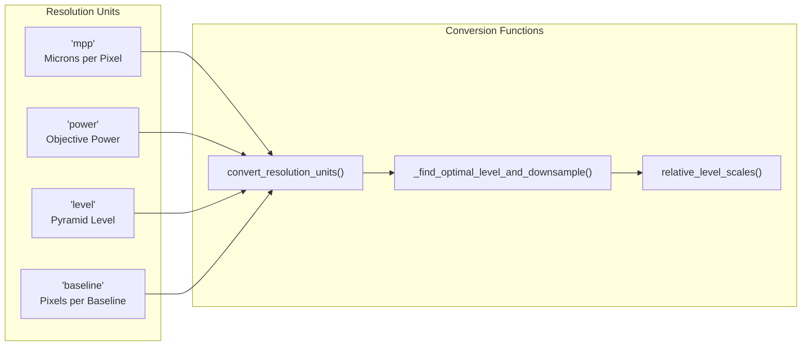

### Resolution Conversion Examples

The system automatically converts between units and finds optimal read parameters:

- **MPP to Power**: `0.25 mpp ≈ 40x objective power`
- **Level to Scale**: `level=1` corresponds to specific downsample factor
- **Baseline Scale**: `0.5 baseline` means half the original resolution

Sources: [tiatoolbox/wsicore/wsireader.py:993-1033](), [tiatoolbox/utils/misc.py:279-388]()

## Coordinate Systems and Bounds

TIAToolbox uses consistent coordinate conventions across all operations:

### Coordinate Format
All spatial coordinates follow the **(left, top, right, bottom)** or **(start_x, start_y, end_x, end_y)** format, with origin at the top-left corner.

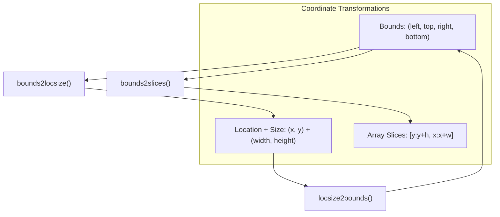

### Multi-Resolution Coordinate Handling

The system automatically handles coordinate transformations between different resolution levels:

Sources: [tiatoolbox/utils/transforms.py:259-334](), [tiatoolbox/wsicore/wsireader.py:590-671]()

## Patches and Regions

Patches represent rectangular regions extracted from WSIs at specific resolutions. TIAToolbox supports various patch extraction strategies:

### Patch Reading Operations

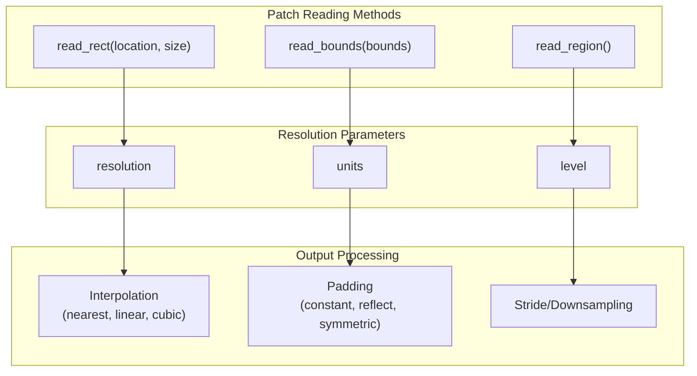

### Sub-Pixel Reading

TIAToolbox supports sub-pixel coordinate reads with interpolation:

```python
# Example: Reading at fractional coordinates
bounds = (10.5, 20.3, 50.7, 60.8)
region = wsi.read_bounds(bounds, resolution=0.5, units="mpp")
```

Sources: [tiatoolbox/utils/image.py:443-738](), [tiatoolbox/wsicore/wsireader.py:1034-1200]()

## Annotation System

The annotation system manages spatial annotations and metadata associated with WSIs:

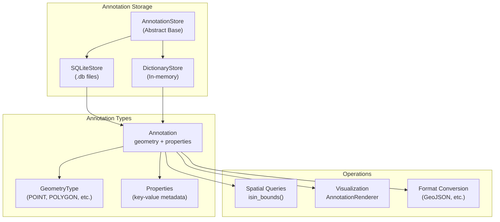

### Annotation Storage Backends

- **SQLiteStore**: Persistent storage with spatial indexing for large datasets
- **DictionaryStore**: In-memory storage for temporary annotations
- **AnnotationStoreReader**: Treats annotation databases as readable image sources

Sources: [tiatoolbox/annotation/storage.py](), [tiatoolbox/wsicore/wsireader.py:417-453]()

## Data Processing Pipeline

The core data flow in TIAToolbox follows a standardized pipeline:

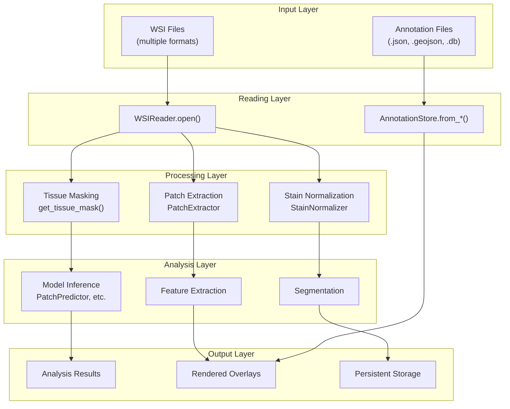

### Processing Paradigms

1. **Patch-Based Processing**: Extract and process small regions independently
2. **Streaming Processing**: Process large WSIs without loading entire images into memory
3. **Multi-Resolution Processing**: Leverage image pyramids for efficient analysis
4. **Annotation-Guided Processing**: Use spatial annotations to focus analysis

Sources: [tiatoolbox/wsicore/wsireader.py:1-100](), [tiatoolbox/utils/image.py:1-50](), [tiatoolbox/utils/transforms.py:1-50]()

## Memory and Performance Considerations

TIAToolbox is designed to handle large-scale WSI data efficiently:

### Lazy Loading and Streaming
- WSI readers use lazy loading - metadata is read immediately, pixel data on-demand
- Patch extraction supports streaming to process arbitrarily large images
- Memory usage is controlled through configurable patch sizes and batch processing

### Multi-Resolution Optimization
- Automatic selection of optimal resolution levels for reading
- Pyramid-aware algorithms that work at appropriate scales
- Resolution conversion with minimal interpolation artifacts

Sources: [tiatoolbox/wsicore/wsireader.py:530-588](), [tiatoolbox/utils/image.py:296-441]()

---

# Page: Data Systems

# Data Systems

<details>
<summary>Relevant source files</summary>

The following files were used as context for generating this wiki page:

- [tests/test_annotation_stores.py](tests/test_annotation_stores.py)
- [tests/test_annotation_tilerendering.py](tests/test_annotation_tilerendering.py)
- [tests/test_visualization.py](tests/test_visualization.py)
- [tests/test_wsireader.py](tests/test_wsireader.py)
- [tiatoolbox/annotation/storage.py](tiatoolbox/annotation/storage.py)
- [tiatoolbox/utils/visualization.py](tiatoolbox/utils/visualization.py)
- [tiatoolbox/wsicore/wsireader.py](tiatoolbox/wsicore/wsireader.py)
- [whitelist.txt](whitelist.txt)

</details>


## Purpose and Scope

This document covers TIAToolbox's data handling systems for whole slide images (WSIs) and spatial annotations. The data systems provide unified interfaces for reading medical imaging data from various formats, managing spatial annotations with efficient storage and querying capabilities, and rendering annotations for visualization.

For information about image processing operations on this data, see [Image Processing Pipeline](#3). For machine learning inference using this data, see [Model and Inference Systems](#4).

## WSI Reading Architecture

The WSI reading system provides format-agnostic access to whole slide images through the `WSIReader` factory pattern. The system automatically detects file formats and instantiates appropriate readers, handling multi-resolution pyramids and coordinate system conversions.

### WSI Reader Factory and Format Detection

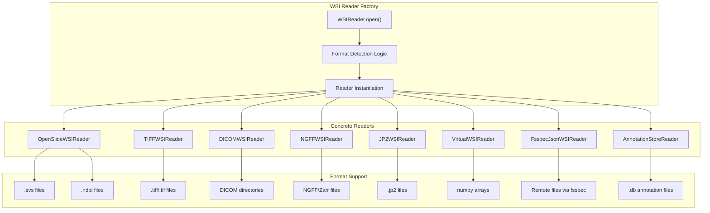

**WSI Reader Selection Logic**

Sources: [tiatoolbox/wsicore/wsireader.py:324-414]()

The `WSIReader.open()` method [tiatoolbox/wsicore/wsireader.py:324-414]() implements a cascading detection system:

| Format Check | Detection Method | Reader Class |
|--------------|------------------|--------------|
| DICOM | `is_dicom()` checks for `.dcm` files | `DICOMWSIReader` |
| NGFF | `is_ngff()` validates zarr metadata | `NGFFWSIReader` |
| OME-TIFF | Suffix pattern matching | `TIFFWSIReader` |
| OpenSlide | `OpenSlide.detect_format()` | `OpenSlideWSIReader` |
| Tiled TIFF | `is_tiled_tiff()` validation | `TIFFWSIReader` |
| Virtual formats | Extension-based routing | `VirtualWSIReader`/`JP2WSIReader` |

### Multi-Resolution and Coordinate Systems

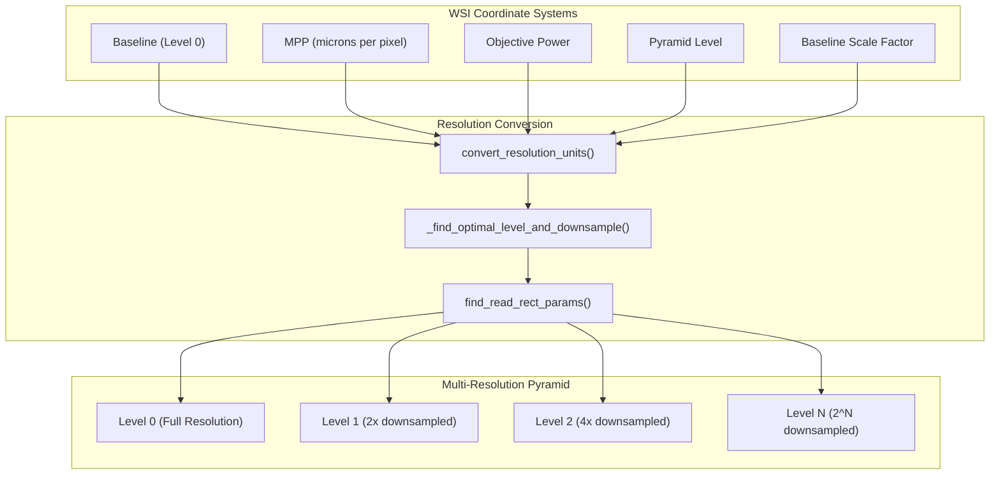

Sources: [tiatoolbox/wsicore/wsireader.py:530-759](), [tiatoolbox/wsicore/wsireader.py:993-1034]()

The system supports multiple coordinate systems and automatically converts between them using `convert_resolution_units()` [tiatoolbox/wsicore/wsireader.py:993-1034](). The `_find_optimal_level_and_downsample()` method [tiatoolbox/wsicore/wsireader.py:530-588]() determines the most efficient resolution level to read from based on the requested output resolution.

## Annotation Storage and Management

The annotation system provides persistent storage and efficient spatial querying of geometric annotations through an abstract `AnnotationStore` interface with multiple concrete implementations.

### Annotation Storage Architecture

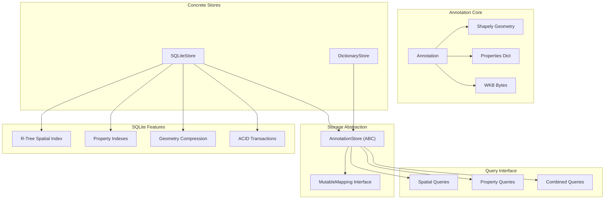

Sources: [tiatoolbox/annotation/storage.py:110-438](), [tiatoolbox/annotation/storage.py:443-460]()

### Annotation Data Model

The `Annotation` class [tiatoolbox/annotation/storage.py:110-438]() provides a unified representation:

| Component | Type | Purpose |
|-----------|------|---------|
| `geometry` | Shapely Geometry | Point, LineString, or Polygon |
| `properties` | Dict | Key-value metadata |
| `wkb` | bytes | Well-Known Binary serialization |

The class implements lazy geometry loading - Shapely objects are only created when first accessed, improving memory efficiency for large annotation sets.

### SQLite Storage Implementation

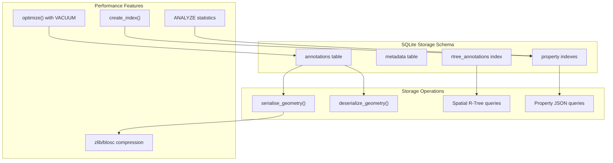

Sources: [tiatoolbox/annotation/storage.py:2025-2685]()

The `SQLiteStore` [tiatoolbox/annotation/storage.py:2025-2685]() provides enterprise-grade features:

- **Spatial Indexing**: R-Tree index for efficient geometric queries
- **Property Indexing**: Custom indexes on annotation properties for fast filtering
- **Compression**: Configurable geometry compression (zlib, blosc, or none)
- **ACID Compliance**: Full transaction support with rollback capabilities

## Data Format Support

TIAToolbox supports reading WSIs from multiple medical imaging formats through format-specific readers that handle the unique characteristics of each format.

### Supported WSI Formats

| Format | Extensions | Reader Class | Key Features |
|--------|-----------|--------------|--------------|
| Aperio SVS | `.svs` | `OpenSlideWSIReader` | Pyramid levels, associated images |
| Hamamatsu NDPI | `.ndpi` | `OpenSlideWSIReader` | Multi-focal planes, metadata |
| MIRAX | `.mrxs` | `OpenSlideWSIReader` | Hierarchical structure |
| Generic TIFF | `.tiff`, `.tif` | `TIFFWSIReader` | Tiled TIFF support |
| OME-TIFF | `.ome.tiff` | `TIFFWSIReader` | OME metadata, multi-channel |
| DICOM WSI | `.dcm`, directories | `DICOMWSIReader` | DICOM metadata, series |
| NGFF/Zarr | `.zarr` | `NGFFWSIReader` | Cloud-native, chunked storage |
| JPEG2000 | `.jp2` | `JP2WSIReader` | Wavelet compression |
| Virtual | `.npy`, `.png`, `.jpg` | `VirtualWSIReader` | In-memory arrays, single images |

Sources: [tiatoolbox/wsicore/wsireader.py:434-452]()

### Format Detection Logic

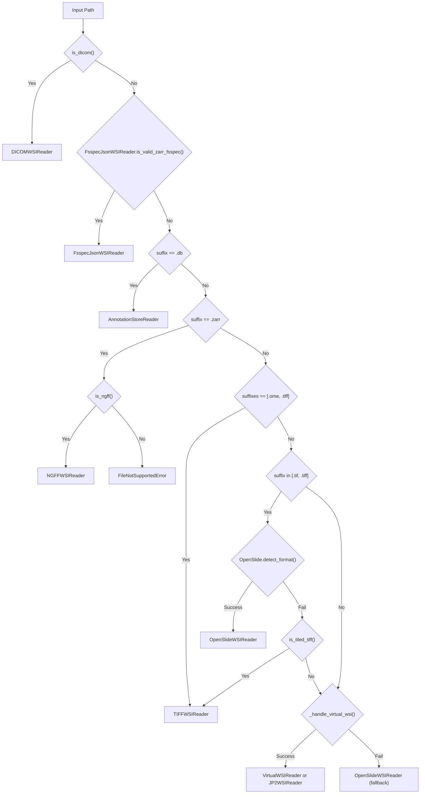

Sources: [tiatoolbox/wsicore/wsireader.py:375-414]()

## Visualization and Rendering

The visualization system renders spatial annotations onto image tiles through the `AnnotationRenderer` class, supporting various color mapping strategies and rendering optimizations.

### Annotation Rendering Pipeline

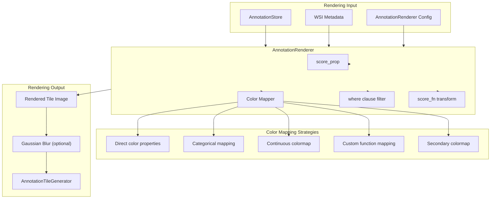

Sources: [tiatoolbox/utils/visualization.py:570-877]()

### Color Mapping Configuration

| Mapping Strategy | Configuration | Use Case |
|------------------|---------------|----------|
| Direct Color | `score_prop="color"` | Pre-defined RGBA values in properties |
| Categorical | `mapper=["cat1", "cat2", ...]` | Discrete categories with random colors |
| Continuous | `mapper="viridis"` | Numerical values with matplotlib colormap |
| Dictionary | `mapper={value: color, ...}` | Explicit value-to-color mapping |
| Function | `function_mapper=lambda props: color` | Custom color computation |

Sources: [tiatoolbox/utils/visualization.py:630-644](), [tiatoolbox/utils/visualization.py:693-770]()

The rendering system optimizes performance through:
- **Scale-based simplification**: Polygons rendered as bounding boxes at high zoom levels
- **Decimation strategies**: Selective rendering of annotations when zoomed out
- **Lazy tile generation**: On-demand rendering with caching
- **GPU acceleration**: OpenCV-based rendering operations

Sources: [tiatoolbox/utils/visualization.py:600-610](), [tiatoolbox/tools/pyramid.py]()

---

# Page: WSI Reading and Formats

# WSI Reading and Formats

<details>
<summary>Relevant source files</summary>

The following files were used as context for generating this wiki page:

- [examples/01-wsi-reading.ipynb](examples/01-wsi-reading.ipynb)
- [examples/02-stain-normalization.ipynb](examples/02-stain-normalization.ipynb)
- [examples/03-tissue-masking.ipynb](examples/03-tissue-masking.ipynb)
- [examples/04-patch-extraction.ipynb](examples/04-patch-extraction.ipynb)
- [tests/test_wsireader.py](tests/test_wsireader.py)
- [tiatoolbox/wsicore/wsireader.py](tiatoolbox/wsicore/wsireader.py)
- [whitelist.txt](whitelist.txt)

</details>


This document covers TIAToolbox's whole slide image (WSI) reading capabilities, including supported formats, reader implementations, and core reading operations. The WSI reading system provides a unified interface for accessing pixel data from various proprietary and open formats used in digital pathology.

For information about patch extraction strategies, see [Patch Extraction](#3.1). For annotation management, see [Annotation Management](#2.2).

## Overview

TIAToolbox supports reading WSI files from multiple vendors and formats through a unified `WSIReader` interface. The system uses a factory pattern to automatically detect file formats and instantiate the appropriate reader implementation.

### Supported Formats

| Format | File Extensions | Reader Class | Notes |
|--------|----------------|--------------|-------|
| Aperio SVS | `.svs` | `OpenSlideWSIReader` | Via OpenSlide library |
| Hamamatsu NDPI | `.ndpi` | `OpenSlideWSIReader` | Via OpenSlide library |  
| 3DHistech MRXS | `.mrxs` | `OpenSlideWSIReader` | Via OpenSlide library |
| TIFF/BigTIFF | `.tif`, `.tiff` | `TIFFWSIReader` | Tiled TIFF support |
| OME-TIFF | `.ome.tiff`, `.ome.tif` | `TIFFWSIReader` | Bio-Formats standard |
| DICOM | `.dcm`, directories | `DICOMWSIReader` | Medical imaging standard |
| JPEG 2000 | `.jp2` | `JP2WSIReader` | Via Glymur library |
| NGFF/Zarr | `.zarr` | `NGFFWSIReader` | OME-NGFF v0.4 |
| SQLite Annotations | `.db` | `AnnotationStoreReader` | Annotation databases |
| Virtual formats | `.npy`, `.png`, `.jpg` | `VirtualWSIReader` | Single images as WSI |
| Fsspec JSON | `.json` | `FsspecJsonWSIReader` | Remote file access |

Sources: [tiatoolbox/wsicore/wsireader.py:434-448](), [tiatoolbox/wsicore/wsireader.py:254-262]()

## Architecture

### WSIReader Factory Pattern

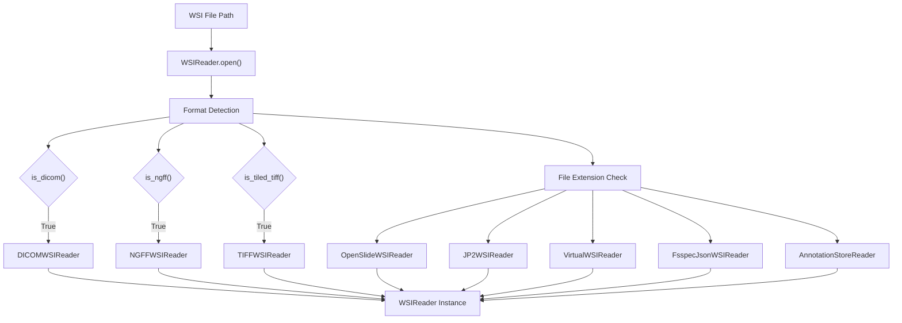

Sources: [tiatoolbox/wsicore/wsireader.py:324-414](), [tiatoolbox/wsicore/wsireader.py:57-216]()

### Reader Class Hierarchy

```mermaid
graph TD
    WSIReader["WSIReader (Base Class)"] --> OpenSlideWSIReader["OpenSlideWSIReader"]
    WSIReader --> TIFFWSIReader["TIFFWSIReader"]
    WSIReader --> DICOMWSIReader["DICOMWSIReader"]
    WSIReader --> NGFFWSIReader["NGFFWSIReader"]
    WSIReader --> VirtualWSIReader["VirtualWSIReader"]
    WSIReader --> JP2WSIReader["JP2WSIReader"]
    WSIReader --> FsspecJsonWSIReader["FsspecJsonWSIReader"]
    WSIReader --> AnnotationStoreReader["AnnotationStoreReader"]
    
    WSIReader -.-> WSIMeta["WSIMeta (metadata)"]
    WSIReader -.-> ReadMethods["read_rect(), read_bounds(), slide_thumbnail()"]
    WSIReader -.-> ResolutionMethods["find_optimal_level_and_downsample()"]
```

Sources: [tiatoolbox/wsicore/wsireader.py:302-528]()

## Format Detection

The format detection process follows a priority hierarchy to determine the appropriate reader:

1. **Special Format Checks**: DICOM, NGFF/Zarr, Fsspec JSON
2. **Extension-Based Detection**: File suffix analysis  
3. **Content-Based Detection**: Tiled TIFF validation, OpenSlide compatibility
4. **Fallback**: OpenSlide as default reader

### Detection Functions

- `is_dicom(path)` - Detects DICOM files or directories [tiatoolbox/wsicore/wsireader.py:57-72]()
- `is_tiled_tiff(path)` - Validates tiled TIFF structure [tiatoolbox/wsicore/wsireader.py:75-92]()
- `is_zarr(path)` - Checks Zarr format compatibility [tiatoolbox/wsicore/wsireader.py:95-113]()
- `is_ngff(path)` - Validates NGFF v0.4 specification [tiatoolbox/wsicore/wsireader.py:116-215]()

Sources: [tiatoolbox/wsicore/wsireader.py:375-414]()

## Core Reading Operations

### Metadata Access

Every WSIReader instance provides standardized metadata through the `info` property:

```python
reader = WSIReader.open("slide.svs")
metadata = reader.info

# Access common properties
dimensions = metadata.slide_dimensions  # (width, height)
mpp = metadata.mpp  # microns per pixel
levels = metadata.level_count
objective_power = metadata.objective_power
```

Sources: [tiatoolbox/wsicore/wsireader.py:484-502]()

### Reading Methods

| Method | Purpose | Parameters |
|--------|---------|------------|
| `read_rect()` | Read rectangular region | location, size, resolution, units |
| `read_bounds()` | Read bounded region | bounds, resolution, units |
| `slide_thumbnail()` | Generate thumbnail | resolution, units |
| `slide_dimensions()` | Get slide size at resolution | resolution, units |

### Resolution Units

TIAToolbox supports multiple resolution unit systems:

- **`mpp`**: Microns per pixel (physical resolution)
- **`power`**: Objective power (e.g., 20x, 40x)
- **`level`**: Pyramid level (0 = highest resolution)
- **`baseline`**: Pixels per baseline pixel

```python
# Read at 0.5 microns per pixel
region = reader.read_rect((1000, 1000), (512, 512), resolution=0.5, units="mpp")

# Read at 20x objective power  
region = reader.read_rect((1000, 1000), (512, 512), resolution=20, units="power")

# Read at pyramid level 2
region = reader.read_rect((1000, 1000), (512, 512), resolution=2, units="level")
```

Sources: [tiatoolbox/wsicore/wsireader.py:590-671](), [tiatoolbox/wsicore/wsireader.py:993-1042]()

## Resolution Handling Workflow

```mermaid
graph TD
    ReadRequest["read_rect(location, size, resolution, units)"] --> FindOptimal["find_optimal_level_and_downsample()"]
    FindOptimal --> LevelScales["Calculate relative_level_scales()"]
    LevelScales --> OptimalLevel["Select optimal pyramid level"]
    OptimalLevel --> ScaleFactor["Calculate post-read scale factor"]
    
    ScaleFactor --> ReadParams["find_read_rect_params()"]
    ReadParams --> LevelLocation["Convert location to level coordinates"]
    ReadParams --> LevelSize["Convert size to level coordinates"]
    
    LevelLocation --> ReadLevel["Read from pyramid level"]
    LevelSize --> ReadLevel
    ReadLevel --> PostScale["Apply post-read scaling"]
    PostScale --> FinalImage["Return scaled image"]
```

Sources: [tiatoolbox/wsicore/wsireader.py:530-589](), [tiatoolbox/wsicore/wsireader.py:672-759]()

## Usage Examples

### Basic WSI Reading

```python
from tiatoolbox.wsicore.wsireader import WSIReader

# Open any supported format
reader = WSIReader.open("sample.svs")

# Get thumbnail
thumbnail = reader.slide_thumbnail(resolution=1.25, units="power")

# Read a patch at baseline resolution
patch = reader.read_rect(location=(1000, 1000), size=(512, 512), 
                        resolution=0, units="level")
```

### Multi-Resolution Reading

```python
# Read same region at different resolutions
for level in range(reader.info.level_count):
    patch = reader.read_rect((1000, 1000), (512, 512), 
                           resolution=level, units="level")
    print(f"Level {level}: {patch.shape}")
```

### Resolution Conversion

```python
# Convert between resolution units
mpp_resolution = reader.convert_resolution_units(
    input_res=20, input_unit="power", output_unit="mpp"
)
```

Sources: [examples/01-wsi-reading.ipynb:217-298](), [tests/test_wsireader.py:296-320]()

## Error Handling

The WSI reading system includes validation and error handling:

- **Format Validation**: `verify_supported_wsi()` checks file format support
- **Path Validation**: Ensures input files exist before processing  
- **Resolution Validation**: Warns when requested resolution exceeds baseline
- **Interpolation Warnings**: Alerts when upsampling will occur

Sources: [tiatoolbox/wsicore/wsireader.py:416-452](), [tiatoolbox/wsicore/wsireader.py:580-587]()

---

# Page: Annotation Management

# Annotation Management

<details>
<summary>Relevant source files</summary>

The following files were used as context for generating this wiki page:

- [.github/workflows/python-package.yml](.github/workflows/python-package.yml)
- [.pre-commit-config.yaml](.pre-commit-config.yaml)
- [benchmarks/annotation_store.ipynb](benchmarks/annotation_store.ipynb)
- [benchmarks/annotation_store_alloc.py](benchmarks/annotation_store_alloc.py)
- [pyproject.toml](pyproject.toml)
- [requirements/requirements_dev.txt](requirements/requirements_dev.txt)
- [tests/test_annotation_stores.py](tests/test_annotation_stores.py)
- [tests/test_annotation_tilerendering.py](tests/test_annotation_tilerendering.py)
- [tests/test_visualization.py](tests/test_visualization.py)
- [tiatoolbox/annotation/storage.py](tiatoolbox/annotation/storage.py)
- [tiatoolbox/utils/env_detection.py](tiatoolbox/utils/env_detection.py)
- [tiatoolbox/utils/visualization.py](tiatoolbox/utils/visualization.py)

</details>


This document covers TIAToolbox's annotation management system, which provides storage, querying, and manipulation of spatial annotations with associated properties. The system handles geometric annotations (points, lines, polygons) and their metadata for whole slide image analysis workflows.

For information about reading and processing whole slide images themselves, see [WSI Reading and Formats](#2.1). For visualization of annotations, see [Visualization and Rendering](#5.3).

## Core Annotation Model

TIAToolbox represents annotations using the `Annotation` class, which combines a spatial geometry with associated properties. Each annotation consists of a Shapely geometry object and a dictionary of JSON-serializable properties.

```mermaid
graph TB
    subgraph "Annotation Data Model"
        Ann["Annotation"]
        Geom["geometry: Geometry"]
        Props["properties: dict"]
        WKB["_wkb: bytes"]
        
        Ann --> Geom
        Ann --> Props  
        Ann --> WKB
    end
    
    subgraph "Supported Geometries"
        Point["Point"]
        LineString["LineString"] 
        Polygon["Polygon"]
        MultiPoint["MultiPoint"]
        MultiLineString["MultiLineString"]
        MultiPolygon["MultiPolygon"]
    end
    
    Geom --> Point
    Geom --> LineString
    Geom --> Polygon
    Geom --> MultiPoint
    Geom --> MultiLineString
    Geom --> MultiPolygon
```

**Sources:** [tiatoolbox/annotation/storage.py:110-280]()

The `Annotation` class provides lazy loading of geometries through Well-Known Binary (WKB) representation, enabling efficient memory usage when working with large numbers of annotations. Properties can store classification results, confidence scores, or any other metadata associated with the spatial region.

## Storage System Architecture

TIAToolbox provides two main storage implementations following the `MutableMapping` interface, allowing them to be used like Python dictionaries while providing specialized functionality for spatial data.

```mermaid
graph TB
    subgraph "Storage Class Hierarchy"
        ABC["AnnotationStore<br/>(ABC, MutableMapping)"]
        Dict["DictionaryStore"]
        SQLite["SQLiteStore"]
        
        ABC --> Dict
        ABC --> SQLite
    end
    
    subgraph "Key Methods"
        Query["query(geometry, where, geometry_predicate)"]
        Append["append(annotation, key)"]
        Patch["patch(key, geometry, properties)"]
        Serialize["dump(fp) / dumps()"]
        Spatial["spatial indexing (SQLite only)"]
    end
    
    ABC --> Query
    ABC --> Append
    ABC --> Patch
    ABC --> Serialize
    SQLite --> Spatial
    
    subgraph "Storage Backends"
        Memory["In-Memory Dictionary"]
        Database["SQLite Database<br/>with R-tree Index"]
    end
    
    Dict --> Memory
    SQLite --> Database
```

**Sources:** [tiatoolbox/annotation/storage.py:443-460](), [tiatoolbox/annotation/storage.py:1205-1450](), [tiatoolbox/annotation/storage.py:1451-2100]()

### DictionaryStore

The `DictionaryStore` provides a simple in-memory implementation suitable for smaller annotation collections. It stores all annotations in a Python dictionary and performs linear scans for queries.

| Feature | Implementation |
|---------|----------------|
| Storage | Python `dict` in memory |
| Querying | Linear scan with Python predicates |
| Persistence | Serialization to GeoJSON/pickle |
| Performance | O(n) queries, fast for small datasets |

### SQLiteStore

The `SQLiteStore` uses SQLite with spatial extensions for efficient storage and querying of large annotation collections. It provides spatial indexing through R-tree indexes and supports complex queries.

| Feature | Implementation |
|---------|----------------|
| Storage | SQLite database (memory or disk) |
| Spatial Index | R-tree index via `rtree` extension |
| Querying | SQL with spatial predicates |
| Compression | Optional zlib compression for geometries |
| Performance | O(log n) spatial queries |

**Sources:** [tiatoolbox/annotation/storage.py:1451-1500](), [tests/test_annotation_stores.py:575-600]()

## Querying and Filtering

Both storage implementations support rich querying capabilities combining spatial and property-based filters.

```mermaid
graph LR
    subgraph "Query Types"
        Spatial["Spatial Queries"]
        Property["Property Queries"]
        Combined["Combined Queries"]
    end
    
    subgraph "Spatial Predicates"
        Intersects["intersects"]
        Contains["contains"]
        Within["within"]
        Touches["touches"]
        BBox["bbox_intersects"]
    end
    
    subgraph "Property Filters"
        StringPred["String expressions:<br/>'props[\"class\"] == 1'"]
        CallablePred["Callable functions"]
        PickledPred["Pickled functions"]
    end
    
    Spatial --> Intersects
    Spatial --> Contains
    Spatial --> Within
    Spatial --> Touches
    Spatial --> BBox
    
    Property --> StringPred
    Property --> CallablePred
    Property --> PickledPred
    
    Combined --> Spatial
    Combined --> Property
```

**Sources:** [tiatoolbox/annotation/storage.py:1070-1100](), [tiatoolbox/annotation/storage.py:922-957]()

### Spatial Query Examples

```python
# Find annotations intersecting a region
results = store.query(Polygon.from_bounds(0, 0, 100, 100))

# Find annotations contained within a region  
results = store.query(
    Polygon.from_bounds(0, 0, 100, 100),
    geometry_predicate="contains"
)
```

### Property-Based Filtering

```python
# Filter by classification
results = store.query(where='props["class"] == "tumor"')

# Combine spatial and property filters
results = store.query(
    Polygon.from_bounds(0, 0, 100, 100),
    where='props["confidence"] > 0.8'
)
```

**Sources:** [tiatoolbox/annotation/storage.py:1070-1200]()

## Serialization and Data Interchange

The annotation storage system supports multiple serialization formats for data exchange and persistence.

```mermaid
graph TB
    subgraph "Input Formats"
        GeoJSONIn["GeoJSON Files"]
        PickleIn["Pickle Files"] 
        CSVIn["CSV with Coordinates"]
        NPYIn["NumPy Arrays"]
    end
    
    subgraph "AnnotationStore"
        Store["AnnotationStore<br/>append_many()"]
        FromMethods["from_geojson()<br/>open()"]
    end
    
    subgraph "Output Formats"
        GeoJSONOut["GeoJSON<br/>to_geojson()"]
        PickleOut["Pickle<br/>dump()"]
        DatabaseOut["SQLite Database<br/>dump()"]
    end
    
    GeoJSONIn --> FromMethods
    PickleIn --> FromMethods
    CSVIn --> Store
    NPYIn --> Store
    
    Store --> GeoJSONOut
    Store --> PickleOut
    Store --> DatabaseOut
```

**Sources:** [tiatoolbox/annotation/storage.py:2101-2200](), [tests/test_annotation_stores.py:800-900]()

### Format Support

| Format | Read | Write | Use Case |
|--------|------|-------|----------|
| GeoJSON | ✓ | ✓ | Interoperability with GIS tools |
| Pickle | ✓ | ✓ | Python-specific serialization |
| SQLite | ✓ | ✓ | Persistent database storage |
| WKT/WKB | ✓ | ✓ | Geometry interchange |

## Integration with Visualization

The annotation management system integrates with TIAToolbox's visualization components through the `AnnotationRenderer` class.

```mermaid
graph TB
    subgraph "Visualization Pipeline"
        Store["AnnotationStore"]
        Renderer["AnnotationRenderer"]
        TileGen["AnnotationTileGenerator"]
        Output["Rendered Tiles"]
    end
    
    subgraph "Rendering Configuration"
        ColorMap["Colormap<br/>score_prop, mapper"]
        Filters["Filters<br/>where predicate"]
        Style["Style<br/>thickness, blur_radius"]
    end
    
    Store --> Renderer
    Renderer --> TileGen
    TileGen --> Output
    
    ColorMap --> Renderer
    Filters --> Renderer
    Style --> Renderer
    
    subgraph "Query Integration"
        SpatialQuery["Spatial Query<br/>query(tile_bounds)"]
        PropertyFilter["Property Filter<br/>where expression"]
    end
    
    Store --> SpatialQuery
    Store --> PropertyFilter
    SpatialQuery --> Renderer
    PropertyFilter --> Renderer
```

**Sources:** [tiatoolbox/utils/visualization.py:570-650](), [tiatoolbox/tools/pyramid.py:1-100]()

The `AnnotationRenderer` supports:
- **Color mapping** based on annotation properties
- **Filtering** using the same query syntax as storage
- **Multi-scale rendering** with different strategies for zoomed-out views
- **Style customization** including line thickness and blur effects

## Performance Characteristics

The choice between storage implementations depends on dataset size and access patterns:

| Dataset Size | Recommended Store | Rationale |
|--------------|------------------|-----------|
| < 1,000 annotations | `DictionaryStore` | Simple, fast for small datasets |
| 1,000 - 10,000 | Either | Depends on query patterns |
| > 10,000 annotations | `SQLiteStore` | Spatial indexing provides better performance |
| Complex spatial queries | `SQLiteStore` | R-tree index optimizes spatial operations |

**Sources:** [benchmarks/annotation_store.ipynb:145-158](), [tests/test_annotation_stores.py:575-600]()

For large datasets, `SQLiteStore` with spatial indexing can provide orders of magnitude better query performance compared to linear scanning approaches.

---

# Page: Image Processing Pipeline

# Image Processing Pipeline

<details>
<summary>Relevant source files</summary>

The following files were used as context for generating this wiki page:

- [tests/test_patch_extraction.py](tests/test_patch_extraction.py)
- [tests/test_utils.py](tests/test_utils.py)
- [tiatoolbox/tools/patchextraction.py](tiatoolbox/tools/patchextraction.py)
- [tiatoolbox/utils/image.py](tiatoolbox/utils/image.py)
- [tiatoolbox/utils/misc.py](tiatoolbox/utils/misc.py)
- [tiatoolbox/utils/transforms.py](tiatoolbox/utils/transforms.py)

</details>


## Purpose and Scope

The Image Processing Pipeline provides a comprehensive suite of preprocessing and image analysis tools that operate on whole slide images (WSIs) and standard images. This system handles fundamental image operations including I/O, transformations, patch extraction, and coordinate management. It serves as the foundation for preparing image data before feeding it to machine learning models and analysis engines.

For information about reading WSI formats, see [WSI Reading and Formats](#2.1). For model inference operations that consume processed images, see [Prediction Engines](#4.1). For stain-specific processing techniques, see [Stain Processing](#3.2).

## Core Image Processing Utilities

The foundation of image processing is built around basic I/O operations, contrast enhancement, and tissue detection utilities in the `misc` module.

### Basic Image Operations

```mermaid
graph TB
    subgraph "Image I/O Operations"
        imread["imread()"]
        imwrite["imwrite()"]
        load_stain_matrix["load_stain_matrix()"]
    end
    
    subgraph "Image Enhancement"
        contrast_enhancer["contrast_enhancer()"]
        get_luminosity_tissue_mask["get_luminosity_tissue_mask()"]
    end
    
    subgraph "Coordinate Utilities"
        mpp2objective_power["mpp2objective_power()"]
        objective_power2mpp["objective_power2mpp()"]
        ppu2mpp["ppu2mpp()"]
    end
    
    subgraph "Data Loading"
        read_locations["read_locations()"]
        grab_files_from_dir["grab_files_from_dir()"]
    end
    
    imread --> "NumPy arrays"
    imwrite --> "Image files"
    contrast_enhancer --> "Enhanced images"
    get_luminosity_tissue_mask --> "Binary tissue masks"
    
    style imread fill:#e1f5fe
    style imwrite fill:#e8f5e8
    style contrast_enhancer fill:#f3e5f5
```

**Core Image Processing Functions**
The `misc` module provides essential image processing functions that handle basic I/O and preprocessing operations. The `imread` and `imwrite` functions support multiple formats including standard images and NumPy arrays, while `contrast_enhancer` applies percentile-based intensity adjustment for improved visualization.

Sources: [tiatoolbox/utils/misc.py:142-201](), [tiatoolbox/utils/misc.py:391-431](), [tiatoolbox/utils/misc.py:247-276]()

### Tissue Detection and Masking

```mermaid
graph LR
    subgraph "Tissue Detection Pipeline"
        InputImage["Input Image"] --> ContrastEnhancement["contrast_enhancer()"]
        ContrastEnhancement --> ColorConversion["RGB to LAB conversion"]
        ColorConversion --> LuminosityChannel["Extract L channel"]
        LuminosityChannel --> ThresholdMask["Apply luminosity threshold"]
        ThresholdMask --> TissueMask["Binary tissue mask"]
    end
    
    subgraph "Coordinate Conversion"
        MPP["Microns per pixel"] --> ObjectivePower["mpp2objective_power()"]
        ObjectivePower --> CommonPower["mpp2common_objective_power()"]
        PPU["Pixels per unit"] --> MPPConversion["ppu2mpp()"]
    end
```

**Tissue Masking Workflow**
The `get_luminosity_tissue_mask` function implements a luminosity-based approach to identify tissue regions. It first enhances contrast using percentile normalization, converts to LAB color space, and applies thresholding on the L channel to separate tissue from background.

Sources: [tiatoolbox/utils/misc.py:247-276](), [tiatoolbox/utils/misc.py:391-431](), [tiatoolbox/utils/misc.py:279-331]()

## Patch Extraction System

The patch extraction system provides two main strategies for extracting regions from images: sliding window extraction and point-based extraction. Both approaches support mask-based filtering and various padding modes.

### Patch Extraction Architecture

```mermaid
graph TB
    subgraph "PatchExtractor Base Class"
        PatchExtractorABC["PatchExtractorABC"] --> PatchExtractor["PatchExtractor"]
        PatchExtractor --> SlidingWindowPatchExtractor["SlidingWindowPatchExtractor"]
        PatchExtractor --> PointsPatchExtractor["PointsPatchExtractor"]
    end
    
    subgraph "Core Methods"
        PatchExtractor --> get_coordinates["get_coordinates()"]
        PatchExtractor --> filter_coordinates["filter_coordinates()"]
        PatchExtractor --> _generate_location_df["_generate_location_df()"]
    end
    
    subgraph "Input Sources"
        WSIReader["WSIReader"] --> PatchExtractor
        VirtualWSIReader["VirtualWSIReader"] --> PatchExtractor
        AnnotationStore["AnnotationStore"] --> PatchExtractor
        NumpyArray["np.ndarray"] --> PatchExtractor
    end
    
    subgraph "Output"
        PatchExtractor --> PatchIterator["Patch Iterator"]
        PatchIterator --> PatchData["Individual Patches"]
    end
    
    style PatchExtractor fill:#e1f5fe
    style SlidingWindowPatchExtractor fill:#e8f5e8
    style PointsPatchExtractor fill:#f3e5f5
```

**Patch Extraction Hierarchy**
The patch extraction system is built around an abstract base class `PatchExtractorABC` with concrete implementations for different extraction strategies. The base `PatchExtractor` class provides common functionality for coordinate generation, mask filtering, and WSI integration.

Sources: [tiatoolbox/tools/patchextraction.py:97-200](), [tiatoolbox/tools/patchextraction.py:612-712](), [tiatoolbox/tools/patchextraction.py:714-785]()

### Coordinate Generation and Filtering

```mermaid
graph TD
    subgraph "Coordinate Generation"
        ImageShape["image_shape"] --> CoordGeneration["get_coordinates()"]
        PatchInputShape["patch_input_shape"] --> CoordGeneration
        StrideShape["stride_shape"] --> CoordGeneration
        CoordGeneration --> CoordinateList["coordinate_list (N×4 array)"]
    end
    
    subgraph "Mask-Based Filtering"
        CoordinateList --> FilterCoords["filter_coordinates()"]
        VirtualWSIReader["mask_reader"] --> FilterCoords
        MinMaskRatio["min_mask_ratio"] --> FilterCoords
        FilterCoords --> FilteredCoords["filtered coordinates"]
    end
    
    subgraph "Validation Steps"
        FilterCoords --> ScaleCoords["Scale coords to mask resolution"]
        ScaleCoords --> DefaultSelFunc["default_sel_func()"]
        DefaultSelFunc --> AreaCheck["Calculate patch area ratio"]
        AreaCheck --> ValidFlags["boolean flags array"]
    end
```

**Coordinate Processing Pipeline**
The `get_coordinates` method generates patch locations using a sliding window approach with configurable stride and boundary handling. The `filter_coordinates` method then validates these coordinates against a tissue mask, rejecting patches with insufficient tissue content based on the `min_mask_ratio` parameter.

Sources: [tiatoolbox/tools/patchextraction.py:483-609](), [tiatoolbox/tools/patchextraction.py:354-457](), [tiatoolbox/tools/patchextraction.py:436-453]()

### Factory Pattern and Extraction Methods

```mermaid
graph LR
    subgraph "Entry Point"
        get_patch_extractor["get_patch_extractor()"] --> MethodRouter{"method_name"}
    end
    
    subgraph "Extraction Strategies"
        MethodRouter -->|"point"| PointsExtractor["PointsPatchExtractor"]
        MethodRouter -->|"slidingwindow"| SlidingExtractor["SlidingWindowPatchExtractor"]
    end
    
    subgraph "Common Parameters"
        ExtractorParams["ExtractorParams"] --> PatchSize["patch_size"]
        ExtractorParams --> Resolution["resolution"]
        ExtractorParams --> Units["units"]
        ExtractorParams --> PadMode["pad_mode"]
        ExtractorParams --> InputMask["input_mask"]
    end
    
    subgraph "Specialized Parameters"
        PointsExtractor --> LocationsList["locations_list"]
        SlidingExtractor --> Stride["stride"]
        SlidingExtractor --> WithinBound["within_bound"]
    end
```

**Factory Pattern Implementation**
The `get_patch_extractor` function serves as a factory that instantiates the appropriate extractor class based on the specified method. It uses TypedDict classes (`ExtractorParams`, `PointsPatchExtractorParams`, `SlidingWindowPatchExtractorParams`) to define parameter interfaces for type safety.

Sources: [tiatoolbox/tools/patchextraction.py:35-96](), [tiatoolbox/tools/patchextraction.py:58-73](), [tiatoolbox/tools/patchextraction.py:75-95]()

## Image Transformations and Coordinate Management

The transforms module provides essential image manipulation and coordinate conversion utilities that support the broader image processing pipeline.

### Image Transformation Operations

```mermaid
graph TB
    subgraph "Core Transformations"
        imresize["imresize()"] --> OutputImage["Resized image"]
        rgb2od["rgb2od()"] --> ODImage["Optical density image"]
        od2rgb["od2rgb()"] --> RGBImage["RGB image"]
        background_composite["background_composite()"] --> CompositeImage["Background composite"]
    end
    
    subgraph "Coordinate Operations"
        bounds2locsize["bounds2locsize()"] --> LocationSize["(location, size)"]
        locsize2bounds["locsize2bounds()"] --> Bounds["(left, top, right, bottom)"]
        bounds2slices["bounds2slices()"] --> SliceObjects["slice objects"]
        pad_bounds["pad_bounds()"] --> PaddedBounds["padded bounds"]
    end
    
    subgraph "Interpolation Support"
        ScaleFactor["scale_factor"] --> imresize
        OutputSize["output_size"] --> imresize
        InterpolationMode["interpolation"] --> imresize
    end
    
    style imresize fill:#e1f5fe
    style rgb2od fill:#e8f5e8
    style bounds2locsize fill:#f3e5f5
```

**Transformation Pipeline**
The `imresize` function supports multiple interpolation modes and automatic dtype conversion to maintain numerical precision. The optical density conversion functions (`rgb2od`, `od2rgb`) enable stain separation workflows by converting between RGB and OD color spaces.

Sources: [tiatoolbox/utils/transforms.py:94-207](), [tiatoolbox/utils/transforms.py:209-257](), [tiatoolbox/utils/transforms.py:259-421]()

### Coordinate System Management

```mermaid
graph LR
    subgraph "Coordinate Representations"
        Bounds["(left, top, right, bottom)"] <--> LocationSize["(location, size)"]
        Bounds --> SliceObjects["slice(start, stop, stride)"]
        Bounds --> PaddedBounds["padded bounds"]
    end
    
    subgraph "Conversion Functions"
        bounds2locsize_func["bounds2locsize()"] --> LocationSize
        locsize2bounds_func["locsize2bounds()"] --> Bounds
        bounds2slices_func["bounds2slices()"] --> SliceObjects
        pad_bounds_func["pad_bounds()"] --> PaddedBounds
    end
    
    subgraph "Origin Support"
        OriginUpper["origin='upper'"] --> bounds2locsize_func
        OriginLower["origin='lower'"] --> bounds2locsize_func
    end
```

**Coordinate Conversion System**
The coordinate management system provides bidirectional conversion between different representations. The `bounds2locsize` function supports both upper and lower origin conventions, while `bounds2slices` enables direct indexing into NumPy arrays with optional stride support.

Sources: [tiatoolbox/utils/transforms.py:259-305](), [tiatoolbox/utils/transforms.py:307-334](), [tiatoolbox/utils/transforms.py:336-380](), [tiatoolbox/utils/transforms.py:382-421]()

## Advanced Image Reading Operations

The image module provides sophisticated reading capabilities that handle edge cases, sub-pixel coordinates, and various padding modes.

### Safe Padded Reading

```mermaid
graph TD
    subgraph "safe_padded_read Pipeline"
        InputBounds["bounds"] --> ValidateBounds["Validate integer bounds"]
        ValidateBounds --> NormalizePadding["normalize_padding_size()"]
        NormalizePadding --> CheckOverlap["Check image overlap"]
        CheckOverlap --> ReadRegion["Read overlapping region"]
        ReadRegion --> ApplyPadding["Apply edge padding"]
    end
    
    subgraph "Padding Support"
        PadMode["pad_mode"] --> PaddingFunc["np.pad()"]
        PadConstantValues["pad_constant_values"] --> PaddingFunc
        PadKwargs["pad_kwargs"] --> PaddingFunc
        PaddingFunc --> PaddedRegion["Padded image region"]
    end
    
    subgraph "Stride Handling"
        StrideParam["stride"] --> ConvOutSize["conv_out_size()"]
        ConvOutSize --> AdjustedBounds["stride-adjusted bounds"]
    end
```

**Safe Reading Implementation**
The `safe_padded_read` function handles reading from image regions that may extend beyond image boundaries. It normalizes padding specifications, calculates overlapping regions, and applies appropriate padding using NumPy's padding modes.

Sources: [tiatoolbox/utils/image.py:296-441](), [tiatoolbox/utils/image.py:32-72](), [tiatoolbox/utils/image.py:74-114]()

### Sub-Pixel Reading with Interpolation

```mermaid
graph TD
    subgraph "sub_pixel_read Workflow"
        SubPixelBounds["fractional bounds"] --> MakePositive["make_bounds_size_positive()"]
        MakePositive --> InterpolationPadding["Add interpolation padding"]
        InterpolationPadding --> ExpandToIntegers["Expand to integer bounds"]
        ExpandToIntegers --> ReadFunc["read_func() or direct read"]
        ReadFunc --> ResizeRegion["imresize() with interpolation"]
        ResizeRegion --> TrimPadding["Trim interpolation padding"]
        TrimPadding --> ApplyFlips["Apply flip corrections"]
    end
    
    subgraph "Interpolation Support"
        InterpolationMode["interpolation mode"] --> ResizeRegion
        ScalingFactors["scaling factors"] --> ResizeRegion
        OutputSizeParam["output_size"] --> ResizeRegion
    end
    
    subgraph "Custom Read Functions"
        ReadFuncParam["read_func"] --> CustomReader["Custom reading logic"]
        ReadKwargs["read_kwargs"] --> CustomReader
    end
```

**Sub-Pixel Reading Pipeline**
The `sub_pixel_read` function enables reading at fractional coordinates with various interpolation modes. It handles negative bounds by tracking flip operations, applies temporary padding to avoid interpolation artifacts, and supports custom read functions for specialized image sources.

Sources: [tiatoolbox/utils/image.py:443-739](), [tiatoolbox/utils/image.py:153-191](), [tiatoolbox/utils/image.py:193-294]()

## Integration with WSI Pipeline

The image processing pipeline integrates seamlessly with the broader TIAToolbox architecture, particularly with WSI readers and model inference engines.

### Pipeline Integration Flow

```mermaid
graph LR
    subgraph "Data Input"
        WSIReader --> PatchExtractor
        AnnotationStore --> MaskGeneration["AnnotationRenderer"]
        NumpyArrays --> VirtualWSIReader
    end
    
    subgraph "Processing Pipeline"
        PatchExtractor --> ImageTransforms["Transform operations"]
        ImageTransforms --> TissueMasking["Tissue detection"]
        TissueMasking --> CoordinateFiltering["Coordinate filtering"]
    end
    
    subgraph "Output to Models"
        CoordinateFiltering --> ModelInput["Model inference engines"]
        ModelInput --> PatchPredictor
        ModelInput --> SemanticSegmentor
        ModelInput --> NucleusInstanceSegmentor
    end
    
    subgraph "Annotation Integration"
        MaskGeneration --> VirtualWSIReader
        VirtualWSIReader --> PatchExtractor
    end
```

**System Integration**
The image processing pipeline serves as a bridge between raw WSI data and machine learning models. It integrates with the `WSIReader` system to access multi-resolution image data, supports annotation-based masking through `AnnotationStore` integration, and provides processed patches to various inference engines.

Sources: [tiatoolbox/tools/patchextraction.py:202-276](), [tiatoolbox/tools/patchextraction.py:238-258](), [tiatoolbox/tools/patchextraction.py:317-352]()

### Error Handling and Validation

```mermaid
graph TB
    subgraph "Input Validation"
        ValidateShape["validate_shape()"] --> ShapeErrors["Shape validation errors"]
        AssertDtypeInt["assert_dtype_int()"] --> DtypeErrors["Data type errors"]
        BoundsValidation["Bounds validation"] --> BoundsErrors["Invalid bounds errors"]
    end
    
    subgraph "Runtime Checks"
        MaskRatioCheck["min_mask_ratio validation"] --> RatioErrors["Ratio range errors"]
        CoordinateCheck["Coordinate format validation"] --> CoordErrors["Coordinate errors"]
        PaddingCheck["Padding size validation"] --> PadErrors["Padding errors"]
    end
    
    subgraph "Exception Types"
        ShapeErrors --> ValueError
        DtypeErrors --> AssertionError
        BoundsErrors --> ValueError
        RatioErrors --> ValueError
    end
```

**Error Handling Framework**
The pipeline implements comprehensive validation at multiple levels, from basic shape and data type checking to complex coordinate and parameter validation. Custom validation functions like `validate_shape` and `assert_dtype_int` provide consistent error handling across the system.

Sources: [tiatoolbox/tools/patchextraction.py:26-33](), [tiatoolbox/utils/misc.py:643-662](), [tiatoolbox/utils/image.py:153-191]()

---

# Page: Patch Extraction

# Patch Extraction

<details>
<summary>Relevant source files</summary>

The following files were used as context for generating this wiki page:

- [examples/01-wsi-reading.ipynb](examples/01-wsi-reading.ipynb)
- [examples/02-stain-normalization.ipynb](examples/02-stain-normalization.ipynb)
- [examples/03-tissue-masking.ipynb](examples/03-tissue-masking.ipynb)
- [examples/04-patch-extraction.ipynb](examples/04-patch-extraction.ipynb)
- [tests/test_patch_extraction.py](tests/test_patch_extraction.py)
- [tiatoolbox/tools/patchextraction.py](tiatoolbox/tools/patchextraction.py)

</details>


## Purpose and Scope

The patch extraction system provides tools for extracting image patches from whole slide images (WSIs) using different strategies including sliding window and point-based approaches. This system is essential for preparing data for deep learning models that cannot process large WSIs directly. For information about WSI reading, see [WSI Reading and Formats](#2.1). For stain processing of extracted patches, see [Stain Processing](#3.2).

## System Overview

The patch extraction system is built around a factory pattern with different extraction strategies. The main entry point is the `get_patch_extractor` function which returns appropriate extractor instances based on the specified method.

```mermaid
graph TD
    A["get_patch_extractor()"] --> B{"method_name"}
    B -->|"point"| C["PointsPatchExtractor"]
    B -->|"slidingwindow"| D["SlidingWindowPatchExtractor"]
    C --> E["PatchExtractor"]
    D --> E
    E --> F["WSIReader"]
    E --> G["VirtualWSIReader"]
    E --> H["AnnotationStore"]
    I["locations_list"] --> C
    J["input_mask"] --> D
    K["stride"] --> D
```

**Diagram: Patch Extraction Factory Pattern**

Sources: [tiatoolbox/tools/patchextraction.py:796-854]()

## Core Classes and Architecture

The patch extraction system follows an inheritance hierarchy with abstract base classes and concrete implementations for different extraction strategies.

```mermaid
classDiagram
    class PatchExtractorABC {
        <<abstract>>
        +__iter__()* PatchExtractor
        +__next__()* np.ndarray  
        +__getitem__(item: int)* np.ndarray
    }
    
    class PatchExtractor {
        +wsi: WSIReader
        +patch_size: tuple[int, int]
        +resolution: Resolution
        +units: Units
        +mask: VirtualWSIReader
        +locations_df: DataFrame
        +coordinate_list: np.ndarray
        +__init__()
        +_generate_location_df()
        +get_coordinates()$ np.ndarray
        +filter_coordinates()$ np.ndarray
    }
    
    class SlidingWindowPatchExtractor {
        +stride: tuple[int, int]
        +__init__()
    }
    
    class PointsPatchExtractor {
        +locations_list: DataFrame
        +__init__()
    }
    
    PatchExtractorABC <|-- PatchExtractor
    PatchExtractor <|-- SlidingWindowPatchExtractor
    PatchExtractor <|-- PointsPatchExtractor
```

**Diagram: Patch Extraction Class Hierarchy**

Sources: [tiatoolbox/tools/patchextraction.py:97-115](), [tiatoolbox/tools/patchextraction.py:116-276](), [tiatoolbox/tools/patchextraction.py:612-712](), [tiatoolbox/tools/patchextraction.py:714-794]()

## Extraction Strategies

### Sliding Window Extraction

The `SlidingWindowPatchExtractor` extracts patches using a regular grid pattern across the WSI. It supports configurable stride and optional mask-based filtering.

| Parameter | Type | Description |
|-----------|------|-------------|
| `patch_size` | `int \| tuple[int, int]` | Size of patches to extract |
| `stride` | `int \| tuple[int, int] \| None` | Step size between patches |
| `input_mask` | Various mask types | Mask for filtering patch locations |
| `min_mask_ratio` | `float` | Minimum mask overlap required |

Key methods:
- `get_coordinates()` - Calculates patch tiling coordinates [tiatoolbox/tools/patchextraction.py:484-609]()
- `filter_coordinates()` - Validates coordinates against mask [tiatoolbox/tools/patchextraction.py:354-457]()

### Point-Based Extraction  

The `PointsPatchExtractor` extracts patches centered at specified coordinate locations. This is useful for extracting patches around detected objects or regions of interest.

| Parameter | Type | Description |
|-----------|------|-------------|
| `locations_list` | `np.ndarray \| DataFrame \| str \| Path` | Coordinates for patch centers |
| `patch_size` | `int \| tuple[int, int]` | Size of patches to extract |

The locations are adjusted to center patches properly: [tiatoolbox/tools/patchextraction.py:788-793]()

Sources: [tiatoolbox/tools/patchextraction.py:671-689](), [tiatoolbox/tools/patchextraction.py:759-771]()

## Configuration and Parameters

The system uses TypedDict classes to define parameter schemas for type safety and documentation:

```mermaid
graph TD
    A["ExtractorParams"] --> B["PointsPatchExtractorParams"]
    A --> C["SlidingWindowPatchExtractorParams"]
    D["input_img"] --> A
    E["patch_size"] --> A
    F["resolution"] --> A
    G["units"] --> A
    H["pad_mode"] --> A
    I["within_bound"] --> A
    J["locations_list"] --> B
    K["input_mask"] --> C
    L["stride"] --> C
    M["min_mask_ratio"] --> C
    N["store_filter"] --> C
```

**Diagram: Parameter Configuration Structure**

### Resolution and Units

The system supports multiple resolution specifications:
- `level` - Pyramid level (0 = highest resolution)
- `mpp` - Microns per pixel  
- `power` - Objective power magnification

### Padding Modes

When patches extend beyond image boundaries, different padding strategies are available:
- `constant` - Pad with constant values
- `reflect` - Reflect image at boundaries
- Other modes supported by `numpy.pad`

Sources: [tiatoolbox/tools/patchextraction.py:35-95](), [tiatoolbox/tools/patchextraction.py:147-161]()

## Mask-Based Filtering

The system supports sophisticated mask-based filtering to extract patches only from regions of interest:

```mermaid
graph TD
    A["input_mask"] --> B{"Mask Type"}
    B -->|"string"| C["'otsu' or 'morphological'"]
    B -->|"AnnotationStore"| D["AnnotationStoreReader"]
    B -->|"VirtualWSIReader"| E["Direct mask usage"]
    B -->|"np.ndarray"| F["VirtualWSIReader conversion"]
    C --> G["TissueMasker"]
    D --> H["AnnotationRenderer"]
    H --> I["Rendered mask"]
    G --> J["Generated tissue mask"]
    E --> K["filter_coordinates()"]
    F --> K
    I --> K
    J --> K
```

**Diagram: Mask Processing Pipeline**

The `filter_coordinates` method validates patch locations based on mask overlap using a configurable `min_mask_ratio` threshold. The method scales coordinates to match mask resolution and applies a selection function to determine valid patches.

Sources: [tiatoolbox/tools/patchextraction.py:238-275](), [tiatoolbox/tools/patchextraction.py:354-457]()

## Integration with WSI Reading System

Patch extraction integrates closely with the WSI reading system through the `WSIReader` interface:

```mermaid
graph LR
    A["PatchExtractor"] --> B["WSIReader.open()"]
    B --> C{"WSI Format"}
    C -->|".svs"| D["OpenSlideWSIReader"]
    C -->|".jp2"| E["JP2WSIReader"] 
    C -->|".tiff"| F["TIFFWSIReader"]
    C -->|"numpy"| G["VirtualWSIReader"]
    H["read_rect()"] --> D
    H --> E
    H --> F
    H --> G
    I["patch coordinates"] --> H
    J["resolution/units"] --> H
    K["pad_mode"] --> H
```

**Diagram: WSI Reader Integration**

The extraction process uses `WSIReader.read_rect()` to extract individual patches at specified coordinates and resolution, with appropriate padding handling.

Sources: [tiatoolbox/tools/patchextraction.py:231](), [tiatoolbox/tools/patchextraction.py:307-315]()

## Iterator Protocol Implementation

All patch extractors implement Python's iterator protocol for efficient batch processing:

| Method | Purpose | Returns |
|--------|---------|---------|
| `__iter__()` | Initialize iterator | `PatchExtractor` |
| `__next__()` | Get next patch | `np.ndarray` |
| `__getitem__()` | Random access | `np.ndarray` |
| `__len__()` | Number of patches | `int` |

This allows extractors to be used in loops and with other Python iteration tools.

Sources: [tiatoolbox/tools/patchextraction.py:277-315]()

## Usage Examples

The system is demonstrated in several example notebooks showing different use cases:

### Basic Sliding Window Extraction
From [examples/04-patch-extraction.ipynb](), the notebook shows creating a sliding window extractor and iterating through patches.

### Point-Based Extraction  
The same notebook demonstrates extracting patches at specific coordinate locations, useful for nuclei detection and analysis.

### Mask-Based Filtering
Examples show using tissue masks, annotation stores, and custom masks to filter patch locations.

Sources: [examples/04-patch-extraction.ipynb:267-283](), [examples/04-patch-extraction.ipynb:157-195](), [tests/test_patch_extraction.py:514-666]()

---

# Page: Stain Processing

# Stain Processing

<details>
<summary>Relevant source files</summary>

The following files were used as context for generating this wiki page:

- [.github/workflows/mypy-type-check.yml](.github/workflows/mypy-type-check.yml)
- [examples/01-wsi-reading.ipynb](examples/01-wsi-reading.ipynb)
- [examples/02-stain-normalization.ipynb](examples/02-stain-normalization.ipynb)
- [examples/03-tissue-masking.ipynb](examples/03-tissue-masking.ipynb)
- [examples/04-patch-extraction.ipynb](examples/04-patch-extraction.ipynb)
- [tests/test_save_tiles.py](tests/test_save_tiles.py)
- [tests/test_slide_info.py](tests/test_slide_info.py)
- [tests/test_slide_thumbnail.py](tests/test_slide_thumbnail.py)
- [tests/test_stainnorm.py](tests/test_stainnorm.py)
- [tests/test_tissuemask.py](tests/test_tissuemask.py)
- [tests/test_wsimeta.py](tests/test_wsimeta.py)
- [tiatoolbox/tools/stainextract.py](tiatoolbox/tools/stainextract.py)
- [tiatoolbox/tools/stainnorm.py](tiatoolbox/tools/stainnorm.py)

</details>


This document covers the stain normalization and extraction capabilities in TIAToolbox. Stain processing addresses the critical challenge of color variation in histopathology images due to differences in staining protocols, scanner variations, and laboratory conditions. The system provides multiple algorithms for both extracting stain matrices and normalizing images to a consistent appearance.

For information about image preprocessing pipelines more broadly, see [Image Processing Pipeline](#3). For tissue masking and other preprocessing utilities, see [Tissue Masking and Utilities](#3.4).

## System Architecture

The stain processing system consists of two main components: stain extraction and stain normalization. Stain extraction algorithms estimate the stain matrix from images, while stain normalization uses these matrices to transform images to match a target appearance.

```mermaid
graph TB
    subgraph "Stain Extraction"
        RuifrokExtractor["RuifrokExtractor"]
        MacenkoExtractor["MacenkoExtractor"] 
        VahadaneExtractor["VahadaneExtractor"]
        CustomExtractor["CustomExtractor"]
    end
    
    subgraph "Stain Normalization"
        StainNormalizer["StainNormalizer<br/>(Base Class)"]
        RuifrokNormalizer["RuifrokNormalizer"]
        MacenkoNormalizer["MacenkoNormalizer"]
        VahadaneNormalizer["VahadaneNormalizer"]
        CustomNormalizer["CustomNormalizer"]
        ReinhardNormalizer["ReinhardNormalizer"]
    end
    
    subgraph "Factory Functions"
        get_normalizer["get_normalizer()"]
    end
    
    subgraph "CLI Interface"
        stain_norm_cli["stain-norm command"]
    end
    
    RuifrokExtractor --> RuifrokNormalizer
    MacenkoExtractor --> MacenkoNormalizer
    VahadaneExtractor --> VahadaneNormalizer
    CustomExtractor --> CustomNormalizer
    
    StainNormalizer --> RuifrokNormalizer
    StainNormalizer --> MacenkoNormalizer
    StainNormalizer --> VahadaneNormalizer
    StainNormalizer --> CustomNormalizer
    StainNormalizer --> ReinhardNormalizer
    
    get_normalizer --> RuifrokNormalizer
    get_normalizer --> MacenkoNormalizer
    get_normalizer --> VahadaneNormalizer
    get_normalizer --> CustomNormalizer
    get_normalizer --> ReinhardNormalizer
    
    stain_norm_cli --> get_normalizer
```

**Stain Processing System Architecture**

Sources: [tiatoolbox/tools/stainnorm.py:1-424](), [tiatoolbox/tools/stainextract.py:1-278]()

## Stain Normalization Methods

The core normalization functionality is provided by the `StainNormalizer` base class and its derived implementations. Each normalizer follows a fit-transform pattern where you first fit to a target image, then transform source images.

### Base StainNormalizer Class

The `StainNormalizer` class provides the common interface and shared functionality:

| Method | Purpose |
|--------|---------|
| `fit(target)` | Fit the normalizer to a target image |
| `transform(img)` | Transform an image using the fitted parameters |
| `get_concentrations()` | Estimate stain concentrations from image and stain matrix |

### Available Normalization Methods

| Method | Class | Description |
|--------|-------|-------------|
| `"ruifrok"` | `RuifrokNormalizer` | Uses predefined H&E stain matrix from Ruifrok & Johnston (2001) |
| `"macenko"` | `MacenkoNormalizer` | Estimates stain matrix using Macenko et al. (2009) method |
| `"vahadane"` | `VahadaneNormalizer` | Uses sparse dictionary learning approach from Vahadane et al. (2016) |
| `"reinhard"` | `ReinhardNormalizer` | LAB color space transfer method from Reinhard et al. (2001) |
| `"custom"` | `CustomNormalizer` | Uses user-provided stain matrix |

```mermaid
graph LR
    subgraph "Normalization Pipeline"
        target_img["Target Image"]
        source_img["Source Image"] 
        fit_step["fit(target)"]
        transform_step["transform(source)"]
        normalized_img["Normalized Image"]
        
        stain_matrix["Stain Matrix<br/>Extraction"]
        concentrations["Concentration<br/>Estimation"]
        maxC_target["Target Max<br/>Concentrations"]
    end
    
    target_img --> fit_step
    fit_step --> stain_matrix
    stain_matrix --> concentrations
    concentrations --> maxC_target
    
    source_img --> transform_step
    maxC_target --> transform_step
    transform_step --> normalized_img
```

**Stain Normalization Pipeline**

Sources: [tiatoolbox/tools/stainnorm.py:68-114](), [tiatoolbox/tools/stainnorm.py:19-48]()

## Stain Extraction Algorithms

Stain extraction classes estimate the stain matrix from input images. These are used internally by the corresponding normalizers.

### Extraction Methods

| Extractor | Algorithm | Key Parameters |
|-----------|-----------|----------------|
| `RuifrokExtractor` | Fixed H&E matrix | `[[0.65, 0.70, 0.29], [0.07, 0.99, 0.11]]` |
| `MacenkoExtractor` | PCA-based method | `luminosity_threshold`, `angular_percentile` |
| `VahadaneExtractor` | Dictionary learning | `luminosity_threshold`, `regularizer` |
| `CustomExtractor` | User-defined matrix | User-provided stain matrix |

### Utility Functions

The extraction process uses several utility functions for matrix processing:

- `vectors_in_correct_direction()` - Ensures eigenvectors point in correct direction
- `h_and_e_in_right_order()` - Orders H&E stain vectors correctly (H first)
- `dl_output_for_h_and_e()` - Processes dictionary learning output for H&E

Sources: [tiatoolbox/tools/stainextract.py:71-278](), [tiatoolbox/tools/stainextract.py:13-68]()

## Usage Patterns

### Basic Normalization Workflow

```python
from tiatoolbox.tools.stainnorm import get_normalizer

# Get a normalizer instance
norm = get_normalizer("macenko")

# Fit to target image
norm.fit(target_img)

# Transform source image
normalized_img = norm.transform(source_img)
```

### Factory Function

The `get_normalizer()` function provides a unified interface for creating normalizer instances:

| Parameter | Type | Description |
|-----------|------|-------------|
| `method_name` | `str` | One of: `"reinhard"`, `"ruifrok"`, `"macenko"`, `"vahadane"`, `"custom"` |
| `stain_matrix` | `np.ndarray` | Required only for `"custom"` method |

```mermaid
flowchart TD
    get_normalizer_call["get_normalizer(method_name, stain_matrix)"]
    
    method_check{"method_name check"}
    custom_check{"method == 'custom'?"}
    matrix_check{"stain_matrix provided?"}
    
    reinhard_return["return ReinhardNormalizer()"]
    ruifrok_return["return RuifrokNormalizer()"] 
    macenko_return["return MacenkoNormalizer()"]
    vahadane_return["return VahadaneNormalizer()"]
    custom_return["return CustomNormalizer(stain_matrix)"]
    
    error_unsupported["raise MethodNotSupportedError"]
    error_matrix_not_none["raise ValueError:<br/>stain_matrix only for custom"]
    error_matrix_none["raise ValueError:<br/>stain_matrix required for custom"]
    
    get_normalizer_call --> method_check
    
    method_check -->|"reinhard"| reinhard_return
    method_check -->|"ruifrok"| ruifrok_return
    method_check -->|"macenko"| macenko_return
    method_check -->|"vahadane"| vahadane_return
    method_check -->|"custom"| custom_check
    method_check -->|"invalid"| error_unsupported
    
    custom_check -->|"No"| matrix_check
    custom_check -->|"Yes"| custom_return
    
    matrix_check -->|"matrix provided"| error_matrix_not_none
    matrix_check -->|"matrix None"| custom_return
```

**get_normalizer() Function Logic**

Sources: [tiatoolbox/tools/stainnorm.py:368-423]()

## Reinhard Color Normalization

The `ReinhardNormalizer` implements a different approach using LAB color space statistics matching rather than stain matrix estimation.

### Key Methods

| Method | Purpose |
|--------|---------|
| `lab_split(img)` | Convert RGB to LAB and split channels |
| `get_mean_std(img)` | Compute mean and standard deviation for each LAB channel |
| `merge_back(chan1, chan2, chan3)` | Merge LAB channels back to RGB |

The algorithm transfers color statistics from target to source image in LAB color space, avoiding the need for stain matrix estimation.

Sources: [tiatoolbox/tools/stainnorm.py:222-366]()

## Command Line Interface

The stain normalization functionality is available through the CLI using the `stain-norm` command:

```bash
tiatoolbox stain-norm --img-input SOURCE --target-input TARGET --output-path OUTPUT --method METHOD
```

### CLI Parameters

| Parameter | Description | Valid Values |
|-----------|-------------|--------------|
| `--img-input` | Source image path or directory | File or directory path |
| `--target-input` | Target image path | File path |
| `--output-path` | Output directory | Directory path |
| `--method` | Normalization method | `"reinhard"`, `"ruifrok"`, `"macenko"`, `"vahadane"` |

The CLI supports both single file and directory batch processing for the `--img-input` parameter.

Sources: [tests/test_stainnorm.py:173-318]()

## Data Flow and Transforms

```mermaid
graph TB
    subgraph "Input Processing"
        input_img["Input Image<br/>(RGB uint8)"]
        rgb2od_transform["rgb2od()"]
        od_space["OD Space<br/>(Optical Density)"]
    end
    
    subgraph "Stain Matrix Processing"
        stain_extraction["Stain Matrix<br/>Extraction"]
        stain_matrix["Stain Matrix<br/>(2x3 or 3x3)"]
        concentration_est["Concentration<br/>Estimation"]
        concentrations["Stain<br/>Concentrations"]
    end
    
    subgraph "Normalization"
        target_stats["Target Image<br/>Statistics"]
        normalize_conc["Normalize<br/>Concentrations"]
        od2rgb_transform["od2rgb()"]
        output_img["Normalized Image<br/>(RGB uint8)"]
    end
    
    input_img --> rgb2od_transform
    rgb2od_transform --> od_space
    od_space --> stain_extraction
    stain_extraction --> stain_matrix
    stain_matrix --> concentration_est
    od_space --> concentration_est
    concentration_est --> concentrations
    
    target_stats --> normalize_conc
    concentrations --> normalize_conc
    normalize_conc --> od2rgb_transform
    od2rgb_transform --> output_img
```

**Stain Processing Data Flow**

Sources: [tiatoolbox/tools/stainnorm.py:50-67](), [tiatoolbox/tools/stainnorm.py:89-113](), [tiatoolbox/utils/transforms.py]()

---

# Page: Image Registration

# Image Registration

<details>
<summary>Relevant source files</summary>

The following files were used as context for generating this wiki page:

- [tests/conftest.py](tests/conftest.py)
- [tests/test_wsi_registration.py](tests/test_wsi_registration.py)
- [tiatoolbox/data/remote_samples.yaml](tiatoolbox/data/remote_samples.yaml)
- [tiatoolbox/tools/registration/wsi_registration.py](tiatoolbox/tools/registration/wsi_registration.py)

</details>


## Purpose and Scope

This page covers the image registration functionality in TIAToolbox, which provides methods for aligning whole slide images (WSIs) and image patches. The registration system supports both rigid and deformable alignment techniques, with a focus on histopathology image registration challenges.

For patch extraction from registered images, see [Patch Extraction](#3.1). For tissue masking used in registration workflows, see [Tissue Masking and Utilities](#3.4).

## Registration Methods Overview

TIAToolbox implements two primary registration approaches: Deep Feature Based Registration (DFBR) for affine alignment and B-spline registration for deformable alignment. The system handles multi-step registration workflows with preprocessing, coarse alignment, feature-based refinement, and optional deformable registration.

```mermaid
graph TD
    Input["`Input Images
    Fixed + Moving WSI/Patches`"] --> Preprocess["`_check_dims()
    Convert to grayscale
    Validate masks`"]
    
    Preprocess --> Prealign["`prealignment()
    Center of mass alignment
    Rotation search`"]
    
    Prealign --> DFBR["`DFBRegister.register()
    CNN feature extraction
    Feature matching`"]
    
    DFBR --> Refine["`phase_cross_correlation
    Translation refinement`"]
    
    Refine --> BSpline["`estimate_bspline_transform()
    Deformable registration
    (Optional)`"]
    
    BSpline --> Transform["`AffineWSITransformer
    Apply transformations`"]
    
    Transform --> Output["`Registered Images
    Transformation matrices`"]
```

**Sources**: [tiatoolbox/tools/registration/wsi_registration.py:1-1400]()

## Deep Feature Based Registration (DFBR)

The DFBR system uses VGG16 CNN features for robust image alignment, particularly effective for histopathology images with varying staining and artifacts.

### Core Architecture

```mermaid
graph TB
    subgraph "DFBRegister Class"
        DFBReg["`DFBRegister
        Main registration class`"]
        ExtractFeats["`extract_features()
        Resize to 224x224
        VGG16 feature extraction`"]
        FeatureMap["`feature_mapping()
        Euclidean distance matching
        Quality filtering`"]
        EstimateTransform["`estimate_affine_transform()
        Linear least squares`"]
    end
    
    subgraph "DFBRFeatureExtractor"
        VGG16["`DFBRFeatureExtractor
        PyTorch Module`"]
        Hooks["`forward_hook()
        Extract block3_pool
        Extract block4_pool  
        Extract block5_pool`"]
        Pretrained["`torchvision.models.vgg16
        IMAGENET1K_V1 weights`"]
    end
    
    DFBReg --> ExtractFeats
    ExtractFeats --> VGG16
    VGG16 --> Hooks
    Hooks --> Pretrained
    ExtractFeats --> FeatureMap
    FeatureMap --> EstimateTransform
```

**Sources**: [tiatoolbox/tools/registration/wsi_registration.py:327-409](), [tiatoolbox/tools/registration/wsi_registration.py:411-1251]()

### DFBR Workflow Components

| Component | Function | Key Parameters |
|-----------|----------|----------------|
| `DFBRFeatureExtractor` | Extracts multiscale CNN features | VGG16 layers 16, 23, 30 |
| `extract_features()` | Preprocesses images and extracts features | `patch_size=(224, 224)` |
| `feature_mapping()` | Matches features between images | `num_matching_points=128` |
| `compute_feature_distances()` | Calculates Euclidean distances | Multi-scale feature combination |
| `filtering_matching_points()` | Removes duplicates and out-of-tissue points | Uses tissue masks |
| `perform_dfbregister()` | Main registration pipeline | Tissue region extraction |
| `perform_dfbregister_block_wise()` | Block-wise registration | 4-block subdivision |

### Registration Pipeline

```mermaid
flowchart TD
    FixedImg["`Fixed Image (RGB)`"] --> GetTissue["`get_tissue_regions()
    Extract tissue bounding box`"]
    MovingImg["`Moving Image (RGB)`"] --> GetTissue
    
    GetTissue --> TissueReg["`perform_dfbregister()
    Extract features
    Match features
    Estimate transform`"]
    
    TissueReg --> CheckDice{"`Dice overlap improved?`"}
    
    CheckDice -->|Yes| BlockReg["`perform_dfbregister_block_wise()
    4-block subdivision
    Concatenate matches`"]
    CheckDice -->|No| SkipTissue["`tissue_transform = eye(3)`"]
    
    BlockReg --> CheckDice2{"`Block Dice improved?`"}
    SkipTissue --> PhaseCorr
    
    CheckDice2 -->|Yes| PhaseCorr["`phase_cross_correlation()
    Translation refinement`"]
    CheckDice2 -->|No| SkipBlock["`block_transform = eye(3)`"]
    
    SkipBlock --> PhaseCorr
    PhaseCorr --> Combine["`Combine transforms
    translation @ block @ tissue`"]
    
    Combine --> FinalTransform["`Final affine matrix`"]
```

**Sources**: [tiatoolbox/tools/registration/wsi_registration.py:1083-1251]()

## B-spline Deformable Registration

For non-rigid alignment, TIAToolbox provides B-spline registration using SimpleITK, enabling deformable registration for complex tissue deformations.

### B-spline Components

```mermaid
graph LR
    Input["`Grayscale/RGB Images
    Binary tissue masks`"] --> Estimate["`estimate_bspline_transform()
    SimpleITK multi-resolution`"]
    
    Estimate --> Config["`B-spline Parameters
    grid_space: 50.0mm
    scale_factors: [1,2,4]
    shrink_factor: [4,2,1]
    smooth_sigmas: [2,1,0]`"]
    
    Config --> Transform["`sitk.BSplineTransform
    Control point grid`"]
    
    Transform --> Apply["`apply_bspline_transform()
    Deformed image output`"]
```

### B-spline Parameters

| Parameter | Default | Description |
|-----------|---------|-------------|
| `grid_space` | 50.0 | Control point spacing (mm) |
| `scale_factors` | [1, 2, 4] | B-spline scaling per level |
| `shrink_factor` | [4, 2, 1] | Image downsampling per level |
| `smooth_sigmas` | [2, 1, 0] | Gaussian smoothing per level |
| `num_iterations` | 100 | Maximum iterations |
| `sampling_percent` | 0.1 | Fraction of pixels for metric |
| `learning_rate` | 1.0 | Optimization step size |

**Sources**: [tiatoolbox/tools/registration/wsi_registration.py:1253-1400]()

## Utility Functions and Transformations

### Preprocessing and Alignment Utilities

The registration system includes several utility functions for image preprocessing and geometric transformations:

```mermaid
graph TD
    Utilities["`Registration Utilities`"] --> Preprocess["`Preprocessing Functions`"]
    Utilities --> Transform["`Transformation Functions`"]
    Utilities --> Validation["`Validation Functions`"]
    
    Preprocess --> CheckDims["`_check_dims()
    RGB to grayscale conversion
    Shape validation`"]
    Preprocess --> MatchHist["`match_histograms()
    Histogram equalization
    Entropy-based selection`"]
    Preprocess --> CenterMass["`compute_center_of_mass()
    cv2.moments calculation`"]
    
    Transform --> ApplyAffine["`apply_affine_transformation()
    cv2.warpAffine wrapper`"]
    Transform --> ApplyBSpline["`apply_bspline_transform()
    SimpleITK resampling`"]
    
    Validation --> FilterPoints["`find_points_inside_boundary()
    PatchExtractor.filter_coordinates`"]
    Validation --> DiceMetric["`dice() metric
    Overlap assessment`"]
```

### Prealignment Process

The `prealignment()` function performs coarse registration using center of mass alignment and rotation search:

| Step | Function | Description |
|------|----------|-------------|
| 1 | Center of mass calculation | `compute_center_of_mass()` on masked images |
| 2 | Translation alignment | Align center of mass coordinates |  
| 3 | Rotation search | Test rotations in `rotation_step` increments |
| 4 | Dice evaluation | Select rotation with highest mask overlap |
| 5 | Transform validation | Apply transform if dice > `dice_overlap` threshold |

**Sources**: [tiatoolbox/tools/registration/wsi_registration.py:131-274](), [tiatoolbox/tools/registration/wsi_registration.py:80-129]()

## WSI Transformation Interface

### AffineWSITransformer

The `AffineWSITransformer` class provides a `WSIReader`-compatible interface for reading from transformed WSIs:

```mermaid
graph LR
    WSIReader["`Original WSIReader
    read_rect() method`"] --> Transformer["`AffineWSITransformer
    Applies transform matrix`"]
    
    Transformer --> Transform["`Transform Coordinates
    location @ transform_matrix`"]
    
    Transform --> Read["`Read from original WSI
    Transformed coordinates`"]
    
    Read --> Output["`Transformed image patch`"]
```

The transformer handles coordinate transformation at the WSI level, enabling seamless integration with existing TIAToolbox workflows.

**Sources**: [tiatoolbox/tools/registration/wsi_registration.py:1400-1600]()

## Usage Patterns

### Basic DFBR Registration

```python
# Initialize DFBR
dfbr = DFBRegister(patch_size=(224, 224))

# Perform registration  
transform_matrix = dfbr.register(
    fixed_img,      # RGB image (H, W, 3)
    moving_img,     # RGB image (H, W, 3) 
    fixed_mask,     # Binary mask (H, W)
    moving_mask     # Binary mask (H, W)
)

# Apply transformation
registered_img = apply_affine_transformation(
    fixed_img, moving_img, transform_matrix
)
```

### B-spline Deformable Registration

```python
# Estimate B-spline transform
bspline_transform = estimate_bspline_transform(
    fixed_img,     # Grayscale (H, W) or RGB (H, W, 3)
    moving_img,    # Grayscale (H, W) or RGB (H, W, 3)
    fixed_mask,    # Binary mask (H, W)
    moving_mask,   # Binary mask (H, W)
    grid_space=50.0,
    num_iterations=100
)

# Apply deformable transformation
deformed_img = apply_bspline_transform(
    fixed_img, moving_img, bspline_transform
)
```

**Sources**: [tests/test_wsi_registration.py:387-449](), [tests/test_wsi_registration.py:513-552]()

---

# Page: Tissue Masking and Utilities

# Tissue Masking and Utilities

<details>
<summary>Relevant source files</summary>

The following files were used as context for generating this wiki page:

- [tests/test_save_tiles.py](tests/test_save_tiles.py)
- [tests/test_slide_info.py](tests/test_slide_info.py)
- [tests/test_slide_thumbnail.py](tests/test_slide_thumbnail.py)
- [tests/test_stainnorm.py](tests/test_stainnorm.py)
- [tests/test_tissuemask.py](tests/test_tissuemask.py)
- [tests/test_utils.py](tests/test_utils.py)
- [tests/test_wsimeta.py](tests/test_wsimeta.py)
- [tiatoolbox/utils/image.py](tiatoolbox/utils/image.py)
- [tiatoolbox/utils/misc.py](tiatoolbox/utils/misc.py)
- [tiatoolbox/utils/transforms.py](tiatoolbox/utils/transforms.py)

</details>


This document covers tissue masking functionality for identifying tissue regions in whole slide images (WSIs) and the broader collection of image processing utilities provided by TIAToolbox. This includes binary mask generation, image transformations, coordinate conversions, and various helper functions for WSI analysis workflows.

For stain normalization and color processing, see [Stain Processing](#3.2). For patch extraction workflows, see [Patch Extraction](#3.1).

## Tissue Masking System

TIAToolbox provides automated tissue masking capabilities to identify tissue regions and exclude background areas from analysis. The system implements multiple masking algorithms through a consistent scikit-learn-style interface.

### Tissue Masking Architecture

```mermaid
graph TB
    subgraph "Input Processing"
        WSI["WSI Reader"]
        Thumb["slide_thumbnail()"]
        Resize["Image Resizing"]
    end
    
    subgraph "Masking Algorithms"
        OtsuMasker["OtsuTissueMasker"]
        MorphMasker["MorphologicalMasker"]
        LumMask["get_luminosity_tissue_mask()"]
        ContrastEnh["contrast_enhancer()"]
    end
    
    subgraph "Processing Pipeline"
        Fit["fit()"]
        Transform["transform()"]
        FitTransform["fit_transform()"]
    end
    
    subgraph "Configuration"
        Resolution["Resolution Config"]
        MPP["mpp parameter"]
        Power["power parameter"] 
        KernelSize["kernel_size parameter"]
        MinRegion["min_region_size"]
    end
    
    subgraph "Output"
        BinaryMask["Binary Tissue Mask"]
        CLI["tissue-mask CLI"]
    end
    
    WSI --> Thumb
    Thumb --> Resize
    Resize --> OtsuMasker
    Resize --> MorphMasker
    Resize --> LumMask
    
    ContrastEnh --> LumMask
    
    Resolution --> MPP
    Resolution --> Power
    Resolution --> KernelSize
    
    MPP --> MorphMasker
    Power --> MorphMasker
    KernelSize --> MorphMasker
    MinRegion --> MorphMasker
    
    OtsuMasker --> Fit
    MorphMasker --> Fit
    
    Fit --> Transform
    Fit --> FitTransform
    Transform --> BinaryMask
    FitTransform --> BinaryMask
    
    BinaryMask --> CLI
```

**Sources:** [tests/test_tissuemask.py:21-213](), [tiatoolbox/utils/misc.py:247-276]()

### Otsu Tissue Masker

The `OtsuTissueMasker` uses Otsu's automatic thresholding method to separate tissue from background. It analyzes the intensity histogram to find an optimal threshold.

```mermaid
graph LR
    subgraph "OtsuTissueMasker Workflow"
        Input["RGB/Grayscale Image"]
        Histogram["Intensity Histogram"]
        OtsuThresh["Otsu Threshold Calculation"]
        BinaryMask["Binary Mask Output"]
        
        Input --> Histogram
        Histogram --> OtsuThresh
        OtsuThresh --> BinaryMask
    end
    
    subgraph "Interface Methods"
        Fit["fit(images)"]
        Transform["transform(images)"]
        FitTransform["fit_transform(images)"]
        Threshold["threshold attribute"]
    end
    
    Input --> Fit
    Fit --> Transform
    Transform --> BinaryMask
    Fit --> FitTransform
    FitTransform --> BinaryMask
    OtsuThresh --> Threshold
```

**Sources:** [tests/test_tissuemask.py:21-55](), [tests/test_tissuemask.py:148-153]()

### Morphological Tissue Masker

The `MorphologicalMasker` combines thresholding with morphological operations to create robust tissue masks. It supports multiple resolution specifications and can filter small regions.

| Parameter | Type | Description |
|-----------|------|-------------|
| `mpp` | float or tuple | Microns per pixel for resolution |
| `power` | float | Objective lens power (magnification) |
| `kernel_size` | int or tuple | Morphological kernel size in pixels |
| `min_region_size` | int | Minimum region size to keep in mask |

```mermaid
graph TB
    subgraph "MorphologicalMasker Configuration"
        ResolutionInput["Resolution Input"]
        MPPConfig["mpp parameter"]
        PowerConfig["power parameter"]
        KernelConfig["kernel_size parameter"]
        
        ResolutionInput --> MPPConfig
        ResolutionInput --> PowerConfig
        ResolutionInput --> KernelConfig
    end
    
    subgraph "Processing Steps"
        Threshold["Initial Thresholding"]
        Morphology["Morphological Operations"]
        RegionFilter["min_region_size Filtering"]
        OutputMask["Final Binary Mask"]
        
        Threshold --> Morphology
        Morphology --> RegionFilter
        RegionFilter --> OutputMask
    end
    
    MPPConfig --> Morphology
    PowerConfig --> Morphology  
    KernelConfig --> Morphology
```

**Sources:** [tests/test_tissuemask.py:57-146](), [tests/test_tissuemask.py:172-213]()

### Luminosity-Based Masking

The `get_luminosity_tissue_mask()` function provides a simple luminosity-based approach for tissue detection using LAB color space conversion.

**Sources:** [tiatoolbox/utils/misc.py:247-276](), [tests/test_utils.py:918-922]()

## Image Processing Utilities

TIAToolbox provides comprehensive image processing utilities covering transformations, I/O operations, and coordinate manipulations.

### Core Image Operations

```mermaid
graph LR
    subgraph "Image I/O"
        ImRead["imread()"]
        ImWrite["imwrite()"] 
        LoadStain["load_stain_matrix()"]
    end
    
    subgraph "Image Transforms"
        ImResize["imresize()"]
        BackComp["background_composite()"]
        ContrastEnh["contrast_enhancer()"]
        RGB2OD["rgb2od()"]
        OD2RGB["od2rgb()"]
    end
    
    subgraph "Advanced Reading"
        SafeRead["safe_padded_read()"]
        SubPixel["sub_pixel_read()"]
        CropPad["crop_and_pad_edges()"]
    end
    
    subgraph "Coordinate Utils"
        Bounds2LocSize["bounds2locsize()"]
        LocSize2Bounds["locsize2bounds()"]
        Bounds2Slices["bounds2slices()"]
        PadBounds["pad_bounds()"]
    end
```

**Sources:** [tiatoolbox/utils/misc.py:142-201](), [tiatoolbox/utils/transforms.py:94-207](), [tiatoolbox/utils/image.py:296-440]()

### Image Resizing and Interpolation

The `imresize()` function provides robust image resizing with automatic interpolation method selection and dtype preservation.

| Parameter | Type | Description |
|-----------|------|-------------|
| `scale_factor` | float or tuple | Scaling factor for resize |
| `output_size` | int or tuple | Target output dimensions |
| `interpolation` | str | Interpolation method or "optimise" |

```mermaid
graph TB
    subgraph "imresize() Logic"
        InputImg["Input Image"]
        ScaleFactor["scale_factor parameter"]
        OutputSize["output_size parameter"]
        InterpolationMode["interpolation parameter"]
        
        AutoInterp["Automatic Interpolation Selection"]
        DtypeConversion["Dtype Conversion Mapping"]
        CV2Resize["cv2.resize()"]
        OutputImg["Resized Image"]
        
        InputImg --> ScaleFactor
        InputImg --> OutputSize
        ScaleFactor --> AutoInterp
        InterpolationMode --> AutoInterp
        
        InputImg --> DtypeConversion
        DtypeConversion --> CV2Resize
        AutoInterp --> CV2Resize
        CV2Resize --> OutputImg
    end
```

**Sources:** [tiatoolbox/utils/transforms.py:94-207](), [tests/test_utils.py:67-143]()

### Sub-Pixel Reading

The `sub_pixel_read()` function enables reading image regions with sub-pixel coordinates and various padding modes.

```mermaid
graph LR
    subgraph "Sub-Pixel Reading Pipeline"
        BoundsInput["Fractional Bounds"]
        PaddingConfig["Padding Configuration"]
        InterpolationConfig["Interpolation Method"]
        
        ReadFunc["read_func (safe_padded_read)"]
        Resize["Image Resizing"]
        OutputRegion["Output Region"]
        
        BoundsInput --> ReadFunc
        PaddingConfig --> ReadFunc
        ReadFunc --> Resize
        InterpolationConfig --> Resize
        Resize --> OutputRegion
    end
    
    subgraph "Padding Modes"
        PadConstant["constant"]
        PadReflect["reflect"]
        PadWrap["wrap"]
        PadSymmetric["symmetric"]
        PadNone["none/None"]
    end
```

**Sources:** [tiatoolbox/utils/image.py:443-667](), [tests/test_utils.py:380-794]()

## Coordinate and Measurement Utilities

TIAToolbox provides utilities for coordinate system conversions and measurement transformations commonly needed in microscopy.

### Resolution and Power Conversions

```mermaid
graph TB
    subgraph "Microscopy Measurements"
        MPP["Microns Per Pixel (mpp)"]
        ObjectivePower["Objective Power"]
        PPU["Pixels Per Unit"]
        CommonPowers["Common Objective Powers"]
    end
    
    subgraph "Conversion Functions"
        MPP2Power["mpp2objective_power()"]
        Power2MPP["objective_power2mpp()"]
        MPP2Common["mpp2common_objective_power()"]
        PPU2MPP["ppu2mpp()"]
    end
    
    MPP --> MPP2Power
    MPP2Power --> ObjectivePower
    ObjectivePower --> Power2MPP
    Power2MPP --> MPP
    
    MPP --> MPP2Common
    MPP2Common --> CommonPowers
    
    PPU --> PPU2MPP
    PPU2MPP --> MPP
```

**Sources:** [tiatoolbox/utils/misc.py:279-388](), [tests/test_utils.py:168-214]()

### Coordinate System Utilities

The coordinate utilities handle transformations between different coordinate representations used in image processing.

| Function | Purpose |
|----------|---------|
| `bounds2locsize()` | Convert (left, top, right, bottom) to (location, size) |
| `locsize2bounds()` | Convert (location, size) to bounds format |
| `bounds2slices()` | Convert bounds to Python slice objects |
| `pad_bounds()` | Add padding to bounds coordinates |

```mermaid
graph LR
    subgraph "Coordinate Representations"
        Bounds["Bounds (L,T,R,B)"]
        LocSize["Location + Size"]
        Slices["Python Slices"]
        PaddedBounds["Padded Bounds"]
    end
    
    subgraph "Conversion Functions"
        Bounds2LS["bounds2locsize()"]
        LS2Bounds["locsize2bounds()"]
        Bounds2Slice["bounds2slices()"]
        PadBoundsFunc["pad_bounds()"]
    end
    
    Bounds --> Bounds2LS
    Bounds2LS --> LocSize
    LocSize --> LS2Bounds
    LS2Bounds --> Bounds
    
    Bounds --> Bounds2Slice
    Bounds2Slice --> Slices
    
    Bounds --> PadBoundsFunc
    PadBoundsFunc --> PaddedBounds
```

**Sources:** [tiatoolbox/utils/transforms.py:259-421](), [tests/test_utils.py:796-865]()

## File and Data Utilities

TIAToolbox includes utilities for file operations, data loading, and format conversions commonly needed in computational pathology workflows.

### File Operations

```mermaid
graph TB
    subgraph "File Discovery"
        GrabFiles["grab_files_from_dir()"]
        SplitPath["split_path_name_ext()"]
        FileTypes["File Type Filtering"]
    end
    
    subgraph "Data Loading"
        ReadLocations["read_locations()"]
        LoadStainMatrix["load_stain_matrix()"]
        CSVSupport["CSV Files"]
        NPYSupport["NPY Files"] 
        JSONSupport["JSON Files"]
    end
    
    subgraph "Data Saving"
        SaveYAML["save_yaml()"]
        SaveJSON["save_as_json()"]
        DownloadData["download_data()"]
        UnzipData["unzip_data()"]
    end
    
    GrabFiles --> FileTypes
    SplitPath --> GrabFiles
    
    ReadLocations --> CSVSupport
    ReadLocations --> NPYSupport
    ReadLocations --> JSONSupport
    
    LoadStainMatrix --> CSVSupport
    LoadStainMatrix --> NPYSupport
```

**Sources:** [tiatoolbox/utils/misc.py:65-103](), [tiatoolbox/utils/misc.py:485-548](), [tiatoolbox/utils/misc.py:106-139]()

### Annotation Data Handling

The system provides specialized utilities for loading and managing annotation data from various formats.

**Sources:** [tiatoolbox/utils/misc.py:975-1197](), [tests/test_utils.py:924-1050]()

## Command Line Interface

Tissue masking functionality is accessible through the CLI with the `tissue-mask` command, supporting both Otsu and Morphological methods.

```bash
# Otsu tissue masking
tiatoolbox tissue-mask --img-input slide.svs --method Otsu --mode save

# Morphological masking with resolution
tiatoolbox tissue-mask --img-input slide.svs --method Morphological \
  --resolution 32 --units mpp --mode save
```

**Sources:** [tests/test_tissuemask.py:220-488]()

---

# Page: Model and Inference Systems

# Model and Inference Systems

<details>
<summary>Relevant source files</summary>

The following files were used as context for generating this wiki page:

- [tests/models/test_abc.py](tests/models/test_abc.py)
- [tests/models/test_dataset.py](tests/models/test_dataset.py)
- [tests/models/test_multi_task_segmentor.py](tests/models/test_multi_task_segmentor.py)
- [tests/models/test_nucleus_instance_segmentor.py](tests/models/test_nucleus_instance_segmentor.py)
- [tests/models/test_patch_predictor.py](tests/models/test_patch_predictor.py)
- [tests/models/test_semantic_segmentation.py](tests/models/test_semantic_segmentation.py)
- [tiatoolbox/models/dataset/classification.py](tiatoolbox/models/dataset/classification.py)
- [tiatoolbox/models/dataset/info.py](tiatoolbox/models/dataset/info.py)
- [tiatoolbox/models/engine/multi_task_segmentor.py](tiatoolbox/models/engine/multi_task_segmentor.py)
- [tiatoolbox/models/engine/nucleus_instance_segmentor.py](tiatoolbox/models/engine/nucleus_instance_segmentor.py)
- [tiatoolbox/models/engine/patch_predictor.py](tiatoolbox/models/engine/patch_predictor.py)
- [tiatoolbox/models/engine/semantic_segmentor.py](tiatoolbox/models/engine/semantic_segmentor.py)
- [tiatoolbox/wsicore/wsimeta.py](tiatoolbox/wsicore/wsimeta.py)

</details>


This document covers TIAToolbox's machine learning inference infrastructure, including the various prediction engines, model architectures, and configuration systems that enable analysis of whole slide images and image patches. This system provides unified interfaces for patch classification, semantic segmentation, instance segmentation, and multi-task analysis.

For information about the underlying image processing pipeline that feeds these models, see [Image Processing Pipeline](#3). For details about pretrained model architectures and weights, see [Pretrained Models](#4.3).

## System Architecture Overview

The model and inference systems in TIAToolbox are built around several core inference engines that provide different types of analysis capabilities. Each engine handles the complete pipeline from data loading through model inference to result assembly.

### Core Inference Engines

```mermaid
graph TB
    subgraph "Inference Engine Hierarchy"
        ModelABC["ModelABC<br/>Base model interface"]
        
        PatchPredictor["PatchPredictor<br/>Patch classification"]
        SemanticSegmentor["SemanticSegmentor<br/>Pixel-wise segmentation"]
        NucleusInstanceSegmentor["NucleusInstanceSegmentor<br/>Instance segmentation"]
        MultiTaskSegmentor["MultiTaskSegmentor<br/>Multi-task analysis"]
        
        ModelABC --> PatchPredictor
        SemanticSegmentor --> NucleusInstanceSegmentor
        NucleusInstanceSegmentor --> MultiTaskSegmentor
    end
    
    subgraph "Configuration System"
        IOConfigABC["IOConfigABC<br/>Base I/O configuration"]
        IOPatchPredictorConfig["IOPatchPredictorConfig<br/>Patch predictor config"]
        IOSegmentorConfig["IOSegmentorConfig<br/>Segmentor config"]
        
        IOConfigABC --> IOPatchPredictorConfig
        IOConfigABC --> IOSegmentorConfig
    end
    
    subgraph "Data Pipeline"
        PatchDataset["PatchDataset<br/>Basic patch dataset"]
        WSIPatchDataset["WSIPatchDataset<br/>WSI patch extraction"]
        WSIStreamDataset["WSIStreamDataset<br/>Streaming WSI data"]
        
        PatchDatasetABC["PatchDatasetABC<br/>Base dataset interface"]
        PatchDatasetABC --> PatchDataset
        PatchDatasetABC --> WSIPatchDataset
    end
    
    IOPatchPredictorConfig --> PatchPredictor
    IOSegmentorConfig --> SemanticSegmentor
    IOSegmentorConfig --> NucleusInstanceSegmentor
    IOSegmentorConfig --> MultiTaskSegmentor
    
    WSIStreamDataset --> SemanticSegmentor
    PatchDataset --> PatchPredictor
    WSIPatchDataset --> PatchPredictor
```

**Sources:** [tiatoolbox/models/engine/patch_predictor.py:50-225](), [tiatoolbox/models/engine/semantic_segmentor.py:435-518](), [tiatoolbox/models/engine/nucleus_instance_segmentor.py:304-400](), [tiatoolbox/models/engine/multi_task_segmentor.py:182-244]()

## Inference Engine Details

### PatchPredictor

The `PatchPredictor` class handles patch-level classification tasks, processing individual image patches or extracting patches from whole slide images and tiles. It supports various pretrained models for different classification tasks.

**Key Features:**
- Supports both individual model instances and pretrained models by name
- Handles patch, tile, and WSI processing modes
- Configurable batch processing and parallel data loading
- Built-in prediction merging for spatial assembly

**Core Methods:**
- `predict()` - Main inference method supporting multiple input modes
- `merge_predictions()` - Static method for assembling patch predictions into spatial maps
- `_predict_engine()` - Internal batch processing engine

### SemanticSegmentor

The `SemanticSegmentor` provides pixel-wise segmentation capabilities, processing images to generate dense prediction maps where each pixel is assigned a class label.

**Key Features:**
- Multi-resolution input and output support
- Configurable patch tiling with overlap handling
- Automatic tissue masking integration
- Memory-efficient processing with optional disk caching

**Core Processing Flow:**
```mermaid
flowchart TD
    WSI["WSI Input"] --> Coordinates["get_coordinates()<br/>Patch coordinate generation"]
    Mask["Optional Mask"] --> Filter["filter_coordinates()<br/>Mask-based filtering"]
    
    Coordinates --> Filter
    Filter --> Dataset["WSIStreamDataset<br/>Streaming data loader"]
    
    Dataset --> Inference["Model Inference<br/>Batch processing"]
    Inference --> Assembly["merge_prediction()<br/>Spatial assembly"]
    
    Assembly --> Output["Segmentation Maps<br/>Multi-resolution output"]
    
    Config["IOSegmentorConfig<br/>Resolution & tiling config"] --> Coordinates
    Config --> Dataset
    Config --> Assembly
```

**Sources:** [tiatoolbox/models/engine/semantic_segmentor.py:435-518](), [tiatoolbox/models/engine/semantic_segmentor.py:578-633](), [tiatoolbox/models/engine/semantic_segmentor.py:292-433]()

### NucleusInstanceSegmentor

The `NucleusInstanceSegmentor` specializes in detecting and segmenting individual nucleus instances, extending the semantic segmentor with post-processing for instance separation and boundary refinement.

**Key Features:**
- Instance-aware tiling with boundary handling
- Parallel post-processing workers for performance
- Instance tracking across tile boundaries
- Output in structured format with bounding boxes, centroids, and contours

**Instance Processing Pipeline:**
```mermaid
flowchart LR
    Tiles["Tile Processing"] --> PostProc["model.postproc_func<br/>Instance extraction"]
    PostProc --> TileInfo["_get_tile_info()<br/>Boundary analysis"]
    
    TileInfo --> ProcessTile["_process_tile_predictions()<br/>Tile-level processing"]
    ProcessTile --> ProcessInst["_process_instance_predictions()<br/>Instance deduplication"]
    
    ProcessInst --> Accumulate["Instance Accumulation<br/>UUID assignment"]
    Accumulate --> Output["Instance Dictionary<br/>{uuid: {box, centroid, contour, type}}"]
```

**Sources:** [tiatoolbox/models/engine/nucleus_instance_segmentor.py:304-400](), [tiatoolbox/models/engine/nucleus_instance_segmentor.py:25-183]()

### MultiTaskSegmentor

The `MultiTaskSegmentor` extends nucleus instance segmentation to handle models that produce multiple output types simultaneously, such as both instance segmentation and semantic segmentation maps.

**Key Features:**
- Support for models with multiple output heads
- Configurable output type specification (`output_types` parameter)
- Parallel processing of different output streams
- Unified storage format for mixed output types

## Configuration System

### IOSegmentorConfig

The `IOSegmentorConfig` class defines input/output specifications for segmentation models, handling multi-resolution processing and coordinate transformations.

**Key Configuration Parameters:**

| Parameter | Type | Description |
|-----------|------|-------------|
| `input_resolutions` | `list[dict]` | Resolution specs for each model input |
| `output_resolutions` | `list[dict]` | Resolution specs for each model output |
| `patch_input_shape` | `IntPair` | Input patch dimensions (H, W) |
| `patch_output_shape` | `IntPair` | Output patch dimensions (H, W) |
| `stride_shape` | `IntPair` | Stride for patch extraction |
| `save_resolution` | `dict` | Target resolution for final output |

**Resolution Format:**
```python
resolution_spec = {
    "resolution": 0.25,  # Numeric resolution value
    "units": "mpp"       # Units: "mpp", "power", "baseline"
}
```

**Sources:** [tiatoolbox/models/engine/semantic_segmentor.py:114-290]()

### IOPatchPredictorConfig

The `IOPatchPredictorConfig` specializes the base configuration for patch classification tasks, simplifying the interface by assuming single-resolution processing.

**Sources:** [tiatoolbox/models/engine/patch_predictor.py:27-48]()

## Data Handling System

### Dataset Classes Architecture

```mermaid
classDiagram
    class PatchDatasetABC {
        <<abstract>>
        +inputs
        +labels
        +preproc_func
        +__getitem__(idx)
        +__len__()
        +_preproc(patch)
        +_check_input_integrity(mode)
    }
    
    class PatchDataset {
        +inputs: list|ndarray
        +labels: list
        +data_is_npy_alike: bool
        +__getitem__(idx)
        +load_img(path)
    }
    
    class WSIPatchDataset {
        +reader: WSIReader
        +patch_input_shape: IntPair
        +resolution: Resolution
        +units: Units
        +__getitem__(idx)
    }
    
    class WSIStreamDataset {
        +ioconfig: IOSegmentorConfig
        +mp_shared_space: Namespace
        +wsi_paths: list
        +mode: str
        +__getitem__(idx)
        +collate_fn(batch)
    }
    
    PatchDatasetABC <|-- PatchDataset
    PatchDatasetABC <|-- WSIPatchDataset
    PatchDatasetABC <|.. WSIStreamDataset
    
    PatchDataset --> "loads" PatchImages["Image Files<br/>(.jpg, .png, .tif, .npy)"]
    WSIPatchDataset --> "reads from" WSIReader["WSIReader<br/>(pyramidal images)"]
    WSIStreamDataset --> "streams from" WSIFiles["WSI Files<br/>(multi-worker processing)"]
```

**Sources:** [tiatoolbox/models/dataset/classification.py:77-139](), [tiatoolbox/models/dataset/classification.py:141-363](), [tiatoolbox/models/engine/semantic_segmentor.py:292-433]()

### Dataset Specializations

#### PatchDataset
Handles pre-extracted image patches stored as individual files or numpy arrays. Supports various image formats and provides configurable preprocessing.

#### WSIPatchDataset  
Dynamically extracts patches from whole slide images during training/inference. Integrates with tissue masking and supports both WSI and large tile processing modes.

#### WSIStreamDataset
Designed for efficient parallel processing of multiple WSIs with persistent workers. Uses shared memory for coordination and supports multi-resolution patch extraction.

## Model Architecture Integration

### Model Loading and Management

```mermaid
flowchart TB
    subgraph "Model Sources"
        PretrainedModels["Pretrained Models<br/>get_pretrained_model()"]
        UserModels["User Models<br/>torch.nn.Module"]
        ModelWeights["Custom Weights<br/>pretrained_weights param"]
    end
    
    subgraph "Model Processing"
        ModelCompilation["compile_model()<br/>torch.compile optimization"]
        DevicePlacement["model_to()<br/>Device placement (CPU/GPU)"]
        ConfigExtraction["IOConfig Extraction<br/>From pretrained models"]
    end
    
    subgraph "Inference Engines"
        PatchPred["PatchPredictor"]
        SemanticSeg["SemanticSegmentor"] 
        InstanceSeg["NucleusInstanceSegmentor"]
        MultiTask["MultiTaskSegmentor"]
    end
    
    PretrainedModels --> ModelCompilation
    UserModels --> ModelCompilation
    ModelWeights --> PretrainedModels
    
    ModelCompilation --> DevicePlacement
    PretrainedModels --> ConfigExtraction
    
    DevicePlacement --> PatchPred
    DevicePlacement --> SemanticSeg
    DevicePlacement --> InstanceSeg
    DevicePlacement --> MultiTask
    
    ConfigExtraction --> PatchPred
    ConfigExtraction --> SemanticSeg
    ConfigExtraction --> InstanceSeg
    ConfigExtraction --> MultiTask
```

**Sources:** [tiatoolbox/models/architecture/__init__.py](), [tiatoolbox/models/architecture/utils.py](), [tiatoolbox/models/models_abc.py:17-60]()

### ModelABC Interface

The `ModelABC` class provides the base interface that all TIAToolbox models must implement:

**Required Methods:**
- `forward()` - PyTorch forward pass implementation
- `infer_batch()` - Static method for batch inference with device handling
- `postproc_func` - Post-processing function for model outputs

**Optional Methods:**
- `preproc_func` - Preprocessing function for model inputs (defaults to identity)

## Prediction Workflow

### End-to-End Processing Pipeline

```mermaid
sequenceDiagram
    participant User
    participant Engine as "Inference Engine"
    participant Config as "IOConfig"
    participant Dataset as "Dataset"
    participant Model as "Model"
    participant Output as "Output Processing"
    
    User->>Engine: predict(imgs, mode, **kwargs)
    Engine->>Config: _update_ioconfig()
    Config-->>Engine: Validated configuration
    
    Engine->>Dataset: Create dataset (WSI/Patch/Stream)
    Dataset-->>Engine: Data loader ready
    
    loop Batch Processing
        Engine->>Dataset: Load batch
        Dataset-->>Engine: Preprocessed batch
        Engine->>Model: infer_batch(model, batch, device)
        Model-->>Engine: Raw predictions
        Engine->>Engine: Accumulate results
    end
    
    Engine->>Output: merge_prediction() / post-process
    Output-->>Engine: Assembled output
    Engine-->>User: Results dictionary
```

**Sources:** [tiatoolbox/models/engine/patch_predictor.py:384-478](), [tiatoolbox/models/engine/semantic_segmentor.py:741-900]()

This system provides a comprehensive and flexible framework for applying machine learning models to histopathology images, supporting everything from simple patch classification to complex multi-task analysis of whole slide images.

---

# Page: Prediction Engines

# Prediction Engines

<details>
<summary>Relevant source files</summary>

The following files were used as context for generating this wiki page:

- [examples/05-patch-prediction.ipynb](examples/05-patch-prediction.ipynb)
- [examples/06-semantic-segmentation.ipynb](examples/06-semantic-segmentation.ipynb)
- [examples/08-nucleus-instance-segmentation.ipynb](examples/08-nucleus-instance-segmentation.ipynb)
- [examples/09-multi-task-segmentation.ipynb](examples/09-multi-task-segmentation.ipynb)
- [examples/10-wsi-registration.ipynb](examples/10-wsi-registration.ipynb)
- [tests/models/test_abc.py](tests/models/test_abc.py)
- [tests/models/test_dataset.py](tests/models/test_dataset.py)
- [tests/models/test_multi_task_segmentor.py](tests/models/test_multi_task_segmentor.py)
- [tests/models/test_nucleus_instance_segmentor.py](tests/models/test_nucleus_instance_segmentor.py)
- [tests/models/test_patch_predictor.py](tests/models/test_patch_predictor.py)
- [tests/models/test_semantic_segmentation.py](tests/models/test_semantic_segmentation.py)
- [tiatoolbox/models/dataset/classification.py](tiatoolbox/models/dataset/classification.py)
- [tiatoolbox/models/dataset/info.py](tiatoolbox/models/dataset/info.py)
- [tiatoolbox/models/engine/multi_task_segmentor.py](tiatoolbox/models/engine/multi_task_segmentor.py)
- [tiatoolbox/models/engine/nucleus_instance_segmentor.py](tiatoolbox/models/engine/nucleus_instance_segmentor.py)
- [tiatoolbox/models/engine/patch_predictor.py](tiatoolbox/models/engine/patch_predictor.py)
- [tiatoolbox/models/engine/semantic_segmentor.py](tiatoolbox/models/engine/semantic_segmentor.py)
- [tiatoolbox/wsicore/wsimeta.py](tiatoolbox/wsicore/wsimeta.py)

</details>


Prediction engines are the core inference components in TIAToolbox that handle machine learning model execution on medical imaging data. These engines provide a unified interface for running different types of models (classification, segmentation, instance detection) across various input scales from individual patches to whole slide images.

For information about the underlying model architectures, see [Model Architectures](#4.2). For details about pretrained models and the model registry, see [Pretrained Models](#4.3).

## Engine Types and Capabilities

TIAToolbox provides four main prediction engine classes, each specialized for different tasks:

| Engine | Primary Use Case | Input Types | Output Types |
|--------|------------------|-------------|--------------|
| `PatchPredictor` | Patch classification | Patches, tiles, WSIs | Class predictions, probabilities |
| `SemanticSegmentor` | Pixel-wise segmentation | Tiles, WSIs | Segmentation maps |
| `NucleusInstanceSegmentor` | Nucleus detection/classification | Tiles, WSIs | Instance masks, classifications |
| `MultiTaskSegmentor` | Combined semantic + instance tasks | Tiles, WSIs | Multiple output types |

### PatchPredictor

The `PatchPredictor` class handles patch-level classification tasks, supporting models trained on datasets like Kather100K and PCam. It can process individual patches or extract patches from larger images automatically.

```mermaid
graph TB
    subgraph "PatchPredictor Architecture"
        PP["PatchPredictor"]
        PP --> Model["PyTorch Model"]
        PP --> IOConfig["IOPatchPredictorConfig"]
        PP --> Dataset["PatchDataset/WSIPatchDataset"]
        
        Model --> InferBatch["infer_batch()"]
        Model --> PostProc["postproc_func()"]
        
        IOConfig --> PatchShape["patch_input_shape"]
        IOConfig --> Resolution["input_resolutions"]
        IOConfig --> Stride["stride_shape"]
        
        Dataset --> PreProc["preproc_func()"]
        Dataset --> DataLoader["torch.DataLoader"]
    end
```

Sources: [tiatoolbox/models/engine/patch_predictor.py:50-225](), [tests/models/test_patch_predictor.py:1-1087]()

### SemanticSegmentor

The `SemanticSegmentor` provides pixel-wise segmentation capabilities with support for multi-resolution processing and overlapping patch strategies to handle boundary artifacts.

```mermaid
graph TB
    subgraph "SemanticSegmentor Architecture"
        SS["SemanticSegmentor"]
        SS --> WSIStream["WSIStreamDataset"]
        SS --> IOSConfig["IOSegmentorConfig"]
        SS --> Merge["merge_prediction()"]
        
        IOSConfig --> InputRes["input_resolutions"]
        IOSConfig --> OutputRes["output_resolutions"]
        IOSConfig --> PatchIO["patch_input/output_shape"]
        
        WSIStream --> Reader["WSIReader"]
        WSIStream --> MPSpace["mp_shared_space"]
        
        Merge --> Canvas["Canvas Assembly"]
        Merge --> Overlap["Overlap Handling"]
    end
```

Sources: [tiatoolbox/models/engine/semantic_segmentor.py:435-577](), [tiatoolbox/models/engine/semantic_segmentor.py:292-433]()

### Specialized Segmentors

Both `NucleusInstanceSegmentor` and `MultiTaskSegmentor` extend the base segmentation architecture with additional post-processing capabilities for instance detection and multi-task outputs.

```mermaid
graph TB
    subgraph "Segmentor Hierarchy"
        SS["SemanticSegmentor"]
        NIS["NucleusInstanceSegmentor"]
        MTS["MultiTaskSegmentor"]
        
        SS --> NIS
        NIS --> MTS
        
        NIS --> InstProc["Instance Processing"]
        NIS --> PostProcWorkers["Parallel Post-processing"]
        
        MTS --> MultiOut["Multiple Output Heads"]
        MTS --> TaskMerge["Task Result Merging"]
    end
```

Sources: [tiatoolbox/models/engine/nucleus_instance_segmentor.py:256-418](), [tiatoolbox/models/engine/multi_task_segmentor.py:144-312]()

## IO Configuration System

All prediction engines use IO configuration objects to define input/output parameters, resolutions, and processing strategies. This system provides consistent handling of multi-scale processing across different engine types.

### Configuration Classes

```mermaid
graph LR
    subgraph "IO Configuration Hierarchy"
        IOConfigABC["IOConfigABC"]
        IOSegConfig["IOSegmentorConfig"]
        IOPatchConfig["IOPatchPredictorConfig"]
        
        IOConfigABC --> IOSegConfig
        IOSegConfig --> IOPatchConfig
        
        IOSegConfig --> InputRes["input_resolutions[]"]
        IOSegConfig --> OutputRes["output_resolutions[]"]
        IOSegConfig --> SaveRes["save_resolution"]
        
        IOPatchConfig --> StrideShape["stride_shape"]
        IOPatchConfig --> PatchShape["patch_input_shape"]
    end
```

### Resolution Handling

The IO configuration system supports multiple resolution specifications and automatic scaling between coordinate systems:

| Resolution Units | Description | Use Case |
|------------------|-------------|----------|
| `"mpp"` | Microns per pixel | Physical resolution matching |
| `"power"` | Objective power | Magnification-based processing |
| `"baseline"` | Relative to level 0 | Direct pyramid level access |

Sources: [tiatoolbox/models/engine/semantic_segmentor.py:114-290](), [tiatoolbox/models/engine/patch_predictor.py:27-48]()

## Processing Modes and Data Flow

Prediction engines support three main processing modes that determine how input data is handled and patches are extracted.

### Processing Mode Architecture

```mermaid
graph TB
    subgraph "Processing Modes"
        Input["Input Data"]
        
        Input --> PatchMode["mode='patch'"]
        Input --> TileMode["mode='tile'"]
        Input --> WSIMode["mode='wsi'"]
        
        PatchMode --> PatchList["List of patches"]
        TileMode --> TileImage["Large tile image"]
        WSIMode --> WSIFile["WSI file path"]
        
        PatchList --> PatchDataset["PatchDataset"]
        TileImage --> VirtualReader["VirtualWSIReader"]
        WSIFile --> WSIReader["WSIReader"]
        
        PatchDataset --> Engine["Prediction Engine"]
        VirtualReader --> WSIPatchDataset["WSIPatchDataset"]
        WSIReader --> WSIPatchDataset
        
        WSIPatchDataset --> Engine
        Engine --> Results["Prediction Results"]
    end
```

### Patch Extraction and Merging

For tile and WSI modes, engines automatically extract patches using the `PatchExtractor` and merge results back to the original image space:

```mermaid
graph LR
    subgraph "Patch Processing Pipeline"
        WSI["WSI Input"]
        Extract["PatchExtractor.get_coordinates()"]
        Patches["Patch Coordinates"]
        
        WSI --> Extract
        Extract --> Patches
        
        Patches --> Inference["Batch Inference"]
        Inference --> PatchResults["Patch Results"]
        
        PatchResults --> Merge["merge_predictions()"]
        Merge --> Canvas["Canvas Assembly"]
        Canvas --> Final["Final Output"]
        
        subgraph "Merging Details"
            Merge --> Overlap["Handle Overlaps"]
            Merge --> Scale["Scale Coordinates"]
            Merge --> Accumulate["Accumulate Results"]
        end
    end
```

Sources: [tiatoolbox/models/engine/semantic_segmentor.py:578-709](), [tiatoolbox/models/engine/patch_predictor.py:266-382]()

## Model Integration and Inference

Prediction engines support both pretrained models from the TIAToolbox registry and custom user models. The engines handle model loading, device placement, and batch processing automatically.

### Model Loading Process

```mermaid
graph TB
    subgraph "Model Integration"
        Engine["Prediction Engine"]
        
        Engine --> PretrainedPath{"pretrained_model?"}
        Engine --> CustomPath{"model?"}
        
        PretrainedPath -->|Yes| GetPretrained["get_pretrained_model()"]
        CustomPath -->|Yes| CustomModel["User Model"]
        
        GetPretrained --> ModelWeights["Model + Weights"]
        GetPretrained --> PretrainedIOConfig["Pretrained IOConfig"]
        
        CustomModel --> UserIOConfig["User IOConfig"]
        
        ModelWeights --> CompileModel["compile_model()"]
        CustomModel --> CompileModel
        
        CompileModel --> DevicePlacement["model_to(device)"]
        DevicePlacement --> InferenceReady["Ready for Inference"]
    end
```

### Batch Inference Pipeline

The inference process follows a consistent pattern across all engines:

```mermaid
graph LR
    subgraph "Inference Pipeline"
        DataLoader["torch.DataLoader"]
        ModelInfer["model.infer_batch()"]
        PostProc["model.postproc_func()"]
        Accumulate["Accumulate Results"]
        
        DataLoader --> ModelInfer
        ModelInfer --> PostProc
        PostProc --> Accumulate
        
        subgraph "Batch Processing"
            ModelInfer --> Forward["model.forward()"]
            Forward --> DeviceTransfer["Device Transfer"]
            DeviceTransfer --> InferMode["torch.inference_mode()"]
        end
    end
```

Sources: [tiatoolbox/models/engine/patch_predictor.py:384-478](), [tiatoolbox/models/architecture/__init__.py:85-109]()

## Output Handling and Post-processing

Different engines produce different output formats, but all follow consistent patterns for saving and returning results.

### Output Formats by Engine

| Engine | Output Format | File Extensions | Content |
|--------|---------------|-----------------|---------|
| `PatchPredictor` | Dictionary | `.json` | Predictions, probabilities, coordinates |
| `SemanticSegmentor` | NumPy arrays | `.npy` | Segmentation maps per output head |
| `NucleusInstanceSegmentor` | Joblib files | `.dat` | Instance dictionaries with contours |
| `MultiTaskSegmentor` | Multiple formats | `.npy`, `.dat` | Combined outputs from multiple tasks |

### Result Merging and Assembly

For WSI processing, engines handle coordinate transformation and result assembly:

```mermaid
graph TB
    subgraph "Result Assembly Process"
        PatchResults["Patch Results"]
        CoordTransform["Coordinate Transform"]
        Canvas["Canvas Creation"]
        
        PatchResults --> CoordTransform
        CoordTransform --> OverlapHandle["Handle Overlaps"]
        OverlapHandle --> Canvas
        
        Canvas --> OutputRes["Output Resolution"]
        OutputRes --> SaveFiles["Save Files"]
        
        subgraph "File Organization"
            SaveFiles --> RawFiles["Raw predictions (.npy)"]
            SaveFiles --> MetaFiles["Metadata (.json)"]
            SaveFiles --> MergedFiles["Merged results"]
            SaveFiles --> FileMap["file_map.dat"]
        end
    end
```

Sources: [tiatoolbox/models/engine/semantic_segmentor.py:1044-1224](), [tiatoolbox/models/engine/patch_predictor.py:553-659]()

---

# Page: Model Architectures

# Model Architectures

<details>
<summary>Relevant source files</summary>

The following files were used as context for generating this wiki page:

- [tests/models/test_arch_vanilla.py](tests/models/test_arch_vanilla.py)
- [tests/models/test_feature_extractor.py](tests/models/test_feature_extractor.py)
- [tiatoolbox/models/architecture/__init__.py](tiatoolbox/models/architecture/__init__.py)
- [tiatoolbox/models/architecture/unet.py](tiatoolbox/models/architecture/unet.py)
- [tiatoolbox/models/architecture/utils.py](tiatoolbox/models/architecture/utils.py)
- [tiatoolbox/models/architecture/vanilla.py](tiatoolbox/models/architecture/vanilla.py)
- [tiatoolbox/models/models_abc.py](tiatoolbox/models/models_abc.py)

</details>


This document covers the neural network architectures available in TIAToolbox, including CNN backbones, UNet variants, modern transformer-based models, and utility components. These architectures serve as the foundation for the prediction engines and pretrained models. For information about using these architectures within prediction workflows, see [Prediction Engines](#4.1). For information about specific pretrained models and weights, see [Pretrained Models](#4.3).

## Architecture System Overview

TIAToolbox provides a comprehensive collection of neural network architectures organized into specialized modules. The system supports both traditional CNN architectures and modern transformer-based models, with particular emphasis on medical imaging tasks.

**Architecture System Components**

```mermaid
graph TB
    subgraph "Abstract Base Layer"
        ModelABC["`ModelABC`<br/>Base class for all models"]
        IOConfigABC["`IOConfigABC`<br/>I/O configuration interface"]
    end
    
    subgraph "CNN Architectures"
        CNNModel["`CNNModel`<br/>Classification models"]
        CNNBackbone["`CNNBackbone`<br/>Feature extractors"]
        TorchVision["`_get_architecture()`<br/>ResNet, DenseNet, etc."]
    end
    
    subgraph "Modern Architectures"
        TimmModel["`TimmModel`<br/>Classification with timm"]
        TimmBackbone["`TimmBackbone`<br/>Feature extraction with timm"]
        TimmAPI["`_get_timm_architecture()`<br/>UNI, Virchow, H-optimus, etc."]
    end
    
    subgraph "Segmentation Architectures"
        UNetModel["`UNetModel`<br/>Segmentation models"]
        ResNetEncoder["`ResNetEncoder`<br/>UNet encoder backbone"]
        UnetEncoder["`UnetEncoder`<br/>Vanilla UNet encoder"]
    end
    
    subgraph "Utility Components"
        ArchUtils["`architecture/utils.py`<br/>Layers and helpers"]
        UpSample2x["`UpSample2x`<br/>Upsampling layer"]
        CompileModel["`compile_model()`<br/>torch.compile wrapper"]
    end
    
    subgraph "Model Management"
        ArchInit["`architecture/__init__.py`<br/>Model factory functions"]
        GetPretrained["`get_pretrained_model()`<br/>Model instantiation"]
        FetchWeights["`fetch_pretrained_weights()`<br/>Weight downloading"]
    end
    
    ModelABC --> CNNModel
    ModelABC --> CNNBackbone
    ModelABC --> TimmModel
    ModelABC --> TimmBackbone
    ModelABC --> UNetModel
    
    CNNModel --> TorchVision
    CNNBackbone --> TorchVision
    TimmModel --> TimmAPI
    TimmBackbone --> TimmAPI
    
    UNetModel --> ResNetEncoder
    UNetModel --> UnetEncoder
    UNetModel --> ArchUtils
    
    ArchInit --> GetPretrained
    ArchInit --> FetchWeights
    
    GetPretrained --> CNNModel
    GetPretrained --> TimmModel
    GetPretrained --> UNetModel
```

Sources: [tiatoolbox/models/architecture/__init__.py:1-172](), [tiatoolbox/models/architecture/vanilla.py:1-692](), [tiatoolbox/models/architecture/unet.py:1-464](), [tiatoolbox/models/models_abc.py:1-231]()

## CNN Architectures

The vanilla CNN architectures provide traditional convolutional neural networks primarily sourced from torchvision, with support for both classification and feature extraction tasks.

### CNN Model Classes

| Class | Purpose | Base Architectures |
|-------|---------|-------------------|
| `CNNModel` | Patch classification | ResNet, DenseNet, MobileNet, etc. |
| `CNNBackbone` | Feature extraction | Same as CNNModel, without classifier |
| `TimmModel` | Modern classification | EfficientNet, UNI, Virchow, etc. |
| `TimmBackbone` | Modern feature extraction | Same as TimmModel, without classifier |

**CNN Architecture Class Hierarchy**

```mermaid
graph TB
    ModelABC["`ModelABC`<br/>Abstract base class"]
    
    subgraph "Classification Models"
        CNNModel["`CNNModel`<br/>backbone + classifier"]
        TimmModel["`TimmModel`<br/>timm backbone + classifier"]
    end
    
    subgraph "Feature Extraction Models"
        CNNBackbone["`CNNBackbone`<br/>backbone only"]
        TimmBackbone["`TimmBackbone`<br/>timm backbone only"]
    end
    
    subgraph "Architecture Functions"
        GetArch["`_get_architecture()`<br/>torchvision models"]
        GetTimmArch["`_get_timm_architecture()`<br/>timm models"]
    end
    
    subgraph "Supported Backbones"
        TorchVisionModels["`ResNet variants`<br/>`DenseNet variants`<br/>`MobileNet variants`<br/>`AlexNet, GoogLeNet`"]
        TimmModels["`EfficientNet B0-B7`<br/>`UNI, UNI2`<br/>`Virchow, Virchow2`<br/>`H-optimus-0/1, H0-mini`<br/>`prov-gigapath, kaiko`"]
    end
    
    ModelABC --> CNNModel
    ModelABC --> CNNBackbone
    ModelABC --> TimmModel
    ModelABC --> TimmBackbone
    
    CNNModel --> GetArch
    CNNBackbone --> GetArch
    TimmModel --> GetTimmArch
    TimmBackbone --> GetTimmArch
    
    GetArch --> TorchVisionModels
    GetTimmArch --> TimmModels
```

Sources: [tiatoolbox/models/architecture/vanilla.py:20-91](), [tiatoolbox/models/architecture/vanilla.py:93-206](), [tiatoolbox/models/architecture/vanilla.py:266-370](), [tiatoolbox/models/architecture/vanilla.py:499-600]()

### Supported CNN Architectures

The system supports a comprehensive set of CNN architectures through the `_get_architecture()` function:

**Traditional CNN Backbones** (via torchvision):
- **ResNet family**: `resnet18`, `resnet34`, `resnet50`, `resnet101`
- **ResNeXt variants**: `resnext50_32x4d`, `resnext101_32x8d`
- **Wide ResNet**: `wide_resnet50_2`, `wide_resnet101_2`
- **DenseNet family**: `densenet121`, `densenet161`, `densenet169`, `densenet201`
- **Mobile architectures**: `mobilenet_v2`, `mobilenet_v3_large`, `mobilenet_v3_small`
- **Classic architectures**: `alexnet`, `googlenet`, `inception_v3`

**Modern Architectures** (via timm):
- **EfficientNet**: `efficientnet_b0` through `efficientnet_b7`
- **Foundation models**: `UNI`, `UNI2`, `Virchow`, `Virchow2`
- **Bioptimus models**: `H-optimus-0`, `H-optimus-1`, `H0-mini`
- **Other pathology models**: `prov-gigapath`, `kaiko`

Sources: [tiatoolbox/models/architecture/vanilla.py:53-72](), [tiatoolbox/models/architecture/vanilla.py:123-194]()

## UNet Architectures

The UNet module provides segmentation architectures with customizable encoders and decoders, designed for pixel-wise prediction tasks.

### UNet Components

**UNet Architecture System**

```mermaid
graph TB
    subgraph "UNet Model"
        UNetModel["`UNetModel`<br/>Main segmentation model"]
        UNetInit["`__init__()`<br/>Configure encoder/decoder"]
        UNetForward["`forward()`<br/>Inference logic"]
    end
    
    subgraph "Encoder Options"
        ResNetEnc["`ResNetEncoder`<br/>ResNet50-based encoder"]
        UnetEnc["`UnetEncoder`<br/>Vanilla UNet encoder"]
        ResNetForward["`_forward_impl()`<br/>Returns multi-scale features"]
    end
    
    subgraph "Decoder Components"
        CreateBlock["`create_block()`<br/>Convolution block factory"]
        UpSample["`UpSample2x`<br/>2x upsampling layer"]
        SkipConnections["`skip_type`<br/>add or concat"]
    end
    
    subgraph "Configuration"
        EncoderLevels["`encoder_levels`<br/>Channel configuration"]
        DecoderBlock["`decoder_block`<br/>Kernel sizes"]
        SkipType["`skip_type`<br/>Connection method"]
    end
    
    UNetModel --> UNetInit
    UNetModel --> UNetForward
    
    UNetInit --> ResNetEnc
    UNetInit --> UnetEnc
    UNetInit --> CreateBlock
    
    UNetForward --> UpSample
    UNetForward --> SkipConnections
    
    ResNetEnc --> ResNetForward
    UnetEnc --> EncoderLevels
    
    CreateBlock --> DecoderBlock
```

Sources: [tiatoolbox/models/architecture/unet.py:236-412](), [tiatoolbox/models/architecture/unet.py:17-91](), [tiatoolbox/models/architecture/unet.py:93-176]()

### UNet Configuration Options

The `UNetModel` class supports flexible configuration through several parameters:

| Parameter | Options | Description |
|-----------|---------|-------------|
| `encoder` | `"resnet50"`, `"unet"` | Encoder architecture choice |
| `encoder_levels` | List of integers | Channel counts per encoder level |
| `decoder_block` | Tuple of integers | Kernel sizes for decoder convolutions |
| `skip_type` | `"add"`, `"concat"` | Skip connection combination method |

**Example Usage**:
```python
# ResNet50 encoder with 3x3 decoder blocks
unet = UNetModel(
    num_input_channels=3,
    num_output_channels=6,
    encoder="resnet50",
    decoder_block=(3, 3),
    skip_type="add"
)
```

Sources: [tiatoolbox/models/architecture/unet.py:285-318](), [tiatoolbox/models/architecture/unet.py:367-411]()

## Utility Components

The architecture utilities provide common layers and helper functions used across different model types.

### Core Utility Functions

**Architecture Utilities System**

```mermaid
graph TB
    subgraph "Model Compilation"
        CompileModel["`compile_model()`<br/>torch.compile wrapper"]
        IsCompatible["`is_torch_compile_compatible()`<br/>GPU compatibility check"]
        CompileModes["`mode parameter`<br/>default, reduce-overhead, max-autotune"]
    end
    
    subgraph "Image Processing"
        CentreCrop["`centre_crop()`<br/>Center crop with shape"]
        CentreCropToShape["`centre_crop_to_shape()`<br/>Crop to reference shape"]
        DataFormats["`data_format`<br/>NCHW or NHWC support"]
    end
    
    subgraph "Custom Layers"
        UpSample2x["`UpSample2x`<br/>Kronecker product upsampling"]
        UnpoolMat["`unpool_mat`<br/>2x2 upsampling matrix"]
        Forward["`forward()`<br/>2x scale operation"]
    end
    
    subgraph "Platform Support"
        GPUCheck["`torch.cuda.is_available()`<br/>CUDA detection"]
        DeviceCapability["`torch.cuda.get_device_capability()`<br/>GPU compatibility"]
        WindowsCheck["`sys.platform == 'win32'`<br/>Windows detection"]
    end
    
    CompileModel --> IsCompatible
    CompileModel --> CompileModes
    IsCompatible --> GPUCheck
    IsCompatible --> DeviceCapability
    IsCompatible --> WindowsCheck
    
    CentreCrop --> DataFormats
    CentreCropToShape --> CentreCrop
    
    UpSample2x --> UnpoolMat
    UpSample2x --> Forward
```

Sources: [tiatoolbox/models/architecture/utils.py:15-101](), [tiatoolbox/models/architecture/utils.py:104-189](), [tiatoolbox/models/architecture/utils.py:192-234]()

### Key Utility Features

**Torch Compile Support**: The `compile_model()` function provides a wrapper around `torch.compile` with GPU compatibility checking and platform-specific handling.

**Image Processing**: Functions like `centre_crop()` and `centre_crop_to_shape()` support both NCHW and NHWC data formats for flexible image manipulation.

**Custom Upsampling**: The `UpSample2x` layer implements 2x upsampling using Kronecker product instead of standard interpolation, providing more control over the upsampling process.

Sources: [tiatoolbox/models/architecture/utils.py:48-101](), [tiatoolbox/models/architecture/utils.py:104-136](), [tiatoolbox/models/architecture/utils.py:192-234]()

## Abstract Base Classes

The model system is built on abstract base classes that define consistent interfaces for all architectures.

### ModelABC Structure

**Abstract Base Class Hierarchy**

```mermaid
graph TB
    subgraph "Abstract Interfaces"
        ModelABC["`ModelABC`<br/>Base model interface"]
        IOConfigABC["`IOConfigABC`<br/>I/O configuration interface"]
        ABC["`ABC, torch.nn.Module`<br/>Python/PyTorch base classes"]
    end
    
    subgraph "Required Methods"
        Forward["`forward()`<br/>@abstractmethod"]
        InferBatch["`infer_batch()`<br/>@abstractmethod"]
        InputRes["`input_resolutions`<br/>@property @abstractmethod"]
        OutputRes["`output_resolutions`<br/>@property @abstractmethod"]
    end
    
    subgraph "Optional Methods"
        Preproc["`preproc()`<br/>@staticmethod"]
        Postproc["`postproc()`<br/>@staticmethod"]
        PreprocFunc["`preproc_func`<br/>@property"]
        PostprocFunc["`postproc_func`<br/>@property"]
    end
    
    subgraph "Utility Methods"
        ModelTo["`to()`<br/>Device transfer with DataParallel"]
        LoadWeights["`load_weights_from_file()`<br/>Weight loading helper"]
        ModelToFunc["`model_to()`<br/>Standalone device transfer"]
    end
    
    ABC --> ModelABC
    ABC --> IOConfigABC
    
    ModelABC --> Forward
    ModelABC --> InferBatch
    ModelABC --> Preproc
    ModelABC --> Postproc
    ModelABC --> PreprocFunc
    ModelABC --> PostprocFunc
    ModelABC --> ModelTo
    ModelABC --> LoadWeights
    
    IOConfigABC --> InputRes
    IOConfigABC --> OutputRes
    
    ModelToFunc --> ModelTo
```

Sources: [tiatoolbox/models/models_abc.py:19-38](), [tiatoolbox/models/models_abc.py:62-177](), [tiatoolbox/models/models_abc.py:178-231]()

### Abstract Method Requirements

All model architectures must implement:

- **`forward()`**: Core inference logic as a torch.nn.Module
- **`infer_batch()`**: Batch inference with I/O handling
- **Device Management**: Automatic DataParallel for multi-GPU setups
- **Preprocessing/Postprocessing**: Configurable data transformation hooks

The abstract base classes ensure consistent interfaces across all architectures while allowing specialization for different model types.

Sources: [tiatoolbox/models/models_abc.py:71-105](), [tiatoolbox/models/models_abc.py:178-211]()

## Architecture Instantiation

The architecture system provides factory functions for creating and configuring models with pretrained weights.

### Model Factory System

**Model Instantiation Flow**

```mermaid
graph TB
    subgraph "Entry Points"
        GetPretrained["`get_pretrained_model()`<br/>Main factory function"]
        FetchWeights["`fetch_pretrained_weights()`<br/>Weight downloading"]
        PretrainedInfo["`PRETRAINED_INFO`<br/>Model registry"]
    end
    
    subgraph "Model Resolution"
        ModelClass["`model_class_info`<br/>Architecture class path"]
        ArchModule["`arch_module`<br/>Module loading via locate()"]
        ModelConstruct["`model_class(**kwargs)`<br/>Model instantiation"]
    end
    
    subgraph "I/O Configuration"
        IOInfo["`io_info`<br/>IOConfig specification"]
        EngineModule["`engine_module`<br/>Engine class loading"]
        IOConstruct["`engine_class(**kwargs)`<br/>IOConfig instantiation"]
    end
    
    subgraph "Weight Management"
        WeightPath["`pretrained_weights`<br/>Local or download path"]
        StateDict["`saved_state_dict`<br/>torch.load() result"]
        LoadState["`model.load_state_dict()`<br/>Weight loading"]
    end
    
    GetPretrained --> PretrainedInfo
    GetPretrained --> FetchWeights
    
    PretrainedInfo --> ModelClass
    PretrainedInfo --> IOInfo
    
    ModelClass --> ArchModule
    ArchModule --> ModelConstruct
    
    IOInfo --> EngineModule
    EngineModule --> IOConstruct
    
    FetchWeights --> WeightPath
    WeightPath --> StateDict
    StateDict --> LoadState
    
    ModelConstruct --> LoadState
```

Sources: [tiatoolbox/models/architecture/__init__.py:23-61](), [tiatoolbox/models/architecture/__init__.py:64-171]()

### Usage Examples

**Loading a pretrained model**:
```python
from tiatoolbox.models.architecture import get_pretrained_model

# Load ResNet18 trained on Kather100K dataset
model, ioconfig = get_pretrained_model("resnet18-kather100k")

# Load with custom weights
model, ioconfig = get_pretrained_model(
    pretrained_model="resnet18-kather100k",
    pretrained_weights="/path/to/custom/weights.pth"
)
```

**Creating architecture instances directly**:
```python
from tiatoolbox.models.architecture.vanilla import CNNModel, TimmModel
from tiatoolbox.models.architecture.unet import UNetModel

# CNN classification model
cnn_model = CNNModel(backbone="resnet50", num_classes=5)

# Modern timm-based model
timm_model = TimmModel(backbone="UNI", pretrained=True)

# UNet segmentation model
unet_model = UNetModel(
    num_input_channels=3,
    num_output_channels=6,
    encoder="resnet50"
)
```

Sources: [tiatoolbox/models/architecture/__init__.py:111-121](), [tiatoolbox/models/architecture/vanilla.py:288-305](), [tiatoolbox/models/architecture/unet.py:285-295]()

---

# Page: Pretrained Models

# Pretrained Models

<details>
<summary>Relevant source files</summary>

The following files were used as context for generating this wiki page:

- [LICENSE](LICENSE)
- [docs/pretrained.rst](docs/pretrained.rst)
- [examples/05-patch-prediction.ipynb](examples/05-patch-prediction.ipynb)
- [examples/06-semantic-segmentation.ipynb](examples/06-semantic-segmentation.ipynb)
- [examples/08-nucleus-instance-segmentation.ipynb](examples/08-nucleus-instance-segmentation.ipynb)
- [examples/09-multi-task-segmentation.ipynb](examples/09-multi-task-segmentation.ipynb)
- [examples/10-wsi-registration.ipynb](examples/10-wsi-registration.ipynb)
- [tiatoolbox/data/pretrained_model.yaml](tiatoolbox/data/pretrained_model.yaml)
- [tiatoolbox/models/architecture/hovernet.py](tiatoolbox/models/architecture/hovernet.py)
- [tiatoolbox/models/architecture/hovernetplus.py](tiatoolbox/models/architecture/hovernetplus.py)
- [tiatoolbox/models/architecture/idars.py](tiatoolbox/models/architecture/idars.py)

</details>


This document covers TIAToolbox's pretrained model system, which provides a comprehensive registry of pre-trained neural network models for various computational pathology tasks. The system includes models for patch classification, semantic segmentation, nucleus instance segmentation, and specialized tasks like molecular pathway prediction.

For information about using these models in prediction workflows, see [Prediction Engines](#4.1). For details about the underlying model architectures, see [Model Architectures](#4.2).

## Model Registry System

TIAToolbox maintains a centralized registry of pretrained models in YAML format that defines model metadata, download URLs, architecture specifications, and input/output configurations.

```mermaid
graph TB
    subgraph "Model Registry"
        YAML["pretrained_model.yaml<br/>Central Registry"]
        ModelDef["Model Definition<br/>- url<br/>- architecture<br/>- ioconfig<br/>- dataset"]
    end
    
    subgraph "Model Categories"
        PatchClass["Patch Classification<br/>Kather100k, PCam"]
        SemanticSeg["Semantic Segmentation<br/>BCSS, Tissue Mask"]
        InstanceSeg["Instance Segmentation<br/>HoVer-Net variants"]
        MultiTask["Multi-Task Models<br/>HoVer-Net+"]
        Molecular["Molecular Prediction<br/>IDaRS models"]
        Detection["Detection Models<br/>MapDe, SCCNN"]
        Interactive["Interactive Models<br/>NuClick"]
    end
    
    subgraph "Architecture Classes"
        CNNModel["vanilla.CNNModel"]
        UNetModel["unet.UNetModel"]
        HoVerNet["hovernet.HoVerNet"]
        HoVerNetPlus["hovernetplus.HoVerNetPlus"]
        IDaRS["idars.IDaRS"]
        MicroNet["micronet.MicroNet"]
        MapDe["mapde.MapDe"]
        SCCNN["sccnn.SCCNN"]
        NuClick["nuclick.NuClick"]
    end
    
    subgraph "IO Configuration"
        PatchConfig["IOPatchPredictorConfig"]
        SegConfig["IOSegmentorConfig"]
    end
    
    YAML --> ModelDef
    ModelDef --> PatchClass
    ModelDef --> SemanticSeg
    ModelDef --> InstanceSeg
    ModelDef --> MultiTask
    ModelDef --> Molecular
    ModelDef --> Detection
    ModelDef --> Interactive
    
    PatchClass --> CNNModel
    PatchClass --> IDaRS
    SemanticSeg --> UNetModel
    InstanceSeg --> HoVerNet
    InstanceSeg --> MicroNet
    InstanceSeg --> UNetModel
    MultiTask --> HoVerNetPlus
    Molecular --> IDaRS
    Detection --> MapDe
    Detection --> SCCNN
    Interactive --> NuClick
    Interactive --> UNetModel
    
    ModelDef --> PatchConfig
    ModelDef --> SegConfig
```

**Sources:** [tiatoolbox/data/pretrained_model.yaml:1-937]()

## Model Registry Structure

The pretrained model registry follows a standardized structure where each model is defined with specific metadata and configuration parameters.

```mermaid
graph TB
    subgraph "YAML Registry Structure"
        ModelKey["model-name-dataset<br/>e.g., 'resnet50-kather100k'"]
        URL["url:<br/>Download location"]
        Architecture["architecture:<br/>class + kwargs"]
        IOConfig["ioconfig:<br/>class + kwargs"]
        Dataset["dataset:<br/>Training dataset"]
        Description["description:<br/>Optional details"]
    end
    
    subgraph "Architecture Definition"
        ArchClass["class: 'vanilla.CNNModel'"]
        ArchKwargs["kwargs:<br/>- backbone<br/>- num_classes"]
    end
    
    subgraph "IO Configuration"
        IOClass["class: 'patch_predictor.IOPatchPredictorConfig'"]
        IOKwargs["kwargs:<br/>- patch_input_shape<br/>- stride_shape<br/>- input_resolutions"]
    end
    
    ModelKey --> URL
    ModelKey --> Architecture
    ModelKey --> IOConfig
    ModelKey --> Dataset
    ModelKey --> Description
    
    Architecture --> ArchClass
    Architecture --> ArchKwargs
    
    IOConfig --> IOClass
    IOConfig --> IOKwargs
```

**Sources:** [tiatoolbox/data/pretrained_model.yaml:1-50](), [tiatoolbox/data/pretrained_model.yaml:479-492]()

## Model Categories and Architectures

TIAToolbox provides pretrained models across multiple computational pathology domains, each utilizing specific neural network architectures optimized for their respective tasks.

### Patch Classification Models

| Model Family | Dataset | Architecture | Input Size | Classes | Resolution |
|--------------|---------|--------------|------------|---------|------------|
| Kather100k Models | Kather100k | `vanilla.CNNModel` | 224×224 | 9 | 0.5 mpp |
| PCam Models | PCam | `vanilla.CNNModel` | 96×96 | 2 | 1.0 mpp |
| IDaRS Models | TCGA-CRC | `idars.IDaRS` | 224×224 or 512×512 | 2 | 0.5-1.0 mpp |

**Kather100k Models:** `alexnet-kather100k`, `resnet18-kather100k`, `resnet34-kather100k`, `resnet50-kather100k`, `resnet101-kather100k`, `resnext50_32x4d-kather100k`, `resnext101_32x8d-kather100k`, `wide_resnet50_2-kather100k`, `wide_resnet101_2-kather100k`, `densenet121-kather100k`, `densenet161-kather100k`, `densenet169-kather100k`, `densenet201-kather100k`, `mobilenet_v2-kather100k`, `mobilenet_v3_large-kather100k`, `mobilenet_v3_small-kather100k`, `googlenet-kather100k`

**PCam Models:** Same backbone variants as Kather100k but with `-pcam` suffix

**IDaRS Models:** `resnet18-idars-tumour`, `resnet34-idars-msi`, `resnet34-idars-braf`, `resnet34-idars-cimp`, `resnet34-idars-cin`, `resnet34-idars-tp53`, `resnet34-idars-hm`

**Sources:** [tiatoolbox/data/pretrained_model.yaml:1-239](), [tiatoolbox/data/pretrained_model.yaml:240-477](), [tiatoolbox/data/pretrained_model.yaml:479-570]()

### Semantic Segmentation Models

| Model | Architecture | Input Size | Output Classes | Resolution |
|-------|--------------|------------|---------------|------------|
| `fcn-tissue_mask` | `unet.UNetModel` | 1024×1024 | 2 | 2.0 mpp |
| `fcn_resnet50_unet-bcss` | `unet.UNetModel` | 1024×1024 | 5 | 0.25 mpp |
| `unet_tissue_mask_tsef` | `unet.UNetModel` | 1024×1024 | 3 | baseline |

**Sources:** [tiatoolbox/data/pretrained_model.yaml:572-637]()

### Instance Segmentation Models

| Model | Architecture | Dataset | Input Size | Nucleus Types | Resolution |
|-------|--------------|---------|------------|---------------|------------|
| `hovernet_fast-pannuke` | `hovernet.HoVerNet` | PanNuke | 256×256 | 6 | 0.25 mpp |
| `hovernet_fast-monusac` | `hovernet.HoVerNet` | MoNuSAC | 256×256 | 5 | 0.25 mpp |
| `hovernet_original-consep` | `hovernet.HoVerNet` | CoNSeP | 270×270 | 5 | 0.25 mpp |
| `hovernet_original-kumar` | `hovernet.HoVerNet` | Kumar | 270×270 | N/A | 0.25 mpp |
| `micronet-consep` | `micronet.MicroNet` | CoNSeP | 252×252 | 2 | 0.25 mpp |

**Sources:** [tiatoolbox/data/pretrained_model.yaml:639-806]()

### Multi-Task Segmentation Models

| Model | Architecture | Tasks | Input Size | Resolution |
|-------|--------------|-------|------------|------------|
| `hovernetplus-oed` | `hovernetplus.HoVerNetPlus` | Nuclear + Layer Segmentation | 256×256 | 0.50 mpp |

**Sources:** [tiatoolbox/data/pretrained_model.yaml:752-786]()

### Detection Models

| Model | Architecture | Dataset | Detection Target | Resolution |
|-------|--------------|---------|------------------|------------|
| `mapde-crchisto` | `mapde.MapDe` | CRC-Histo | Nuclei | 0.5 mpp |
| `mapde-conic` | `mapde.MapDe` | CoNIC | Nuclei | 0.5 mpp |
| `sccnn-crchisto` | `sccnn.SCCNN` | CRC-Histo | Nuclei | 0.5 mpp |
| `sccnn-conic` | `sccnn.SCCNN` | CoNIC | Nuclei | 0.5 mpp |

**Sources:** [tiatoolbox/data/pretrained_model.yaml:808-896]()

### Interactive Segmentation Models

| Model | Architecture | Input Channels | Output | Resolution |
|-------|--------------|----------------|--------|------------|
| `nuclick_original-pannuke` | `nuclick.NuClick` | 5 | 1 | 0.25 baseline |
| `nuclick_light-pannuke` | `unet.UNetModel` | 5 | 1 | 0.25 baseline |

**Sources:** [tiatoolbox/data/pretrained_model.yaml:898-936]()

## Integration with Prediction Engines

Pretrained models are accessed through various prediction engines that handle model loading, inference, and post-processing. The model registry provides the necessary configuration for each engine to properly utilize the models.

```mermaid
graph TB
    subgraph "Prediction Engines"
        PatchPredictor["PatchPredictor<br/>Patch classification"]
        SemanticSegmentor["SemanticSegmentor<br/>Pixel-wise segmentation"]
        NucleusInstanceSegmentor["NucleusInstanceSegmentor<br/>Nuclear segmentation"]
        MultiTaskSegmentor["MultiTaskSegmentor<br/>Multi-task models"]
    end
    
    subgraph "Model Registry Access"
        ModelName["pretrained_model='model-name'"]
        ModelLoader["Model loading system"]
        WeightDownload["Automatic weight download"]
        ConfigSetup["IO configuration setup"]
    end
    
    subgraph "Architecture Instantiation"
        CNNLoad["CNNModel loading"]
        UNetLoad["UNetModel loading"]
        HoVerNetLoad["HoVerNet loading"]
        HoVerNetPlusLoad["HoVerNetPlus loading"]
        IDaRSLoad["IDaRS loading"]
    end
    
    PatchPredictor --> ModelName
    SemanticSegmentor --> ModelName
    NucleusInstanceSegmentor --> ModelName
    MultiTaskSegmentor --> ModelName
    
    ModelName --> ModelLoader
    ModelLoader --> WeightDownload
    ModelLoader --> ConfigSetup
    
    ModelLoader --> CNNLoad
    ModelLoader --> UNetLoad
    ModelLoader --> HoVerNetLoad
    ModelLoader --> HoVerNetPlusLoad
    ModelLoader --> IDaRSLoad
```

**Sources:** [examples/05-patch-prediction.ipynb:184-187](), [examples/06-semantic-segmentation.ipynb:365-369](), [examples/08-nucleus-instance-segmentation.ipynb:134-135](), [examples/09-multi-task-segmentation.ipynb:381-386]()

## Configuration System

Each pretrained model includes detailed configuration specifications that define input/output requirements, processing parameters, and resolution settings.

### IO Configuration Classes

```mermaid
graph TB
    subgraph "Configuration Classes"
        IOPatchPredictorConfig["IOPatchPredictorConfig<br/>- patch_input_shape<br/>- stride_shape<br/>- input_resolutions"]
        IOSegmentorConfig["IOSegmentorConfig<br/>- input_resolutions<br/>- output_resolutions<br/>- patch_input_shape<br/>- patch_output_shape<br/>- stride_shape<br/>- save_resolution<br/>- margin<br/>- tile_shape"]
    end
    
    subgraph "Model Types"
        PatchModels["Patch Classification<br/>Kather100k, PCam, IDaRS"]
        SegmentationModels["Segmentation Models<br/>Semantic, Instance, Multi-task"]
        DetectionModels["Detection Models<br/>MapDe, SCCNN"]
        InteractiveModels["Interactive Models<br/>NuClick"]
    end
    
    IOPatchPredictorConfig --> PatchModels
    IOSegmentorConfig --> SegmentationModels
    IOSegmentorConfig --> DetectionModels
    IOSegmentorConfig --> InteractiveModels
```

### Resolution and Scale Configuration

Models are configured with specific resolution requirements that must match the expected input characteristics:

- **Kather100k models**: 0.5 mpp (microns per pixel)
- **PCam models**: 1.0 mpp
- **IDaRS models**: 0.5-1.0 mpp depending on target
- **Segmentation models**: 0.25-2.0 mpp depending on task
- **HoVer-Net+ models**: 0.50 mpp

**Sources:** [tiatoolbox/data/pretrained_model.yaml:8-13](), [tiatoolbox/data/pretrained_model.yaml:486-491](), [tiatoolbox/data/pretrained_model.yaml:584-591](), [tiatoolbox/data/pretrained_model.yaml:656-668]()

---

# Page: Advanced Tools

# Advanced Tools

<details>
<summary>Relevant source files</summary>

The following files were used as context for generating this wiki page:

- [examples/07-advanced-modeling.ipynb](examples/07-advanced-modeling.ipynb)
- [examples/full-pipelines/slide-graph.ipynb](examples/full-pipelines/slide-graph.ipynb)
- [examples/inference-pipelines/idars.ipynb](examples/inference-pipelines/idars.ipynb)
- [examples/inference-pipelines/slide-graph.ipynb](examples/inference-pipelines/slide-graph.ipynb)
- [tiatoolbox/tools/graph.py](tiatoolbox/tools/graph.py)
- [tiatoolbox/tools/pyramid.py](tiatoolbox/tools/pyramid.py)
- [tiatoolbox/tools/stainaugment.py](tiatoolbox/tools/stainaugment.py)
- [tiatoolbox/tools/tissuemask.py](tiatoolbox/tools/tissuemask.py)

</details>


This document covers specialized tools and advanced workflows in TIAToolbox that extend beyond basic WSI reading and model inference. These tools enable sophisticated analysis pipelines including graph-based slide representation, multi-resolution tile pyramid generation, advanced image preprocessing, and specialized visualization capabilities.

For basic WSI processing and model inference, see [Model and Inference Systems](#4). For fundamental image processing operations, see [Image Processing Pipeline](#3).

## Overview

TIAToolbox's advanced tools provide specialized functionality for complex computational pathology workflows. These tools operate at a higher level than basic image processing, enabling researchers to implement cutting-edge methods and create custom analysis pipelines.

```mermaid
graph TB
    subgraph "Advanced Analysis Tools"
        GraphTools["SlideGraphConstructor<br/>Graph analysis workflows"]
        PyramidTools["TilePyramidGenerator<br/>Multi-resolution tiling"]
        AugmentTools["StainAugmentor<br/>Advanced preprocessing"]
        MaskTools["TissueMasker<br/>Tissue segmentation"]
        VisTools["Visualization<br/>Advanced rendering"]
    end
    
    subgraph "Core Systems"
        WSIReader["WSI Reading System"]
        ModelEngine["Model Inference Engines"]
        AnnotationStore["Annotation Management"]
    end
    
    subgraph "Output Applications"
        Research["Research Pipelines"]
        WebViewing["Web Visualization"]
        DataAugmentation["Training Data"]
        SlideAnalysis["Slide-level Analysis"]
    end
    
    WSIReader --> GraphTools
    WSIReader --> PyramidTools
    WSIReader --> MaskTools
    
    ModelEngine --> GraphTools
    ModelEngine --> AugmentTools
    
    AnnotationStore --> VisTools
    AnnotationStore --> PyramidTools
    
    GraphTools --> SlideAnalysis
    PyramidTools --> WebViewing
    AugmentTools --> DataAugmentation
    MaskTools --> Research
    VisTools --> WebViewing
```

Sources: [tiatoolbox/tools/graph.py:200-521](), [tiatoolbox/tools/pyramid.py:39-521](), [tiatoolbox/tools/stainaugment.py:15-250](), [tiatoolbox/tools/tissuemask.py:14-307]()

## Graph Construction and Analysis

The graph construction system enables slide-level analysis by representing WSIs as graphs where nodes correspond to tissue regions and edges encode spatial relationships. This approach is particularly useful for molecular prediction and understanding tissue architecture.

### SlideGraphConstructor Architecture

```mermaid
graph TB
    subgraph "Input Data"
        PatchFeatures["Patch Features<br/>Deep learning outputs"]
        PatchCoords["Patch Coordinates<br/>WSI spatial locations"]
    end
    
    subgraph "SlideGraphConstructor"
        FeatureFiltering["feature_range_thresh<br/>Remove invariant features"]
        SpatialIndexing["cKDTree<br/>Spatial neighbor search"]
        HybridClustering["Hybrid Clustering<br/>lambda_d, lambda_f weights"]
        ClusterCentroids["Cluster Centroids<br/>Mean features & coordinates"]
        DelaunayTri["delaunay_adjacency<br/>Spatial connectivity"]
        EdgeConstruction["affinity_to_edge_index<br/>Graph edge creation"]
    end
    
    subgraph "Output Graph"
        GraphDict["Graph Dictionary<br/>x, edge_index, coordinates"]
        NodeFeatures["Node Features<br/>Aggregated patch features"]
        EdgeIndex["Edge Index<br/>Node connectivity matrix"]
        NodeCoords["Node Coordinates<br/>WSI spatial positions"]
    end
    
    PatchFeatures --> FeatureFiltering
    PatchCoords --> SpatialIndexing
    
    FeatureFiltering --> HybridClustering
    SpatialIndexing --> HybridClustering
    
    HybridClustering --> ClusterCentroids
    ClusterCentroids --> DelaunayTri
    DelaunayTri --> EdgeConstruction
    
    EdgeConstruction --> GraphDict
    GraphDict --> NodeFeatures
    GraphDict --> EdgeIndex
    GraphDict --> NodeCoords
```

Sources: [tiatoolbox/tools/graph.py:200-417](), [examples/full-pipelines/slide-graph.ipynb:583-1387]()

The `SlideGraphConstructor.build` method implements hybrid hierarchical clustering that combines spatial and feature-space distances:

- **Spatial Distance**: Computed using coordinates in WSI space with `lambda_d` weighting
- **Feature Distance**: Computed using deep learning features with `lambda_f` weighting  
- **Hybrid Similarity**: `1 - exp(-lambda_d * spatial_dist) * exp(-lambda_f * feature_dist)`
- **Clustering**: Hierarchical clustering with threshold `lambda_h`
- **Connectivity**: Delaunay triangulation of cluster centroids with distance threshold `connectivity_distance`

### Graph Construction Parameters

| Parameter | Default | Purpose |
|-----------|---------|---------|
| `lambda_d` | 3.0e-3 | Spatial distance weighting |
| `lambda_f` | 1.0e-3 | Feature distance weighting |
| `lambda_h` | 0.8 | Clustering threshold |
| `connectivity_distance` | 4000 | Maximum spatial connection distance |
| `neighbour_search_radius` | 2000 | Spatial neighbor search radius |
| `feature_range_thresh` | 1e-4 | Minimum feature variance threshold |

Sources: [tiatoolbox/tools/graph.py:234-417]()

### Graph Visualization

The `SlideGraphConstructor.visualise` method provides sophisticated graph visualization with customizable node coloring and sizing:

```mermaid
graph LR
    subgraph "Visualization Pipeline"
        GraphInput["Graph Dictionary<br/>x, edge_index, coordinates"]
        ColorFunction["Color Function<br/>_umap_reducer (default)"]
        SizeFunction["Size Function<br/>Static or dynamic sizing"]
        EdgeRendering["Edge Rendering<br/>LineCollection"]
        NodeRendering["Node Rendering<br/>Scatter plot"]
    end
    
    subgraph "Color Options"
        UMAPColors["UMAP Embedding<br/>3D RGB projection"]
        CustomColors["Custom Colors<br/>User-defined values"]
        FunctionColors["Function Colors<br/>Callable color mapping"]
    end
    
    GraphInput --> ColorFunction
    GraphInput --> SizeFunction
    GraphInput --> EdgeRendering
    GraphInput --> NodeRendering
    
    ColorFunction --> UMAPColors
    ColorFunction --> CustomColors
    ColorFunction --> FunctionColors
```

Sources: [tiatoolbox/tools/graph.py:418-521]()

## Tile Pyramid Generation

The tile pyramid system creates multi-resolution tiled representations of WSIs for efficient web viewing and progressive loading. It supports multiple output formats including generic pyramids, DeepZoom, and Zoomify.

### Pyramid Generator Architecture

```mermaid
graph TB
    subgraph "TilePyramidGenerator"
        WSIInput["WSIReader<br/>Source WSI"]
        LevelCalculation["level_count<br/>Calculate pyramid levels"]
        TileCoordination["get_tile<br/>Extract tile at level,x,y"]
        ThumbnailGeneration["get_thumb_tile<br/>Overview thumbnail"]
        OutputGeneration["dump<br/>Write to container"]
    end
    
    subgraph "Configuration"
        TileSize["tile_size: 256<br/>Base tile dimensions"]
        Downsample["downsample: 2<br/>Level scaling factor"]
        Overlap["overlap: 0<br/>Tile edge overlap"]
    end
    
    subgraph "Output Formats"
        Directory["Directory Structure<br/>Individual tile files"]
        ZipContainer["ZIP Archive<br/>Compressed tiles"]
        TarContainer["TAR Archive<br/>Compressed tiles"]
    end
    
    subgraph "Specialized Generators"
        ZoomifyGen["ZoomifyGenerator<br/>Zoomify format support"]
        AnnotationGen["AnnotationTileGenerator<br/>Annotation rendering"]
    end
    
    WSIInput --> LevelCalculation
    TileSize --> TileCoordination
    Downsample --> TileCoordination
    Overlap --> TileCoordination
    
    LevelCalculation --> TileCoordination
    TileCoordination --> ThumbnailGeneration
    ThumbnailGeneration --> OutputGeneration
    
    OutputGeneration --> Directory
    OutputGeneration --> ZipContainer
    OutputGeneration --> TarContainer
    
    TilePyramidGenerator --> ZoomifyGen
    TilePyramidGenerator --> AnnotationGen
```

Sources: [tiatoolbox/tools/pyramid.py:39-402](), [tiatoolbox/tools/pyramid.py:403-483](), [tiatoolbox/tools/pyramid.py:485-521]()

### Tile Generation Process

The `get_tile` method implements the core tile extraction logic:

1. **Level Validation**: Verify requested level exists in pyramid
2. **Coordinate Calculation**: Convert tile indices to WSI baseline coordinates
3. **Scale Computation**: Calculate downsample factor for level
4. **Bounds Calculation**: Determine tile bounds with overlap
5. **Image Reading**: Extract image data via `WSIReader.read_rect`
6. **Format Conversion**: Convert to PIL Image for output

### ZoomifyGenerator Enhancements

The `ZoomifyGenerator` extends the base pyramid generator with Zoomify-specific features:

- **Tile Grouping**: Groups tiles into folders of 256 tiles each via `tile_group`
- **Path Generation**: Creates Zoomify-compatible paths via `tile_path`
- **Naming Convention**: Uses `TileGroup{g}/{z}-{x}-{y}.jpg` format

Sources: [tiatoolbox/tools/pyramid.py:403-483]()

### AnnotationTileGenerator

The `AnnotationTileGenerator` creates tile pyramids that render annotations overlaid on transparent backgrounds:

```mermaid
graph LR
    subgraph "Annotation Rendering"
        WSIMeta["WSIMeta<br/>Slide metadata"]
        AnnotationStore["AnnotationStore<br/>Annotation data"]
        AnnotationRenderer["AnnotationRenderer<br/>Rendering engine"]
        TileGeneration["Tile Generation<br/>Rendered overlay tiles"]
    end
    
    subgraph "Rendering Pipeline"
        SpatialQuery["Spatial Query<br/>Annotations in tile bounds"]
        GeometryRender["Geometry Rendering<br/>Shapes to pixels"]
        ColorMapping["Color Mapping<br/>Category to color"]
        AlphaBlending["Alpha Blending<br/>Transparency handling"]
    end
    
    WSIMeta --> TileGeneration
    AnnotationStore --> SpatialQuery
    AnnotationRenderer --> GeometryRender
    
    SpatialQuery --> GeometryRender
    GeometryRender --> ColorMapping
    ColorMapping --> AlphaBlending
    AlphaBlending --> TileGeneration
```

Sources: [tiatoolbox/tools/pyramid.py:485-521]()

## Stain Augmentation

The `StainAugmentor` provides advanced stain normalization and augmentation capabilities for improving model robustness and training data diversity.

### StainAugmentor Architecture

```mermaid
graph TB
    subgraph "StainAugmentor"
        MethodSelection["method<br/>vahadane or macenko"]
        StainMatrixMgmt["stain_matrix<br/>Predefined or extracted"]
        ParameterControl["sigma1, sigma2<br/>Augmentation parameters"]
        TissueMasking["augment_background<br/>Selective augmentation"]
    end
    
    subgraph "Processing Pipeline"
        StainExtraction["Stain Extraction<br/>Matrix + concentrations"]
        TissueMaskGen["Tissue Mask<br/>get_luminosity_tissue_mask"]
        ConcentrationMod["Concentration Modification<br/>alpha * conc + beta"]
        ImageReconstruction["Image Reconstruction<br/>255 * exp(-matrix @ conc)"]
    end
    
    subgraph "Integration Options"
        Standalone["Standalone Usage<br/>fit + augment"]
        Albumentations["Albumentations<br/>Pipeline integration"]
    end
    
    MethodSelection --> StainExtraction
    StainMatrixMgmt --> StainExtraction
    ParameterControl --> ConcentrationMod
    TissueMasking --> TissueMaskGen
    
    StainExtraction --> ConcentrationMod
    TissueMaskGen --> ConcentrationMod
    ConcentrationMod --> ImageReconstruction
    
    StainAugmentor --> Standalone
    StainAugmentor --> Albumentations
```

Sources: [tiatoolbox/tools/stainaugment.py:15-250]()

### Augmentation Parameters

The stain augmentation process modifies stain concentrations using random parameters:

- **Alpha (Scale)**: Random value in `[1-sigma1, 1+sigma1]` range
- **Beta (Shift)**: Random value in `[-sigma2, sigma2]` range
- **Per-Stain**: Applied independently to each stain channel
- **Tissue-Selective**: Can be limited to tissue regions only

The augmented concentrations are computed as: `augmented_conc = alpha * original_conc + beta`

Sources: [tiatoolbox/tools/stainaugment.py:177-206]()

## Tissue Masking

The tissue masking system provides automated tissue detection and background removal capabilities essential for WSI analysis workflows.

### TissueMasker Hierarchy

```mermaid
graph TB
    subgraph "TissueMasker ABC"
        AbstractMasker["TissueMasker<br/>Abstract base class"]
        FitMethod["fit(images, masks)<br/>Learn parameters"]
        TransformMethod["transform(images)<br/>Generate masks"]
        FitTransformMethod["fit_transform<br/>Combined operation"]
    end
    
    subgraph "Otsu Implementation"
        OtsuMasker["OtsuTissueMasker<br/>Threshold-based masking"]
        ThresholdCalculation["threshold_otsu<br/>Automatic threshold"]
        GrayscaleConversion["RGB2GRAY<br/>Color conversion"]
        BinaryThresholding["Binary Threshold<br/>Tissue vs background"]
    end
    
    subgraph "Morphological Enhancement"
        MorphMasker["MorphologicalMasker<br/>Advanced post-processing"]
        RegionFiltering["Connected Components<br/>Small region removal"]
        MorphDilation["Morphological Dilation<br/>Gap filling"]
        KernelScaling["Kernel Sizing<br/>MPP-based scaling"]
    end
    
    AbstractMasker --> OtsuMasker
    OtsuMasker --> MorphMasker
    
    FitMethod --> ThresholdCalculation
    TransformMethod --> GrayscaleConversion
    GrayscaleConversion --> BinaryThresholding
    
    BinaryThresholding --> RegionFiltering
    RegionFiltering --> MorphDilation
    KernelScaling --> MorphDilation
```

Sources: [tiatoolbox/tools/tissuemask.py:14-307]()

### MorphologicalMasker Features

The `MorphologicalMasker` extends Otsu's method with spatial processing:

- **Scale-Aware Processing**: Kernel size computed from MPP or objective power
- **Small Region Removal**: Connected component analysis with size thresholding  
- **Morphological Dilation**: Gap filling using elliptical structuring elements
- **Automatic Scaling**: Default kernel size of `64/mpp` pixels

Sources: [tiatoolbox/tools/tissuemask.py:167-307]()

## Advanced Modeling Integration

The advanced tools integrate seamlessly with TIAToolbox's modeling framework to enable sophisticated analysis workflows.

### Custom Model Integration

```mermaid
graph TB
    subgraph "Custom Model Framework"
        ModelABC["ModelABC<br/>Abstract model interface"]
        InferBatch["infer_batch<br/>Batch inference method"]
        PreprocFunc["preproc<br/>Preprocessing function"]
        PostprocFunc["postproc<br/>Post-processing function"]
        ForwardMethod["forward<br/>Model forward pass"]
    end
    
    subgraph "Advanced Integration"
        CustomPreproc["Custom Preprocessing<br/>Stain normalization injection"]
        BatchOptimization["Batch Optimization<br/>GPU acceleration"]
        ModelChaining["Model Chaining<br/>Multi-stage pipelines"]
        ResultMerging["Result Merging<br/>WSI-level assembly"]
    end
    
    subgraph "Example Applications"
        BlurModel["BlurModel<br/>Focus scoring example"]
        FeatureExtraction["Feature Extraction<br/>Deep feature workflows"]
        MultiTaskModels["Multi-Task Models<br/>Combined outputs"]
    end
    
    ModelABC --> CustomPreproc
    InferBatch --> BatchOptimization
    PreprocFunc --> CustomPreproc
    PostprocFunc --> ResultMerging
    
    CustomPreproc --> BlurModel
    BatchOptimization --> FeatureExtraction
    ModelChaining --> MultiTaskModels
```

Sources: [examples/07-advanced-modeling.ipynb:343-577](), [tiatoolbox/models/models_abc.py]()

### Pipeline Workflows

Advanced tools enable complex multi-stage analysis pipelines:

1. **Feature Extraction**: Extract deep features or cellular composition from WSI patches
2. **Graph Construction**: Build slide-level graphs from extracted features and coordinates  
3. **Graph Analysis**: Apply graph neural networks for slide-level prediction
4. **Visualization**: Render results as overlays or interactive visualizations
5. **Export**: Generate tile pyramids for web viewing or further analysis

Sources: [examples/full-pipelines/slide-graph.ipynb:583-1387](), [examples/inference-pipelines/slide-graph.ipynb:448-1165]()

---

# Page: Graph Construction and Analysis

# Graph Construction and Analysis

<details>
<summary>Relevant source files</summary>

The following files were used as context for generating this wiki page:

- [examples/07-advanced-modeling.ipynb](examples/07-advanced-modeling.ipynb)
- [examples/full-pipelines/slide-graph.ipynb](examples/full-pipelines/slide-graph.ipynb)
- [examples/inference-pipelines/idars.ipynb](examples/inference-pipelines/idars.ipynb)
- [examples/inference-pipelines/slide-graph.ipynb](examples/inference-pipelines/slide-graph.ipynb)
- [tiatoolbox/tools/graph.py](tiatoolbox/tools/graph.py)
- [tiatoolbox/tools/pyramid.py](tiatoolbox/tools/pyramid.py)
- [tiatoolbox/tools/stainaugment.py](tiatoolbox/tools/stainaugment.py)
- [tiatoolbox/tools/tissuemask.py](tiatoolbox/tools/tissuemask.py)

</details>


This document covers TIAToolbox's graph construction and analysis tools for whole slide image (WSI) level analysis. The system enables construction of spatial-feature graphs from WSI data, primarily using the SlideGraph+ methodology for molecular prediction and other slide-level classification tasks.

For patch-level feature extraction methods, see [4.1 Prediction Engines](#4.1). For visualization tools, see [5.3 Visualization and Rendering](#5.3).

## Purpose and Workflow

The graph construction system transforms WSI data into graph representations where nodes represent local tissue regions and edges encode spatial-feature relationships. This enables slide-level predictions using graph neural networks.

### Overall Graph Construction Pipeline

```mermaid
flowchart TD
    WSI["WSI Input"] --> FE["Feature Extraction"]
    FE --> PF["Patch Features"]
    FE --> PC["Patch Coordinates"]
    
    PF --> SGC["SlideGraphConstructor"]
    PC --> SGC
    
    SGC --> HC["Hybrid Clustering"]
    HC --> DT["Delaunay Triangulation"]
    DT --> Graph["Graph Output"]
    
    Graph --> GNN["Graph Neural Network"]
    GNN --> Pred["Slide-level Prediction"]
    
    subgraph "Feature Types"
        CNN["CNN Features<br/>(ResNet50, etc.)"]
        CC["Cellular Composition<br/>(HoVer-Net counts)"]
    end
    
    CNN --> FE
    CC --> FE
```

Sources: [tiatoolbox/tools/graph.py:200-521](), [examples/full-pipelines/slide-graph.ipynb:583-1862]()

## Core Components

### SlideGraphConstructor

The `SlideGraphConstructor` class implements the SlideGraph+ methodology for building graphs from spatial coordinates and features.

```mermaid
classDiagram
    class SlideGraphConstructor {
        +build(points, features, lambda_d, lambda_f, lambda_h) dict
        +visualise(graph, color, node_size, edge_color) Axes
        -_umap_reducer(graph) ndarray
    }
    
    class GraphUtilities {
        +delaunay_adjacency(points, dthresh) ndarray
        +affinity_to_edge_index(affinity_matrix, threshold) ndarray  
        +edge_index_to_triangles(edge_index) ndarray
        +triangle_signed_area(triangle) int
    }
    
    SlideGraphConstructor ..> GraphUtilities : uses
```

Sources: [tiatoolbox/tools/graph.py:200-245](), [tiatoolbox/tools/graph.py:21-86]()

### Graph Construction Process

The `SlideGraphConstructor.build()` method performs hybrid clustering in spatial and feature space:

```mermaid
flowchart TD
    Input["Input: points, features"] --> FR["Feature Range Filtering"]
    FR --> KDT["Build KDTree for spatial queries"]
    KDT --> DM["Build condensed distance matrix"]
    
    DM --> Loop["For each point pair"]
    Loop --> SD["Calculate spatial distance (d)"]
    Loop --> FD["Calculate feature distance (f)"] 
    SD --> Sim["Similarity = 1 - (fd)"]
    FD --> Sim
    
    Sim --> HC["Hierarchical Clustering"]
    HC --> CC["Compute cluster centroids"]
    CC --> DA["Delaunay adjacency"]
    DA --> EI["Convert to edge_index"]
    EI --> Output["Graph dict: {x, edge_index, coordinates}"]
    
    subgraph "Parameters"
        LD["lambda_d: spatial weight"]
        LF["lambda_f: feature weight"] 
        LH["lambda_h: clustering threshold"]
        CD["connectivity_distance"]
    end
    
    LD --> Sim
    LF --> Sim
    LH --> HC
    CD --> DA
```

Sources: [tiatoolbox/tools/graph.py:234-416]()

## Feature Extraction for Graphs

The graph construction pipeline supports two primary feature types extracted from WSI patches:

### CNN Deep Features

Deep features are extracted using pretrained CNN models through `DeepFeatureExtractor`:

| Component | Function | Configuration |
|-----------|----------|---------------|
| `CNNBackbone` | Feature extraction model | ResNet50, EfficientNet, etc. |
| `IOSegmentorConfig` | Patch extraction config | 512x512 patches at 0.25 mpp |
| `DeepFeatureExtractor` | Extraction engine | Batch processing with GPU support |

Sources: [examples/full-pipelines/slide-graph.ipynb:664-714]()

### Cellular Composition Features

Cellular composition features count nucleus types within patches using `NucleusInstanceSegmentor`:

```mermaid
flowchart LR
    WSI --> NIS["NucleusInstanceSegmentor<br/>(HoVer-Net)"]
    NIS --> Nuclei["Nucleus Detections<br/>{type, box}"]
    Nuclei --> Patches["Patch Grid Generation"]
    Patches --> Count["Count nuclei per patch<br/>by type"]
    Count --> Features["Composition Features<br/>[6 nucleus types]"]
    
    subgraph "Nucleus Types"
        Neo["Neoplastic"]
        NonNeo["Non-neoplastic epithelial"] 
        Inflam["Inflammatory"]
        Conn["Connective tissue"]
        Necr["Necrotic"]
        Other["Other"]
    end
```

Sources: [examples/full-pipelines/slide-graph.ipynb:751-860](), [examples/inference-pipelines/slide-graph.ipynb:613-722]()

## Graph Structure and Output

### Graph Dictionary Format

The `SlideGraphConstructor.build()` method returns a dictionary with standardized keys for PyTorch Geometric compatibility:

| Key | Type | Description |
|-----|------|-------------|
| `"x"` | `np.ndarray` | Node features (cluster centroids) |
| `"edge_index"` | `np.ndarray` | Edge connectivity (2×M matrix) |
| `"coordinates"` | `np.ndarray` | Spatial coordinates of nodes |

Sources: [tiatoolbox/tools/graph.py:299-317]()

### Adjacency and Edge Conversion

```mermaid
flowchart TD
    Points["Spatial Points"] --> DT["Delaunay Triangulation"]
    DT --> Adj["Adjacency Matrix<br/>(NxN)"]
    Adj --> Thresh["Apply distance threshold"]
    Thresh --> EI["Edge Index<br/>(2xM)"]
    
    subgraph "Utility Functions"
        DA["delaunay_adjacency()"]
        AEI["affinity_to_edge_index()"]
    end
    
    DA --> Adj
    AEI --> EI
```

Sources: [tiatoolbox/tools/graph.py:21-86](), [tiatoolbox/tools/graph.py:159-197]()

## Graph Visualization

The visualization system provides spatial plotting of graphs with customizable node and edge rendering:

```mermaid
classDiagram
    class SlideGraphConstructor {
        +visualise(graph, color, node_size, edge_color, ax) Axes
        -_umap_reducer(graph) ndarray
    }
    
    class VisualizationFeatures {
        <<interface>>
        +color: str | ndarray | Callable
        +node_size: int | ndarray | Callable  
        +edge_color: str | ArrayLike
        +ax: matplotlib.axes.Axes
    }
    
    SlideGraphConstructor --> VisualizationFeatures : configures
```

The default coloring uses UMAP reduction of node features to RGB space for intuitive visualization.

Sources: [tiatoolbox/tools/graph.py:418-521](), [tiatoolbox/utils/visualization.py:947-984]()

## Integration with Prediction Pipelines

### SlideGraph Pipeline Integration

The graph construction integrates with TIAToolbox's prediction infrastructure:

```mermaid
flowchart TD
    subgraph "TIAToolbox Core"
        WSI["WSIReader"] --> PP["PatchPredictor"]
        WSI --> NIS["NucleusInstanceSegmentor"]
        WSI --> DFE["DeepFeatureExtractor"]
    end
    
    subgraph "Graph Construction"
        PP --> Features["Extract Features"]
        NIS --> Features
        DFE --> Features
        Features --> SGC["SlideGraphConstructor"]
        SGC --> Graph["Graph Output"]
    end
    
    subgraph "Downstream Analysis" 
        Graph --> PyG["PyTorch Geometric"]
        PyG --> GNN["Graph Neural Networks"]
        GNN --> Pred["Molecular Predictions<br/>(HER2, ER, MSI, etc.)"]
    end
```

Sources: [examples/full-pipelines/slide-graph.ipynb:1-100](), [examples/inference-pipelines/slide-graph.ipynb:1-50]()

### Molecular Prediction Example

The system supports various molecular prediction tasks through graph neural networks:

| Prediction Target | Model Type | Features Used |
|------------------|------------|---------------|
| HER2 Status | Cell Composition | HoVer-Net nucleus counts |
| ER Status | Deep Features | ResNet50 features |
| MSI Status | Mixed | IDaRS pipeline integration |

Sources: [examples/full-pipelines/slide-graph.ipynb:36-66](), [examples/inference-pipelines/slide-graph.ipynb:87-95]()

## Configuration Parameters

### SlideGraphConstructor Parameters

Key parameters for controlling graph construction behavior:

| Parameter | Default | Purpose |
|-----------|---------|---------|
| `lambda_d` | 3.0e-3 | Spatial distance weighting |
| `lambda_f` | 1.0e-3 | Feature distance weighting |
| `lambda_h` | 0.8 | Clustering distance threshold |
| `connectivity_distance` | 4000 | Max spatial connection distance |
| `neighbour_search_radius` | 2000 | Spatial neighbor search radius |
| `feature_range_thresh` | 1e-4 | Minimum feature variance threshold |

Sources: [tiatoolbox/tools/graph.py:234-243]()

## Example Usage

The slide-graph notebooks demonstrate complete workflows from WSI input to graph-based predictions, including feature extraction, graph construction, and integration with graph neural networks for molecular biomarker prediction.

Sources: [examples/full-pipelines/slide-graph.ipynb](), [examples/inference-pipelines/slide-graph.ipynb]()

---

# Page: Tile Pyramid Generation

# Tile Pyramid Generation

<details>
<summary>Relevant source files</summary>

The following files were used as context for generating this wiki page:

- [tiatoolbox/tools/graph.py](tiatoolbox/tools/graph.py)
- [tiatoolbox/tools/pyramid.py](tiatoolbox/tools/pyramid.py)
- [tiatoolbox/tools/stainaugment.py](tiatoolbox/tools/stainaugment.py)
- [tiatoolbox/tools/tissuemask.py](tiatoolbox/tools/tissuemask.py)

</details>


This page covers TIAToolbox's tile pyramid generation system, which creates multi-resolution tile pyramids from WSI data for web viewing and efficient processing. The system supports multiple output formats including Zoomify, DeepZoom, and generic pyramids, with options for annotation overlay rendering.

For information about WSI reading and formats, see [WSI Reading and Formats](#2.1). For visualization tools beyond tile generation, see [Visualization and Rendering](#5.3).

## Overview

Tile pyramid generation converts large WSIs into hierarchical sets of smaller tiles at multiple resolution levels. This enables efficient web-based viewing where users can zoom in and out smoothly, loading only the tiles needed for the current view. The system also supports rendering annotations directly onto tiles for overlay visualization.

## Core Architecture

The tile pyramid system is built around three main generator classes that handle different output formats and use cases:

```mermaid
graph TB
    subgraph "WSI Input"
        WSIReader["WSIReader<br/>Input WSI source"]
        WSIMeta["WSIMeta<br/>Slide metadata"]
    end
    
    subgraph "Core Generator Classes"
        TilePyramidGenerator["TilePyramidGenerator<br/>Base pyramid generator"]
        ZoomifyGenerator["ZoomifyGenerator<br/>Zoomify format support"]
        AnnotationTileGenerator["AnnotationTileGenerator<br/>Annotation rendering"]
    end
    
    subgraph "Configuration"
        tile_size["tile_size<br/>Base tile dimensions"]
        downsample["downsample<br/>Level scaling factor"]
        overlap["overlap<br/>Tile edge padding"]
    end
    
    subgraph "Output Methods"
        get_tile["get_tile()<br/>Individual tile access"]
        dump["dump()<br/>Batch export"]
        tile_path["tile_path()<br/>Path generation"]
    end
    
    subgraph "Storage Options"
        Directory["Directory structure"]
        ZipContainer["ZIP archive"]
        TarContainer["TAR archive"]
    end
    
    WSIReader --> TilePyramidGenerator
    WSIMeta --> AnnotationTileGenerator
    TilePyramidGenerator --> ZoomifyGenerator
    ZoomifyGenerator --> AnnotationTileGenerator
    
    tile_size --> TilePyramidGenerator
    downsample --> TilePyramidGenerator
    overlap --> TilePyramidGenerator
    
    TilePyramidGenerator --> get_tile
    TilePyramidGenerator --> dump
    TilePyramidGenerator --> tile_path
    
    dump --> Directory
    dump --> ZipContainer
    dump --> TarContainer
```

Sources: [tiatoolbox/tools/pyramid.py:39-401]()

## Pyramid Level Structure

The tile pyramid system uses a reverse level numbering scheme where level 0 represents the lowest resolution (entire slide in one tile) and higher levels represent progressively higher resolutions:

```mermaid
graph TD
    subgraph "Level Calculation Methods"
        level_count["level_count<br/>Total pyramid levels"]
        level_downsample["level_downsample()<br/>Scale factor per level"]
        level_dimensions["level_dimensions()<br/>Pixel size per level"]
        tile_grid_size["tile_grid_size()<br/>Tile count per level"]
    end
    
    subgraph "Level 0 (Lowest Resolution)"
        L0["Entire slide in one tile<br/>get_thumb_tile()"]
    end
    
    subgraph "Level N-1 (Highest Resolution)" 
        LN["1:1 with baseline WSI<br/>Maximum detail"]
    end
    
    subgraph "Intermediate Levels"
        L1["Level 1<br/>2x downsampled"]
        L2["Level 2<br/>4x downsampled"]
        LDots["...<br/>Progressive scaling"]
    end
    
    level_count --> L0
    level_count --> L1
    level_count --> L2
    level_count --> LDots
    level_count --> LN
    
    level_downsample --> L0
    level_downsample --> L1
    level_downsample --> L2
    level_downsample --> LN
```

Sources: [tiatoolbox/tools/pyramid.py:80-133]()

## Tile Generation Process

The core tile generation workflow involves coordinate transformation, WSI reading, and optional post-processing:

```mermaid
flowchart TD
    Input["get_tile(level, x, y)"]
    
    ValidateInputs["Validate level, x, y bounds"]
    
    CalcScale["Calculate scale factor<br/>level_downsample(level)"]
    
    TransformCoords["Transform tile coordinates<br/>to baseline WSI coordinates<br/>baseline_x = x * tile_size * scale<br/>baseline_y = y * tile_size * scale"]
    
    ReadWSI["Read from WSI<br/>wsi.read_rect(coord, size, resolution)"]
    
    CheckTransparency{"transparent_value<br/>specified?"}
    
    ApplyTransparency["Apply transparency mask<br/>to specified pixel values"]
    
    ReturnPIL["Return PIL.Image"]
    
    Input --> ValidateInputs
    ValidateInputs --> CalcScale
    CalcScale --> TransformCoords
    TransformCoords --> ReadWSI
    ReadWSI --> CheckTransparency
    CheckTransparency -->|Yes| ApplyTransparency
    CheckTransparency -->|No| ReturnPIL
    ApplyTransparency --> ReturnPIL
```

Sources: [tiatoolbox/tools/pyramid.py:153-252]()

## Format-Specific Generators

### ZoomifyGenerator

The `ZoomifyGenerator` extends the base generator with Zoomify-specific tile organization using tile groups:

| Method | Purpose | Implementation |
|--------|---------|----------------|
| `tile_group()` | Groups tiles into sets of 256 | ZXY axis ordering |
| `tile_path()` | Generates Zoomify paths | `TileGroup{g}/{z}-{x}-{y}.jpg` |

The tile group calculation follows Zoomify's convention of numbering tiles sequentially across all levels and grouping every 256 tiles together due to historical file system limitations.

Sources: [tiatoolbox/tools/pyramid.py:403-483]()

### AnnotationTileGenerator

The `AnnotationTileGenerator` renders annotation overlays instead of WSI data:

```mermaid
graph TB
    subgraph "Input Components"
        WSIMeta["WSIMeta<br/>Slide metadata"]
        AnnotationStore["AnnotationStore<br/>Annotation data"]
        AnnotationRenderer["AnnotationRenderer<br/>Rendering engine"]
    end
    
    subgraph "Rendering Process"
        get_tile_ann["get_tile()<br/>Override for annotations"]
        calc_bounds["Calculate tile bounds<br/>locsize2bounds()"]
        render_annotations["renderer.render_annotations()<br/>Generate overlay"]
        return_rgba["Return RGBA PIL.Image"]
    end
    
    subgraph "Color Mapping"
        categorical_mapper["Categorical mapper<br/>for score_prop values"]
        random_colors["random_colors()<br/>Auto-generated palette"]
    end
    
    WSIMeta --> get_tile_ann
    AnnotationStore --> get_tile_ann
    AnnotationRenderer --> get_tile_ann
    
    get_tile_ann --> calc_bounds
    calc_bounds --> render_annotations
    render_annotations --> return_rgba
    
    AnnotationRenderer --> categorical_mapper
    categorical_mapper --> random_colors
```

Sources: [tiatoolbox/tools/pyramid.py:485-681]()

## Export and Serialization

The `dump()` method provides flexible export options with compression support:

| Container | Compression Options | File Structure |
|-----------|-------------------|----------------|
| Directory | None | File system hierarchy |
| ZIP | deflate, bz2, lzma | Single archive file |
| TAR | gzip, bz2, lzma | Single archive file |

The export process iterates through all pyramid levels and tile coordinates, calling `get_tile()` for each position and saving according to the `tile_path()` format:

```mermaid
sequenceDiagram
    participant Client
    participant Generator as "TilePyramidGenerator"
    participant WSI as "WSIReader"
    participant Storage as "Storage Backend"
    
    Client->>Generator: dump(path, container, compression)
    Generator->>Generator: Setup storage backend
    
    loop For each level
        loop For each tile (x,y)
            Generator->>Generator: get_tile(level, x, y)
            Generator->>WSI: read_rect(coord, size)
            WSI-->>Generator: tile data
            Generator->>Generator: tile_path(level, x, y)
            Generator->>Storage: save_tile(path, tile)
        end
    end
    
    Generator-->>Client: Export complete
```

Sources: [tiatoolbox/tools/pyramid.py:273-387]()

## Integration with WSI Processing

Tile pyramid generators integrate with the broader TIAToolbox WSI processing pipeline by accepting `WSIReader` instances and leveraging their multi-resolution capabilities. The generators handle coordinate transformations between pyramid tile coordinates and WSI baseline coordinates, enabling seamless integration with existing WSI analysis workflows.

The system supports various WSI reader types through the common `WSIReader` interface, including OpenSlide, TIFF, DICOM, and NGFF formats, making it compatible with most digital pathology image formats.

Sources: [tiatoolbox/tools/pyramid.py:39-70](), [tiatoolbox/utils/transforms.py:27](), [tiatoolbox/utils/visualization.py:28]()

---

# Page: Visualization and Rendering

# Visualization and Rendering

<details>
<summary>Relevant source files</summary>

The following files were used as context for generating this wiki page:

- [examples/05-patch-prediction.ipynb](examples/05-patch-prediction.ipynb)
- [examples/06-semantic-segmentation.ipynb](examples/06-semantic-segmentation.ipynb)
- [examples/08-nucleus-instance-segmentation.ipynb](examples/08-nucleus-instance-segmentation.ipynb)
- [examples/09-multi-task-segmentation.ipynb](examples/09-multi-task-segmentation.ipynb)
- [examples/10-wsi-registration.ipynb](examples/10-wsi-registration.ipynb)
- [tests/test_annotation_stores.py](tests/test_annotation_stores.py)
- [tests/test_annotation_tilerendering.py](tests/test_annotation_tilerendering.py)
- [tests/test_visualization.py](tests/test_visualization.py)
- [tiatoolbox/annotation/storage.py](tiatoolbox/annotation/storage.py)
- [tiatoolbox/utils/visualization.py](tiatoolbox/utils/visualization.py)

</details>


TIAToolbox provides comprehensive visualization and rendering capabilities for displaying analysis results, annotations, and predictions on histology images. This system enables users to overlay semantic segmentation masks, instance segmentation contours, probability heatmaps, and spatial annotations onto WSI tiles or image patches. The visualization tools integrate seamlessly with TIAToolbox's prediction engines and annotation storage systems to provide immediate visual feedback on computational pathology workflows.

For information about generating tile pyramids for web viewing, see [Tile Pyramid Generation](#5.2). For details about the annotation storage system that feeds into these visualization tools, see [Annotation Management](#2.2).

## Core Visualization Functions

The primary visualization functionality is provided through several overlay functions in the `utils.visualization` module. These functions handle the most common visualization tasks in computational pathology:

### Prediction Overlay Functions

```mermaid
graph TB
    img["Input Image"] --> overlay_prediction_mask
    prediction["Prediction Map"] --> overlay_prediction_mask
    label_info["Label Info Dict"] --> overlay_prediction_mask
    overlay_prediction_mask --> overlaid_mask["Overlaid Mask Image"]
    
    img --> overlay_probability_map
    prob_map["Probability Map"] --> overlay_probability_map
    overlay_probability_map --> overlaid_prob["Overlaid Probability Heatmap"]
    
    canvas["Canvas Image"] --> overlay_prediction_contours
    inst_dict["Instance Dictionary"] --> overlay_prediction_contours
    type_colours["Type Colors Dict"] --> overlay_prediction_contours
    overlay_prediction_contours --> overlaid_contours["Overlaid Contour Image"]
    
    graph_canvas["Canvas"] --> plot_graph
    nodes["Node Coordinates"] --> plot_graph
    edges["Edge Connections"] --> plot_graph
    plot_graph --> graph_viz["Graph Visualization"]
```

**Core Overlay Functions**

| Function | Purpose | Input Format | Output |
|----------|---------|--------------|---------|
| `overlay_prediction_mask` | Semantic segmentation overlays | Class predictions (H×W) | RGB overlay with colorbar |
| `overlay_probability_map` | Probability heatmaps | Float probabilities (H×W) | RGB heatmap overlay |
| `overlay_prediction_contours` | Instance segmentation contours | Instance dictionary with contours | Contour-overlaid image |
| `plot_graph` | Graph structure visualization | Nodes and edges arrays | Graph-overlaid canvas |

Sources: [tiatoolbox/utils/visualization.py:88-208](), [tiatoolbox/utils/visualization.py:274-351](), [tiatoolbox/utils/visualization.py:419-497](), [tiatoolbox/utils/visualization.py:499-561]()

### Color Management and Utilities

The visualization system includes utilities for color generation and image preprocessing:

```mermaid
graph LR
    num_colors["Number of Colors"] --> random_colors
    bright_flag["Bright Flag"] --> random_colors
    random_colors --> color_array["RGB Color Array"]
    
    single_channel["Single Channel Image"] --> colourise_image
    cmap["Colormap Name"] --> colourise_image
    colourise_image --> rgb_image["RGB Image"]
    
    mpp_info["MPP Information"] --> _find_minimum_mpp_sf
    _find_minimum_mpp_sf --> scale_factor["Scale Factor"]
```

Sources: [tiatoolbox/utils/visualization.py:43-85](), [tiatoolbox/utils/visualization.py:563-568]()

## Annotation Rendering System

The annotation rendering system provides sophisticated capabilities for visualizing stored annotations on WSI tiles. This system is built around the `AnnotationRenderer` class which converts annotation geometries into visual overlays.

### AnnotationRenderer Architecture

```mermaid
graph TB
    subgraph "AnnotationRenderer Components"
        score_prop["score_prop: Property Key"]
        mapper["mapper: Color Mapping"]
        where_clause["where: Filter Predicate"]
        score_fn["score_fn: Value Transform"]
        max_scale["max_scale: Zoom Threshold"]
        thickness["thickness: Line Thickness"]
        edge_thickness["edge_thickness: Edge Width"]
        blur_radius["blur_radius: Gaussian Blur"]
    end
    
    subgraph "Rendering Methods"
        render_poly["render_poly()"]
        render_multipoly["render_multipoly()"]
        render_pt["render_pt()"]
        render_line["render_line()"]
    end
    
    subgraph "Color Resolution"
        get_color["get_color()"]
        function_mapper["function_mapper"]
        secondary_cmap["secondary_cmap"]
    end
    
    score_prop --> get_color
    mapper --> get_color
    function_mapper --> get_color
    secondary_cmap --> get_color
    
    get_color --> render_poly
    get_color --> render_multipoly
    get_color --> render_pt
    get_color --> render_line
    
    thickness --> render_poly
    edge_thickness --> render_poly
    max_scale --> render_poly
```

**Annotation Rendering Pipeline**

The `AnnotationRenderer` processes annotations through several configurable stages:

1. **Filtering**: Apply `where` predicates to select annotations
2. **Color Mapping**: Resolve colors using `mapper`, `score_prop`, and `function_mapper`
3. **Geometry Rendering**: Render different geometry types with appropriate methods
4. **Coordinate Transformation**: Convert from WSI coordinates to tile coordinates
5. **Styling**: Apply thickness, blur, and other visual effects

Sources: [tiatoolbox/utils/visualization.py:570-666](), [tiatoolbox/utils/visualization.py:693-762](), [tiatoolbox/utils/visualization.py:763-893]()

### Geometry-Specific Rendering

```mermaid
graph LR
    subgraph "Geometry Types"
        Point_geom["Point Geometries"]
        LineString_geom["LineString Geometries"] 
        Polygon_geom["Polygon Geometries"]
        MultiPolygon_geom["MultiPolygon Geometries"]
    end
    
    subgraph "Rendering Methods"
        Point_geom --> render_pt["render_pt()"]
        LineString_geom --> render_line["render_line()"]
        Polygon_geom --> render_poly["render_poly()"]
        MultiPolygon_geom --> render_multipoly["render_multipoly()"]
    end
    
    subgraph "CV2 Operations"
        render_pt --> cv2_circle["cv2.circle()"]
        render_line --> cv2_polylines["cv2.polylines()"]
        render_poly --> cv2_fillPoly["cv2.fillPoly()"]
        render_multipoly --> cv2_fillPoly
    end
    
    subgraph "Coordinate Transform"
        to_tile_coords["to_tile_coords()"]
        render_pt --> to_tile_coords
        render_line --> to_tile_coords
        render_poly --> to_tile_coords
        render_multipoly --> to_tile_coords
    end
```

Sources: [tiatoolbox/utils/visualization.py:826-857](), [tiatoolbox/utils/visualization.py:859-893](), [tiatoolbox/utils/visualization.py:763-811](), [tiatoolbox/utils/visualization.py:812-825]()

## Integration with TIAToolbox Components

The visualization system integrates with multiple TIAToolbox components to provide seamless visual feedback throughout analysis workflows.

### WSI and Annotation Integration

```mermaid
graph TB
    subgraph "Data Sources"
        WSIReader_obj["WSIReader"]
        AnnotationStore_obj["AnnotationStore"]
        prediction_outputs["Prediction Engine Outputs"]
    end
    
    subgraph "Tile Generation"
        AnnotationTileGenerator["AnnotationTileGenerator"]
        WSIReader_obj --> AnnotationTileGenerator
        AnnotationStore_obj --> AnnotationTileGenerator
        AnnotationRenderer_obj["AnnotationRenderer"] --> AnnotationTileGenerator
    end
    
    subgraph "Visualization Functions"
        overlay_prediction_mask_func["overlay_prediction_mask()"]
        overlay_probability_map_func["overlay_probability_map()"]
        overlay_prediction_contours_func["overlay_prediction_contours()"]
    end
    
    prediction_outputs --> overlay_prediction_mask_func
    prediction_outputs --> overlay_probability_map_func
    prediction_outputs --> overlay_prediction_contours_func
    
    WSIReader_obj --> overlay_prediction_mask_func
    WSIReader_obj --> overlay_probability_map_func
    WSIReader_obj --> overlay_prediction_contours_func
    
    AnnotationTileGenerator --> tile_output["Rendered Annotation Tiles"]
    overlay_prediction_mask_func --> overlay_output["Prediction Overlays"]
    overlay_probability_map_func --> overlay_output
    overlay_prediction_contours_func --> overlay_output
```

### Prediction Engine Integration

The visualization system is designed to work seamlessly with TIAToolbox's prediction engines:

| Prediction Engine | Compatible Visualization | Output Format |
|------------------|-------------------------|---------------|
| `PatchPredictor` | `overlay_prediction_mask` | Class predictions per patch |
| `SemanticSegmentor` | `overlay_prediction_mask` | Pixel-wise class maps |
| `NucleusInstanceSegmentor` | `overlay_prediction_contours` | Instance dictionaries with contours |
| `MultiTaskSegmentor` | Both mask and contour overlays | Combined semantic + instance outputs |

Sources: [examples/05-patch-prediction.ipynb:184-190](), [examples/06-semantic-segmentation.ipynb:138-146](), [examples/08-nucleus-instance-segmentation.ipynb:134-141](), [examples/09-multi-task-segmentation.ipynb:145-153]()

## Configuration and Customization

### Color Mapping Strategies

The visualization system supports multiple color mapping approaches:

```mermaid
graph LR
    subgraph "Color Mapping Options"
        categorical_list["Categorical List"]
        matplotlib_cmap["Matplotlib Colormap"]
        custom_dict["Custom Color Dictionary"]
        function_mapper_opt["Function Mapper"]
        secondary_cmap_opt["Secondary Colormap"]
    end
    
    subgraph "Color Resolution Process"
        categorical_list --> random_color_gen["Random Color Generation"]
        matplotlib_cmap --> matplotlib_lookup["Matplotlib Color Lookup"]
        custom_dict --> direct_lookup["Direct Dictionary Lookup"]
        function_mapper_opt --> function_call["Function-based Color Calculation"]
        secondary_cmap_opt --> conditional_override["Conditional Color Override"]
    end
    
    subgraph "Final Color"
        random_color_gen --> rgba_color["RGBA Color Tuple"]
        matplotlib_lookup --> rgba_color
        direct_lookup --> rgba_color
        function_call --> rgba_color
        conditional_override --> rgba_color
    end
```

**Color Mapping Configuration Examples**

```python
# Categorical mapping with random colors
renderer = AnnotationRenderer(
    score_prop="type",
    mapper=["epithelial", "inflammatory", "connective"]
)

# Continuous mapping with matplotlib colormap
renderer = AnnotationRenderer(
    score_prop="probability",
    mapper="viridis",
    score_fn=lambda x: x / 100.0  # Normalize to [0,1]
)

# Custom color dictionary
renderer = AnnotationRenderer(
    score_prop="class",
    mapper={0: (1, 0, 0, 1), 1: (0, 1, 0, 1), 2: (0, 0, 1, 1)}
)
```

Sources: [tiatoolbox/utils/visualization.py:894-914](), [tests/test_annotation_tilerendering.py:302-321](), [tests/test_annotation_tilerendering.py:336-350]()

### Advanced Rendering Options

```mermaid
graph TB
    subgraph "Performance Optimization"
        max_scale_opt["max_scale: Zoom Level Threshold"]
        zoomed_out_strat["zoomed_out_strat: Strategy"]
        decimation["Decimation"]
        scaling["Scaling"]
        min_area["Minimum Area Filtering"]
    end
    
    subgraph "Visual Effects"
        thickness_opt["thickness: Fill/Outline Control"]
        edge_thickness_opt["edge_thickness: Edge Width"]
        blur_radius_opt["blur_radius: Gaussian Blur"]
        ImageFilter_blur["ImageFilter.GaussianBlur"]
    end
    
    subgraph "Filtering"
        where_predicate["where: SQL-like Predicates"]
        geometry_predicate["geometry_predicate: Spatial Filters"]
        property_filters["Property-based Filters"]
    end
    
    max_scale_opt --> zoomed_out_strat
    zoomed_out_strat --> decimation
    zoomed_out_strat --> scaling
    zoomed_out_strat --> min_area
    
    blur_radius_opt --> ImageFilter_blur
    thickness_opt --> edge_thickness_opt
    
    where_predicate --> property_filters
```

Sources: [tiatoolbox/utils/visualization.py:630-666](), [tests/test_annotation_tilerendering.py:175-195](), [tests/test_annotation_tilerendering.py:197-210]()

## Usage Examples and Integration Patterns

### Basic Overlay Usage

The most common usage pattern involves overlaying prediction results onto WSI thumbnails or patches:

```python
# Semantic segmentation overlay
overlaid_image = overlay_prediction_mask(
    img=wsi_thumbnail,
    prediction=semantic_predictions,
    label_info=class_color_mapping,
    alpha=0.5
)

# Instance segmentation overlay  
overlaid_image = overlay_prediction_contours(
    canvas=wsi_patch,
    inst_dict=nucleus_instances,
    type_colours=nucleus_type_colors,
    draw_dot=True
)
```

### Advanced Annotation Rendering

For complex annotation visualization workflows:

```python
# Create renderer with sophisticated color mapping
renderer = AnnotationRenderer(
    score_prop="confidence",
    mapper="jet",
    where='props["type"] == "tumor"',
    max_scale=8,
    zoomed_out_strat="decimate"
)

# Generate annotation tiles
tile_generator = AnnotationTileGenerator(
    wsi_info=wsi.info,
    store=annotation_store,
    renderer=renderer,
    tile_size=256
)
```

Sources: [examples/05-patch-prediction.ipynb:184-190](), [examples/08-nucleus-instance-segmentation.ipynb:134-141](), [tests/test_annotation_tilerendering.py:114-124]()

---

# Page: Examples and Tutorials

# Examples and Tutorials

<details>
<summary>Relevant source files</summary>

The following files were used as context for generating this wiki page:

- [examples/01-wsi-reading.ipynb](examples/01-wsi-reading.ipynb)
- [examples/02-stain-normalization.ipynb](examples/02-stain-normalization.ipynb)
- [examples/03-tissue-masking.ipynb](examples/03-tissue-masking.ipynb)
- [examples/04-patch-extraction.ipynb](examples/04-patch-extraction.ipynb)
- [examples/05-patch-prediction.ipynb](examples/05-patch-prediction.ipynb)
- [examples/06-semantic-segmentation.ipynb](examples/06-semantic-segmentation.ipynb)
- [examples/08-nucleus-instance-segmentation.ipynb](examples/08-nucleus-instance-segmentation.ipynb)
- [examples/09-multi-task-segmentation.ipynb](examples/09-multi-task-segmentation.ipynb)
- [examples/10-wsi-registration.ipynb](examples/10-wsi-registration.ipynb)

</details>


This section provides practical examples demonstrating TIAToolbox capabilities through Jupyter notebooks and step-by-step tutorials. The examples progress from basic WSI operations to advanced analysis pipelines, covering all major functionality including patch extraction, model inference, segmentation, and registration.

For information about the underlying model architectures and inference engines, see [Model and Inference Systems](#4). For details about the command-line interface tools, see [Command Line Interface](#7).

## Overview of Tutorial Structure

The TIAToolbox examples are organized as interactive Jupyter notebooks that demonstrate progressively complex workflows. Each notebook can be run in Google Colab without local installation, making them accessible for learning and experimentation.

### Tutorial Learning Path

```mermaid
graph TD
    A["WSI Reading (01)"] --> B["Stain Normalization (02)"]
    A --> C["Tissue Masking (03)"]
    B --> D["Patch Extraction (04)"]
    C --> D
    D --> E["Patch Prediction (05)"]
    D --> F["Semantic Segmentation (06)"]
    D --> G["Nucleus Segmentation (08)"]
    F --> H["Multi-task Segmentation (09)"]
    G --> H
    A --> I["WSI Registration (10)"]
    
    style A fill:#e1f5fe
    style E fill:#e8f5e8
    style F fill:#e8f5e8
    style G fill:#e8f5e8
    style H fill:#fff3e0
```

Sources: [examples/01-wsi-reading.ipynb:1-400](), [examples/02-stain-normalization.ipynb:1-300](), [examples/03-tissue-masking.ipynb:1-250](), [examples/04-patch-extraction.ipynb:1-300](), [examples/05-patch-prediction.ipynb:1-400](), [examples/06-semantic-segmentation.ipynb:1-400](), [examples/08-nucleus-instance-segmentation.ipynb:1-400](), [examples/09-multi-task-segmentation.ipynb:1-400](), [examples/10-wsi-registration.ipynb:1-400]()

### Core Components Demonstrated

```mermaid
graph TB
    subgraph "Data Input/Output"
        WSIReader["WSIReader"]
        AnnotationStore["AnnotationStore"]
    end
    
    subgraph "Preprocessing Tools"
        StainNormalizer["stainnorm module"]
        TissueMasker["MorphologicalMasker"]
        PatchExtractor["patchextraction module"]
    end
    
    subgraph "Analysis Engines"
        PatchPredictor["PatchPredictor"]
        SemanticSegmentor["SemanticSegmentor"] 
        NucleusSegmentor["NucleusInstanceSegmentor"]
        MultiTaskSegmentor["MultiTaskSegmentor"]
        WSIRegistration["wsi_registration module"]
    end
    
    subgraph "Visualization"
        overlay_prediction_mask["overlay_prediction_mask"]
        overlay_prediction_contours["overlay_prediction_contours"]
    end
    
    WSIReader --> StainNormalizer
    WSIReader --> TissueMasker
    WSIReader --> PatchExtractor
    PatchExtractor --> PatchPredictor
    PatchExtractor --> SemanticSegmentor
    PatchExtractor --> NucleusSegmentor
    SemanticSegmentor --> overlay_prediction_mask
    NucleusSegmentor --> overlay_prediction_contours
    WSIReader --> WSIRegistration
```

Sources: [examples/01-wsi-reading.ipynb:175-180](), [examples/02-stain-normalization.ipynb:183-185](), [examples/03-tissue-masking.ipynb:155-157](), [examples/04-patch-extraction.ipynb:128-130](), [examples/05-patch-prediction.ipynb:184-191](), [examples/06-semantic-segmentation.ipynb:138-146](), [examples/08-nucleus-instance-segmentation.ipynb:134-142](), [examples/09-multi-task-segmentation.ipynb:145-154](), [examples/10-wsi-registration.ipynb:157-165]()

## Basic Usage Examples

### WSI Reading and Visualization

The foundational example demonstrates reading WSIs using `WSIReader.open()` and extracting basic metadata and thumbnails. This example uses the `small_svs()` function from `tiatoolbox.data` to download a sample WSI.

**Key Classes:**
- `WSIReader`: Universal interface for reading different WSI formats
- `WSIReader.info`: Metadata access including magnification, dimensions, and vendor information
- `slide_thumbnail()`: Method for generating overview images

**Example Workflow:**
1. Open WSI using `WSIReader.open(file_path)`
2. Extract metadata with `reader.info.as_dict()`
3. Generate thumbnail with `reader.slide_thumbnail()`
4. Extract regions using `read_rect()` method

Sources: [examples/01-wsi-reading.ipynb:217-220](), [examples/01-wsi-reading.ipynb:252-254](), [examples/01-wsi-reading.ipynb:295-298]()

### Stain Normalization

Demonstrates color standardization across different imaging conditions using the `stainnorm` module. Multiple normalization methods are available including Reinhard, Vahadane, and Macenko techniques.

**Key Classes:**
- `stainnorm.ReinhardNormalizer`: Statistical color transfer
- `stainnorm.VahadaneNormalizer`: Sparse non-negative matrix factorization
- `stainnorm.MacenkoNormalizer`: Singular value decomposition approach

Sources: [examples/02-stain-normalization.ipynb:183-185]()

### Tissue Masking

Shows automatic tissue detection using `MorphologicalMasker` with Otsu thresholding and morphological operations to separate tissue regions from background glass areas.

**Key Classes:**
- `MorphologicalMasker`: Primary tissue masking class
- `get_mask()`: Method for generating binary tissue masks

Sources: [examples/03-tissue-masking.ipynb:155-157]()

### Patch Extraction

Demonstrates extracting image patches using different strategies through the `patchextraction` module. Supports point-based, fixed-window, and variable-window extraction methods.

**Key Functions:**
- `get_patch_extractor()`: Factory function for creating extractors
- `extract()`: Main extraction method
- Point-based extraction using coordinate lists
- Grid-based sliding window extraction

Sources: [examples/04-patch-extraction.ipynb:128-130]()

## Advanced Analysis Pipelines

### Patch-Level Prediction

Demonstrates classification of image patches using pre-trained models through `PatchPredictor`. Includes models trained on Kather 100k dataset for tissue type classification.

**Key Classes:**
- `PatchPredictor`: Engine for patch classification
- `IOPatchPredictorConfig`: Configuration for input/output handling
- Multiple CNN architectures: ResNet, DenseNet, MobileNet variants

**Available Models:**
- `alexnet-kather100k`, `resnet18-kather100k`, `resnet34-kather100k`
- `resnet50-kather100k`, `resnet101-kather100k`
- `densenet121-kather100k`, `densenet161-kather100k`
- `mobilenet_v2-kather100k`, `mobilenet_v3_large-kather100k`

Sources: [examples/05-patch-prediction.ipynb:184-191](), [examples/05-patch-prediction.ipynb:42-62]()

### Semantic Segmentation

Demonstrates pixel-wise tissue classification using `SemanticSegmentor` with models trained on breast cancer datasets for tissue type segmentation.

**Key Classes:**
- `SemanticSegmentor`: Engine for semantic segmentation
- `IOSegmentorConfig`: Configuration for segmentation parameters
- `fcn_resnet50_unet-bcss`: Pre-trained UNet model with ResNet50 encoder

**Tissue Classes:**
- Tumour, Stroma, Inflammatory, Necrosis, Others

Sources: [examples/06-semantic-segmentation.ipynb:138-146](), [examples/06-semantic-segmentation.ipynb:364-382]()

### Nucleus Instance Segmentation

Shows nuclear detection and classification using `NucleusInstanceSegmentor` with HoVer-Net architecture for simultaneous segmentation and classification.

**Key Classes:**
- `NucleusInstanceSegmentor`: Engine for nucleus instance segmentation  
- `hovernet_fast-pannuke`: Pre-trained HoVer-Net model
- `overlay_prediction_contours`: Visualization function for instance masks

**Nuclear Classes:**
- Background, Neoplastic Epithelial, Non-Neoplastic Epithelial
- Inflammatory, Connective, Dead

Sources: [examples/08-nucleus-instance-segmentation.ipynb:134-142](), [examples/08-nucleus-instance-segmentation.ipynb:346-361]()

### Multi-Task Segmentation

Demonstrates simultaneous nuclear instance segmentation and tissue layer classification using `MultiTaskSegmentor` with HoVer-Net+ architecture.

**Key Classes:**
- `MultiTaskSegmentor`: Engine for multi-task segmentation
- `hovernetplus-oed`: Pre-trained HoVer-Net+ model for oral epithelial dysplasia

**Simultaneous Tasks:**
1. Nuclear instance segmentation (epithelial vs. other nuclei)
2. Tissue layer segmentation (keratin, epithelial, basal epithelial, other, background)

Sources: [examples/09-multi-task-segmentation.ipynb:145-154](), [examples/09-multi-task-segmentation.ipynb:380-395]()

### WSI Registration

Shows registration of histology image pairs using Deep Feature Based Registration (DFBR) followed by non-rigid alignment with B-spline transforms.

**Key Classes:**
- `DFBRegister`: Deep feature-based registration engine
- `AffineWSITransformer`: Affine transformation application
- `estimate_bspline_transform`: Non-rigid registration
- `apply_bspline_transform`: Transform application

**Registration Pipeline:**
1. Pre-alignment using tissue masks
2. Feature extraction with deep networks
3. Feature matching and transform estimation
4. Non-rigid refinement with B-splines

Sources: [examples/10-wsi-registration.ipynb:157-165]()

## Tutorial Execution Environment

### Colab Integration

All tutorials include installation cells for Google Colab compatibility:

```bash
%%bash
apt-get -y install libopenjp2-7-dev libopenjp2-tools openslide-tools libpixman-1-dev
pip install git+https://github.com/TissueImageAnalytics/tiatoolbox.git@develop
```

### Device Configuration

Examples support both CPU and GPU execution with device selection:

```python
device = "cuda"  # or "cpu"
```

### Data Management

Tutorials follow consistent patterns for data handling:
- Download sample data to temporary directories
- Clean up previous runs automatically
- Provide paths for user data substitution

Sources: [examples/05-patch-prediction.ipynb:83-97](), [examples/06-semantic-segmentation.ipynb:74-87](), [examples/08-nucleus-instance-segmentation.ipynb:70-83]()

---

# Page: Basic Usage Examples

# Basic Usage Examples

<details>
<summary>Relevant source files</summary>

The following files were used as context for generating this wiki page:

- [examples/01-wsi-reading.ipynb](examples/01-wsi-reading.ipynb)
- [examples/02-stain-normalization.ipynb](examples/02-stain-normalization.ipynb)
- [examples/03-tissue-masking.ipynb](examples/03-tissue-masking.ipynb)
- [examples/04-patch-extraction.ipynb](examples/04-patch-extraction.ipynb)
- [examples/05-patch-prediction.ipynb](examples/05-patch-prediction.ipynb)
- [examples/06-semantic-segmentation.ipynb](examples/06-semantic-segmentation.ipynb)
- [examples/08-nucleus-instance-segmentation.ipynb](examples/08-nucleus-instance-segmentation.ipynb)
- [examples/09-multi-task-segmentation.ipynb](examples/09-multi-task-segmentation.ipynb)
- [examples/10-wsi-registration.ipynb](examples/10-wsi-registration.ipynb)

</details>


This page provides step-by-step tutorials for the most common WSI analysis tasks in TIAToolbox. It covers fundamental workflows that most users will need, including reading WSIs, extracting patches, basic preprocessing, and running pretrained models. For more complex analysis pipelines involving SlideGraph and molecular prediction, see [Advanced Analysis Pipelines](#6.2).

## Overview of Basic WSI Analysis Workflow

The typical basic workflow in TIAToolbox follows a standard pattern from data input to analysis output:

```mermaid
flowchart TD
    WSI["WSI Files<br/>(*.svs, *.tiff, *.jp2, etc.)"] --> WSIReader["WSIReader.open()"]
    WSIReader --> Thumbnail["slide_thumbnail()"]
    WSIReader --> Patches["Patch Extraction"]
    
    Patches --> PatchExtract["patchextraction.get_patch_extractor()"]
    Patches --> SlidingWindow["SlidingWindowPatchExtractor"]
    Patches --> PointBased["PointPatchExtractor"]
    
    WSIReader --> Preprocessing["Image Preprocessing"]
    Preprocessing --> StainNorm["stainnorm.normalizer()"]
    Preprocessing --> TissueMask["MorphologicalMasker"]
    
    Patches --> ModelInference["Model Inference"]
    ModelInference --> PatchPredictor["PatchPredictor"]
    ModelInference --> SemanticSegmentor["SemanticSegmentor"] 
    ModelInference --> NucleusInstanceSegmentor["NucleusInstanceSegmentor"]
    ModelInference --> MultiTaskSegmentor["MultiTaskSegmentor"]
    
    ModelInference --> Results["Results<br/>(predictions, masks, classifications)"]
    Results --> Visualization["overlay_prediction_mask()<br/>overlay_prediction_contours()"]
```

Sources: [examples/01-wsi-reading.ipynb:1-500](), [examples/04-patch-extraction.ipynb:1-500](), [examples/05-patch-prediction.ipynb:1-500]()

## Basic WSI Reading and Metadata Access

### Reading WSI Files

The `WSIReader` class provides a unified interface for reading different WSI formats. The factory method `WSIReader.open()` automatically detects the file format and returns the appropriate reader:

```mermaid
graph LR
    WSIFile["WSI File"] --> WSIReaderOpen["WSIReader.open()"]
    WSIReaderOpen --> FormatDetection["Format Detection"]
    
    FormatDetection --> OpenSlideWSIReader["OpenSlideWSIReader<br/>(*.svs, *.tif)"]
    FormatDetection --> TIFFWSIReader["TIFFWSIReader<br/>(*.tiff)"]
    FormatDetection --> DICOMWSIReader["DICOMWSIReader<br/>(*.dcm)"]
    FormatDetection --> NGFFWSIReader["NGFFWSIReader<br/>(*.zarr)"]
    FormatDetection --> VirtualWSIReader["VirtualWSIReader<br/>(arrays)"]
    
    OpenSlideWSIReader --> Metadata["info.as_dict()"]
    TIFFWSIReader --> Metadata
    DICOMWSIReader --> Metadata
    NGFFWSIReader --> Metadata
    VirtualWSIReader --> Metadata
```

Key methods for basic WSI access:
- `reader.info.as_dict()` - Get WSI metadata including dimensions, magnification, vendor
- `reader.slide_thumbnail()` - Generate overview thumbnail
- `reader.read_rect()` - Read rectangular regions at specified coordinates and resolution

Sources: [examples/01-wsi-reading.ipynb:195-300](), [tiatoolbox/wsicore/wsireader.py:1-100]()

### Essential WSI Information

The most commonly accessed metadata includes:

| Property | Description | Usage |
|----------|-------------|--------|
| `slide_dimensions` | Full resolution dimensions (width, height) | Planning patch extraction grids |
| `level_dimensions` | Dimensions at each pyramid level | Multi-resolution processing |
| `level_downsamples` | Downsample factors for each level | Resolution calculations |
| `mpp` | Microns per pixel (x, y) | Physical measurements |
| `objective_power` | Scanning magnification | Standardizing across datasets |

Sources: [examples/01-wsi-reading.ipynb:260-300]()

## Patch Extraction Fundamentals

### Patch Extraction Strategies

TIAToolbox supports three main patch extraction approaches:

```mermaid
graph TD
    PatchExtraction["Patch Extraction"] --> SlidingWindow["SlidingWindowPatchExtractor"]
    PatchExtraction --> PointBased["PointPatchExtractor"] 
    PatchExtraction --> VariableSize["Variable Size Extraction"]
    
    SlidingWindow --> SWConfig["patch_size: [224, 224]<br/>stride_size: [224, 224]<br/>resolution: 1.0<br/>units: 'baseline'"]
    
    PointBased --> PBConfig["locations: DataFrame(x, y)<br/>patch_size: [224, 224]<br/>resolution: 1.0<br/>units: 'baseline'"]
    
    VariableSize --> VSConfig["locations: DataFrame(x, y, w, h)<br/>resolution: 1.0<br/>units: 'baseline'"]
    
    SWConfig --> Patches["Extracted Patches"]
    PBConfig --> Patches
    VSConfig --> Patches
```

### Basic Sliding Window Extraction

The most common approach uses `SlidingWindowPatchExtractor` for systematic grid-based sampling:

Key parameters:
- `patch_size` - Dimensions of extracted patches (typically [224, 224] or [512, 512])
- `stride_size` - Step size between patches (equal to patch_size for non-overlapping)
- `resolution` - Magnification level (1.0 = baseline, 0.5 = half resolution)
- `units` - Resolution units ('baseline', 'mpp', 'power')

Sources: [examples/04-patch-extraction.ipynb:100-400](), [tiatoolbox/tools/patchextraction.py:1-200]()

### Point-Based Extraction

For targeted sampling at specific locations (e.g., annotated regions):

The `PointPatchExtractor` requires a pandas DataFrame with columns:
- `x`, `y` - Patch center coordinates  
- `class` - Optional classification label
- Additional metadata columns as needed

Sources: [examples/04-patch-extraction.ipynb:200-300]()

## Image Preprocessing

### Stain Normalization

Stain normalization reduces color variation between different scanners and staining protocols:

```mermaid
graph LR
    SourceImage["Source Image"] --> StainNorm["stainnorm.normalizer()"]
    TargetTemplate["Target Template"] --> StainNorm
    
    StainNorm --> Methods["Normalization Methods"]
    Methods --> Reinhard["ReinhatdNormalizer"]
    Methods --> Vahadane["VahadaneNormalizer"] 
    Methods --> Macenko["MacenkoNormalizer"]
    Methods --> Custom["CustomNormalizer"]
    
    Reinhard --> NormalizedImage["Normalized Image"]
    Vahadane --> NormalizedImage
    Macenko --> NormalizedImage
    Custom --> NormalizedImage
```

Common stain normalization workflow:
1. Initialize normalizer with target template
2. Fit normalizer to source image statistics
3. Apply transformation to normalize colors

Sources: [examples/02-stain-normalization.ipynb:150-400](), [tiatoolbox/tools/stainnorm.py:1-200]()

### Tissue Masking

Tissue masking identifies regions containing tissue vs. background glass:

The `MorphologicalMasker` uses Otsu thresholding and morphological operations:
- `get_mask()` - Generate binary tissue mask
- Configurable kernel sizes and morphological operations
- Automatic threshold selection via Otsu's method

Sources: [examples/03-tissue-masking.ipynb:150-300](), [tiatoolbox/tools/tissuemask.py:1-200]()

## Running Pretrained Models

### Model Architecture Overview

TIAToolbox provides several inference engines for different analysis tasks:

```mermaid
graph TD
    PretrainedModels["Pretrained Models"] --> PatchPred["PatchPredictor"]
    PretrainedModels --> SemanticSeg["SemanticSegmentor"]
    PretrainedModels --> InstanceSeg["NucleusInstanceSegmentor"]
    PretrainedModels --> MultiTask["MultiTaskSegmentor"]
    
    PatchPred --> PatchModels["Kather100k Models<br/>alexnet-kather100k<br/>resnet18-kather100k<br/>resnet50-kather100k"]
    
    SemanticSeg --> SegModels["fcn_resnet50_unet-bcss<br/>Tissue type segmentation"]
    
    InstanceSeg --> InstModels["hovernet_fast-pannuke<br/>hovernet_original-pannuke<br/>Nucleus segmentation"]
    
    MultiTask --> MTModels["hovernetplus-oed<br/>Simultaneous tasks"]
```

### Patch Classification

The `PatchPredictor` classifies extracted patches using pretrained CNN models:

Basic usage pattern:
1. Initialize predictor with model name
2. Configure batch size and device
3. Call `predict()` with list of image paths
4. Results saved as structured output files

Common models:
- `resnet18-kather100k` - 9-class tissue classification
- `resnet50-kather100k` - Higher capacity version
- Models trained on Kather 100k colorectal cancer dataset

Sources: [examples/05-patch-prediction.ipynb:300-500](), [tiatoolbox/models/engine/patch_predictor.py:1-200]()

### Semantic Segmentation

The `SemanticSegmentor` performs pixel-wise tissue classification:

Key configuration:
- `pretrained_model` - Model identifier (e.g., "fcn_resnet50_unet-bcss")
- `patch_input_shape` - Input patch dimensions 
- `patch_output_shape` - Output prediction dimensions
- `stride_shape` - Overlap between predictions

Output classes for BCSS model:
- Tumor, Stroma, Inflammatory, Necrosis, Others

Sources: [examples/06-semantic-segmentation.ipynb:300-600](), [tiatoolbox/models/engine/semantic_segmentor.py:1-200]()

### Nucleus Instance Segmentation

The `NucleusInstanceSegmentor` detects and classifies individual nuclei using HoVer-Net:

Nucleus classes (PanNuke dataset):
- Neoplastic Epithelial, Non-Neoplastic Epithelial  
- Inflammatory, Connective, Dead, Background

Output format includes:
- Instance segmentation masks
- Nucleus centroids and boundaries
- Classification labels per instance

Sources: [examples/08-nucleus-instance-segmentation.ipynb:300-600](), [tiatoolbox/models/engine/nucleus_instance_segmentor.py:1-200]()

## Basic Visualization

### Overlay Functions

TIAToolbox provides utilities for visualizing predictions on original images:

```mermaid
graph LR
    OriginalImage["Original Image"] --> Overlay["Visualization Functions"]
    Predictions["Model Predictions"] --> Overlay
    
    Overlay --> PredMask["overlay_prediction_mask()<br/>Semantic segmentation overlays"]
    Overlay --> PredContours["overlay_prediction_contours()<br/>Instance boundaries"]
    Overlay --> Combined["Combined visualizations"]
    
    PredMask --> DisplayImage["Final Display"]
    PredContours --> DisplayImage
    Combined --> DisplayImage
```

Key visualization functions:
- `overlay_prediction_mask()` - Color-coded semantic segmentation
- `overlay_prediction_contours()` - Instance boundaries and labels
- Configurable transparency, colors, and label display

Sources: [examples/06-semantic-segmentation.ipynb:400-600](), [examples/08-nucleus-instance-segmentation.ipynb:400-600](), [tiatoolbox/utils/visualization.py:1-200]()

### Common Workflow Integration

A typical basic analysis combines multiple components:

1. Load WSI with `WSIReader.open()`
2. Extract patches using `SlidingWindowPatchExtractor`
3. Apply preprocessing (stain normalization, tissue masking)
4. Run inference with appropriate model (PatchPredictor, SemanticSegmentor, etc.)
5. Visualize results using overlay functions
6. Save outputs for downstream analysis

This workflow forms the foundation for more complex analysis pipelines covered in [Advanced Analysis Pipelines](#6.2).

Sources: [examples/05-patch-prediction.ipynb:1-500](), [examples/06-semantic-segmentation.ipynb:1-600](), [examples/08-nucleus-instance-segmentation.ipynb:1-600]()

---

# Page: Advanced Analysis Pipelines

# Advanced Analysis Pipelines

<details>
<summary>Relevant source files</summary>

The following files were used as context for generating this wiki page:

- [examples/07-advanced-modeling.ipynb](examples/07-advanced-modeling.ipynb)
- [examples/full-pipelines/slide-graph.ipynb](examples/full-pipelines/slide-graph.ipynb)
- [examples/inference-pipelines/idars.ipynb](examples/inference-pipelines/idars.ipynb)
- [examples/inference-pipelines/slide-graph.ipynb](examples/inference-pipelines/slide-graph.ipynb)

</details>


This document covers sophisticated end-to-end analysis workflows that combine multiple TIAToolbox components to solve complex computational pathology problems. These pipelines demonstrate how to orchestrate various TIAToolbox tools including WSI processing, deep learning inference, graph construction, and result visualization for tasks like molecular prediction and slide-level classification.

For basic usage examples of individual components, see [Basic Usage Examples](#6.1). For information about individual model architectures and prediction engines, see [Model Architectures](#4.2) and [Prediction Engines](#4.1).

## Pipeline Overview

Advanced analysis pipelines in TIAToolbox implement complete research methodologies from recent computational pathology papers. These workflows typically involve:

- Multi-stage processing with different models and resolutions
- Integration of patch extraction, feature computation, and aggregation
- Graph-based representations of whole slide images
- Molecular and phenotypic prediction from histology

The primary advanced pipelines available are:

| Pipeline | Purpose | Key Paper | Main Classes |
|----------|---------|-----------|--------------|
| SlideGraph | HER2/ER status prediction via graph neural networks | Lu et al. (2021) | `SlideGraphConstructor`, `DeepFeatureExtractor`, `NucleusInstanceSegmentor` |
| IDaRS | Molecular pathway prediction with iterative sampling | Bilal et al. (2021) | `PatchPredictor` with tumor segmentation models |

## SlideGraph Pipeline Architecture

The SlideGraph pipeline converts whole slide images into graph representations where nodes correspond to tissue regions and edges represent spatial relationships.

### SlideGraph Workflow

```mermaid
flowchart TD
    WSI["WSI Input<br/>(*.svs, *.tiff)"] --> PatchExtract["PatchExtractor<br/>get_coordinates()"]
    WSI --> TissueMask["Tissue Masking<br/>WSIReader.tissue_mask()"]
    
    PatchExtract --> StainNorm["Stain Normalization<br/>get_normalizer('vahadane')"]
    TissueMask --> StainNorm
    
    StainNorm --> FeatureChoice{"Feature Type"}
    
    FeatureChoice -->|Deep Features| DeepFeat["DeepFeatureExtractor<br/>CNNBackbone('resnet50')"]
    FeatureChoice -->|Cell Composition| CellFeat["NucleusInstanceSegmentor<br/>('hovernet_fast-pannuke')"]
    
    DeepFeat --> Features["Node Features<br/>*.features.npy"]
    CellFeat --> CellCount["Cell Type Counting<br/>get_cell_compositions()"]
    CellCount --> Features
    
    PatchExtract --> Positions["Node Positions<br/>*.position.npy"]
    
    Features --> GraphConstruct["SlideGraphConstructor.build()"]
    Positions --> GraphConstruct
    
    GraphConstruct --> GraphJSON["WSI Graph<br/>(*.json format)"]
    GraphJSON --> GNN["Graph Neural Network<br/>(EdgeConv, GINConv)"]
    GNN --> Prediction["Slide-Level Prediction<br/>(HER2/ER status)"]
```

### SlideGraph Code Architecture

```mermaid
classDiagram
    class SlideGraphConstructor {
        +build(positions, features, feature_range_thresh)
        +_feature_clustering()
        +_spatial_connectivity()
    }
    
    class DeepFeatureExtractor {
        +predict(wsi_paths, mode='wsi')
        +model: CNNBackbone
        +batch_size: int
    }
    
    class NucleusInstanceSegmentor {
        +predict(wsi_paths, mode='wsi') 
        +pretrained_model: str
        +ioconfig: IOSegmentorConfig
    }
    
    class PatchExtractor {
        +get_coordinates(image_shape, patch_input_shape, stride_shape)
        +filter_coordinates(mask_reader, coordinates, min_mask_ratio)
    }
    
    SlideGraphConstructor --> PatchExtractor : uses positions from
    DeepFeatureExtractor --> CNNBackbone : contains
    NucleusInstanceSegmentor --> HoverNet : uses pretrained
    
    class CNNBackbone {
        +backbone: str
        +pretrained: bool
        +forward(x)
    }
    
    class IOSegmentorConfig {
        +input_resolutions: list
        +patch_input_shape: tuple
        +stride_shape: tuple
        +tile_shape: tuple
    }
```

The SlideGraph implementation creates graphs where clustering is performed both in feature space and spatial coordinates, connecting nearby clusters to form the final graph structure.

Sources: [examples/full-pipelines/slide-graph.ipynb:990-1066](), [examples/inference-pipelines/slide-graph.ipynb:849-889](), [tiatoolbox/tools/graph.py]()

## IDaRS Pipeline Architecture

The IDaRS (Iterative Draw and Rank Sampling) pipeline performs molecular pathway prediction through a two-stage approach: tumor region identification followed by task-specific prediction.

### IDaRS Workflow

```mermaid
flowchart TD
    WSI["WSI Input"] --> Stage1["Stage 1: Tumor Segmentation"]
    Stage1 --> TumorPredictor["PatchPredictor<br/>('resnet18-idars-tumour')"]
    TumorPredictor --> TumorMask["Tumor Mask<br/>(binary predictions)"]
    
    TumorMask --> Stage2["Stage 2: Molecular Prediction"]
    WSI --> Stage2
    
    Stage2 --> TaskChoice{"Prediction Task"}
    
    TaskChoice -->|MSI| MSIModel["PatchPredictor<br/>('resnet34-idars-msi')"]
    TaskChoice -->|Hypermutation| HMModel["PatchPredictor<br/>('resnet34-idars-hm')"]
    TaskChoice -->|Chromosomal Instability| CINModel["PatchPredictor<br/>('resnet34-idars-cin')"]
    TaskChoice -->|CIMP-high| CIMPModel["PatchPredictor<br/>('resnet34-idars-cimp')"]
    TaskChoice -->|BRAF Mutation| BRAFModel["PatchPredictor<br/>('resnet34-idars-braf')"]
    TaskChoice -->|TP53 Mutation| TP53Model["PatchPredictor<br/>('resnet34-idars-tp53')"]
    
    MSIModel --> Aggregation["Prediction Aggregation<br/>merge_predictions()"]
    HMModel --> Aggregation
    CINModel --> Aggregation
    CIMPModel --> Aggregation
    BRAFModel --> Aggregation
    TP53Model --> Aggregation
    
    Aggregation --> MolecularPred["Molecular Pathway<br/>Prediction"]
```

### IDaRS Implementation Details

The IDaRS pipeline uses the `PatchPredictor` engine with different pretrained models for each task:

```mermaid
graph LR
    subgraph "Tumor Segmentation Models"
        ResNet18["resnet18-idars-tumour<br/>Identifies tumor regions"]
    end
    
    subgraph "Molecular Prediction Models"  
        ResNet34_MSI["resnet34-idars-msi<br/>Microsatellite instability"]
        ResNet34_HM["resnet34-idars-hm<br/>Hypermutation density"]
        ResNet34_CIN["resnet34-idars-cin<br/>Chromosomal instability"]
        ResNet34_CIMP["resnet34-idars-cimp<br/>CpG island methylator"]
        ResNet34_BRAF["resnet34-idars-braf<br/>BRAF mutation"]
        ResNet34_TP53["resnet34-idars-tp53<br/>TP53 mutation"]
    end
    
    PatchPredictor --> ResNet18
    PatchPredictor --> ResNet34_MSI
    PatchPredictor --> ResNet34_HM
    PatchPredictor --> ResNet34_CIN
    PatchPredictor --> ResNet34_CIMP
    PatchPredictor --> ResNet34_BRAF
    PatchPredictor --> ResNet34_TP53
```

Each model in the IDaRS pipeline uses consistent processing parameters but different neural network weights trained for specific molecular targets.

Sources: [examples/inference-pipelines/idars.ipynb:386-423](), [examples/inference-pipelines/idars.ipynb:63-76]()

## Advanced Model Integration

TIAToolbox provides extensive capabilities for integrating custom models and data processing workflows through the `ModelABC` abstract base class and related infrastructure.

### Custom Model Integration Pattern

```mermaid
classDiagram
    class ModelABC {
        <<abstract>>
        +preproc(image)* 
        +infer_batch(batch)*
        +postproc(predictions)*
        +forward(x)*
    }
    
    class CustomModel {
        +preproc(image)
        +infer_batch(batch) 
        +postproc(predictions)
        +forward(x)
        +custom_processing()
    }
    
    class PatchPredictor {
        +model: ModelABC
        +predict(imgs, mode, device)
        +merge_predictions()
    }
    
    class SemanticSegmentor {
        +model: ModelABC
        +dataset: WSIStreamDataset
        +predict(imgs, mode, device)
    }
    
    ModelABC <|-- CustomModel
    PatchPredictor --> ModelABC : uses
    SemanticSegmentor --> ModelABC : uses
    
    class WSIStreamDataset {
        +wsi_reader: WSIReader
        +mode: str
        +ioconfig: IOConfig
        +__getitem__(index)
    }
    
    class IOSegmentorConfig {
        +input_resolutions: list
        +output_resolutions: list
        +patch_input_shape: tuple
        +stride_shape: tuple
    }
    
    SemanticSegmentor --> WSIStreamDataset : uses
    WSIStreamDataset --> IOSegmentorConfig : configured by
```

### Pipeline Configuration and Execution

Advanced pipelines leverage TIAToolbox's configuration system to manage complex multi-stage workflows:

| Configuration Class | Purpose | Key Parameters |
|---------------------|---------|----------------|
| `IOSegmentorConfig` | Controls patch extraction and processing | `input_resolutions`, `patch_input_shape`, `stride_shape` |
| `IOPatchPredictorConfig` | Configures patch-level prediction | `patch_input_shape`, `stride_shape` |
| Resolution objects | Defines processing magnifications | `units` ('mpp', 'power'), `resolution` values |

The configuration system enables precise control over processing parameters while maintaining consistency across different stages of complex pipelines.

Sources: [examples/07-advanced-modeling.ipynb:388-419](), [tiatoolbox/models/models_abc.py](), [tiatoolbox/models/engine/semantic_segmentor.py:165-169]()

## Pipeline Execution and Results

Advanced analysis pipelines typically follow this execution pattern:

1. **Data Preparation**: Load WSIs, apply tissue masking, configure processing parameters
2. **Feature Extraction**: Extract patches and compute representations (deep features or cellular composition)
3. **Aggregation**: Combine patch-level information into slide-level representations (graphs or summary statistics)
4. **Prediction**: Apply trained models to generate molecular or phenotypic predictions
5. **Visualization**: Create overlay maps, graphs, and summary outputs

The modular design allows researchers to adapt individual components while leveraging the robust infrastructure for WSI processing, model inference, and result management that TIAToolbox provides.

Sources: [examples/full-pipelines/slide-graph.ipynb:964-983](), [examples/inference-pipelines/idars.ipynb:477-498]()

---

# Page: Command Line Interface

# Command Line Interface

<details>
<summary>Relevant source files</summary>

The following files were used as context for generating this wiki page:

- [tests/test_save_tiles.py](tests/test_save_tiles.py)
- [tests/test_slide_info.py](tests/test_slide_info.py)
- [tests/test_slide_thumbnail.py](tests/test_slide_thumbnail.py)
- [tests/test_stainnorm.py](tests/test_stainnorm.py)
- [tests/test_tiatoolbox.py](tests/test_tiatoolbox.py)
- [tests/test_tissuemask.py](tests/test_tissuemask.py)
- [tests/test_wsimeta.py](tests/test_wsimeta.py)
- [tiatoolbox/utils/exceptions.py](tiatoolbox/utils/exceptions.py)

</details>


The Command Line Interface (CLI) provides command-line tools for batch processing and automation of common computational pathology tasks in TIAToolbox. The CLI offers five main commands for processing whole slide images, each designed for specific analysis workflows including stain normalization, tile extraction, metadata extraction, tissue masking, and thumbnail generation.

For information about the underlying Python APIs that power these CLI commands, see the relevant sections: [Image Processing Pipeline](#3), [Data Systems](#2), and [Advanced Tools](#5).

## CLI Architecture Overview

The TIAToolbox CLI is built using the Click framework and provides a unified interface for accessing core functionality through command-line operations.

```mermaid
graph TB
    subgraph "CLI Entry Point"
        MainCLI["cli.main"]
        HelpSystem["--help / --version"]
    end
    
    subgraph "Core Commands"
        StainNorm["stain-norm"]
        SaveTiles["save-tiles"] 
        SlideInfo["slide-info"]
        TissueMask["tissue-mask"]
        SlideThumb["slide-thumbnail"]
    end
    
    subgraph "Common Options"
        ImgInput["--img-input"]
        OutputPath["--output-path"]
        FileTypes["--file-types"]
        Mode["--mode (save/show)"]
        Verbose["--verbose"]
    end
    
    subgraph "Backend Systems"
        StainNormAPI["tools.stainnorm"]
        TileSaver["tools.save_tiles"]
        WSIReader["wsicore.wsireader"]
        TissueMaskAPI["tools.tissuemask"]
    end
    
    MainCLI --> StainNorm
    MainCLI --> SaveTiles
    MainCLI --> SlideInfo
    MainCLI --> TissueMask
    MainCLI --> SlideThumb
    
    StainNorm --> ImgInput
    SaveTiles --> ImgInput
    SlideInfo --> ImgInput
    TissueMask --> ImgInput
    SlideThumb --> ImgInput
    
    StainNorm --> OutputPath
    SaveTiles --> OutputPath
    SlideInfo --> OutputPath
    TissueMask --> OutputPath
    SlideThumb --> OutputPath
    
    StainNorm --> StainNormAPI
    SaveTiles --> TileSaver
    SlideInfo --> WSIReader
    TissueMask --> TissueMaskAPI
    SlideThumb --> WSIReader
```

Sources: [tests/test_tiatoolbox.py:15-32](), [tests/test_stainnorm.py:173-245](), [tests/test_save_tiles.py:14-44](), [tests/test_slide_info.py:14-38](), [tests/test_tissuemask.py:220-488](), [tests/test_slide_thumbnail.py:31-54]()

## Main CLI Entry Point

The primary CLI interface is accessed through `tiatoolbox.cli.main` and provides version information and help functionality.

| Option | Description | Example |
|--------|-------------|---------|
| `--version`, `-v` | Display TIAToolbox version | `tiatoolbox --version` |
| `--help` | Show help message | `tiatoolbox --help` |

The main CLI displays: "Computational pathology toolbox by TIA Centre." when invoked with help.

Sources: [tests/test_tiatoolbox.py:15-32]()

## Stain Normalization Command

The `stain-norm` command provides stain normalization functionality for histopathology images using various algorithms.

### Usage
```bash
tiatoolbox stain-norm --img-input <input> --target-input <target> --output-path <output> --method <method>
```

### Options

| Option | Required | Description | Valid Values |
|--------|----------|-------------|--------------|
| `--img-input` | Yes | Input image file or directory | File or directory path |
| `--target-input` | Yes | Target image for normalization | Image file path |
| `--output-path` | Yes | Output directory | Directory path |
| `--method` | Yes | Stain normalization method | `reinhard`, `ruifrok`, `macenko`, `vahadane` |

### Supported Methods

- **reinhard**: Reinhard color normalization
- **ruifrok**: Ruifrok & Johnston stain separation
- **macenko**: Macenko stain normalization  
- **vahadane**: Vahadane stain separation

### Examples

```bash
# Single image normalization
tiatoolbox stain-norm --img-input input.svs --target-input target.png --output-path ./output --method reinhard

# Directory processing
tiatoolbox stain-norm --img-input ./images/ --target-input target.png --output-path ./output --method macenko
```

Sources: [tests/test_stainnorm.py:173-268]()

## Tile Extraction Command

The `save-tiles` command extracts and saves image tiles from whole slide images at specified objective magnifications.

### Usage
```bash
tiatoolbox save-tiles --img-input <input> --tile-objective-value <objective> --output-path <output>
```

### Options

| Option | Required | Description | Default |
|--------|----------|-------------|---------|
| `--img-input` | Yes | Input WSI file or directory | - |
| `--tile-objective-value` | Yes | Objective magnification for tiles | - |
| `--output-path` | Yes | Output directory | - |
| `--file-types` | No | File type filter | `"*.ndpi, *.svs"` |
| `--verbose` | No | Enable verbose output | `False` |

### Output Structure

For each processed slide, the command creates:
- `slide_thumbnail.jpg` - Overview thumbnail
- `Tile_{objective}_{x}_{y}.jpg` - Individual tiles
- `Output.csv` - Tile metadata and coordinates

Sources: [tests/test_save_tiles.py:14-85]()

## Slide Information Command  

The `slide-info` command extracts and displays metadata from whole slide images.

### Usage
```bash
tiatoolbox slide-info --img-input <input> --mode <mode> [--output-path <output>]
```

### Options

| Option | Required | Description | Valid Values |
|--------|----------|-------------|--------------|
| `--img-input` | Yes | Input WSI file or directory | File or directory path |
| `--mode` | Yes | Operation mode | `save`, `show` |
| `--output-path` | No* | Output directory | Directory path |
| `--file-types` | No | File type filter | `"*.ndpi, *.svs"` |
| `--verbose` | No | Enable verbose output | `True`/`False` |

*Required when `--mode save`

### Output

When using `--mode save`, metadata is saved as YAML files with the same basename as input images. Default output location is `<input_directory>/meta-data/` when no output path specified.

Sources: [tests/test_slide_info.py:14-149]()

## Tissue Masking Command

The `tissue-mask` command generates binary tissue masks to identify tissue regions in whole slide images.

### Usage
```bash
tiatoolbox tissue-mask --img-input <input> --method <method> --mode <mode> [options]
```

### Core Options

| Option | Required | Description | Valid Values |
|--------|----------|-------------|--------------|
| `--img-input` | Yes | Input WSI file or directory | File or directory path |
| `--method` | Yes | Masking algorithm | `Otsu`, `Morphological` |
| `--mode` | Yes | Operation mode | `save`, `show` |
| `--output-path` | No* | Output directory | Directory path |

*Required when `--mode save`

### Method-Specific Options

#### Morphological Method Additional Options

| Option | Description | Valid Values |
|--------|-------------|--------------|
| `--resolution` | Resolution value | Numeric value |
| `--units` | Resolution units | `mpp`, `power` |
| `--kernel-size` | Morphological kernel size | Two integers |

### Examples

```bash
# Basic Otsu masking
tiatoolbox tissue-mask --img-input slide.svs --method Otsu --mode save --output-path ./masks

# Morphological with custom resolution
tiatoolbox tissue-mask --img-input slide.svs --method Morphological --mode save --resolution 32 --units mpp

# Directory processing
tiatoolbox tissue-mask --img-input ./slides/ --method Otsu --mode save --output-path ./masks
```

Sources: [tests/test_tissuemask.py:220-488]()

## Slide Thumbnail Command

The `slide-thumbnail` command generates thumbnail images from whole slide images.

### Usage
```bash
tiatoolbox slide-thumbnail --img-input <input> --mode <mode> [--output-path <output>]
```

### Options

| Option | Required | Description | Valid Values |
|--------|----------|-------------|--------------|
| `--img-input` | Yes | Input WSI file | File path |
| `--mode` | Yes | Operation mode | `save`, `show` |
| `--output-path` | No* | Output directory | Directory path |

*Required when `--mode save`

### Output

Thumbnails are saved as JPEG files with the same basename as the input slide. Default output location is `<input_directory>/slide-thumbnail/` when no output path specified.

Sources: [tests/test_slide_thumbnail.py:31-81]()

## CLI Command Processing Flow

```mermaid
flowchart TD
    UserInput["User CLI Command"]
    InputValidation["Input Validation"]
    FileDiscovery["File Discovery & Filtering"]
    
    subgraph "Processing Pipeline"
        WSILoad["WSI Loading via wsireader"]
        MethodDispatch["Method Dispatch"]
        Processing["Core Processing"]
        OutputGen["Output Generation"]
    end
    
    subgraph "Output Modes"
        SaveMode["Save Mode<br/>Write to files"]
        ShowMode["Show Mode<br/>Display results"]
    end
    
    subgraph "Error Handling"
        FileNotFound["FileNotFoundError"]
        MethodNotSupported["Method validation"]
        InvalidParams["Parameter validation"]
    end
    
    UserInput --> InputValidation
    InputValidation --> FileDiscovery
    InputValidation --> FileNotFound
    InputValidation --> InvalidParams
    
    FileDiscovery --> WSILoad
    WSILoad --> MethodDispatch
    MethodDispatch --> MethodNotSupported
    MethodDispatch --> Processing
    
    Processing --> OutputGen
    OutputGen --> SaveMode
    OutputGen --> ShowMode
```

Sources: [tests/test_stainnorm.py:270-317](), [tests/test_save_tiles.py:87-110](), [tests/test_slide_info.py:86-149](), [tests/test_tissuemask.py:429-488](), [tests/test_slide_thumbnail.py:110-133]()

## Error Handling

The CLI implements consistent error handling patterns across all commands:

### Common Error Types

| Error Type | Trigger | CLI Behavior |
|------------|---------|--------------|
| `FileNotFoundError` | Invalid input path | Exit code 1, empty output |
| `SystemExit` | Invalid parameter values | Exit code != 0, error message |
| Method validation | Unsupported method name | Exit code != 0, "Invalid value" message |

### Input Validation

All commands validate:
- Input file/directory existence
- Method parameter validity  
- Required parameter presence
- Output path accessibility (for save mode)

Sources: [tests/test_stainnorm.py:270-317](), [tests/test_save_tiles.py:87-110](), [tests/test_slide_info.py:86-149](), [tests/test_tissuemask.py:429-488](), [tests/test_slide_thumbnail.py:110-133]()

## Common Usage Patterns

### Batch Processing
Most commands support directory input for batch processing multiple slides:

```bash
# Process all slides in directory
tiatoolbox stain-norm --img-input ./slides/ --target-input target.png --output-path ./normalized --method reinhard
tiatoolbox tissue-mask --img-input ./slides/ --method Otsu --mode save --output-path ./masks
```

### File Type Filtering
Use `--file-types` to process specific formats:

```bash
tiatoolbox slide-info --img-input ./data/ --file-types "*.svs, *.ndpi" --mode save
```

### Output Organization
Commands create organized output structures with meaningful filenames and metadata preservation.

Sources: [tests/test_stainnorm.py:247-268](), [tests/test_save_tiles.py:14-44](), [tests/test_slide_info.py:14-63](), [tests/test_tissuemask.py:264-286]()

---

# Page: Development and Contributing

# Development and Contributing

<details>
<summary>Relevant source files</summary>

The following files were used as context for generating this wiki page:

- [.github/workflows/python-package.yml](.github/workflows/python-package.yml)
- [.pre-commit-config.yaml](.pre-commit-config.yaml)
- [CONTRIBUTING.rst](CONTRIBUTING.rst)
- [benchmarks/annotation_store.ipynb](benchmarks/annotation_store.ipynb)
- [benchmarks/annotation_store_alloc.py](benchmarks/annotation_store_alloc.py)
- [pyproject.toml](pyproject.toml)
- [requirements/requirements_dev.txt](requirements/requirements_dev.txt)
- [tiatoolbox/utils/env_detection.py](tiatoolbox/utils/env_detection.py)

</details>


This document provides comprehensive information for developers who want to contribute to TIAToolbox, including development workflow, code quality tools, testing infrastructure, and CI/CD processes. This covers the technical aspects of contributing code, running tests, and maintaining code quality.

For information about using TIAToolbox's features and APIs, see [Core Concepts](#1.2) and [Examples and Tutorials](#6). For CI/CD and development infrastructure details, see [CI/CD and Development Infrastructure](#8.3).

## Development Workflow Overview

TIAToolbox follows a structured development workflow that emphasizes code quality, automated testing, and collaborative development through GitHub. The development process integrates multiple tools and stages to ensure code reliability and maintainability.

### Development Process Flow

```mermaid
flowchart TD
    A["Developer Fork & Clone"] --> B["Local Development"]
    B --> C["pre-commit Hooks"]
    C --> D["Local Testing"]
    D --> E["Git Commit & Push"]
    E --> F["GitHub Pull Request"]
    F --> G["GitHub Actions CI"]
    G --> H["Code Review"]
    H --> I["Merge to develop"]
    I --> J["Release Pipeline"]
    
    C --> K["ruff Linting"]
    C --> L["mdformat"]
    C --> M["pytest Changed Files"]
    
    G --> N["Matrix Testing"]
    G --> O["Coverage Report"]
    G --> P["Docker Build"]
    
    J --> Q["Test PyPI"]
    J --> R["Production PyPI"]
    
    subgraph "Local Quality Checks"
        K
        L
        M
    end
    
    subgraph "CI Pipeline"
        N
        O
        P
    end
    
    subgraph "Release Process"
        Q
        R
    end
```

Sources: [.pre-commit-config.yaml:1-71](), [.github/workflows/python-package.yml:1-118](), [CONTRIBUTING.rst:52-93]()

## Code Quality Infrastructure

TIAToolbox employs a comprehensive code quality infrastructure built around modern Python tooling. The system uses `ruff` as the primary linter and formatter, `pytest` for testing, and `pre-commit` for automated quality checks.

### Code Quality Tools Architecture

```mermaid
graph TB
    subgraph "Pre-commit Framework"
        PreCommit["pre-commit"] --> LocalHooks["Local Hooks"]
        PreCommit --> ExternalRepos["External Repos"]
        
        LocalHooks --> PytestChanged["pytest-changed-files"]
        LocalHooks --> NotebookFormat["notebook-markdown-format"]
        
        ExternalRepos --> RuffCheck["ruff check"]
        ExternalRepos --> RuffFormat["ruff format"]
        ExternalRepos --> MdFormat["mdformat"]
        ExternalRepos --> PreCommitHooks["pre-commit-hooks"]
    end
    
    subgraph "Ruff Configuration"
        RuffConfig["pyproject.toml"] --> RuffRules["Lint Rules (A,B,D,E,F,...)"]
        RuffConfig --> RuffSettings["Line Length: 88"]
        RuffConfig --> RuffTarget["Target: py39"]
    end
    
    subgraph "Testing Framework"
        PytestConfig["pytest.ini_options"] --> Coverage["coverage.run"]
        PytestConfig --> TestCollection["collect_ignore"]
        Coverage --> CoverageReport["coverage.report"]
    end
    
    RuffCheck --> RuffConfig
    RuffFormat --> RuffConfig
    PytestChanged --> PytestConfig
```

The code quality system is configured through several key files:

- **Pre-commit Configuration**: [.pre-commit-config.yaml:1-71]() defines all automated checks
- **Ruff Settings**: [pyproject.toml:52-178]() configures linting rules and formatting
- **Test Configuration**: [pyproject.toml:1-17]() sets up pytest and coverage

### Linting and Formatting Rules

TIAToolbox uses an extensive set of linting rules through `ruff`, covering code style, security, performance, and documentation standards:

| Category | Rules | Purpose |
|----------|-------|---------|
| Core | A, B, E, F, W | flake8-builtins, bugbear, pycodestyle, pyflakes |
| Documentation | D | pydocstyle with Google convention |
| Security | S | flake8-bandit security checks |
| Performance | PERF | Performance optimizations |
| Modern Python | UP | pyupgrade compatibility |

Sources: [pyproject.toml:53-106](), [pyproject.toml:147-149]()

## Testing Framework

The testing infrastructure uses `pytest` with comprehensive coverage reporting and parallel execution capabilities. Tests are automatically triggered by pre-commit hooks for changed files and run in full during CI.

### Testing Architecture

```mermaid
graph TB
    subgraph "Test Execution"
        PytestRunner["pytest"] --> TestDiscovery["Test Discovery"]
        TestDiscovery --> UnitTests["Unit Tests"]
        TestDiscovery --> IntegrationTests["Integration Tests"]
        TestDiscovery --> BenchmarkTests["Benchmark Tests"]
    end
    
    subgraph "Coverage Analysis"
        CoverageRun["coverage.run"] --> SourceTracking["Source: tiatoolbox"]
        CoverageRun --> OmitFiles["Omit: tests/*, __main__.py"]
        SourceTracking --> CoverageReport["coverage.report"]
        OmitFiles --> CoverageReport
    end
    
    subgraph "Test Categories"
        UnitTests --> CoreTests["Core Algorithm Tests"]
        UnitTests --> ModelTests["Model Tests"]
        UnitTests --> IOTests["I/O Tests"]
        
        IntegrationTests --> WSITests["WSI Processing Tests"]
        IntegrationTests --> PipelineTests["Pipeline Tests"]
        
        BenchmarkTests --> AnnotationBench["annotation_store.ipynb"]
        BenchmarkTests --> AllocBench["annotation_store_alloc.py"]
    end
    
    subgraph "CI Integration"
        GithubActions["GitHub Actions"] --> MatrixTesting["Python 3.9-3.12"]
        MatrixTesting --> CoverageUpload["Codecov & DeepSource"]
    end
    
    PytestRunner --> CoverageRun
    CoverageReport --> CoverageUpload
```

### Test Configuration

The test system is configured with specific collection and coverage rules:

- **Test Collection**: [pyproject.toml:2]() excludes setup files and benchmarks
- **Coverage Tracking**: [pyproject.toml:4-7]() monitors source code with branch coverage
- **Excluded Files**: [pyproject.toml:7]() omits tests, main modules, and typing files

Sources: [pyproject.toml:1-17](), [.github/workflows/python-package.yml:56-62]()

## CI/CD Pipeline

The CI/CD system uses GitHub Actions to provide automated testing, building, and deployment across multiple Python versions and platforms. The pipeline ensures code quality and compatibility before merging changes.

### GitHub Actions Workflow

```mermaid
flowchart TD
    subgraph "Trigger Events"
        PushTrigger["Push to develop/main"]
        PRTrigger["Pull Request"]
        TagTrigger["Tag v*"]
    end
    
    subgraph "Build Job"
        MatrixSetup["Matrix: Python 3.9-3.12"] --> DepInstall["Install Dependencies"]
        DepInstall --> SystemDeps["System Dependencies"]
        SystemDeps --> VersionInfo["Print Version Info"]
        VersionInfo --> RuffLint["Ruff Linting"]
        RuffLint --> PytestRun["pytest with Coverage"]
        PytestRun --> CoverageUpload["Upload Coverage"]
    end
    
    subgraph "Release Job"
        BuildSuccess["Build Success"] --> ReleaseCondition["Check Branch/Tag"]
        ReleaseCondition --> PackageBuild["Build Package"]
        PackageBuild --> TestPyPI["Publish to Test PyPI"]
        TestPyPI --> ProductionPyPI["Publish to PyPI (tags only)"]
    end
    
    subgraph "Dependencies"
        SystemDeps --> OpenJPEG["libopenjp2-7"]
        SystemDeps --> OpenSlide["libopenslide-dev"]
        DepInstall --> Requirements["requirements.txt"]
        DepInstall --> TestDeps["pytest, ruff, coverage"]
    end
    
    PushTrigger --> MatrixSetup
    PRTrigger --> MatrixSetup
    TagTrigger --> MatrixSetup
    
    PytestRun --> BuildSuccess
    ReleaseCondition --> TestPyPI
```

### CI Configuration Details

The CI pipeline configuration includes:

- **Platform Support**: [.github/workflows/python-package.yml:16]() runs on ubuntu-24.04
- **Python Matrix**: [.github/workflows/python-package.yml:20]() tests Python 3.9, 3.10, 3.11, 3.12
- **System Dependencies**: [.github/workflows/python-package.yml:30-31]() installs OpenJPEG and OpenSlide
- **Coverage Reporting**: [.github/workflows/python-package.yml:63-78]() uploads to Codecov and DeepSource

Sources: [.github/workflows/python-package.yml:1-118]()

## Development Dependencies

TIAToolbox maintains separate dependency sets for development and production environments. Development dependencies include testing tools, documentation generators, and code quality utilities.

### Development Dependency Structure

```mermaid
graph TB
    subgraph "Development Dependencies"
        DevReqs["requirements_dev.txt"] --> BaseReqs["requirements.txt"]
        DevReqs --> DocsReqs["docs/requirements.txt"]
        
        DevReqs --> TestingTools["Testing Tools"]
        DevReqs --> QualityTools["Quality Tools"]
        DevReqs --> BuildTools["Build Tools"]
    end
    
    subgraph "Testing Tools"
        TestingTools --> Pytest["pytest>=7.2.0"]
        TestingTools --> Coverage["coverage>=7.0.0"]
        TestingTools --> PytestCov["pytest-cov>=4.0.0"]
        TestingTools --> PytestXdist["pytest-xdist[psutil]"]
    end
    
    subgraph "Quality Tools"
        QualityTools --> PreCommit["pre-commit>=2.20.0"]
        QualityTools --> Ruff["ruff==0.11.8"]
        QualityTools --> MyPy["mypy>=1.6.1"]
    end
    
    subgraph "Build Tools"
        BuildTools --> Poetry["poetry-bumpversion>=0.3.1"]
        BuildTools --> Twine["twine>=4.0.1"]
        BuildTools --> Wheel["wheel>=0.37.1"]
    end
```

Key development dependencies include:

- **Testing**: `pytest` with coverage and parallel execution support
- **Linting**: `ruff` for comprehensive code analysis
- **Type Checking**: `mypy` for static type analysis
- **Documentation**: Sphinx and related tools
- **Build**: Poetry and wheel building tools

Sources: [requirements/requirements_dev.txt:1-17]()

## Contributing Process

The contribution process follows GitHub's fork-and-pull-request model with additional quality gates and review requirements. Contributors must follow coding standards and pass all automated checks.

### Contribution Workflow

```mermaid
sequenceDiagram
    participant Dev as "Developer"
    participant Fork as "Forked Repo"
    participant Origin as "Origin Repo"
    participant CI as "GitHub Actions"
    participant Review as "Code Review"
    
    Dev->>Fork: 1. Fork Repository
    Dev->>Fork: 2. Clone & Setup
    Dev->>Fork: 3. Create Feature Branch
    Dev->>Fork: 4. Make Changes
    Dev->>Fork: 5. Run pre-commit
    Fork->>Dev: 6. Local Quality Checks
    Dev->>Fork: 7. Commit & Push
    Fork->>Origin: 8. Create Pull Request
    Origin->>CI: 9. Trigger CI Pipeline
    CI->>Origin: 10. Report Results
    Origin->>Review: 11. Request Review
    Review->>Origin: 12. Approve/Request Changes
    Origin->>Origin: 13. Merge to develop
```

### Setup Instructions

To set up a development environment:

1. **Fork and Clone**: [CONTRIBUTING.rst:56-59]() describes the initial setup
2. **Virtual Environment**: [CONTRIBUTING.rst:61-65]() shows environment creation
3. **Install Dependencies**: Install from `requirements_dev.txt`
4. **Pre-commit Setup**: [CONTRIBUTING.rst:78-84]() configures git hooks

### Pull Request Requirements

All pull requests must meet these requirements:

- **Tests**: [CONTRIBUTING.rst:99]() requires test coverage for new functionality
- **Documentation**: [CONTRIBUTING.rst:100]() requires documentation updates
- **Python Compatibility**: [CONTRIBUTING.rst:101]() must work on Python 3.9-3.12
- **Quality Checks**: All pre-commit hooks and CI checks must pass

Sources: [CONTRIBUTING.rst:94-102]()

## Development Environment Detection

TIAToolbox includes sophisticated environment detection capabilities to adapt behavior based on the runtime context. This helps optimize performance and user experience across different platforms and environments.

### Environment Detection System

```mermaid
graph TB
    subgraph "Environment Detection"
        EnvDetection["env_detection.py"] --> InteractiveCheck["is_interactive()"]
        EnvDetection --> NotebookCheck["is_notebook()"]
        EnvDetection --> CondaCheck["in_conda_env()"]
        EnvDetection --> CICheck["running_on_ci()"]
        EnvDetection --> GPUCheck["has_gpu()"]
        EnvDetection --> NetworkCheck["has_network()"]
    end
    
    subgraph "CI Platform Detection"
        CICheck --> TravisCheck["running_on_travis()"]
        CICheck --> GitHubCheck["running_on_github()"]
        CICheck --> CircleCICheck["running_on_circleci()"]
        CICheck --> KaggleCheck["running_on_kaggle()"]
        CICheck --> ColabCheck["running_on_colab()"]
    end
    
    subgraph "System Analysis"
        GPUCheck --> TorchCUDA["torch.cuda.is_available()"]
        NetworkCheck --> SocketTest["Socket Connection Test"]
        CondaCheck --> EnvVars["CONDA_DEFAULT_ENV, CONDA_PREFIX"]
    end
    
    subgraph "Dependency Checking"
        EnvDetection --> PixmanCheck["pixman_versions()"]
        PixmanCheck --> CondaPixman["check_pixman_using_anaconda()"]
        PixmanCheck --> DpkgPixman["check_pixman_using_dpkg()"]
        PixmanCheck --> BrewPixman["check_pixman_using_brew()"]
    end
```

The environment detection system provides:

- **Interactive Detection**: [tiatoolbox/utils/env_detection.py:50-81]() detects REPL and notebook environments
- **CI Platform Detection**: [tiatoolbox/utils/env_detection.py:125-177]() identifies various CI services
- **Hardware Detection**: [tiatoolbox/utils/env_detection.py:34-47]() checks for GPU availability
- **Dependency Verification**: [tiatoolbox/utils/env_detection.py:249-380]() validates system libraries

Sources: [tiatoolbox/utils/env_detection.py:1-452]()

---

# Page: Contributing Guidelines

# Contributing Guidelines

<details>
<summary>Relevant source files</summary>

The following files were used as context for generating this wiki page:

- [CONTRIBUTING.rst](CONTRIBUTING.rst)

</details>


## Purpose and Scope

This document provides comprehensive guidelines for contributing to TIAToolbox, covering the complete developer workflow from initial setup through code submission. It details the processes for reporting bugs, implementing features, writing documentation, and submitting pull requests. For information about the testing framework and test development, see [Testing Framework](#8.2). For details about continuous integration pipelines and development infrastructure, see [CI/CD and Development Infrastructure](#8.3).

## Types of Contributions

TIAToolbox welcomes various forms of contributions from the community:

### Bug Reports
Bug reports should be submitted via GitHub Issues with comprehensive details including:
- Operating system name and version
- Local setup configuration details  
- Detailed reproduction steps

### Feature Implementation
Features can be implemented by:
- Reviewing GitHub issues tagged with "enhancement" and "help wanted"
- Following the development workflow outlined below
- Ensuring proper documentation and testing

### Documentation Improvements
Documentation contributions include:
- Official documentation updates
- Docstring improvements in source code
- External articles and blog posts

### Feedback Submission
Feature proposals should include:
- Detailed implementation descriptions
- Narrow scope for easier implementation
- Recognition of volunteer-driven development model

Sources: [CONTRIBUTING.rst:11-50]()

## Development Setup Workflow

The following diagram shows the complete development setup process with specific tools and commands:

**Development Environment Setup Process**

```mermaid
flowchart TD
    A["Fork tiatoolbox repo"] --> B["git clone"]
    B --> C["mkvirtualenv tiatoolbox"]
    C --> D["python setup.py develop"]
    D --> E["git checkout -b branch-name"]
    E --> F["Code Development"]
    
    F --> G["pre-commit run --all-files"]
    G --> H["pytest execution"]
    H --> I{"Quality Checks Pass?"}
    
    I -->|No| F
    I -->|Yes| J["git add ."]
    J --> K["git commit -m message"]
    K --> L["git push origin branch-name"]
    L --> M["Submit Pull Request"]
    
    N["pip install pre-commit"] --> O["pre-commit install"]
    O --> G
    
    style F fill:#f9f9f9
    style G fill:#e8f5e8
    style H fill:#e8f5e8
    style M fill:#e1f5fe
```

Sources: [CONTRIBUTING.rst:54-93]()

## Code Quality Infrastructure

The development infrastructure relies on several integrated tools for maintaining code quality:

**Quality Assurance Pipeline**

```mermaid
graph TB
    subgraph "Pre-commit Hooks"
        PreCommitConfig[".pre-commit-config.yaml"]
        PreCommitInstall["pre-commit install"]
        PreCommitRun["pre-commit run --all-files"]
    end
    
    subgraph "Testing Framework"
        SetupPyTest["python setup.py test"]
        PytestExec["pytest"]
        TestSubset["pytest tests.test_tiatoolbox"]
    end
    
    subgraph "CI/CD Integration"
        GitHubActions["GitHub Actions Workflow"]
        PythonPackageYml["python-package.yml"]
        MultiPython["Python 3.9-3.12 + PyPy"]
    end
    
    subgraph "Development Commands"
        SetupDevelop["python setup.py develop"]
        VirtualEnv["mkvirtualenv tiatoolbox"]
        GitWorkflow["git checkout -b feature-branch"]
    end
    
    PreCommitConfig --> PreCommitInstall
    PreCommitInstall --> PreCommitRun
    PreCommitRun --> SetupPyTest
    PreCommitRun --> PytestExec
    
    PytestExec --> TestSubset
    SetupPyTest --> GitHubActions
    PytestExec --> GitHubActions
    
    GitHubActions --> PythonPackageYml
    PythonPackageYml --> MultiPython
    
    VirtualEnv --> SetupDevelop
    SetupDevelop --> GitWorkflow
    GitWorkflow --> PreCommitRun
    
    style PreCommitRun fill:#e8f5e8
    style PytestExec fill:#e8f5e8
    style GitHubActions fill:#e1f5fe
    style MultiPython fill:#fff3e0
```

Sources: [CONTRIBUTING.rst:73-84](), [CONTRIBUTING.rst:106-109]()

## Pull Request Requirements

Pull requests must satisfy the following criteria before submission:

| Requirement | Description | Verification Method |
|-------------|-------------|-------------------|
| **Tests Included** | All new functionality must include comprehensive tests | `pytest` execution |
| **Documentation Updated** | New features require docstring documentation and feature description | Manual review |
| **Python Compatibility** | Support for Python 3.9, 3.10, 3.11, 3.12, and PyPy | GitHub Actions validation |
| **Quality Checks** | Code must pass pre-commit hooks and linting | `pre-commit run --all-files` |

The continuous integration system validates compatibility across multiple Python versions through the GitHub Actions workflow at `python-package.yml`.

Sources: [CONTRIBUTING.rst:94-102]()

## Testing Guidelines

### Running Tests

The testing framework supports various execution modes:

- **Full test suite**: `python setup.py test` or `pytest`
- **Subset execution**: `pytest tests.test_tiatoolbox`
- **Quality validation**: `pre-commit run --all-files`

### Test Development

When implementing new features:
1. Include unit tests for individual functions
2. Add integration tests for complex workflows  
3. Ensure tests cover edge cases and error conditions
4. Validate functionality across supported Python versions

Sources: [CONTRIBUTING.rst:73-76](), [CONTRIBUTING.rst:106-109]()

## Deployment Process

### Version Management

The deployment process uses Poetry for version management:

```bash
poetry version patch  # or minor/major
git push
git push --tags
```

### Automated Deployment

GitHub Actions automatically deploys to PyPI when:
1. All tests pass across supported Python versions
2. Version tags are properly pushed to the repository
3. Changes are documented in `HISTORY.rst`

The deployment pipeline integrates with the existing CI/CD infrastructure to ensure quality before release.

Sources: [CONTRIBUTING.rst:110-122]()

## Development Environment Setup

### Prerequisites

- Python 3.9+ (supports 3.9, 3.10, 3.11, 3.12, and PyPy)
- Git for version control
- Virtual environment management tool (`virtualenvwrapper` recommended)

### Installation Steps

1. **Repository Setup**:
   ```bash
   git clone git@github.com:your_name_here/tiatoolbox.git
   cd tiatoolbox/
   ```

2. **Environment Configuration**:
   ```bash
   mkvirtualenv tiatoolbox
   python setup.py develop
   ```

3. **Development Tools**:
   ```bash
   pip install pre-commit
   pre-commit install
   ```

This setup enables the complete development workflow with integrated quality assurance and testing capabilities.

Sources: [CONTRIBUTING.rst:54-85]()

---

# Page: Testing Framework

# Testing Framework

<details>
<summary>Relevant source files</summary>

The following files were used as context for generating this wiki page:

- [tests/models/test_abc.py](tests/models/test_abc.py)
- [tests/models/test_dataset.py](tests/models/test_dataset.py)
- [tests/models/test_multi_task_segmentor.py](tests/models/test_multi_task_segmentor.py)
- [tests/models/test_nucleus_instance_segmentor.py](tests/models/test_nucleus_instance_segmentor.py)
- [tests/models/test_patch_predictor.py](tests/models/test_patch_predictor.py)
- [tests/models/test_semantic_segmentation.py](tests/models/test_semantic_segmentation.py)
- [tests/test_save_tiles.py](tests/test_save_tiles.py)
- [tests/test_slide_info.py](tests/test_slide_info.py)
- [tests/test_slide_thumbnail.py](tests/test_slide_thumbnail.py)
- [tests/test_stainnorm.py](tests/test_stainnorm.py)
- [tests/test_tissuemask.py](tests/test_tissuemask.py)
- [tests/test_wsimeta.py](tests/test_wsimeta.py)
- [tiatoolbox/models/dataset/info.py](tiatoolbox/models/dataset/info.py)

</details>


## Purpose and Scope

The TIAToolbox testing framework provides comprehensive test coverage for all components of the computational pathology toolkit. This document covers the test infrastructure, organization, patterns, and best practices for maintaining and extending the test suite. The framework ensures reliability across different environments, validates model behavior, and provides regression testing for all core functionality.

For information about CI/CD processes and development workflows, see [CI/CD and Development Infrastructure](#8.3). For contributing guidelines including how to submit tests, see [Contributing Guidelines](#8.1).

## Testing Architecture Overview

The testing framework is built on pytest and provides multiple layers of validation, from unit tests for individual components to integration tests for complete workflows.

```mermaid
graph TB
    subgraph "Test Categories"
        UT["Unit Tests<br/>Individual components"]
        IT["Integration Tests<br/>End-to-end workflows"]
        CT["CLI Tests<br/>Command line interface"]
        BT["Behavior Tests<br/>Model validation"]
        ET["Error Tests<br/>Exception handling"]
    end
    
    subgraph "Test Infrastructure"
        PyTest["pytest<br/>Test runner"]
        Fixtures["Test Fixtures<br/>Data & environment setup"]
        Mocks["Mock Objects<br/>Error simulation"]
        Conftest["conftest.py<br/>Shared configuration"]
    end
    
    subgraph "Test Data Management"
        LocalData["Local Test Data<br/>Small samples"]
        RemoteData["Remote Test Data<br/>WSI samples via remote_sample"]
        TmpData["Temporary Data<br/>Generated during tests"]
        Artifacts["Test Artifacts<br/>Output validation"]
    end
    
    subgraph "Environment Handling"
        GPUDetect["GPU Detection<br/>toolbox_env.has_gpu()"]
        CIDetect["CI Detection<br/>toolbox_env.running_on_ci()"]
        DeviceSelect["Device Selection<br/>select_device()"]
        CondSkip["Conditional Skipping<br/>@pytest.mark.skipif"]
    end
    
    PyTest --> UT
    PyTest --> IT
    PyTest --> CT
    PyTest --> BT
    PyTest --> ET
    
    Fixtures --> LocalData
    Fixtures --> RemoteData
    Fixtures --> TmpData
    
    GPUDetect --> DeviceSelect
    CIDetect --> CondSkip
    DeviceSelect --> BT
    CondSkip --> BT
    
    Conftest --> Fixtures
    Conftest --> Mocks
```

Sources: [tests/models/test_patch_predictor.py:1-33](), [tests/models/test_semantic_segmentation.py:1-45](), [tests/test_stainnorm.py:1-15]()

## Test Organization Structure

Tests are organized hierarchically to mirror the codebase structure, with specialized directories for different component types.

```mermaid
graph TD
    TestsRoot["tests/"]
    
    TestsRoot --> Models["models/"]
    TestsRoot --> Tools["tools/ (implied)"]
    TestsRoot --> Core["core tests"]
    
    Models --> PatchPred["test_patch_predictor.py<br/>PatchPredictor validation"]
    Models --> SemanticSeg["test_semantic_segmentation.py<br/>SemanticSegmentor testing"]
    Models --> NucleusSeg["test_nucleus_instance_segmentor.py<br/>NucleusInstanceSegmentor tests"]
    Models --> MultiTask["test_multi_task_segmentor.py<br/>MultiTaskSegmentor validation"]
    Models --> Dataset["test_dataset.py<br/>Dataset classes testing"]
    Models --> ABC["test_abc.py<br/>Abstract base classes"]
    
    Core --> StainNorm["test_stainnorm.py<br/>Stain normalization tools"]
    Core --> TissueMask["test_tissuemask.py<br/>Tissue masking algorithms"]
    Core --> SaveTiles["test_save_tiles.py<br/>Tile extraction CLI"]
    Core --> SlideInfo["test_slide_info.py<br/>Metadata extraction"]
    Core --> SlideThumbnail["test_slide_thumbnail.py<br/>Thumbnail generation"]
    Core --> WSIMeta["test_wsimeta.py<br/>WSI metadata handling"]
    
    style PatchPred fill:#e1f5fe
    style SemanticSeg fill:#e8f5e8
    style NucleusSeg fill:#f3e5f5
    style MultiTask fill:#fff3e0
```

Sources: [tests/models/test_patch_predictor.py:1](), [tests/models/test_semantic_segmentation.py:1](), [tests/models/test_nucleus_instance_segmentor.py:1](), [tests/test_stainnorm.py:1]()

## Core Testing Components

### Test Fixtures and Data Management

The testing framework uses a comprehensive fixture system to provide test data and environment setup.

| Fixture Type | Purpose | Examples |
|--------------|---------|----------|
| Sample Data | Small test images and WSIs | `sample_patch1`, `sample_svs`, `sample_ndpi` |
| Remote Data | Large WSI samples downloaded on demand | `remote_sample("wsi2_4k_4k_svs")` |
| Temporary Paths | Isolated test environments | `tmp_path` |
| Environment Setup | Test configuration | `chdir`, `caplog` |

**Key Test Data Fixtures:**
- `sample_patch1`, `sample_patch2`: Small image patches for quick testing
- `sample_svs`, `sample_ndpi`: Local WSI files
- `remote_sample`: Function to download larger test WSIs
- `sample_wsi_dict`: Dictionary of various WSI formats

Sources: [tests/models/test_patch_predictor.py:39-53](), [tests/models/test_semantic_segmentation.py:206-210](), [tests/test_stainnorm.py:71-83]()

### Mock Classes and Error Testing

The framework includes specialized mock classes to test error conditions and edge cases:

```python
# Example mock classes for testing
class _CNNTo1(ModelABC):  # Semantic segmentation mock
class Proto(ModelABC):     # ABC testing mock
class _crash_func():       # Crash simulation
```

These mocks enable testing of:
- Abstract base class validation
- Error propagation in parallel processing
- Exception handling in inference pipelines
- Model interface compliance

Sources: [tests/models/test_semantic_segmentation.py:55-111](), [tests/models/test_abc.py:24-75](), [tests/models/test_nucleus_instance_segmentor.py:41-45]()

### Environment Detection and Conditional Testing

The framework adapts to different execution environments:

```python
ON_GPU = toolbox_env.has_gpu()
RUNNING_ON_CI = toolbox_env.running_on_ci()

@pytest.mark.skipif(ON_GPU or RUNNING_ON_CI, reason="Local test only")
def test_local_functionality():
    # Test that only runs locally with GPU
```

**Environment Variables:**
- `ON_GPU`: Determines if GPU testing is available
- `BATCH_SIZE`: Adapts batch size based on available resources
- `NUM_POSTPROC_WORKERS`: CPU core count for parallel processing tests

Sources: [tests/models/test_patch_predictor.py:31-32](), [tests/models/test_semantic_segmentation.py:38-44](), [tests/models/test_nucleus_instance_segmentor.py:34-36]()

## Testing Patterns and Strategies

### Model Testing Pattern

All model components follow a consistent testing pattern:

```mermaid
flowchart TD
    Setup["Test Setup<br/>- Load fixtures<br/>- Configure environment<br/>- Set device"]
    
    Setup --> BasicFunc["Basic Functionality<br/>- Model creation<br/>- Input validation<br/>- Output format"]
    
    BasicFunc --> PredTest["Prediction Testing<br/>- Single image inference<br/>- Batch processing<br/>- WSI processing"]
    
    PredTest --> ErrorTest["Error Testing<br/>- Invalid inputs<br/>- Crash conditions<br/>- Exception handling"]
    
    ErrorTest --> CLITest["CLI Testing<br/>- Command line interface<br/>- File I/O validation<br/>- Parameter parsing"]
    
    CLITest --> Cleanup["Cleanup<br/>- Remove temp files<br/>- Reset state<br/>- Validate outputs"]
    
    style Setup fill:#e1f5fe
    style PredTest fill:#e8f5e8
    style ErrorTest fill:#f3e5f5
    style CLITest fill:#fff3e0
```

Sources: [tests/models/test_patch_predictor.py:633-731](), [tests/models/test_semantic_segmentation.py:466-613]()

### Command Line Interface Testing

CLI tests use the `CliRunner` pattern to validate command-line tools:

```python
from click.testing import CliRunner

def test_command_line_tool():
    runner = CliRunner()
    result = runner.invoke(cli.main, [
        "tool-name",
        "--input", "path/to/input",
        "--output", "path/to/output"
    ])
    assert result.exit_code == 0
```

**CLI Test Coverage:**
- Parameter validation
- File I/O operations
- Error message handling
- Exit code verification
- Output file validation

Sources: [tests/models/test_patch_predictor.py:1075-1100](), [tests/test_stainnorm.py:173-245](), [tests/test_save_tiles.py:14-44]()

### Dataset Testing Strategy

Dataset tests validate data loading and processing pipelines:

| Test Type | Purpose | Implementation |
|-----------|---------|----------------|
| Input Validation | Various input formats | `PatchDataset([paths])`, `PatchDataset(arrays)` |
| Error Handling | Malformed inputs | Invalid paths, mixed dtypes, wrong shapes |
| Preprocessing | Data transformation | Custom `preproc_func` validation |
| WSI Datasets | Large image handling | `WSIPatchDataset` with various modes |

Sources: [tests/models/test_patch_predictor.py:39-230](), [tests/models/test_dataset.py:89-119]()

## Inference Engine Testing

### Prediction Accuracy Validation

The framework includes reference implementations to validate model outputs:

```python
def _test_predictor_output(inputs, pretrained_model, 
                          probabilities_check=None, 
                          predictions_check=None):
    predictor = PatchPredictor(pretrained_model=pretrained_model)
    output = predictor.predict(inputs, return_probabilities=True)
    
    # Validate predictions match expected values
    assert predictions[idx] == predictions_check[idx]
    assert abs(probabilities_max - probabilities_check[idx]) <= 1e-3
```

**Validation Datasets:**
- Kather100K: Colorectal tissue classification
- PCam: Patch-based metastasis detection
- Custom validation sets for each pretrained model

Sources: [tests/models/test_patch_predictor.py:957-995](), [tests/models/test_patch_predictor.py:997-1067]()

### Parallel Processing Testing

Tests validate parallel processing and worker management:

```python
# Test with different worker configurations
segmentor = SemanticSegmentor(num_postproc_workers=2)
segmentor = NucleusInstanceSegmentor(num_postproc_workers=0)

# Crash propagation testing
segmentor.model.postproc_func = _crash_func
with pytest.raises(ValueError, match="Propagation Crash"):
    segmentor.predict(inputs, crash_on_exception=True)
```

Sources: [tests/models/test_semantic_segmentation.py:334-357](), [tests/models/test_nucleus_instance_segmentor.py:240-286]()

## GPU and Performance Testing

### Device Selection Testing

The framework tests model behavior across different compute devices:

```python
device = select_device(on_gpu=ON_GPU)
output = predictor.predict(inputs, device=device)

# GPU-specific tests (local only)
@pytest.mark.skipif(not ON_GPU, reason="GPU required")
def test_gpu_functionality():
    model = model.to(device="cuda")
    assert model.dummy_param.device.type == "cuda"
```

### Batch Size Adaptation

Tests adapt batch sizes based on available resources:
- CI environments: `BATCH_SIZE = 1`
- GPU environments: `BATCH_SIZE = 8-16`
- Memory-constrained testing with smaller inputs

Sources: [tests/models/test_patch_predictor.py:645-649](), [tests/models/test_abc.py:91-100](), [tests/models/test_semantic_segmentation.py:38-44]()

## Writing New Tests

### Test File Structure

Follow the established pattern when creating new test files:

```python
"""Test for [Component Name]."""

from __future__ import annotations
import pytest
from pathlib import Path
from typing import Callable

from tiatoolbox import [imports]
from tests.conftest import timed

# Constants
ON_GPU = toolbox_env.has_gpu()
BATCH_SIZE = 1 if not ON_GPU else 16

# Test functions
def test_basic_functionality():
    """Test basic component functionality."""
    
def test_error_conditions():
    """Test error handling."""
    
def test_cli_interface():
    """Test command line interface."""
```

### Adding Model Tests

When adding tests for new models:

1. **Basic functionality**: Model creation, input validation, output format
2. **Prediction testing**: Single images, batches, WSI processing
3. **Error handling**: Invalid inputs, crash conditions
4. **CLI testing**: Command-line interface validation
5. **Performance testing**: Device compatibility, batch processing

### Test Data Management

- Use existing fixtures when possible
- Add new fixtures to `conftest.py` for reusable test data
- Use `tmp_path` for temporary file operations
- Clean up generated files in test teardown

Sources: [tests/models/test_patch_predictor.py:1-30](), [tests/models/test_semantic_segmentation.py:1-50](), [tests/test_stainnorm.py:1-20]()

---

# Page: CI/CD and Development Infrastructure

# CI/CD and Development Infrastructure

<details>
<summary>Relevant source files</summary>

The following files were used as context for generating this wiki page:

- [.github/workflows/mypy-type-check.yml](.github/workflows/mypy-type-check.yml)
- [.github/workflows/python-package.yml](.github/workflows/python-package.yml)
- [.pre-commit-config.yaml](.pre-commit-config.yaml)
- [benchmarks/annotation_store.ipynb](benchmarks/annotation_store.ipynb)
- [benchmarks/annotation_store_alloc.py](benchmarks/annotation_store_alloc.py)
- [pyproject.toml](pyproject.toml)
- [requirements/requirements_dev.txt](requirements/requirements_dev.txt)
- [tiatoolbox/tools/stainextract.py](tiatoolbox/tools/stainextract.py)
- [tiatoolbox/tools/stainnorm.py](tiatoolbox/tools/stainnorm.py)
- [tiatoolbox/utils/env_detection.py](tiatoolbox/utils/env_detection.py)

</details>


This document covers the continuous integration, continuous deployment, and development infrastructure systems used in TIAToolbox. This includes code quality enforcement, automated testing pipelines, release automation, and developer workflow tools.

For information about the testing framework and adding new tests, see [Testing Framework](#8.2). For contributing guidelines and development processes, see [Contributing Guidelines](#8.1).

## Overview

TIAToolbox employs a comprehensive development infrastructure built around GitHub Actions, pre-commit hooks, and automated quality assurance tools. The system ensures code quality, runs extensive tests across multiple Python versions and platforms, and automates the release process to PyPI and other distribution channels.

## Pre-commit Hooks and Code Quality

### Pre-commit Configuration

The repository uses pre-commit hooks defined in [.pre-commit-config.yaml:1-71]() to enforce code quality standards before commits are made. The configuration includes multiple stages of validation:

```mermaid
flowchart TD
    commit["git commit"] --> precommit["pre-commit hooks"]
    
    precommit --> ruff["ruff (linting & formatting)"]
    precommit --> pytest_changed["pytest-changed-files"]
    precommit --> markdown["mdformat"]
    precommit --> validation["File validation checks"]
    
    ruff --> ruff_check["ruff check --fix"]
    ruff --> ruff_format["ruff-format"]
    
    validation --> check_ast["check-ast"]
    validation --> check_json["check-json"] 
    validation --> check_yaml["check-yaml"]
    validation --> check_toml["check-toml"]
    validation --> trailing_ws["trailing-whitespace"]
    validation --> eof_fixer["end-of-file-fixer"]
    
    pytest_changed --> test_execution["Run tests for changed files"]
    
    ruff_check --> success["Commit allowed"]
    ruff_format --> success
    test_execution --> success
    check_ast --> success
    check_json --> success
    check_yaml --> success
    check_toml --> success
    trailing_ws --> success
    eof_fixer --> success
```

**Pre-commit Hook Categories:**

Sources: [.pre-commit-config.yaml:6-71]()

### Ruff Integration

TIAToolbox uses Ruff as its primary linting and formatting tool, configured in [pyproject.toml:52-178](). Ruff replaces multiple traditional tools (flake8, black, isort, etc.) with a single fast implementation:

| Rule Category | Description | Ruff Code |
|---------------|-------------|-----------|
| Code Style | pycodestyle errors and warnings | `E`, `W` |
| Import Sorting | isort-style import organization | `I` |
| Code Complexity | McCabe complexity analysis | `C90` |
| Security | bandit-style security checks | `S` |
| Type Annotations | flake8-annotations checks | `ANN` |
| Performance | Performance anti-patterns | `PERF` |

Sources: [pyproject.toml:53-106](), [.pre-commit-config.yaml:61-70]()

## Continuous Integration Pipeline

### Main CI/CD Workflow

The primary CI/CD pipeline is defined in [.github/workflows/python-package.yml:1-118]() and runs on pushes to main branches and pull requests:

```mermaid
flowchart TD
    trigger["Push/PR to develop, pre-release, master, main"] --> matrix_build["Matrix Build Job"]
    
    matrix_build --> python_setup["Setup Python 3.9-3.12"]
    python_setup --> deps_install["Install Dependencies"]
    
    deps_install --> sys_deps["System Dependencies"]
    deps_install --> python_deps["Python Dependencies"] 
    deps_install --> cache_assets["Cache tiatoolbox assets"]
    
    sys_deps --> libopenjp2["libopenjp2-7"]
    python_deps --> ruff_install["ruff==0.11.8"]
    python_deps --> pytest_install["pytest, pytest-cov"]
    python_deps --> requirements["requirements.txt"]
    
    cache_assets --> version_info["Print Version Information"]
    version_info --> sqlite_version["SQLite version"]
    version_info --> openjpeg_version["OpenJPEG version"]
    version_info --> python_libs["Python library versions"]
    
    python_libs --> lint_step["ruff check ."]
    lint_step --> test_step["pytest with coverage"]
    
    test_step --> coverage_codecov["Report to Codecov"]
    test_step --> coverage_deepsource["Report to DeepSource"]
    
    coverage_codecov --> release_job["Release Job (conditional)"]
    coverage_deepsource --> release_job
    
    release_job --> build_package["python -m build"]
    build_package --> test_pypi["Publish to Test PyPI"]
    test_pypi --> prod_pypi["Publish to PyPI (tags only)"]
```

**Build Matrix Configuration:**
- **Python Versions:** 3.9, 3.10, 3.11, 3.12
- **Operating System:** Ubuntu 24.04
- **Parallel Execution:** All combinations run concurrently

Sources: [.github/workflows/python-package.yml:14-21](), [.github/workflows/python-package.yml:28-62]()

### Type Checking Workflow

A separate workflow handles static type checking using MyPy:

```mermaid
flowchart LR
    type_trigger["Push/PR trigger"] --> mypy_matrix["MyPy Matrix Build"]
    mypy_matrix --> mypy_setup["Setup Python 3.9-3.12"]
    mypy_setup --> mypy_deps["Install dev dependencies"]
    mypy_deps --> mypy_check["mypy --install-types --non-interactive"]
    
    mypy_check --> type_targets["Type check specific modules"]
    type_targets --> init_files["__init__.py, __main__.py"]
    type_targets --> utils_module["tiatoolbox/utils"]
    type_targets --> tools_module["tiatoolbox/tools"]
    type_targets --> models_module["tiatoolbox/models"]
```

Sources: [.github/workflows/mypy-type-check.yml:1-54]()

## Development Dependencies and Tools

### Development Environment Setup

Development dependencies are managed through [requirements/requirements_dev.txt:1-17]():

| Category | Tools | Purpose |
|----------|-------|---------|
| Testing | `pytest`, `pytest-cov`, `pytest-xdist` | Test execution and coverage |
| Linting | `ruff==0.11.8`, `mypy>=1.6.1` | Code quality and type checking |
| Publishing | `twine>=4.0.1`, `wheel>=0.37.1` | Package distribution |
| Documentation | `docutils>=0.18.1` | Documentation generation |
| Pre-commit | `pre-commit>=2.20.0` | Git hook management |

Sources: [requirements/requirements_dev.txt:1-17]()

### Configuration Management

All tool configurations are centralized in [pyproject.toml:1-178]():

```mermaid
graph TB
    pyproject["pyproject.toml"] --> pytest_config["[tool.pytest.ini_options]"]
    pyproject --> coverage_config["[tool.coverage.run/report]"]
    pyproject --> ruff_config["[tool.ruff]"]
    pyproject --> mypy_config["[tool.mypy]"]
    pyproject --> build_config["[build-system]"]
    pyproject --> poetry_config["[tool.poetry_bumpversion]"]
    
    pytest_config --> collect_ignore["collect_ignore = ['setup.py', 'benchmark/']"]
    
    coverage_config --> source_paths["source = ['tiatoolbox']"]
    coverage_config --> omit_patterns["omit = ['tests/*', '__main__.py']"]
    
    ruff_config --> lint_rules["lint.select = ['A', 'B', 'D', 'E', 'F'...]"]
    ruff_config --> line_length["line-length = 88"]
    ruff_config --> target_version["target-version = 'py39'"]
    
    mypy_config --> ignore_imports["ignore_missing_imports = true"]
    mypy_config --> python_version["python_version = 3.9"]
```

Sources: [pyproject.toml:1-178]()

## Release Automation

### Version Management and Publishing

The release process is automated through the main CI pipeline with conditional publishing based on branch and tag patterns:

```mermaid
flowchart TD
    release_trigger["master/main/pre-release branch OR version tag"] --> release_job["Release Job"]
    
    release_job --> setup_python["Setup Python 3.10"]
    setup_python --> install_build_deps["Install build dependencies"]
    install_build_deps --> build_package["python -m build"]
    
    build_package --> test_pypi_publish["Publish to Test PyPI"]
    test_pypi_publish --> pypi_check{"Is version tag?"}
    
    pypi_check -->|"Yes (refs/tags/v*)"| prod_pypi["Publish to PyPI"]
    pypi_check -->|"No"| skip_prod["Skip production publish"]
    
    subgraph "Version Bumping"
        poetry_bump["poetry_bumpversion"]
        version_files["Update version in:"]
        version_files --> tia_init["tiatoolbox/__init__.py"]
        version_files --> setup_py["setup.py"]
        version_files --> citation["CITATION.cff"]
        version_files --> docker_workflow[".github/workflows/docker-publish.yml"]
    end
```

**Publishing Targets:**
- **Test PyPI:** All qualifying branches for pre-release testing
- **Production PyPI:** Only version tags starting with `v`
- **Authentication:** Uses repository secrets for API tokens

Sources: [.github/workflows/python-package.yml:80-118](), [pyproject.toml:32-50]()

## Environment Detection and Platform Support

### Runtime Environment Detection

TIAToolbox includes comprehensive environment detection capabilities in [tiatoolbox/utils/env_detection.py:1-452]():

```mermaid
graph TB
    env_detection["Environment Detection"] --> interactive_check["is_interactive()"]
    env_detection --> notebook_check["is_notebook()"]
    env_detection --> platform_check["Platform Detection"]
    env_detection --> dependency_check["Dependency Validation"]
    
    interactive_check --> hasattr_ps1["hasattr(sys, 'ps1')"]
    
    notebook_check --> ipython_check["IPython shell detection"]
    notebook_check --> zmq_shell["ZMQInteractiveShell detection"]
    
    platform_check --> conda_env["in_conda_env()"]
    platform_check --> ci_detection["CI Platform Detection"]
    platform_check --> cloud_detection["Cloud Platform Detection"]
    
    ci_detection --> github_actions["running_on_github()"]
    ci_detection --> travis["running_on_travis()"]
    ci_detection --> circleci["running_on_circleci()"]
    
    cloud_detection --> kaggle["running_on_kaggle()"]
    cloud_detection --> colab["running_on_colab()"]
    
    dependency_check --> gpu_check["has_gpu()"]
    dependency_check --> network_check["has_network()"]
    dependency_check --> pixman_check["pixman_versions()"]
```

**Key Detection Functions:**
- `running_on_github()`: Detects GitHub Actions environment via `GITHUB_ACTIONS=true`
- `running_on_ci()`: Aggregates multiple CI platform detections
- `pixman_versions()`: Validates pixman dependency across package managers
- `has_gpu()`: GPU availability through `torch.cuda.is_available()`

Sources: [tiatoolbox/utils/env_detection.py:137-177](), [tiatoolbox/utils/env_detection.py:349-380]()

## Development Workflow Integration

### Complete Development Lifecycle

The development infrastructure supports the full lifecycle from local development to production deployment:

```mermaid
flowchart TD
    local_dev["Local Development"] --> pre_commit_install["pre-commit install"]
    pre_commit_install --> code_changes["Code Changes"]
    
    code_changes --> pre_commit_run["Pre-commit Hooks Execute"]
    pre_commit_run --> ruff_fix["ruff --fix"]
    pre_commit_run --> pytest_changed["pytest on changed files"]
    pre_commit_run --> format_check["Format validation"]
    
    ruff_fix --> commit_ready["Commit Ready"]
    pytest_changed --> commit_ready
    format_check --> commit_ready
    
    commit_ready --> push_pr["Push/Create PR"]
    push_pr --> ci_trigger["CI Pipeline Triggered"]
    
    ci_trigger --> matrix_test["Matrix Testing (Python 3.9-3.12)"]
    matrix_test --> type_check["MyPy Type Checking"]
    matrix_test --> coverage["Coverage Analysis"]
    
    coverage --> codecov_report["Codecov Integration"]
    coverage --> deepsource["DeepSource Analysis"]
    
    type_check --> merge_ready["Ready for Merge"]
    codecov_report --> merge_ready
    deepsource --> merge_ready
    
    merge_ready --> main_branch["Merge to main"]
    main_branch --> release_trigger["Release Pipeline"]
    
    release_trigger --> build_dist["Build Distribution"]
    build_dist --> test_pypi_deploy["Test PyPI Deployment"]
    test_pypi_deploy --> tag_check{"Version Tag?"}
    
    tag_check -->|"Yes"| prod_deploy["Production PyPI"]
    tag_check -->|"No"| test_only["Test-only Release"]
```

Sources: [.pre-commit-config.yaml:1-71](), [.github/workflows/python-package.yml:1-118](), [.github/workflows/mypy-type-check.yml:1-54]()

## Benchmarking and Performance Testing

### Annotation Store Benchmarking

The repository includes comprehensive benchmarking infrastructure for performance-critical components like annotation storage:

```mermaid
graph LR
    benchmark_suite["Benchmarking Suite"] --> notebook_bench["annotation_store.ipynb"]
    benchmark_suite --> memory_bench["annotation_store_alloc.py"]
    
    notebook_bench --> storage_comparison["Storage Performance Comparison"]
    notebook_bench --> query_performance["Query Performance Analysis"]
    
    memory_bench --> psutil_tracking["psutil Memory Tracking"]
    memory_bench --> memray_tracking["memray Allocation Tracking"]
    
    storage_comparison --> dict_store["DictionaryStore"]
    storage_comparison --> sqlite_store["SQLiteStore"]
    
    query_performance --> spatial_queries["Spatial Query Benchmarks"]
    query_performance --> predicate_queries["Predicate Query Benchmarks"]
```

**Benchmark Capabilities:**
- Memory allocation tracking with `psutil` and `memray`
- Performance comparison between `DictionaryStore` and `SQLiteStore`
- Spatial query performance analysis
- File system usage measurements

Sources: [benchmarks/annotation_store.ipynb:1-400](), [benchmarks/annotation_store_alloc.py:1-366]()